[ ] [ ] [x] [ ]

# 바로빌 개발자센터 와이어프레임

(제안) · 갱신 2026-11-18 · 페이지 19개 · 1440 데스크톱

보는 법

### 왼쪽 1440 = 실제 화면

**헤더**

*32**풀폭 (GNB · 메가메뉴 · 문서 탭)**32*

**기본 페이지**

*112**콘텐츠 1216**112*

**API 개발 문서**

*메뉴 288**48**본문 784**48**패널 224**48*

파란 세로선 = 콘텐츠 경계 · 모바일(360)은 범위 밖 · 규칙: 조사/방문자 해상도

화면 폭: 상단 둘째 줄 버튼(360 \~ 1920)으로 페이지 영역 폭을 바꿉니다. 경계는 Tailwind(sm 640 · md 768 · lg 1024 · xl 1280 · 2xl 1536), 배치 단계는 모바일 \<768 · 태블릿 768–1023 · 데스크톱 ≥1024. 반응형 규칙이 들어간 섹션: 메인 전 섹션 · 서브 27쪽(주석 '반응형'). '창 맞춤'을 누르면 페이지 영역이 창 폭을 따라가 창을 드래그로 줄여 볼 수 있습니다. 치수 라벨은 1440 기준 값입니다.

이력: 2026-11-20 반응형 1회차 — 화면 폭 전환(360 \~ 1920) · 컨테이너 쿼리 공통 장치(좌우 여백 · 12열 비율 그리드 · 쌓기 유틸 · 모바일 타이포 · 섹션 상하 여백) · GNB(햄버거 + 아코디언) · 02 · 02-4(세로 Stepper) · 03 · 05 · 06 · 푸터 배치 규칙. 04와 컨셉 섹션(01 · 02-1 · 02-2 · 02-3)은 다음 회차. 1440 화면은 그대로.

이력: 2026-11-21 반응형 2회차 — 메인 01 · 02-1 · 02-2 · 02-3 · 04(모든 안, 이미지 위 노드는 좁은 폭에서 흐름 배치) · 서브 27쪽(본문 좌우 여백을 컨테이너 밖 자식 여백으로, 공통 골격 · 표 · 문서 셸 · 폼) · 화면 폭 '창 맞춤' 추가. 1440 화면은 그대로.

### 오른쪽 320 = 검토 주석

- 검은 띠 섹션 이름
- 섹션 의도 · 근거 · 결정 필요
- **화면 메모** 화면 동작 지시 (누르면 이동 등)

### 기호

| 미확정 | 값이 정해지면 들어갈 자리 |
| --- | --- |
| 점선 | 근거가 약한 카드 |
|  | 이미지·도식 자리 (안의 글 = 그릴 내용) |
| DARK | 어두운 배경 섹션 |
|  | 컨셉 A 사진·화면 자리 (라벨 '사진:' '화면:' = 찍을 내용) |
|  | 컨셉 B 그래픽 자리 (점선 + 회색 도형, 라벨 '그래픽:') |
| *\[재동의 필요\]* | 고객사 실명·로고·사진 · 재동의 전 |

카피는 모두 (제안)

근거

제안서 마스터(**바로빌개발자센터_리뉴얼 제안서_20261106_v1.0.html**)의 10 사이트 구조 · 11-1 메인 · 11-2 서브 구성을 페이지 단위 와이어프레임으로 옮긴 것입니다. 색·폰트·이미지는 넣지 않았고, **콘텐츠 · 구성 · 위계**만 표현했습니다.

카피와 콘텐츠는 볼트의 연동문의 분석(602건, 2026-07-12\~11-10), 기존 고객 설문(7명, 2026-10-26), 퍼널 분석, 제안서에서 가져왔습니다. 섹션마다 오른쪽 주석에 근거가 있습니다. 작성일 2026-11-17 · **(제안)** 단계 문서입니다.

[메인](#p-main)

API 상품

[**공통 규칙**](#p-api-rules)[1-1 전자세금계산서](#p-api) [1-2 현금영수증 발행](#p-cashbill)[1-3 홈택스 매입매출조회](#p-hometax) [1-4 카드 통합 조회](#p-card)[1-5 계좌 통합 조회](#p-bank) [1-6 사업자등록상태조회](#p-corp)[1-7 문자 전송](#p-sms) [1-8 카카오 메시지 전송](#p-kakao)[1-9 팩스 전송](#p-fax) [1-10 예금주 성명·실명 조회](#p-holder)[1-11 제3자세금계산서발급사실조회](#p-third) [1-12 전자문서 (신규)](#p-edoc)[1-13 전자세금계산서 구축형 (신규)](#p-onprem)

상황별 솔루션

[회계·경비 데이터 수집 (업무 상황 골격)](#p-sol-work) [SaaS·플랫폼에 탑재 (제공 상황 골격)](#p-sol-saas)

[재판매](#p-resell) [API 개발 문서](#p-docs) [요금 안내](#p-pricing)

고객지원·계정

[FAQ · 고객사례](#p-support) [이용문의 (신규)](#p-contact)[제안서 다운로드 (신규)](#p-proposal) [공지사항 목록·상세 (신규)](#p-notice) [AI 에이전트 연결 (신규)](#p-mcp) [회원가입 (신규)](#p-signup)[탈퇴 (신규)](#p-leave)

주석 숨기기

화면 폭페이지 영역 폭 · 경계 sm 640 · md 768 · lg 1024 · xl 1280 · 2xl 1536 · 창보다 넓으면 가로 스크롤 · 창 맞춤 = 창을 줄이면 페이지 영역도 줄어듦 · ?w=360 · ?w=fit 처럼 주소로도 열림

## 0. 메인

/

섹션 제목만 이어 읽어도 "무엇을 하는 곳인가 → 왜 바로빌인가 → 어떻게 쓰나 → 어떻게 시작하나"가 전해지도록 짰습니다. 모든 섹션은 테스트 시작하기로 이어집니다. (제안서 11-1)

BAROBILL 로고

API 소개 ▴API 개발 문서요금 안내고객지원·리소스 ▾

로그인테스트 시작하기콘솔 바로가기 ▾**user@company.com**(주)회사명▾

**user@company.com**(주)회사명정보수정로그인테스트 시작하기콘솔 바로가기

로그아웃

문의하기소개자료 요청1544-9256

CAPI 상품 소개 · 13개

문서 발행

전자세금계산서 발행전자세금계산서 구축형현금영수증 발행전자문서

데이터 조회·수집

계좌 통합 조회카드 통합 조회홈택스 매입매출조회사업자등록상태조회예금주 성명·실명 조회제3자세금계산서발급사실조회

메시지·팩스 전송

카카오 메시지 전송문자 전송팩스 전송

C상황별 솔루션

업무 자동화

회계·경비 데이터 수집매출증빙 발행입금 확인·정산

고객·거래처 서비스 제공

SaaS·플랫폼에 탑재재판매로 수익화SI·외주 구축

[API 개발 문서 연동에 필요한 문서를 한곳에서](#p-docs)

BAROBILL 로고

API 소개 ▴API 개발 문서요금 안내고객지원·리소스 ▾

로그인테스트 시작하기콘솔 바로가기 ▾**user@company.com**(주)회사명▾

**user@company.com**(주)회사명정보수정로그인테스트 시작하기콘솔 바로가기

로그아웃

문의하기소개자료 요청1544-9256

CAPI 상품 소개 · 13개

문서 발행

전자세금계산서 발행 전자세금계산서 구축형 현금영수증 발행 전자문서

데이터 조회·수집

계좌 통합 조회 카드 통합 조회 홈택스 매입매출조회 사업자등록상태조회 예금주 성명·실명 조회 제3자세금계산서발급사실조회

메시지·팩스 전송

카카오 메시지 전송 문자 전송 팩스 전송

[API 개발 문서 연동에 필요한 문서를 한곳에서](#p-docs)

C상황별 솔루션

업무 자동화

**회계·경비 데이터 수집**은행사, 카드사, 홈택스 개별 접속 없이 우리 시스템에 자동 수집 **매출증빙 발행**주문·청구 시스템에서 바로 발행 **입금 확인·정산**흩어진 계좌의 입금 내역을 한 번에 통합 조회

고객·거래처 서비스 제공

**SaaS·플랫폼에 탑재**SaaS·플랫폼 안에서 고객사가 발행·조회 **재판매로 수익화**판매가는 직접 정하고 매월 정산 **SI·외주 구축**SI·외주로 납품하고 고객사에 이관

GNB · 메가메뉴 펼침

#### 레이아웃 안 · 누르면 화면이 바뀜

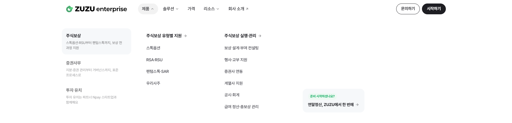⤢

A · 그룹 + 텍스트 링크 + CTA 1장후보(권고)

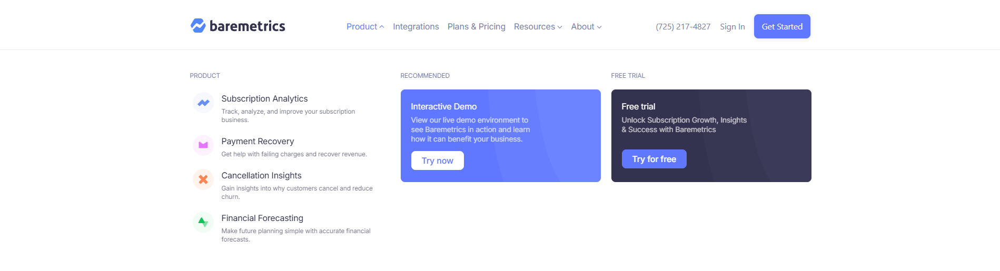⤢

B · 아이콘 + 설명 줄후보

이력: 2026-11-23 사용자 결정 — 문서 카드를 두는 이유: 'API 소개'에서 API 레퍼런스를 기대하고 들어온 개발자의 혼동을 줄이려고 API 개발 문서로 바로 보냄. 카드 왼쪽에 문서 아이콘 이미지 자리(32) 추가, 카드 폭 320 → 344(제목 246이 잘리지 않게).

디자이너 주석 · 컨셉 공통

#### 1 기획 의도

목적

- 13개 상품과 6개 상황을 한 패널에서 바로 찾게 합니다.
- 설명은 각 상품 페이지 Hero가 맡습니다.
- 'API 소개'에서 API 레퍼런스를 기대한 개발자가 헤매지 않도록, 문서 카드로 API 개발 문서에 바로 보냅니다.

주고 싶은 인상

**정돈 · 한눈에** — "무엇을 파는지 전부 보인다."

목적 달성을 위한 시각장치

- 그룹 제목 + 텍스트 링크 열
- 상품(왼쪽) · 상황별 솔루션(오른쪽)을 가는 세로선으로 나눔
- 오른쪽 작은 문서 카드 1장 레퍼런스
  - 구성: 왼쪽 아이콘 + 제목 + 한 줄 설명
  - 아이콘: 문서 위에 \</> 표시되어 있는 아이콘
  - 라인 굵기와 스타일은 전체 아이콘 컨셉에 맞춤
- 회색 배경 없음

##### 시각적 우선순위

1. GNB 오른쪽 주 CTA 버튼
2. 상품 3열(그룹 제목 + 링크)
3. 상황별 솔루션 열

##### Next Trigger

- 상품·솔루션 링크 → 각 페이지
- 문서 카드 → API 개발 문서
- GNB 버튼 → 가입

#### 2 동작 명세

- **열기·닫기**
  - 'API 소개'에 마우스를 올리면 열림
  - Esc를 누르면 닫힘
  - 열리면 아래 화면을 어둡게 덮음
- **상태**
  - 메뉴 항목 hover: 연한 면
  - GNB 현재 메뉴: ▴ 표시
  - 문서 카드: 카드 전체가 링크(→ API 개발 문서)
- **로그인 후**
  - GNB '테스트 시작하기' 자리에 '콘솔 바로가기 ▾'
  - GNB '로그인' 자리에 프로필(아바타, 이메일, 회사명, ▾)
  - 프로필을 누르면 메뉴: 정보수정, 로그아웃
  - '콘솔 바로가기 ▾'에 마우스를 올리면 '파트너 콘솔 선택' 메뉴
    - 파트너가 있을 때: 파트너 목록(아이콘, 이름, 파트너 ID), 맨 아래 '전체 파트너 목록 →'
    - 파트너가 없을 때: '연동된 파트너가 없습니다', 맨 아래 '파트너 등록하기 →'

    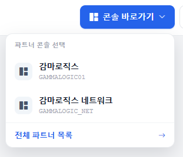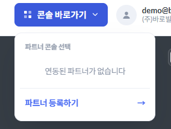⤢

    로그인 후 · 콘솔 바로가기 메뉴
- **반응형**
  - 1440 미만
    - 문서 카드가 상품 열 아래 왼쪽으로
  - 1280 미만(로그인 후)
    - 프로필은 아바타와 ▾만 표시
    - 이메일과 회사명은 펼친 메뉴 맨 위에
    - 글자까지 두면 1024에서 GNB 메뉴가 두 줄로 꺾임
  - 1024 미만: 햄버거 패널
    - GNB 줄에는 로고와 햄버거만
    - 패널 크기
      - 640 미만: 풀폭
      - 640\~1023: 오른쪽 폭 고정 서랍(400), 뒤 화면은 어둡게 덮음
    - 열기·닫기
      - 패널은 헤더까지 덮음
      - 패널 오른쪽 위 ✕로 닫음
      - 서랍은 바깥 어두운 면을 눌러도 닫힘
    - 패널 맨 위
      - 로그인 전: 버튼 2개(로그인, 테스트 시작하기), 같은 폭
      - 로그인 후: 프로필 줄(아바타, 이메일, 회사명) + 오른쪽 끝 약한 텍스트 링크 '정보수정'(▾ 없음)
      - 로그인 후: 그 아래 '콘솔 바로가기' 버튼 하나
      - '콘솔 바로가기'를 누르면 파트너 선택 화면(파트너가 없으면 등록 화면)
      - 640 미만 풀폭에서도 버튼은 서랍 안에서와 같은 폭까지만, 왼쪽 정렬. 프로필 줄은 풀폭
    - 메뉴 목록
      - 'API 소개'는 아코디언, 패널을 처음 열면 닫힌 상태
      - 누르면 그룹 제목만 보이는 접힌 행이 펼쳐짐
      - 모든 폭 1열, 상품이 위
      - 문서 카드 없음
    - 메뉴 목록 맨 끝(로그인 후): 약한 텍스트 '로그아웃', 왼쪽 정렬
      - 자주 누르는 곳과 떨어뜨려 잘못 누르지 않게
      - 스크롤 영역 맨 끝에 있음(고정 아님)
    - 패널 맨 아래: 고정 바 3칸(문의하기, 소개자료 요청, 전화). 화면에 고정되는 것은 이 바뿐
    - 와이어프레임은 패널과 'API 소개'를 연 상태를 그림

컨셉 공통 섹션: GNB·메가메뉴는 컨셉 A·B 모두 A안(그룹 + 텍스트 링크 + 문서 카드 1장, REF-006 골격)입니다.

썸네일은 참고 레퍼런스입니다(A = REF-006 골격 + REF-005 CTA 카드, B = REF-005). 채택은 사용자가 정합니다.

#### 결정 필요

- 메가메뉴 레이아웃 안 (디자이너 권고 A)
- 전자문서 그룹 = 문서 발행 (PM 제안, 사용자 확인)
- 문서 카드 문구 (PM 제안 · 카피 검토 전)
- 법인카드·경비(상황 3위, 20.6%)를 '회계·경비'에서 떼어 별도 메뉴로 둘지

#### 화면 메모

- 'API 소개'에 마우스를 올리거나 포커스 후 Enter로 엽니다. Esc로 닫습니다. 열리면 아래 화면을 어둡게 덮습니다.
- 로그인 후에는 GNB '테스트 시작하기' 자리에 **콘솔 바로가기**가 들어갑니다(유관부서 요청 1).
- 문서 카드는 카드 전체가 링크이고 API 개발 문서 페이지(#p-docs)로 이동합니다. 1024 미만 햄버거 메뉴에는 카드가 없습니다(1차 메뉴 'API 개발 문서'와 중복).

안 비교 · 권고 상세

|  | A | B |
| --- | --- | --- |
| 목적 | 4 | 3 |
| 스캔 | 4 | 4 |
| 콘텐츠 | 5 | 2 |
| 확장 | 4 | 3 |
| 비용 | 4 | 3 |

- **A** — 19개 항목(상품 13 + 상황 6)이 텍스트 링크로 392 안에 다 들어갑니다. 우측 작은 카드 1장(320×104)은 API 개발 문서 보조 진입로입니다.
- **B** — 상품 13개는 A와 같이 이름만 둡니다(사용자 결정 2026-11-18: 설명 줄 삭제). 상황별 솔루션 6개만 아이콘 + 설명 전문을 보여 줍니다. 설명은 말줄임 없이 1\~3줄로 줄바꿈하고, 행 높이는 내용에 맞춥니다(1줄 64 · 2줄 84 · 3줄 104). 패널 640, GNB 64 + 640 = 704라 1440×800 안에 다 들어갑니다.
- 상품 아이콘은 지웠습니다. 이름 1줄 옆 아이콘은 스캔을 돕기보다 12종 자산 비용만 늘리고, 솔루션(아이콘 + 설명)과 상품(이름) 두 분류의 위계를 흐립니다. 상품 열(608)은 A와 같아 안을 바꿔도 상품 위치가 같습니다. B는 솔루션 열이 264라 오른쪽 카드 자리가 276으로 카드 제목(약 246) + 안쪽 48보다 좁아, 문서 카드를 모든 폭에서 상품 열 아래 왼쪽(24 아래)에 둡니다(2026-11-23). 패널 높이 640은 그대로입니다(상품 열 272 + 24 + 카드 88 = 384 \< 솔루션 열 568).

#### 권고 · A (신뢰도: 추정)

- 메가메뉴의 일은 13개 상품과 6개 상황을 한눈에 찾게 하는 것입니다. 설명은 상품 페이지 Hero가 맡습니다.
- 실패 조건: 상품 이름만으로 무엇인지 모르는 방문자가 많다는 데이터가 나오면 B의 설명 줄을 조회 그룹에만 부분 적용합니다.

섹션 높이: A 456(GNB 64 + 패널 392 = 위 40 + 320 + 아래 32) · B 704(64 + 640 = 위 40 + 솔루션 열 568 + 아래 32). 보조 링크 띠(API 개발 문서 · 요금 안내 · 견적 문의) 삭제: GNB와 중복(사용자 2026-11-18).

레이아웃 상세 · 줄일 때 지킬 것

- 시작선 x=164 = GNB 'API 소개' 글자 시작(좌여백 32 + 로고 110 + 간격 22). 오른쪽 끝 x=1408 = '테스트 시작하기' 버튼 오른쪽 끝.
- A 열: 상품 608(문서 발행 176 · 24 · 데이터 조회·수집 232 · 24 · 메시지·팩스 전송 152) · 간격 48(가운데 1px 선) · 솔루션 192 · 48 · 문서 카드 320×104(남는 오른쪽 28은 비움, 아래 끝을 마지막 메뉴 줄에 맞춤). 합 1244 중 1216. x 좌표: 문서 발행 164 · 데이터 조회·수집 364 · 메시지·팩스 전송 620 · 선 795 · 솔루션 820 · 문서 카드 1060\~1380. (2026-11-23 이전: 상품 560 · 문서 발행 128 · 카드 1012\~1332)
- 메가메뉴 카드는 가입 CTA가 아니라 문서 진입로다. 가입 CTA는 GNB 우측 '테스트 시작하기' 버튼이 맡는다(사용자 2026-11-18). (2026-11-23) 카드는 ZUZU(REF-006)처럼 눈썹 + 제목 1줄(→)만 둔 작은 카드로 줄였습니다. 버튼과 설명은 없애고 카드 전체를 링크로 둡니다. GNB에 'API 개발 문서'가 1차 메뉴로 있어 카드는 보조 진입로이고, 메가메뉴의 주인공은 상품 · 솔루션 목록입니다.
- 카드에 문서·코드 미리보기 자리는 없습니다(문서 화면 캡처 자리 해당 없음).
- 패널 맨 아래 보조 링크 띠(56)는 지웠습니다. 링크 3개가 모두 GNB에 보여 GNB와 중복(사용자 2026-11-18)입니다. 패널 아래 여백은 32로 둡니다.
- 상품 그룹은 세 열로 왼쪽부터 문서 발행(4) → 데이터 조회·수집(6) → 메시지·팩스 전송(3) 순서입니다. 왼쪽→오른쪽으로 읽으면 발행 → 조회 → 발송 순서가 됩니다. 두 그룹을 한 열에 쌓으면(발행 위 · 조회 아래) 열 높이가 432가 되어 패널 320을 넘으므로 세 열로 폈습니다. 가운데 열이 240으로 가장 길고 문서 발행 168 · 메시지·팩스 전송 132입니다.
- 그룹 사이 24는 분류 사이 48보다 좁게 두어, 세 열이 한 분류(API 상품)로 묶여 보이게 합니다.
- 열 폭은 가장 긴 항목 + 여유입니다: 문서 발행 176('전자세금계산서 구축형' 실측 약 166 · 2026-11-23 128에서 넓힘, 줄바꿈하지 않음) · 메시지·팩스 전송 152('카카오 메시지 전송' 약 139) · 솔루션 192('회계·경비 데이터 수집' 약 159).
- 데이터 조회·수집 열 232는 '제3자세금계산서발급사실조회'(14자, 실측 약 217 · 글꼴에 따라 224)가 1줄로 들어가는 폭입니다.
- 그룹 안 순서는 관심 API 체크 순입니다(그룹 순서만 바꾸고 항목 순서는 그대로). 신규 두 상품(예금주 성명·실명 조회, 제3자세금계산서발급사실조회)은 관심 데이터가 없어 데이터 조회·수집 끝에 둡니다(PM-D-21). "신규 예정" 소제목은 없앴습니다.
- 줄일 때 지킬 것: ① 두 분류(상품·솔루션)를 한 패널에 동시에 ② 상품 왼쪽 · 솔루션 오른쪽(쌓이면 상품 위) ③ 상품 그룹 순서 문서 발행 → 데이터 조회·수집 → 메시지·팩스 전송 ④ 항목 1줄 ⑤ 우측 카드 1장. 회색 배경은 쓰지 않습니다. 폭이 모자라면 문서 카드부터 줄입니다(상품 · 솔루션 열 폭은 고정).
- Tab 순서: 상품(문서 발행 → 데이터 조회·수집 → 메시지·팩스 전송) → 상황별 솔루션 → 문서 카드.

이력: 2026-11-23 사용자 결정 — 상품 왼쪽 · 상황별 솔루션 오른쪽(모바일은 상품 위), 그룹 순서 발행→조회→발송, 그룹명 '문서 발행 · 데이터 조회·수집 · 문자·팩스 전송', 모바일 그룹 제목만. (이전: 솔루션 264 | 상품 480(발행+발송 200 · 조회 248) | 카드 404)

이력: 2026-11-23 사용자 결정 2 — 그룹명 '문자·팩스 전송' → '메시지·팩스 전송'(카카오 메시지 포함), 태블릿(768–1023)도 그룹 제목만 접기

이력: 2026-11-23 사용자 결정 — 문서 발행 그룹에 전자세금계산서 구축형 추가(상품 13개). 문서 발행 열 128 → 176(항목 실측 166, 줄바꿈 없음), 상품 열 560 → 608, 문서 카드 1012\~1332 → 1060\~1380(남는 오른쪽 76 → 28). 1280–1439는 A도 카드가 아래로, lg는 상품 그룹 사이 16, B는 카드를 상품 열 아래로 옮김. 상품 페이지 #p-onprem

이력: 2026-11-23 사용자 결정 3 — 문서 카드를 ZUZU처럼 작게(396×288 → 320×104, 눈썹 + 제목 1줄, 버튼 · 설명 삭제, 카드 전체 링크), 1024 미만 메뉴의 'API 개발 문서 바로가기' 버튼 삭제

근거

- 그룹 안 API 순서(관심 API 체크): 세금계산서 55.3% · 계좌 54.0% · 홈택스 48.8% · 카드 44.9% · 현금영수증 24.6% · 카카오톡 19.3% · 사업자 상태조회 16.1% · 문자 15.8% · 팩스 12.5% · 전자문서 9.5%

관심 API 분석 (602건) · 레퍼런스 목록 'GNB 메가메뉴' · 프로젝트 규칙 상품 분류

반응형

- **xl 이상(≥1280)**: 1440 이상은 지금 배치(상품 3열 | 솔루션 | 문서 카드). 1280–1439는 분류 사이 48 → 최소 32로 줄고, 상품 열이 608이라 카드 자리가 220까지 좁아지므로 A도 작은 카드(344)가 아래 줄 왼쪽으로 내려갑니다(패널 높이는 내용만큼, 2026-11-23). B안은 모든 폭에서 카드가 상품 열 아래입니다. 1440보다 넓으면 GNB 내용은 최대 1376 가운데, 바깥 여백만 늘어납니다.
- **lg(1024–1279)**: GNB 그대로. 상품 그룹 사이 24 → 16(1024에서 592 + 32 + 솔루션 192 = 816 ≤ 828). 메가메뉴의 작은 문서 카드(320)가 아래 줄 왼쪽으로 내려오고, 패널 높이는 내용만큼입니다. B안은 솔루션(264)이 옆에 들어가지 않아 상품 아래에 2열(업무 자동화 | 고객·거래처 서비스 제공)로 둡니다.
- **lg 미만(\<1024)**: 메뉴를 햄버거로 접습니다. 위 줄 = 로고 · 테스트 시작하기 · 햄버거(로그인은 메뉴 맨 아래로). 햄버거를 누르면 전체 화면 메뉴가 열리고 'API 소개'는 아코디언으로 펼칩니다: API 상품(문서 발행 → 데이터 조회·수집 → 메시지·팩스 전송) → 상황별 솔루션(업무 자동화 → 고객·거래처 서비스 제공) → 나머지 메뉴 행(API 개발 문서 · 요금 안내 · 고객지원·리소스) → 로그인. 문서 카드 · 바로가기 버튼은 두지 않습니다(1차 메뉴 'API 개발 문서'와 중복, 2026-11-23). 메뉴 행 56 · 항목 행 48.
- **md(768–1023)**: 펼친 'API 소개' 안을 2열(왼쪽 API 상품 | 오른쪽 상황별 솔루션)로 둡니다. 모바일처럼 그룹 제목만 접힌 아코디언 행(48 · ▾)으로 보이고, 누르면 그 그룹 항목이 펼쳐집니다(사용자 결정 2026-11-23 — 펼치면 왼쪽 열 752 대 오른쪽 416으로 길이 차가 커서).
- **md 미만(\<768)**: 1열, 상품이 위 · 솔루션이 아래. 그룹 제목만 접힌 아코디언 행(48 · 오른쪽 ▾)으로 보입니다: 문서 발행 · 데이터 조회·수집 · 메시지·팩스 전송 · 업무 자동화 · 고객·거래처 서비스 제공. 행을 누르면 그 그룹 항목이 아래로 펼쳐집니다(와이어프레임은 접힌 상태만 그림). 열 제목(API 상품 소개 · 상황별 솔루션)은 Caption으로 남깁니다.

참고 레퍼런스 (2)

REF-006 · ZUZU 메가메뉴 · A안 골격


차용

그룹 제목 + 텍스트 링크 열, 작은 보조 카드 자리(크기는 키움)

버림

좌측 1차 분류 호버 탭(분류 2개를 동시에 보여야 함)

REF-005 · Baremetrics 메가메뉴 · B안 · A안 CTA 카드


차용

A: 우측 CTA 카드 1장 · B: 항목 아이콘 + 설명 줄, 열 제목 Caption

버림

CTA 카드 2장(주 CTA 하나 원칙)

카피 검토 (3)

- 카피 검토 필요문서 카드 문구(눈썹·제목)는 PM 제안입니다(2026-11-18). 2026-11-23 설명 · 버튼을 없애 '언어별 샘플 코드' 문구 확인 건은 사라졌습니다. 개발 문서는 개발팀 주관이라 카드 링크 주소는 개발팀 문서 주소로 맞춥니다.
- 카피 검토 필요B안 상품 설명은 지웠습니다(사용자 결정 2026-11-18). 남은 솔루션 설명 6개는 전문을 보여 주며 220 폭에서 1\~3줄입니다. '회계·경비 데이터 수집' 설명이 3줄로 가장 깁니다. 줄 수를 맞추려면 문구를 줄여야 합니다(말줄임은 쓰지 않음).
- 카피 검토 필요열 제목 'API 상품 소개 · 13개' — 전자문서를 넣어 10 → 12, 전자세금계산서 구축형을 넣어 12 → 13(2026-11-23)으로 고쳤습니다.

C기업 업무·데이터 연동 · SINCE 2009

H1기술의 연결,\
더 큰 비즈니스 가치

B기업에 필요한 기술을 하나로, 더 나은 비즈니스를 위한 연결.\
세금계산서 발행부터 홈택스·계좌·카드 조회, 문자·팩스 발송까지 \
바로빌 API로 완성하세요.

테스트 시작하기견적 문의

카카오다이소코카콜라W컨셉현대벤디스국가철도공단농협정보시스템KB신용정보카카오모빌리티후지필름토스모바일KT엠모바일효성ITX신세계디에프영풍문고캐치테이블

C기업 업무·데이터 연동 · SINCE 2009

H1기술의 연결,\
더 큰 비즈니스 가치

B기업에 필요한 기술을 하나로, 더 나은 비즈니스를 위한 연결.\
세금계산서 발행부터 홈택스·계좌·카드 조회, 문자·팩스 발송까지 \
바로빌 API로 완성하세요.

테스트 시작하기견적 문의

연결 개념 도식

카카오다이소코카콜라W컨셉현대벤디스국가철도공단농협정보시스템KB신용정보카카오모빌리티후지필름토스모바일KT엠모바일

C기업 업무·데이터 연동 · SINCE 2009

H1기술의 연결,\
더 큰 비즈니스 가치

B기업에 필요한 기술을 하나로, 더 나은 비즈니스를 위한 연결.\
세금계산서 발행부터 홈택스·계좌·카드 조회, 문자·팩스 발송까지 \
바로빌 API로 완성하세요.

테스트 시작하기견적 문의

카카오다이소코카콜라W컨셉현대벤디스국가철도공단농협정보시스템KB신용정보카카오모빌리티후지필름토스모바일KT엠모바일효성ITX신세계디에프영풍문고캐치테이블

C기업 업무·데이터 연동 · SINCE 2009

H1기업 업무가\
멈추지 않도록

B세금계산서 발행, 홈택스·계좌·카드 조회, 메시지·팩스 발송까지.\
중요한 기업 업무일수록 검증된 바로빌 API로 바로 연동하세요.

테스트 시작하기견적 문의

연결 개념 도식 (선형, 3D·글래스 없음)\
우리 시스템(ERP·SaaS) ↔ 바로빌 API ↔ 국세청·은행·카드사·통신사

카카오다이소코카콜라W컨셉현대벤디스국가철도공단농협정보시스템KB신용정보카카오모빌리티후지필름토스모바일KT엠모바일효성ITX신세계디에프영풍문고캐치테이블

C기업 업무·데이터 연동 · SINCE 2009

H1기업 업무가\
멈추지 않도록

B세금계산서 발행, 홈택스·계좌·카드 조회, 메시지·팩스 발송까지.\
중요한 기업 업무일수록 검증된 바로빌 API로 바로 연동하세요.

테스트 시작하기견적 문의

카카오다이소코카콜라W컨셉현대벤디스국가철도공단농협정보시스템KB신용정보카카오모빌리티후지필름토스모바일KT엠모바일효성ITX신세계디에프영풍문고캐치테이블

01 Hero · 무엇을 하는 곳인가 DARK

#### 레이아웃 안 · 누르면 화면이 바뀜

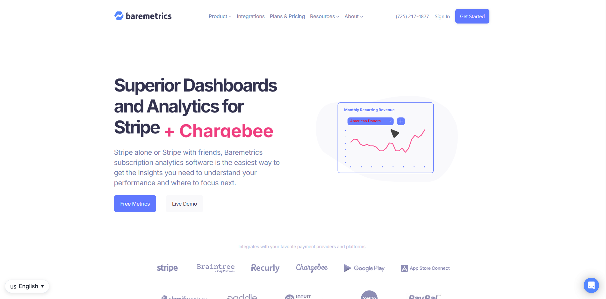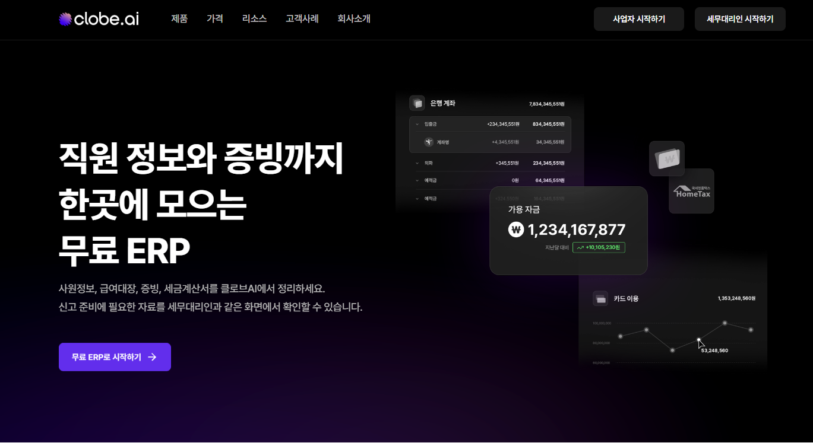⤢

A · 6:6 + 풀폭 로고 띠후보(권고)

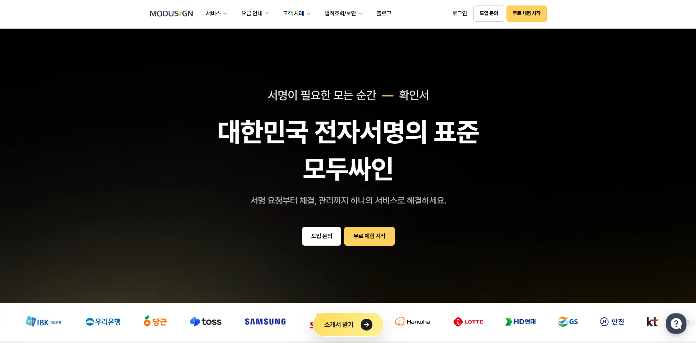⤢

B · 가운데 정렬 다크후보

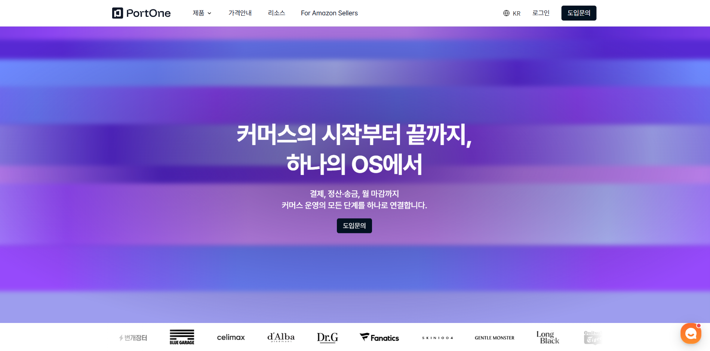⤢

C · 그라데이션 + 흰 로고 띠후보

⤢

D · A 배치 + 미래지향 카피후보

⤢

E · B 배치 + 미래지향 카피후보

디자이너 주석 · 컨셉별 · 상단 \[컨셉 A | B\]로 전환

#### 1 기획 의도

공통 목적

- 첫 화면 3초 안에 전할 것: "기업 업무·데이터를 연동하는 API이고, 테스트를 바로 시작할 수 있다"
- H1은 2줄 유지(3줄 금지)
- 리드에 API 이름이 남아야 함

컨셉 A판 = 안 C · 가운데 정렬 면

목적

H1 한 문장과 CTA에 시선을 모으고, 흰 띠의 고객 로고로 신뢰를 받칩니다.

주고 싶은 인상

**단단함 · 신뢰 · 집중** — "큰 회사들이 이미 쓰는 기반."

목적 달성을 위한 시각장치

- 다크 그라데이션 면 위 가운데 정렬 — 눈썹 → H1 2줄 → 리드 2줄 → 버튼 2개
- 주 CTA '테스트 시작하기'(채움) + 보조 '견적 문의'(외곽선)
- 면 아래 흰 면 로고 띠(풀폭) — 고객 로고를 원래 색으로
- 그라데이션은 면색으로 바꿔도 됨

##### 시각적 우선순위

1. H1 Headline copy
2. CTA 주(채움) > 보조(외곽선)
3. 흰 면 고객 로고 줄

##### Next Trigger

- 주 CTA → 가입
- 보조 → 견적 문의

컨셉 B판 = 안 A · 6:6 + 연결 도식

목적

왼쪽은 무엇을 하는지, 오른쪽은 무엇을 잇는지 그림으로 받칩니다.

주고 싶은 인상

**명료 · 연결** — "우리 시스템과 국세청·은행·카드사가 한 번에 이어진다."

목적 달성을 위한 시각장치

- 왼쪽 글 6열 / 오른쪽 연결 개념 도식(X 박스 자리) 레퍼런스
  - 여러 연동처가 바로빌 한곳으로 모이는 방향
  - 구성: 우리 시스템(ERP·SaaS) ↔ 바로빌 API ↔ 국세청·은행·카드사·통신사
- 히어로 바로 아래 흰 면에 고객 로고 2줄, 회색조

##### 시각적 우선순위

1. H1 Headline copy
2. 오른쪽 연결 개념 도식(이미지)
3. 고객 로고 2줄

##### Next Trigger

- 주 CTA → 가입
- 보조 → 견적 문의

#### 2 동작 명세

- **로고 줄**
  - A판: 흐르는 한 줄
    - 오른쪽 → 왼쪽, 같은 속도로 끊김 없이 무한 반복
    - 로고 16개 1세트가 한 바퀴 도는 데 80초(로고 1개당 5초)
    - 로고 수가 바뀌면 같은 비율로 조정
    - 멈춤 없음
    - 로고 높이 26 기준, 로고 사이 88
    - 띠 양 끝 8%는 페이드로 흐려짐
  - B판: 정지된 2줄
    - 로고 12개를 2줄 × 6으로 배치, 움직임 없음
    - 모두 회색조로 단정하게(Baremetrics 방식)
- **버튼 상태**
  - hover를 다크 면 기준으로 정의(채움 / 외곽선 각각)
- **크기**
  - GNB 아래부터 로고 띠 끝까지가 첫 화면을 가득 채움
  - 1440×800 기준: A판 면 640 + 띠 96, B판 면 576 + 로고 2줄 160
- **반응형**
  - 1024 미만
    - 높이는 내용만큼
    - B판은 글 → 도식(4:3) 순서로 쌓음
  - 640 미만
    - 리드 줄바꿈을 풀어 한 문장으로 이어 붙임
  - 768 미만
    - H1 최대 3줄 허용
    - 버튼은 폭 전체로 세로 배치
    - A판 로고 띠는 두 줄로 바꾸지 않고 한 줄로 흐름
    - B판 로고는 1024 미만에서 4열 × 3줄, 640 미만에서 3열 × 4줄

컨셉판 상세 · A / B

- **컨셉 A판 = 안 C**(PortOne 골격 · REF-003): 가운데 정렬 면(눈썹 → H1 → 리드 → CTA 2개: 테스트 시작하기 · 견적 문의) + 면 아래 흰 로고 띠(2026-11-23 변경). 눈썹은 B판(안 A)과 같은 '기업 업무·데이터 연동 · SINCE 2009'. 실사 히어로(사진 풀블리드 + 화면 카드)는 사용자 피드백으로 뺐습니다. 새 variant를 만들지 않고 안 C에 컨셉 A 표시만 달았습니다.
- **컨셉 B판 = 안 A**(6:6 · REF-001): 오른쪽 592×440은 X 박스 + 캡션 '연결 개념 도식'. 선·도형으로 직접 그리지 않습니다.
- 참고 추가(2026-11-23 사용자 제공): REF-050 클로브 히어로 — 6:6 배치와 오른쪽 시각물 방향 참고. 오른쪽에 계좌 · 가용 자금 · 카드 이용 카드를 겹쳐 '여러 곳의 데이터가 한곳에 모인다'를 보여 줍니다. 썸네일 A의 확대(⤢)에서 두 번째 이미지로 봅니다.
- 로고 띠는 \[재동의 필요\]입니다(PM-D-12와 같음).

이력: 2026-11-23 사용자 결정 — 로고 띠 16개(카카오 · 다이소 · 코카콜라 · W컨셉 · 현대벤디스 · 국가철도공단 · 농협정보시스템 · KB신용정보 · 카카오모빌리티 · 후지필름 · 토스모바일 · KT엠모바일 · 효성ITX · 신세계디에프 · 영풍문고 · 캐치테이블), 흐름 1바퀴 80초.

이력: 2026-11-23 사용자 결정 — 리드 '메시지·팩스 발송까지' + 줄바꿈(640 미만은 이어 붙임) · A판(안 C)에 '견적 문의' 보조 버튼 · 로고를 면 밖 흰 띠로 분리 · 히어로 + 로고 띠가 첫 화면을 가득 채움(1440×800 기준 GNB 64 + 면 640 + 띠 96 = 800, 섹션 696 → 736) · 시각적 우선순위 H1 → CTA → 로고 줄.

이력: 2026-11-23 사용자 결정 — Hero 컨셉 A판에도 눈썹 추가(안 C · B판과 같은 문구 · rs-cap). 섹션 높이 696 그대로, 가운데 덩어리만 눈썹 24 + 16 = 40 늘어남.

C는 비교용입니다(디자이너는 권고하지 않음). 채택은 사용자가 정합니다.

H1 사용자 확정 2026-11-27 · 기술의 연결, / 더 큰 비즈니스 가치

#### 결정 필요

- 히어로 레이아웃 안 (디자이너 권고 A)
- 도식의 표현 방식 — 제안서 14 '화면 언어'
- 로고 사용 동의 — 배포 전 확인(PM-D-12)
- 서브 2줄 '검증된' — 근거(시스템사업자·2009)를 같은 화면에 보여 줄지

#### 화면 메모

- 로고 띠는 자동으로 흐르고, '동작 줄이기' 설정에서 멈춥니다. 점선(치수 표시)은 1440×800 첫 화면의 끝입니다.
- 사용자 결정 2026-11-18: 칩·로고 캡션·마이크로카피 삭제(요소 과다). A\~E 모두 적용.

안 비교 · 권고 상세

|  | A | B | C |
| --- | --- | --- | --- |
| 목적 | 5 | 3 | 2 |
| 스캔 | 4 | 5 | 4 |
| 콘텐츠 | 4 | 3 | 2 |
| 확장 | 4 | 3 | 2 |
| 비용 | 3 | 4 | 3 |

- **A** — 헤드라인 → 본문 → 버튼이 왼쪽 한 줄로 흐릅니다. 오른쪽 도식이 "무엇을 잇는가"를 그림으로 받칩니다.
- **B** — 가장 빨리 읽힙니다. 칩·마이크로카피를 지워 가운데 요소가 4단(눈썹·헤드라인·본문·버튼)으로 줄었습니다. API 이름은 본문 한 줄이 맡습니다.
- **C** — 그라데이션이 정보 없이 면적을 차지합니다. CTA가 1개뿐이고 본문 폭이 좁아(640) P2(무슨 API인지)를 본문으로만 풉니다. 로고가 같은 면 위에 있어 히어로와 신뢰 영역이 끊기지 않습니다.

#### 권고 · A (신뢰도: 추정)

- 첫 화면 = GNB 64 + 히어로 640 + 로고 띠 96 = 800. 1440×800에서 히어로와 로고 띠가 첫 화면을 가득 채웁니다(2026-11-23 사용자 결정). 02 위 여백으로 "아래에 더 있다"를 알리던 장치는 뺐습니다.
- 실패 조건: 연결 도식이 정해지지 않거나 약하면 오른쪽이 비어 보입니다. 이때 오른쪽에 API 요청·응답 코드 카드(592×360)를 대안으로 둡니다.

섹션 높이: A\~E 모두 696 (히어로 600 + 로고 띠 96, GNB 64 별도). C는 같은 면 696 안에 로고 96.

레이아웃 상세 · 줄일 때 지킬 것

- A 왼쪽 열(338 실측): 눈썹 24 → 16 → H1 120 → 24 → 본문 56 → 40 → 버튼 48. 오른쪽 도식 440이 행 높이를 정하고, 왼쪽 열은 세로 가운데. 히어로 600 = 상하 80 + 440.
- B·E: 가운데 4단(338)을 600 안에 세로 가운데 정렬(위아래 각 약 131). A와 높이를 맞춰 안을 바꿔도 아래 섹션 위치가 같습니다.
- 헤드라인 2줄, 줄당 최대 12자. 3줄 금지. 주 CTA(채움 176)가 왼쪽, 보조(선 128)가 오른쪽.
- 로고 띠는 히어로와 반대 명도(밝게). 로고 칸 160×48, 사이 48, 1440 안에 약 7개.
- 줄일 때 지킬 것: ① 헤드라인 2줄 ② 본문에 API 이름 유지 ③ 로고 띠 1줄.

근거

- 고객은 API 이름으로 찾아옵니다(칩을 지운 뒤에는 본문 한 줄이 API 이름을 맡습니다). 설문 인지경로 '검색' 6/7, 검색어는 "세금계산서 api", "전자세금계산서 API", "계좌정보 API", "카드 결제 내역 api", "법인카드 스크래핑"
- 문의 표현 '연동' 51.7% · '조회' 44.2% · '자동화' 2.8% → 본문을 '연동'으로 씁니다
- 로고 띠 후보: 카카오·토스모바일·다이소·KB신용정보·국가철도공단 외 (제안서 06 PILLAR 01)

설문 응답 집계 06·07 · 솔루션 메뉴용 고객 분류 · 제안서 06 · 레퍼런스 목록 '메인 01 HERO'

360 폭에서

- 1열. 헤드라인 28/36 최대 3줄 → 본문 16/24 → 버튼 2개 세로(폭 328) → 도식 328×246.
- 로고 띠 높이 72(상하 18), 로고 120×36.

참고 레퍼런스 (3)

REF-003 · 포트원 히어로 · C안 = 컨셉 A판 (2026-11-20)


차용

컨셉 A판 골격: 가운데 정렬 면 + 주 CTA 1개 + 같은 면 위 로고(사용자 결정 2026-11-20)

버림

장식 그라데이션은 시안에서 면색으로 바꿀 수 있음

REF-001 · Baremetrics 히어로 · A안 배치 = 컨셉 B판


차용

좌 텍스트 6열 + 우 시각물 6열, 주·보조 CTA 무게 차이

버림

로고 2줄(1줄 띠로 뺌)

REF-002 · 모두싸인 히어로 · B안 · A안 로고 띠


차용

히어로 바로 아래 반대 명도의 풀폭 로고 띠

버림

떠 있는 자료 받기 버튼, 회전 문구

반응형

- **lg 이상(≥1024)**: 지금 배치(높이 600 · 696).
- **lg 미만(\<1024)**: 높이는 내용만큼, 상하 64. A · D는 6:6을 풀어 문구 → 도식(4:3)으로 쌓음. C의 로고 줄은 면 아래쪽 겹침을 풀고 버튼 아래 48에 둠.
- **md 미만**: Display 32/40 · 리드 16/24. 로고 줄은 가로로 흐르는 띠 그대로(양 끝 잘림).

CWHY BAROBILL

H2기업이 원하는 API, 바로빌을 선택하는 이유 3가지

B바로빌은 2009년부터 쌓아 온 운영 노하우, 빠르고 간편한 연동, 합리적인 단가로 선택받습니다.

[H3운영 안정성 **93.3%** 2009년 연동 고객 유지율 · 2026년 11월 조사 기준 오랜 운영 경험과 안정적인 처리 환경을 바탕으로 기업의 지속적인 서비스 운영을 지원합니다.](#m02-1) [H3연동 편의성 이미지 2종 준비\
768 이상: 6:5 (768×640 제작)\
768 미만: 2:1 (880×440 제작) 인증키 즉시 발급부터 무료 테스트, AI 친화적인 개발 문서까지. 개발 부담을 줄이고 효율적인 연동을 지원합니다.](#m02-2) [H3비용 경쟁력 **바로빌****도입비 0원**기본료 0원**유지보수비 0원** **A사** **B사** 합리적인 이용 단가로 초기 도입부터 지속적인 서비스 운영까지 기업의 비용 부담을 줄입니다.](#m02-3)

CWHY BAROBILL

H2기업이 원하는 API, 바로빌을 선택하는 이유 3가지

B바로빌은 2009년부터 쌓아 온 운영 노하우, 빠르고 간편한 연동, 합리적인 단가로 선택받습니다.

[H3운영 안정성오랜 운영 경험과 안정적인 처리 환경을 바탕으로 기업의 지속적인 서비스 운영을 지원합니다. ↓](#m02-1) [H3연동 편의성인증키 즉시 발급부터 무료 테스트, AI 친화적인 개발 문서까지. 개발 부담을 줄이고 효율적인 연동을 지원합니다. ↓](#m02-2) [H3비용 경쟁력합리적인 이용 단가로 초기 도입부터 지속적인 서비스 운영까지 기업의 비용 부담을 줄입니다. ↓](#m02-3)

CWHY BAROBILL

H2기업이 원하는 API, 바로빌을 선택하는 이유 3가지

B바로빌은 2009년부터 쌓아 온 운영 노하우, 빠르고 간편한 연동, 합리적인 단가로 선택받습니다.

[H3운영 안정성↓ 오랜 운영 경험과 안정적인 처리 환경을 바탕으로 기업의 지속적인 서비스 운영을 지원합니다. 운영 지표 패널(호출 수 추이·가동 상태)\
또는 전자세금계산서 시스템사업자 인증 표기](#m02-1) [H3연동 편의성↓인증키 즉시 발급부터 무료 테스트, AI 친화적인 개발 문서까지. 개발 부담을 줄이고 효율적인 연동을 지원합니다. 이미지 (레퍼런스 참고)](#m02-2) [H3비용 경쟁력↓합리적인 이용 단가로 초기 도입부터 지속적인 서비스 운영까지 기업의 비용 부담을 줄입니다. 과금 구조 도식\
발행은 건수 · 조회는 등록 계좌·카드 수](#m02-3)

02 왜 바로빌인가 · 머리말

#### 레이아웃 안 · 누르면 화면이 바뀜

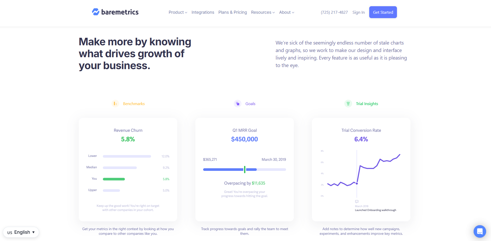⤢

A · 좌우 분할 + 미니 UI 카드(Baremetrics)후보(권고)

⤢

B · 좌 제목 + 우 리스트후보

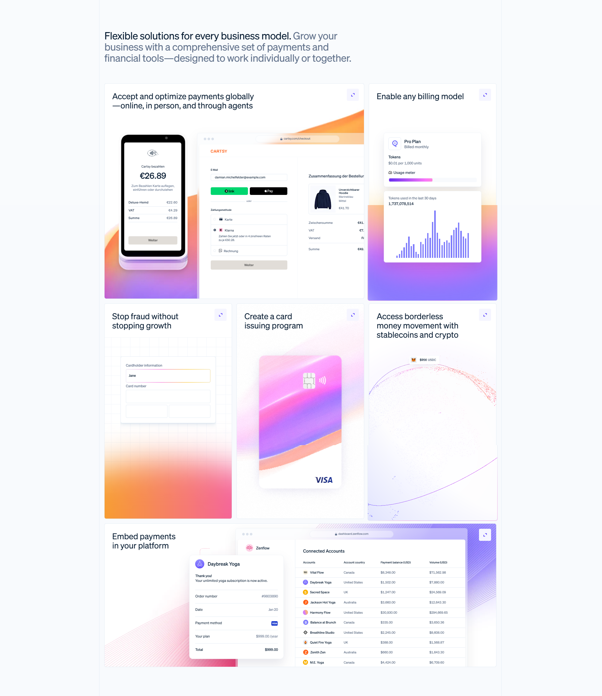⤢

S · 이미지 강조 카드(Stripe 방식)후보

디자이너 주석 · 컨셉 공통 · 안 A

**MCP 포함***off = 1차 기본(MCP 없음) · on = MCP가 들어갈 때 바뀌는 화면·주석*

#### 1 기획 의도

목적

- 세 기둥(운영 안정성, 연동 편의성, 비용 경쟁력)을 한 화면에 알립니다.
- 각 기둥에서 02-1\~02-3으로 보냅니다.
- 증거 본편은 아래 섹션 몫입니다.

주고 싶은 인상

**균형 · 근거 있음** — "세 가지를 다 갖췄다."

목적 달성을 위한 시각장치

- 같은 크기 카드 3장
- 카드 안 화면 조각
  - ① 93.3% + 유지율 막대
  - ② 상자 가득 이미지 자리(내용은 레퍼런스 참고)
    - 도식이라 자르지 않음, 상자 안에 이미지 전체가 보이게

    레퍼런스
  - ③ 바로빌·A사·B사 비교 막대
    - 길이는 연출(바로빌 ≈ A사의 1/2)
    - 금액 숫자는 넣지 않음
    - 바로빌 막대만 강조, 이름은 글자로 병기
    - 바로빌 막대 아래에 '도입비 0원 · 기본료 0원 · 유지보수비 0원' 표시
- 카드 밖 위 라벨(아이콘 + 기둥 이름), 아래 설명

##### 시각적 우선순위

1. H2 Headline copy
2. 기둥 라벨
3. 카드 3장 이미지

##### Next Trigger

- 라벨·카드·설명 한 열 전체가 링크 → 해당 섹션(02-1 / 02-2 / 02-3)으로 이동

#### 2 동작 명세

- **클릭**
  - 열 전체가 링크 하나
  - 누르면 같은 페이지의 해당 섹션으로 스크롤
- **상태**
  - hover: 카드 테두리 진하게
- **반응형**
  - 768 이상
    - 카드 상자는 6:5 비율을 유지하며 폭에 맞춰 함께 줄어듦(세로로 길쭉해지지 않음)
  - 1280 미만
    - H2와 오른쪽 설명 문단을 좌우 배치에서 위아래로 바꿈(H2 → 설명)
  - 768\~1023
    - 카드 3열 유지
  - 768 미만
    - 카드 1열
    - 카드 라벨과 원 크기는 768과 같게(위계 유지)
    - 카드 폭은 꽉 채움(글과 양쪽 끝을 맞춤)
    - 시각물 상자는 2:1, 최대 높이 220
    - 상자 안 막대는 최대 320, 가운데
    - 연동 편의성 이미지는 2:1로 가운데. 폭이 440을 넘으면 좌우는 상자 배경

컨셉 공통 · 안 A

- 컨셉 A·B 모두 안 A(Baremetrics 미니 UI 카드)를 씁니다. 카드 2 그림은 X 박스 + 캡션, 카드 1 유지율 막대 · 카드 3 비교 막대는 회색 막대로 그립니다.
- 카드 전체를 누르면 해당 섹션(02-1\~02-3)으로 이동합니다. 호버 시 테두리를 진하게 합니다.
- 360 폭: 카드 1열로 쌓입니다.

이력: 2026-11-23 사용자 결정 — 카드 2(연동 편의성)의 인증키 노드 삭제, 상자 가득 이미지 자리 하나로. 그림 내용(코드 스니펫 왼쪽 + Docs · OpenAPIMCP · Docs · SDK · Sandbox · Rest API · Soap API 노드 연결, 덜 중요한 노드는 작게)은 디자이너 주석 레퍼런스 시트(REF-059\~061)에서 확인.

이력: 2026-11-22 사용자 결정 — 인증키 노드 테스트·운영 구분 삭제, 키 칸 1칸('인증키 ••••-••••'), 노드 264 → 216 가운데.

A = REF-004(머리말), S = REF-007. B는 캡처 레퍼런스가 없습니다('레퍼런스 대기'). 채택은 사용자가 정합니다.

#### 결정 필요

- 머리말 레이아웃 안 (디자이너 권고 A)
- S 시각물 3종 제작 비용 — 운영 지표 패널·콘솔 캡처·과금 도식에 일러스트·캡처가 필요
- S 시각물과 02-1\~02-3 증거(스탯·코드 블록·막대)가 겹칠 위험
- A 카드 미니 UI와 02-1\~02-3 증거 중복(93.3%, 비교 막대)

#### 화면 메모

- 카드(행)를 누르면 해당 섹션(02-1\~02-3)으로 이동합니다.
- A는 라벨·카드·설명 한 열 전체가 링크 하나입니다. 라벨이 카드 밖에 있어도 누르는 곳이 하나라 헷갈리지 않고, 읽기 프로그램은 라벨(기둥 이름)을 링크 이름으로 읽습니다. 호버 시 카드 테두리를 진하게 합니다(사용자 결정 2026-11-18: A 카드를 Baremetrics처럼).
- S는 카드 전체가 링크입니다. 호버 시 테두리를 진하게 합니다.
- 사용자 결정 2026-11-18: A2 배치를 남기고 라벨만 A로(쌓기 머리말 안은 삭제). C(앵커 탭) 삭제, S 추가.
- **A 오른쪽 위가 비는 것은 의도한 그대로입니다.** 리드가 488 폭에서 2줄(56)이고 왼쪽 제목 덩어리(144)보다 짧아 위쪽 88이 빕니다(아래 정렬). 문구를 늘리지 않았습니다.

안 비교 · 권고 상세

|  | A | B | S |
| --- | --- | --- | --- |
| 목적 | 4 | 4 | 4 |
| 스캔 | 5 | 4 | 5 |
| 콘텐츠 | 3 | 4 | 2 |
| 확장 | 2 | 3 | 3 |
| 비용 | 3 | 5 | 2 |

- **A**(미니 UI 카드) — 목적 4: 세 기둥을 증거와 함께 먼저 보여 주지만 머리말의 일(세 주제를 알리고 02-1\~02-3으로 보내기)보다 무겁습니다. 스캔 5: 큰 숫자·키 행·막대가 먼저 읽힙니다. 콘텐츠 3: 확정 숫자·사실만으로 채웠지만 02-1\~02-3과 같은 증거가 한 화면에 두 번 나옵니다. 확장 2: 상품 페이지 01에 반복하면 상품마다 미니 UI가 필요합니다. 비용 3: 캡처 없이 화면 조각을 직접 그릴 수 있습니다.
- **B** — 기존 안을 새 카피로 다시 그렸습니다. 왼쪽 488 폭이라 H1이 2줄입니다.
- **S** — 목적 4: 시각물이 세 주장을 그림으로 먼저 보여 주지만, 바로 아래 02-1\~02-3이 같은 증거를 다시 보여 줘 섹션 역할이 겹칩니다. 스캔 5: 큰 시각물이 먼저 읽혀 세 주제가 가장 빨리 구분됩니다. 콘텐츠 2: 시각물 3종을 지금 갖고 있지 않고, 운영 지표는 실데이터가 있어야 합니다(가짜 데이터 금지). 확장 3: 상품 페이지 01에 반복하면 상품마다 시각물 3장(11×3)이 필요합니다. 비용 2: 일러스트·캡처 제작과 갱신(콘솔 화면이 바뀌면 다시 캡처)이 듭니다.

#### 권고 · A (신뢰도: 추정)

- 02 머리말의 일은 세 주제를 알리고 02-1\~02-3으로 보내는 것입니다. 증거는 아래 섹션이 맡습니다.
- S가 나은 조건: 02-1\~02-3을 줄이거나 합쳐 S 카드가 증거를 직접 맡을 때, 그리고 시각물 3종을 실제 화면·실데이터로 만들 수 있을 때.

섹션 높이: A 920 · B 624 · S ~~832~~ 884(H2 2줄, 2026-11-20)

레이아웃 상세 · 줄일 때 지킬 것

- A: 머리말 1216×144 아래 정렬 — 좌 6열 592(눈썹 + H1 40/52 2줄) · 7열 비움 · 우 8\~12열 488(리드 Title 18/28, 아래 끝을 제목 마지막 줄 기준선에 맞춤) → 64 → 카드 3장. 머리말-카드 간격 64 > 카드 안 간격(24·8). 섹션 920 = 120 + 144 + 64 + 카드 열 472 + 120.
- A 카드 열 384×472(4열 × 3, 사이 32): 라벨 32(아이콘 + 기둥 이름 H3 22/32, 가운데) → 24 → 카드 384×320(안쪽 32: 제목 Small 14/20 → 16 → 화면 조각 320×168 → 보조 줄 Small 14/20, 위 1px 선) → 24 → 설명 Body 16/24 최대 3줄(72 자리 고정, 가운데). 세 카드 모두 제목 · 화면 조각 · 보조 줄 3단으로 같습니다.
- 화면 조각(가짜 데이터 없음): ① 93.3% + 유지율 막대(93.3% 채움) ② 상자 가득 이미지 자리(2026-11-23 인증키 노드 삭제 · 내용은 레퍼런스 시트) ③ 바로빌·A사·B사 막대(금액 없음, 연출 길이: B사 272 · A사 155 · 바로빌 78).
- **2026-11-20 변경 (사용자 확정)**
  - 비용 막대: 막대 길이는 실제 요금 비율이 아닌 연출(사용자 결정 2026-11-20, 바로빌 ≈ A사의 1/2). 바로빌 ~~25\~29~~ → 78 · A사 155 · B사 272(B:A 비율 1.75 유지). 가격이 오를 수 있어 바로빌 막대를 지나치게 짧게 두지 않습니다. 금액 숫자는 넣지 않습니다. 02-3 본문 막대는 바꾸지 않았습니다.
  - 사용자 결정 2026-11-20: 이미지 자리 + 인증키 노드 오버레이. 처음 그린 상세 연출(에디터 창 막대 · 프롬프트 · 코드 회색 막대 · 커서 · '작성 중' · 예시 배지 · 점선 화살표)을 와이어프레임답게 단순화.
  - **카드 2 그림**(2026-11-23): 상자 가득 이미지 자리 하나(X 표시, '이미지 (레퍼런스 참고)'). 인증키 노드는 없앴습니다. 그림 방향은 디자이너 주석 레퍼런스 시트(REF-059\~061)를 따릅니다. 세 카드 모두 화면 조각 168이라 카드 높이 472가 같습니다.
  - 이미지 제작 시: 02-2 D AI 예시 창의 시각 언어(밝은 회색 창 · 흰 프롬프트 칸 · 진한 1px 강조)를 따르되, 단계 목록 없이 '프롬프트 → 코드가 써지는 모습'만 담은 축약판으로 만듭니다(같은 그림을 두 번 보여 주지 않기). 프롬프트 예: '전자세금계산서 발행 코드 작성해 줘'.
  - AI가 API를 호출하는 장면으로 그리지 않습니다(AI 도구는 문서를 읽고 코드를 쓸 뿐 API를 호출하지 않음문서 MCP는 문서를 읽고 개발을 도울 뿐 API를 호출하지 않음).
- S 머리말은 쌓기(눈썹 → H1 1줄 → 리드 1줄, 같은 문구)입니다. 사용자 결정 2026-11-18: S 머리말은 쌓기 유지. 섹션 808 = 상하 120×2 + 머리말 136 + 64 + 카드 368.
- S 카드 384×392(4열 × 3, 사이 32): 텍스트 384×152(안쪽 32: 타이틀 H3 22/32 1줄 + 화살표 24 오른쪽 끝 → 8 → 설명 Body 16/24 2줄 48) → 시각물 384×216(16:9, 카드 높이 59%). 아이콘 없음, 카드 전체 링크.
- REF-007에서 차용: 타이틀을 카드 위·왼쪽에 두고 시각물을 아래에 두는 순서, 시각물을 카드 좌·우·아래 가장자리까지 채우는 것(full-bleed), 오른쪽 위 모서리의 이동 표시(우리는 ↓ 화살표). 버림: 폭이 다른 벤토 배치(세 기둥은 같은 무게라 같은 크기), 장식 그라데이션, 가짜 데이터가 든 UI, 카드 사이 16(우리 그리드 간격 32를 유지).
- full-bleed를 고른 이유: 세 종류(지표 패널·화면 캡처·도식)를 같은 16:9 틀로 잘라 세 카드가 한 덩어리로 읽히고, 카드 테두리 안에 또 테두리가 생기는 액자 속 액자를 피합니다. 시각물 안의 내용은 영역 안 24 여백 안에 둡니다. 신뢰도: 추정.
- REF-007은 시각물이 카드 높이의 약 75%이고 설명이 없습니다. 우리는 설명 2줄이 주장을 전하므로 시각물을 59%로 줄였습니다.
- S 시각물 자리(가짜 데이터 없이): ① 운영 안정성 — 운영 지표 패널(호출 수 추이·가동 상태) 또는 시스템사업자 인증 표기 ② 연동 편의성 — 이미지 자리(A와 같은 구성, 2026-11-23 인증키 노드 삭제 · 내용은 레퍼런스 시트) ③ 비용 경쟁력 — 과금 구조 도식(발행은 건수, 조회는 등록 수).
- 줄일 때 지킬 것: ① 세 카드 같은 폭·높이 ② 설명 2줄 이하 ③ 머리말-카드 간격 > 카드 안 간격 ④ S 시각물 비율 16:9 유지. 상하 여백 120은 96까지.
- 02 머리말의 문서 위계는 H2, 글자 크기는 H1 40입니다. 02-1\~02-3은 H2 32입니다.

근거

- 설문 선택 기준: 단가 6/7 · 개발 환경 3/7 · 서비스 범위 1/7 · 신뢰도 0/7 (중복 선택)

설문 응답 집계 09 · 제안서 03·06 · 레퍼런스 목록 '메인 02'

반응형

- **xl 이상(≥1280)**: 지금 배치.
- **xl 미만(\<1280)**: 머리말 좌우 분할을 풀고 눈썹 → 제목 → 16 → 리드로 쌓습니다(좁은 왼쪽 열에서 제목 첫 줄이 '메리트' 앞에서 접히지 않게). 카드 안쪽 32 → 24.
- **lg(1024–1279)**: 카드 3열 그대로, 열 폭만 줄어듭니다. 비용 막대는 비율(바로빌 28.7% · A사 57% · B사 100%)로 줄어듭니다.
- **md(768–1023)**: 카드 3열(사이 24) — 라벨 18/26 → 화면 조각 카드 4:3(최소 160) → 설명 14/22, 가운데 정렬. 원 그래프 지름 112(폭 따라 최대 150) · 숫자 24\~32, 연동 카드는 이미지 자리만, 비용 막대 이름 40.
- **md 미만(\<768)**: 카드 1열 세로(라벨 → 16 → 화면 조각 카드 폭 전체 × 320 → 16 → 설명, 가운데 정렬), 카드 사이 32. 제목 28/36 · 리드 16/24 · 섹션 상하 64.
- B · S: lg 미만에서 1열로 쌓고, B 행과 S 카드 높이는 내용만큼 늘어납니다. 모바일 세로 길이가 문제면 2·3번째 카드의 화면 조각을 뺄 수 있습니다(지금은 적용하지 않음).

참고 레퍼런스 (2)

REF-004 · Baremetrics 3열 카드 · A안 머리말


차용

머리말 좌(제목) · 우(설명) 분할, 카드 밖 위 라벨(작은 아이콘 + 이름), 카드 안 화면 조각(제목 → 큰 숫자 → 미니 차트), 카드 밖 아래 설명, 가운데 정렬

버림

색 라벨·색 숫자, 카드 그림자, 가짜 지표 값, 카드 사이 큰 간격(그리드 32 유지)

REF-007 · Stripe 이미지 강조 카드 · S안


차용

위 타이틀 + 아래 full-bleed 시각물, 모서리 이동 표시, 카드 전체 링크

버림

벤토(폭이 다른 카드), 장식 그라데이션, 가짜 데이터 UI

REF-008\~010(클로브·모두싸인·포트원)은 02-1·02-3·02-2에 안으로 넣었습니다(짝짓기 사용자 확정 2026-11-18).

카피 검토 (4)

- 사용자 결정 2026-11-20카드 1 보조 줄 '월평균 API 호출 약 700만 건' 삭제, 각주 '2026년 자사 집계'만 구분선 없이 표시. 카드 2 화면 조각 제목·보조 줄 삭제. 카드 3 제목 '같은 구성, 다른 월 비용' → '월 이용 비용 비교'(제안), 각주 '각 사 공개 요금 기준' 삭제(공개 요금이 아니라 견적으로 확인한 값).
- 카피 검토 필요A 카드 1 라벨 '2009년 연동 고객 유지율'(PM 제공)은 02-1의 '2009년 연동 고객 중 지금도 이용'과 표현이 다릅니다. 한쪽으로 맞춰야 합니다.
- ~~A(592)·B(488)는 H1이 2줄입니다. 줄바꿈 위치를 정해야 합니다.~~ → 새 H2의 줄바꿈 위치 '메리트' 뒤로 확정(사용자 확정 2026-11-20).

C01 운영 안정성

H2연동 후, 운영은\
바로빌이 함께 합니다

B매달 약 700만 건¹을 처리하는 안정적인 엔진을 그대로 연동하세요. 서버·장애 대응·백업과 국세청·은행·카드사 정책 변화 대응까지 바로빌이 맡습니다.

AWS 서울 리전 운영 외부에서 함부로 접근할 수 없도록, 서버를 분리된 내부망에 두고 접근을 통제합니다. AWS 서울 리전 · 내부망 분리

트래픽 분산 처리 요청이 몰려도 로드밸런서가 API 요청을 여러 서버로 나눠 안정적으로 처리합니다. 로드밸런서 · 다중 서버

실시간 모니터링 이상 징후가 생기면 APM 모니터링으로 감지하고,\
담당 채널에 실시간으로 알려 즉시 대응합니다. 감지 → 알림 → 원인 분석 → 조치

자동 백업 서비스에 영향이 없도록, 트래픽이 적은 시간대에 데이터를 자동으로 백업합니다. 정기 자동 백업

2009년 연동 고객의 93.3%가 지금도 이용²

1. 2026년 상반기 월평균, 테스트 호출 제외
2. 2026년 11월 조사 기준

C01 운영 안정성

H2연동 후, 운영은\
바로빌이 함께 합니다

B매달 약 700만 건¹을 처리하는 안정적인 엔진을 그대로 연동하세요. 서버·장애 대응·백업과 국세청·은행·카드사 정책 변화 대응까지 바로빌이 맡습니다.

이용 규모 25만 누적 고객사 수

2026년 11월 11일 기준, 누적 고객사

처리 규모 약 700만 건 월평균 API 호출

2026년 상반기 월평균, 테스트 호출 제외

AWS 인프라

고객 유지 93.3% 2009년 연동 고객 대부분이 17년간 안정적으로 이용하고 있습니다.

2026년 11월 조사 기준

전자세금계산서 국세청 시스템사업자 41000022 · 2009년 10월 전자세금계산서 표준인증 · 운영사 (주)케이넷, 2002년 설립

보안 안내 보기 →고객사례 보기 →

C01 운영 안정성

H2연동 후, 운영은 바로빌이 함께 합니다

B매달 약 700만 건¹을 처리하는 안정적인 엔진을 그대로 연동하세요. 서버·장애 대응·백업과 국세청·은행·카드사 정책 변화 대응까지 바로빌이 맡습니다.

25만누적 고객사 수2026년 11월 11일 기준, 누적 고객사

약 700만 건월평균 API 호출2026년 상반기 월평균, 테스트 호출 제외

93.3%2009년 연동 고객 대부분이 17년간 안정적으로 이용하고 있습니다.2026년 11월 조사 기준

전자세금계산서 국세청 시스템사업자 41000022

2009년 10월 전자세금계산서 표준인증

운영사 (주)케이넷, 2002년 설립

보안 안내 보기 →고객사례 보기 →

운영 지표 패널 캡처 자리(실화면)\
월평균 API 호출 약 700만 건¹ · 93.3%²\
월별 추이는 실데이터 확보 전 — 가짜 값으로 그리지 않음

01 운영 안정성

H2연동 후, 운영은\
바로빌이 함께 합니다

B매달 약 700만 건¹을 처리하는 안정적인 엔진을 그대로 연동하세요. 서버·장애 대응·백업과 국세청·은행·카드사 정책 변화 대응까지 바로빌이 맡습니다.

전자세금계산서 국세청 시스템사업자 41000022 · 2009년 10월 전자세금계산서 표준인증 · 운영사 (주)케이넷, 2002년 설립

보안 안내 보기 →고객사례 보기 →

1. 2026년 상반기 월평균, 테스트 호출 제외
2. 2026년 11월 조사 기준

**AWS 서울 리전 운영**VPC 내부망 · 보안 그룹 접근 통제

**트래픽 분산 처리**로드밸런서 분산

**실시간 모니터링**APM 실시간 알림

**자동 백업**DB 정기 자동 백업

C01 운영 안정성

H2연동 후, 운영은\
바로빌이 함께 합니다

B매달 약 700만 건을 처리하는 안정적인 엔진을 그대로 연동하세요. 서버·장애 대응·백업과 국세청·은행·카드사 정책 변화 대응까지 바로빌이 맡습니다.

**AWS 서울 리전 운영***−*

외부에서 함부로 접근할 수 없도록, 서버를 분리된 내부망에 두고 접근을 통제합니다.

**트래픽 분산 처리***+*

요청이 몰려도 로드밸런서가 API 요청을 여러 서버로 나눠 안정적으로 처리합니다.

**실시간 모니터링***+*

이상 징후가 생기면 APM 모니터링으로 감지하고, 담당 채널에 실시간으로 알려 즉시 대응합니다.

**자동 백업***+*

서비스에 영향이 없도록, 트래픽이 적은 시간대에 데이터를 자동으로 백업합니다.

02-1 운영 안정성 · S5 인증·보안 DARK

#### 레이아웃 안 · 누르면 화면이 바뀜

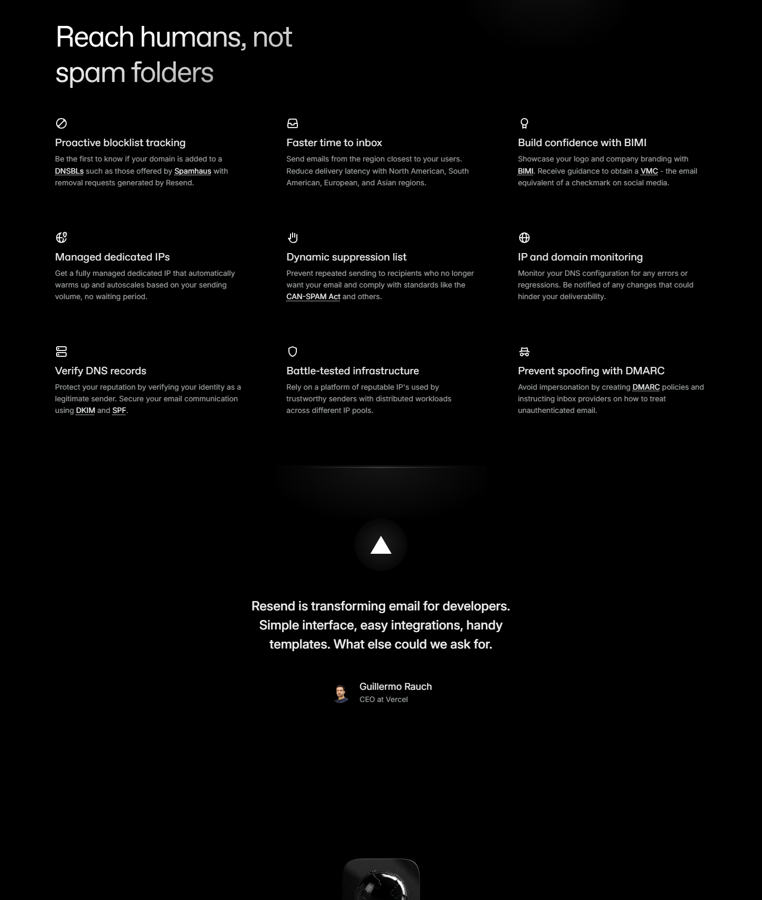⤢

안 5 · 주장 + 운영 근거 4묶음후보(권고)

⤢

안 2 · 신뢰 기둥 3열 (이전 권고)후보

⤢

안 1 · 숫자 띠 + 근거 줄후보

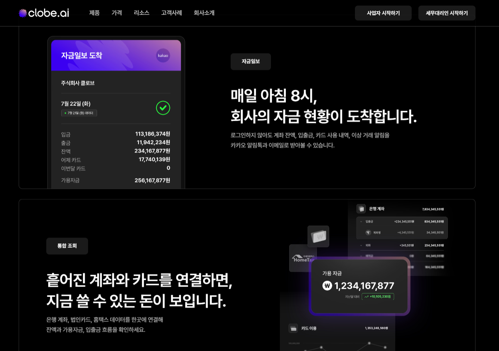⤢

안 4 · 와이드 카드(클로브)후보

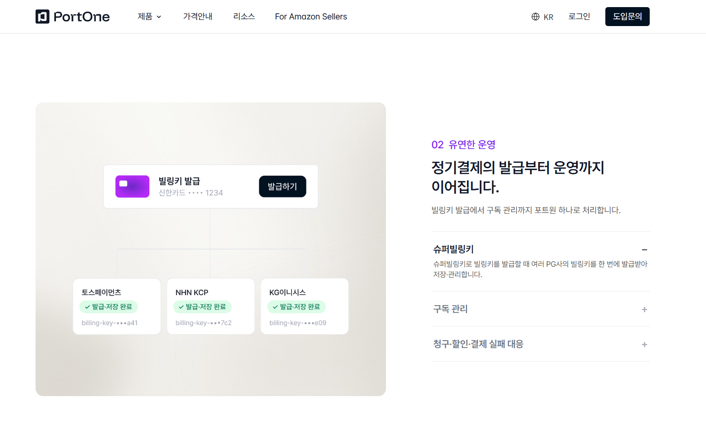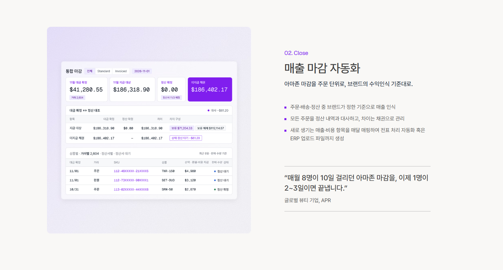⤢

시각 패널 + 아코디언(포트원)현재 안

디자이너 주석 · 컨셉 공통 · DARK

#### 1 기획 의도

목적

고객의 시간, 비용을 안정적인 바로빌이 줄여준다는 인상을 준다.

주고 싶은 인상

**체계적 · 안심** — "운영 구조가 갖춰져 있다."

목적 달성을 위한 시각장치

- 다크 배경 — 체계적이고 안심되는 인상을 주기 위해 섹션 전체를 어두운 면으로
- 왼쪽 큰 시각 패널(html로 표현)

##### 시각적 우선순위

1. H2 Headline copy
2. 왼쪽 패널 구조 시각자료
3. 펼친 아코디언 항목(기본 첫 항목)

##### Next Trigger

- 아래로 스크롤
- 아코디언을 열어 봄

#### 2 동작 명세

- **아코디언**
  - 컴포넌트: Nuxt UI Accordion을 적용 ([ui.nuxt.com/docs/components/accordion](https://ui.nuxt.com/docs/components/accordion))
  - 처음에는 첫 항목이 열려 있음
  - 한 번에 하나만 펼침(다른 항목을 열면 열려 있던 항목은 닫힘)
  - 펼칠 때 내용이 부드럽게 열리고, 닫힐 때도 부드럽게 접힘
- **반응형**
  - 1280 미만
    - 패널은 연결선을 숨기고 위 1 + 아래 3 격자
  - 1024 미만
    - 1열로 바뀜: 눈썹·H2·서브 → 아코디언 → 패널 순서로 위에서 아래로
  - 768 미만
    - 아코디언 펼친 문구 text-sm(14/20)

컨셉판 상세 · A 실사형 / B 그래픽형

- **컨셉 A판**(REF-010) — 왼쪽 시각 패널: 위 카드 'AWS 서울 리전 운영' 1개에서 회색 연결선이 갈라져 아래 카드 3개(트래픽 분산 처리 → 실시간 모니터링 → 자동 백업, 오른쪽 아코디언 순서와 같음)로 이어집니다. 93.3%는 02 WHY 카드 1(원그래프)에서만 보입니다. 카드마다 아이콘 자리 · 제목만 둡니다(상태 뱃지 없음). 섹션에 각주를 두지 않습니다. 연한 면 위 흰 카드, 회색조 선만.
- 치수: 7:5, DARK. 패널 696×712(라운드 12) · 위 카드 360×96 · 아래 카드 200×120 사이 24 · 연결선 1px · 묶음 세로 가운데. 오른쪽 5열 488: 눈썹 '01 운영 안정성' 14/24 → 16 → H2 32/40 2줄 → 16 → 서브 Title 18/28 최대 4줄 → 32 → 아코디언 4(열린 항목: 제목 Title 18/28 + 설명 Body 16/24 · 닫힌 행 64). 섹션 952 = 120 + 712 + 120.
- 아코디언 항목(근거 4칸 문구): AWS 서울 리전 운영 · 트래픽 분산 처리 · 실시간 모니터링 · 자동 백업. 펼친 항목 설명 = 근거 칸 설명 문장.
- **컨셉 B판** 구성: 머리말 + 숫자 칸 셋(칸마다 아래에 출처 한 줄) + 근거 칸 넷(아이콘 자리 · 제목 · 설명 · 칩).
- 컨셉 B판 치수: 안 5 머리말 → 숫자 2칸(누적 고객사 수 25만 · 월평균 API 호출 약 700만 건, 칸 맨 아래 출처 한 줄 Caption 12/16 ink3 · 구분선 없음) → 근거 4칸(아이콘 자리 X 박스 · 칸 높이 240 · 칸 3은 칩 없음). 섹션 하단 각주 목록 · 위첨자 없음. 섹션 896 = 120 + 머리말 120 + 64 + 184 + 48 + 240 + 120.
- 360 폭: A판은 눈썹 → 제목 → 서브 → 카드 구조 패널 → 아코디언 순서로 한 줄에 쌓입니다. B판은 숫자 칸(출처 줄 포함)과 근거 칸이 한 줄씩 세로로 쌓입니다.
- B판 숫자 3칸(누적 고객사 수 25만 · 약 700만 건 · 93.3%) 중 약 700만 건은 서브 문장과 겹칩니다 확인 필요

REF-010 · 포트원 카드 · 컨셉 A판


차용

왼쪽 큰 시각 패널 7열 + 오른쪽 번호 눈썹 · H2 · 서브 · 아코디언(첫 항목만 펼침), 위 카드 1 → 아래 카드 3 구조, 펼친 항목에 해당하는 카드 강조

버림

카드 안 상태 뱃지, 보라 강조색, 그라데이션 면, 카드 안 실제 키 값

이력: 2026-11-20 사용자 결정 — 02-1 H2 '연동한 뒤의 유지보수는 / 바로빌이 맡습니다'(안 5·CA·CB) · '2009년에 연동한 고객 대부분이 지금도 바로빌을 씁니다'(안 1·2·4)를 '운영에 드는 시간과 비용, / 바로빌이 덜어 드립니다'(제안)로, 서브를 '25만¹ 기업이 이용하고 …'(제안)로 바꿈. '유지보수'는 개발자가 자기 코드까지로 읽을 수 있어 고객 화면에서 쓰지 않음. 컨셉 B판(2026-11-20 사용자): 25만 라벨 '바로빌 이용 기업' → '누적 고객사 수', 장애 대응 흐름 도식과 칸 3 '아래 흐름 도식 ↓' 삭제("너무 당연한 얘기"), 하단 각주 목록 · 위첨자 삭제 후 칸마다 출처 한 줄("보고서 같다"). 하단 근거 줄은 93.3%³만 남김. 컨셉 A판은 운영팀 사진 + 전송 결과 화면 구성을 걷고 REF-010 구성으로 다시 짬(실사 없음). 서브 첫 문장 '매달 약 700만 건¹을 처리하는 안정적인 엔진을 그대로 연동하세요.'는 사용자 문장(2026-11-20, (제안) 아님). 2026-11-20 사실 정정(사용자): 25만은 누적 고객사 수이고 모두 라이브는 아님 → 서브 첫 문장을 '매달 약 700만 건을 처리하는 안정적인 엔진을 그대로 연동하세요.'(사용자 문장)로 줄임, 25만 각주 삭제 후 번호 재정렬(700만 ¹ · 93.3% ²), 숫자 칸 라벨 '누적 고객사 수'(후킹 용도로 유지), 출처 '2026년 11월 11일 기준, 누적 고객사'.

93.3% 근거(기획 전용 · 2026-11-20 사용자: 고객 화면에는 '2026년 11월 조사 기준'만 표기): 2009년 연동 등록 고객 30곳 중 28곳이 지금도 이용, 폐업·운영 미전환 제외, 2026년 11월 조사. 02 카드 1 · 02-1 안 5 · 2 · 1 · 4 · CA · CB 출처를 같은 문구로 맞춤.

2026-11-19 PM 위임으로 안 5를 기본으로 바꿨습니다. 안 2(2026-11-18 권고) · 1 · 4는 되돌릴 수 있게 남겼습니다. 채택은 사용자가 정합니다. 안 5 = REF-016 + REF-015.

#### 결정 필요

- 02-1 레이아웃 안 (디자이너 권고 안 5)
- H2 · 본문 · 근거 4묶음 문구 — 모두 (제안), 카피 검수
- 누적 고객사 수는 25만으로 씁니다(현재 이용 수 아님 · 사용자 정정 2026-11-20, 30만은 쓰지 않음).
- ISO 27001은 갱신하지 않아 화면에서 뺐습니다(사용자 확인 2026-11-19). 사이트 어디에도 ISO 인증을 쓰지 않습니다.
- 근거 칩과 문장의 인프라 공개 수준(AWS 서울 리전 · 내부망 분리까지만) — 개발팀

#### 화면 메모

- 컨셉 A판 아코디언: 항목을 누르면 그 항목만 펼쳐지고 나머지는 닫힙니다(한 번에 하나). 펼칠 때 내용이 부드럽게 열립니다. 왼쪽 패널 카드는 아코디언과 연동하지 않습니다(강조 없음). 기본은 첫 항목 'AWS 서울 리전 운영' 펼침. 헤더는 button(aria-expanded), Enter·Space로 엽니다.
- 안 5는 링크가 없습니다. 안 1·2·4의 '보안 안내 보기 →'는 상품 페이지 03-2 보안 공통 블록으로 이동합니다.
- 근거 4묶음은 누르는 곳이 없습니다(정적). 장식 그림은 쓰지 않습니다.
- 세 안 모두 "고객의 고민" 제목·따옴표 질문·보안 Q&A를 뺀 상태입니다(PM-D-19).

근거 4칸 순서: 인프라 → 분산 → 감지 → 백업(평시 기반 → 몰릴 때 → 이상할 때 → 데이터 보호). 41000022는 메인에서는 푸터에만 둡니다. ⚠ 개발팀 확인① 다른 상품도 같은 AWS 서울 리전·감지·백업 체계로 운영되는지 ② 로드밸런서가 여러 서버로 실제 분산하는지(아니면 칸 2 없이 3칸 구성) ③ 내부 구성 이름은 화면에 쓰지 않음

1차 재작업 · PM 조건부 채택 반영 (2026-11-19)

- **2026-11-19 카드 재구성 (사용자 방향 · PM 문구)** — 운영 안정성과 관계없는 연결·엔진 카드를 빼고 네 칸을 인프라 → 분산 → 감지 → 백업(평시 기반 → 몰릴 때 → 이상할 때 → 데이터 보호) 순서로 바꿨습니다. H2 '외부 기관 연결부터…' → 'AWS 서울 리전 위에서 / 분산하고, 감지하고, 백업합니다', 본문 → '연동한 뒤의 서버 운영과 장애 대응은 바로빌이 맡습니다.' 41000022는 메인에서는 푸터에만 둡니다. ⚠ 개발팀 확인① 제안서 18\~20쪽 인프라·모니터링·백업 근거는 모두 '세금계산서 인프라 구성' 쪽입니다. 다른 상품도 같은 AWS 서울 리전·감지·백업 체계로 운영되는지 확인해야 메인에 쓸 수 있습니다. ② 분산 카드 근거는 구성도의 NLB와 EKS 클러스터뿐이고, 문장으로 된 주장은 없습니다. 로드밸런서가 여러 서버(노드)로 실제 분산하는지, 자동 확장이 있는지 확인. 없으면 칸 2를 빼고 3칸으로 갑니다. ③ 구성 이름(NLB·EKS·APM 도구)은 화면에 쓰지 않습니다.
- **2026-11-19 H2 교체 (사용자: 오래 믿고 쓴다는 말은 02 요약 카드에서 했으니, 02-1은 유지보수 걱정을 덜어 주는 메시지로)** — H2 '연동한 뒤의 유지보수는 / 바로빌이 맡습니다' + 본문 '서버 운영·장애 대응·백업은 물론, 국세청·은행·카드사의 정책 변화 대응도 바로빌이 챙깁니다.'(정책 변화 대응 근거: 제안서 9쪽). 네 칸은 '무엇을 맡는가'의 목록, 하단 숫자 줄은 작은 증거로 둡니다. 대안 B '연동은 한 번, / 유지보수는 바로빌이' · 대안 C '연동 뒤에 손 갈 일을 / 바로빌이 줄입니다'. 이전 H2 '한 번 연동하면, 오래 믿고 씁니다'는 02 요약 카드와 겹쳐 뺐습니다. 02-3의 '유지보수비 0원'과 역할 구분: 02-1은 일(누가 챙기나), 02-3은 돈(얼마 드나). 칸 1 제목 'AWS 클라우드에서 운영'(사용자 지시: AWS 키워드를 제목에), 설명은 '국내 서울 리전…'으로 AWS 반복을 뺌.
- H2 → '전송 엔진부터 장애 대응까지, 바로빌이 직접 만들고 운영합니다' (PM 채택, 로고 교체 테스트 통과용)
- 칸 1 칩 → '국세청 시스템사업자 41000022' (사용자 확인 2026-11-19, 푸터와 같은 명칭).
- **2026-11-19 사용자 확인 반영** — 칸 4를 대체 카드 '새벽 자동 백업'으로 바꿨습니다(ISO 27001 미갱신). 하단 줄에 '바로빌 이용 기업 25만¹'을 되살리고 각주를 3개로 다시 맞췄습니다(높이 800 → 816).
- 칸 2 → 제목 '내부망으로 분리한 인프라' / 칩 'AWS 서울 리전 · 내부망 운영'
- 칸 3 → 제목 '이상 징후 실시간 감지' / 설명 '…바로빌 담당자에게 알리고…'. 칩 유지. 확인4단계 흐름(감지 → 알림 → 원인 분석 → 조치)이 세금계산서 외 상품에도 적용되는지 개발팀 확인.
- 칸 4(ISO) 화면 유지. ⚠ 차단ISO 27001 갱신 여부 확인 전 배포 불가. 미갱신이면 대체 카드: 제목 '새벽 자동 백업' / 설명 '트래픽이 적은 새벽 시간대에 스케줄러가 운영자 개입 없이 데이터를 정기 백업합니다.' / 칩 '새벽 정기 자동 백업'.
- 하단 줄: '바로빌 이용 기업 25만'을 화면에서 뺐습니다(30만/25만 충돌이 풀릴 때까지). 각주 3개 → 2개로 번호를 다시 맞췄고, 유지율 각주는 '30곳 중 28곳'을 밝힙니다.
- '보안 안내 보기 →' 링크 삭제(갈 곳 없음). 하단 줄 오른쪽은 비워 둡니다. IA 제안: API 개발 문서에 인증·보안 페이지 신설 시 연결(사용자 결정 대기).
- 높이 816 → 800(각주 3줄 → 2줄). 아래 '안 5 상세'의 치수 중 각주·링크·높이는 이 항목이 우선합니다.

안 5 상세 · 치수 · 권고 (2026-11-19)

- **왜 바꿨나** — 이전 기본안(안 2)의 H2 "2009년에 연동한 고객 대부분이…"는 연혁 소개로 읽히고, 숫자 3개(25만·700만·93.3%)는 '얼마나 쓰나'에만 답합니다. 검토자(개발 리드·CTO)의 질문은 '장애가 나면 누가 무엇을 하나, 데이터는 어디서 어떻게 다루나'입니다. 안 5는 H2를 주장으로 바꾸고, 그 주장을 운영 방식 네 묶음(전송 엔진 · 인프라 · 감지·대응 · 인증·백업)으로 받칩니다. 규모 숫자는 하단 한 줄로 내렸습니다(유지율은 02에서 이미 말함, 사용자 지시).
- **구성** 섹션 1440×816, DARK, 상하 120. 머리말 1216×120(02 머리말과 같은 좌우 분할): 좌 6열 592 눈썹 14/24 → 16 → H2 32/40 2줄(줄당 최대 18자) / 우 8\~12열 488 본문 Title 18/28 2줄, 아래 정렬. → 64 → 근거 줄 1216×216: 3열씩 280 네 칸, 사이 32, 상자 없이 위 1px 선. 칸 안: 위 24 → 아이콘 → 16 → 제목 Title 18/28 700 1줄(최대 15자) → 8 → 설명 Body 16/24 3줄 자리 72(최대 약 48자) → 16 → 증거 칩 H24(Caption 12/16 700, 선 1px). → 48 → 하단 줄 1216×64(위 1px 선): 왼쪽 규모 한 줄 Small 14/20 + 각주 번호, 오른쪽 링크 1개. → 16 → 각주 3줄 48.
- 높이 합: 120 + 120 + 64 + 216 + 48 + 64 + 16 + 48 + 120 = 816 (이전 안 2 808).
- **줄일 때 지킬 것**: ① 네 칸 같은 높이(설명 3줄 자리 고정) ② 제목 > 설명 > 칩 순서의 무게 ③ 규모 숫자는 근거 줄보다 약하게(Small) ④ 칩에는 확인된 고유값만(인증번호·리전·인증 시점). 내부 구성 이름은 쓰지 않습니다.

|  | 5 | 2 | 1 | 4 |
| --- | --- | --- | --- | --- |
| 목적 | 5 | 4 | 3 | 4 |
| 스캔 | 4 | 4 | 5 | 4 |
| 콘텐츠 | 5 | 4 | 4 | 2 |
| 확장 | 5 | 5 | 4 | 3 |
| 비용 | 5 | 5 | 5 | 2 |

- 점수 근거 — 안 5 목적 5: '운영을 누가 어떻게'에 네 칸이 직접 답함 · 콘텐츠 5: 제안서 근거로 네 칸을 모두 채움(빈칸 없음) · 확장 5: 칸 1개를 떼어 상품 페이지 01 '검증된 운영' 넛지나 03-2 보안 블록 머리에 쓸 수 있음 · 비용 5: 선 아이콘 4개뿐. 안 2 목적은 5 → 4로 내렸습니다(숫자가 운영 방식에 답하지 않음).
- **권고 · 안 5** (신뢰도: 추정 — 페르소나 테스트 전).
- **안 5가 안 2보다 못할 수 있는 이유**: ① 큰 숫자가 없어 첫 시선을 끄는 요소가 약합니다. 텍스트 네 칸이 '기능 목록'처럼 평평하게 보일 수 있습니다. ② 다크 배경 위 Body 16 3줄 × 4칸은 읽을 양이 늘어납니다(안 2는 숫자 3개 + 각주). ③ 경쟁사도 비슷한 운영 문장을 쓸 수 있어 '바로빌만의' 느낌은 숫자보다 약합니다.
- **회의적인 CTO가 떠날 수 있는 지점**: "실시간 감지·조치"에 가동률·장애 이력·공개 상태 페이지가 없습니다. 숫자 없이 과정만 말하면 "누구나 하는 말"로 읽힙니다. 상태 페이지나 장애 공지 이력이 공개 가능해지면 칸 3의 칩을 그 링크로 바꾸는 것이 가장 큰 보강입니다. 또 'AWS 서울 리전'은 흔한 사실이라 칸 2가 약합니다.
- 판단이 뒤집히는 조건: 공개 가능한 가동률·장애 이력이 생기면 칸 3을 숫자 칸으로 바꾸거나 안 4(실화면 패널)로 갑니다. 사용자가 '숫자 압도감'을 우선하면 안 2.

#### 카피 전후 (제안)

- 눈썹: '01 검증된 운영 안정성' → '01 운영 안정성' (02 머리말 카드 이름과 맞춤, 네 안 모두)
- H2: '2009년에 연동한 고객 대부분이 지금도 바로빌을 씁니다' → '국세청 전송부터 장애 대응까지, 바로빌이 직접 운영합니다' (PM 후보 그대로) (제안)
- 본문(신규): '국세청·은행·카드사와의 연결과 정책 변화 대응은 바로빌이 맡습니다.' (제안서 9쪽) (제안)
- 근거 4묶음 제목·설명·칩(신규, 제안서 1·3·7·15·19·20쪽): 자체 국세청 전송 엔진 / 격리된 클라우드 인프라 / 실시간 감지와 장애 대응 / 정보보호 인증과 백업 (제안). 백업 주기는 근거가 없어 '매일'을 쓰지 않고 '새벽 시간대'로 썼습니다. '담당 채널'은 고객에게 낯선 말이라 '담당자에게'로 바꿨습니다.
- 유지율: 대표 숫자 → 하단 한 줄 '2009년 연동 고객의 93.3%가 지금도 이용³' + 각주 (제안). 이 섹션의 '2009'는 이 한 번만 남았습니다(근거 띠의 '2009년 10월 표준인증'은 뺐고, 칸 1 칩은 인증번호만 씁니다).
- 안 2 열 이름(빈칸 채움): 이용 규모 · 처리 규모 · 고객 유지 (제안). 안 4 본문(빈칸 채움): 안 5 본문과 같은 문장 (제안).

#### 360 폭에서

- 머리말 1열(눈썹 → H2 28/36 3줄 → 본문 16/24). 근거 4칸은 2×2(156 폭)가 아니라 1열 세로(328, 칸 높이 자동, 사이 32) — 설명이 156 폭에서 6줄이 되기 때문. 하단 줄은 규모 문장 → 링크 세로, 각주는 맨 아래.

참고 레퍼런스 · 안 5 (4)

REF-016 · Resend 전달률 그리드 · 채택 근거


차용

3×3 사실 그리드: 상자 없이 아이콘 → 제목 → 설명 3줄, 칸마다 같은 높이. 문장형 사실만으로 신뢰를 쌓는 방식

버림

9칸(우리는 근거 4묶음이라 4칸 1줄), 칸 아래 고객 인용, 검정 바탕 광택 장식

REF-015 · Stripe 신뢰성 섹션

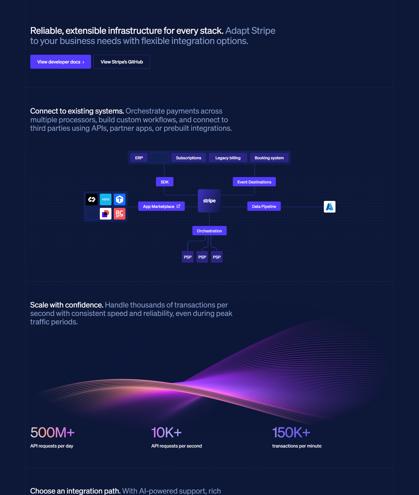

차용

굵은 주장 + 같은 줄 흐린 설명의 문장형 제목, 규모 숫자 3개를 섹션 맨 아래 작은 띠로 내림

버림

물결 그래픽(정보 없는 장식), 연동 도식(02-2 소재)

REF-017 · Plaid 네트워크 규모 · 탈락

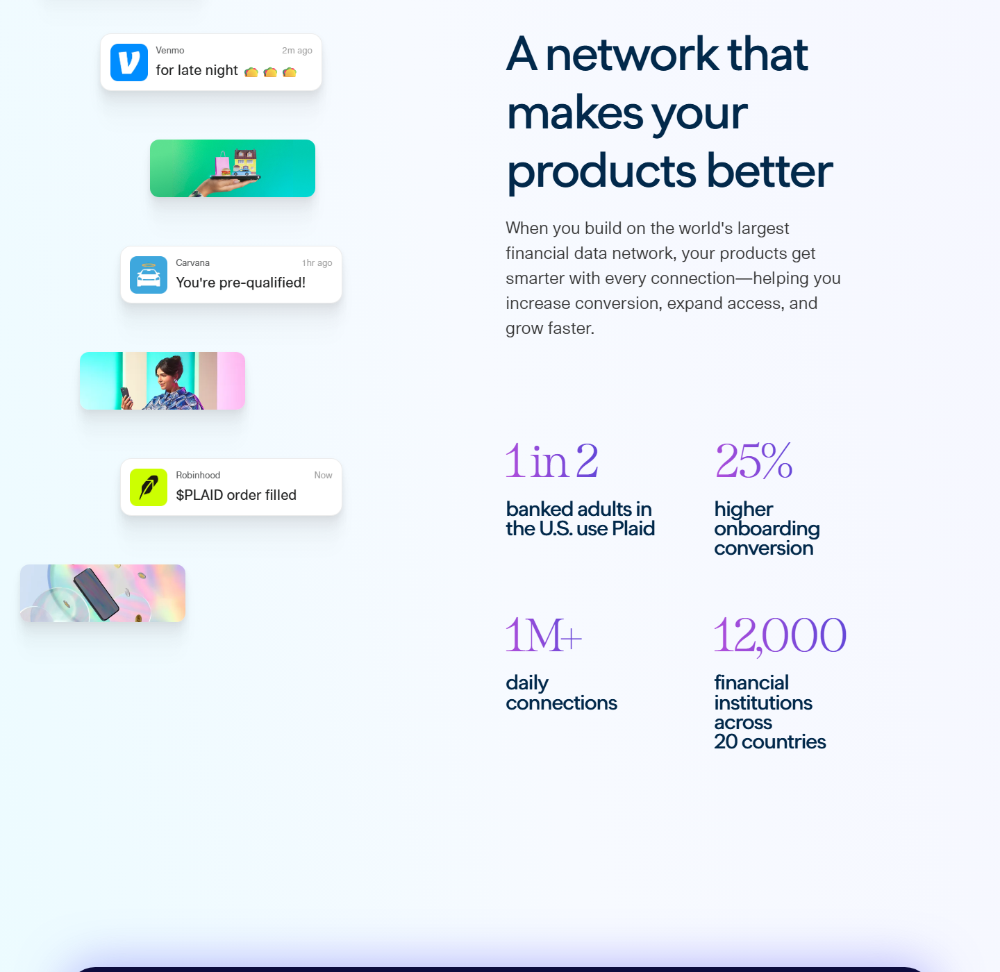

차용

2×2 숫자 배치는 버림. 숫자 + 짧은 라벨의 짝만 하단 줄에 참고

버림

왼쪽 앱 알림 콜라주(가짜 데이터 UI), 큰 세리프 숫자

REF-018 · Twilio 외부 평가 카드 · 탈락

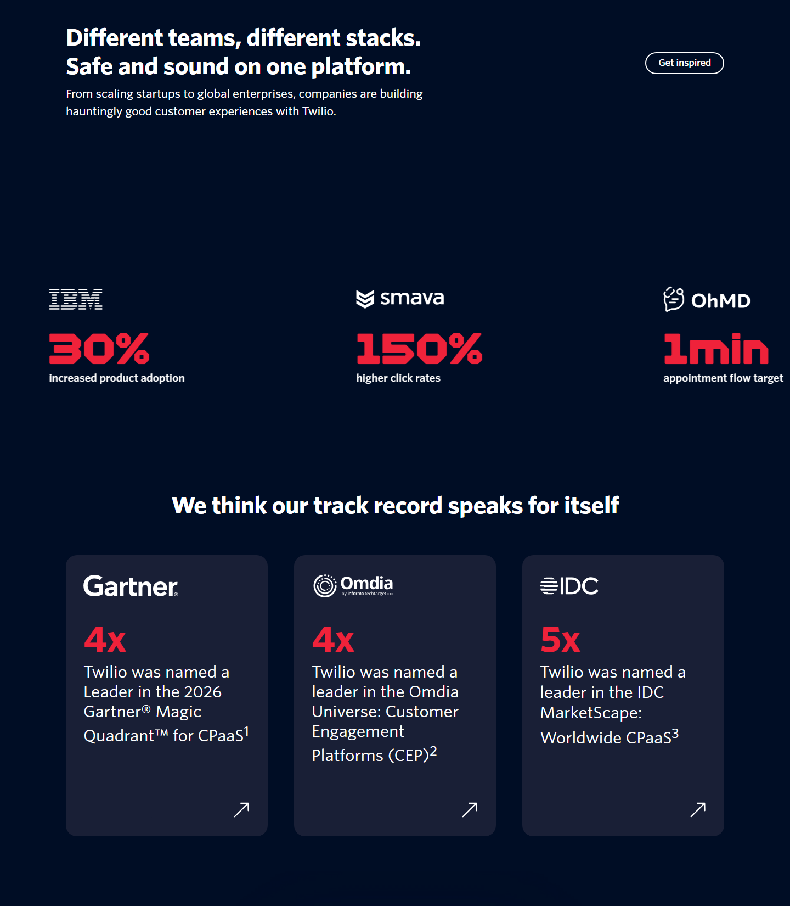

차용

없음. 제3자 평가(애널리스트 리포트)가 우리에게 없어 칸을 채울 수 없음

버림

고객 실명 수치, 외부 평가 카드 3장

점수(목적·스캔·콘텐츠·확장·비용): REF-016 5·4·5·4·5 · REF-015 3·4·3·4·4 · REF-017 3·4·3·3·2 · REF-018 2·4·1·3·4 · REF-008 4·4·2·3·2. 상세는 레퍼런스 목록 '메인 02-1 · 2026-11-19'.

안 1 · 2 · 4 비교 (2026-11-18 기록)

|  | 1 | 2 | 4 |
| --- | --- | --- | --- |
| 목적 | 4 | 5 | 4 |
| 스캔 | 5 | 4 | 4 |
| 콘텐츠 | 4 | 4 | 2 |
| 확장 | 4 | 5 | 3 |
| 비용 | 5 | 5 | 2 |

- **중복 정리** — 02 카드 1 설명에 '2009년 표준인증 · 41000022'가 있어, 안 2의 대표 숫자는 25만 / 약 700만 건 / 93.3%로 하고 시스템사업자·표준인증은 근거 줄(띠)에만 둡니다. 대표 숫자에 '2009'를 쓰지 않습니다.
- **안 1** — 숫자 4칸이 3칸이 되어 4열씩 384 세 칸입니다. 가장 단순하지만 운영 질문에 답하는 요소가 없습니다.
- **안 4** — REF-008 점수(4·4·2·3·2). 실화면 패널이 근거를 그림으로 증명하지만, 공개 가능한 실화면 캡처가 없으면 왼쪽 592가 빈 자리로 남습니다. 숫자 3개는 시각물 안에만 있어 안 2보다 덜 읽힐 수 있습니다.

#### 권고 · 안 2 (신뢰도: 추정)

- 숫자마다 받침 사실(각주)이 붙어 숫자 나열보다 주장이 선명합니다. 미확정 숫자가 빠져도 그리드가 흔들리지 않습니다. 02 카드와 같은 3열 그리드입니다.
- 실패 조건: ① 열 이름을 짧고 다르게 쓰지 못하면 안 1 ② 공개 가능한 운영 지표 실화면이 생기면 안 4 ③ '숫자 압도감'을 우선하면 안 1.

섹션 높이: 안 2 808 · 안 1 680 · 안 4 736 (현행 896)

레이아웃 상세 · 줄일 때 지킬 것

- 안 2 열(272 고정): 선 2 → 24 → 열 이름 24 → 24 → 숫자 56 → 8 → 라벨 24 → 24 → 1px 선 → 16 → 각주·사실 2행. 사실이 1개인 열도 2행 자리를 잡아 높이를 맞춥니다.
- 안 2 머리말 오른쪽 리드 자리(8\~12열 488)는 선택 항목이라 문구가 없어 비웠습니다.
- 안 2 하단 줄 64: 근거 띠(왼쪽, 1줄) + 링크 2개(오른쪽). 근거는 숫자보다 약하게 둡니다.
- 줄일 때 지킬 것: ① 세 열 같은 높이 ② 숫자 > 라벨 크기 차이 ③ 각주를 숫자와 같은 열에.
- 안 4: 와이드 카드 1216×432 = 좌 592 시각물(카드 위·아래·왼쪽 끝까지 full-bleed, 실화면 캡처) + 우 624 텍스트(안쪽 48: 배지 28 → 24 → H2 32/40 2줄 → 16 → 본문 Body 2줄 → 아래 끝에 근거 줄 + 링크). 아래 16 → 각주 3개. 섹션 736 = 120 + 432 + 16 + 각주 3줄 48 + 120.
- DARK 섹션입니다. 와이어프레임에서는 짙은 회색 면으로 그렸습니다.

근거

- 유지율 28/30 (2009 코호트, 폐업·운영 미전환 제외) → 93.3%로 표기(PM-D-17)
- 인증·보안 질문 51건(10.2%, 500건 기준) — 상세는 상품 페이지 03-2(PM-D-03)
- 도입 전 걱정 3/7은 PM-D-10에 따라 고객 화면에서 뺐습니다.

고객 문제와 미충족 니즈 §1·§2·§3-2 · 연동사 유지율 분석 · 제안서 06 · 레퍼런스 목록 '메인 02-1'

360 폭에서

- 안 2: 기둥 1열 세로 3개(328×약 200, 사이 32), 숫자 36/44. 하단 줄은 근거 → 링크 2개 세로.
- 안 1: 숫자 1열 3개, 근거 줄 세로 3행(행 64). 안 4: 텍스트(배지 → H2 → 본문 → 근거) → 시각물 328×246(4:3), 각주는 맨 아래.

참고 레퍼런스 (1)

REF-008 · 클로브 카드 · 안 4


차용

한 줄 와이드 카드, 실화면 패널을 크게 + 옆에 배지 · 큰 제목 · 설명, 카드 테두리 안에 시각물을 끝까지 채움

버림

좌우 교차 반복(카드 1장만), 보라 그라데이션·광택, 화면 속 가짜 금액

카피 검토 (3)

- 카피 검토 필요2026-11-19: 안 2 열 이름(이용 규모 · 처리 규모 · 고객 유지)과 안 4 본문을 (제안)으로 채웠습니다. 아래 두 항목은 2026-11-18 기록입니다.
- 카피 검토 필요H2(26자)는 안 2·3에서 2줄(592·488 폭), 안 1에서 1줄입니다. 2줄일 때 줄바꿈 위치를 정해야 합니다.
- 카피 검토 필요안 4 본문(Body 2줄, 528 폭 약 60자)이 없습니다. 미확정으로 두었습니다. 배지는 기존 눈썹 '01 운영 안정성'을 그대로 썼습니다.

반응형

- **xl 미만(\<1280)**: 컨셉 A판 카드 구조 패널은 절대 위치를 풀고 위 카드 1 + 아래 카드 3 격자로(연결선 숨김).
- **lg 미만**: 머리말 H2와 서브를 위아래로(H2 → 16 → 서브). 근거 4칸 → 2열, 숫자 칸 · 기둥 · 근거 줄 → 1열, 와이드 카드는 시각물 위 · 글 아래, 근거 줄과 링크는 세로로.
- **md 미만 순서**: 눈썹 · H2 · 서브 → 항목(아코디언 · 근거 칸 · 세로 단계) → 이미지 · 그래픽(4:3 · 최대 높이 240, 이미지 위 노드는 이미지 바로 아래에 붙여 함께) → CTA · 근거 줄 · 각주. DOM 순서는 그대로 두고 보이는 순서만 바꿈. md 이상은 그대로.
- **md 미만**: 근거 칸 1열, 컨셉 A판 패널은 위 카드 1 + 아래 카드 3칸, 큰 숫자 40/48.

C02 연동 편의성

H2AI로 더 빠르게,\
기술지원은 확실하게

BAI 에이전트에는 문서 MCP로 연결하고, 문서는 명확하게, 예제 코드는 18개 언어로 제공합니다.

REST · JSON · SOAP 지원

AI 에이전트바로빌 문서 MCP 연결됨*예시*

바로빌 전자세금계산서 발행 연동 코드를 Node.js로 작성해 줘

1. *✓***문서 MCP**발행 명세 조회
2. *✓***문서 MCP**Node.js 샘플 · 오류 코드 확인
3. *✓***코드 작성**문서대로 작성

**✓ 코드 작성 완료**참조: 발행 API 명세 · Node.js 샘플 · 오류 코드

H3AI 에이전트 연동

문서 MCP로 AI 에이전트가 바로빌 문서를 직접 찾아보며 코드를 쓸 수 있습니다.

문서 MCP마크다운 버전llms.txt

H3사람이 읽기에도 명확한 문서

API마다 요청·응답 예시를 두고, 오류 코드마다 원인과 조치를 적습니다.

요청·응답 예시오류 원인·조치시작 3단계

H318개 언어 예제 코드

Java·Node.js부터 Delphi·PowerBuilder까지, 쓰는 언어의 예제 코드로 시작합니다.

Java · Node.js · Python · .NET · PHP · ASP · Delphi · PowerBuilder · Visual Basic · 나머지 9종 언어 이름 자리

18개 언어

**01파트너 등록하면 인증키 자동 발급**

테스트·운영 인증키가 함께 발급됩니다. 신청하고 기다릴 필요가 없습니다.

**02운영과 같은 테스트 환경**

가입하면 테스트 포인트 1만 점이 자동 지급됩니다. 세금계산서·현금영수증은 국세청 실전송만 빠집니다.

**03인증키와 API 주소만 바꾸면 운영 전환**

별도 신청 없이 전환합니다. 조회 상품만 운영 환경에서 다시 신청합니다.

막히면 사내 개발팀 전담 엔지니어가 1:1로 답합니다 · 업무시간 연동 문의 답변 중앙값 17분¹

샘플 코드 보기AI 에이전트 연결 방법API 개발 문서 보기 →

1. 평일 09:00\~18:00 접수 연동 문의 602건 기준, 2026년 11월 10일 집계

C02 연동 편의성

H2인증키를 기다리지 않고,\
바로 개발을 시작합니다

B테스트 인증키로 개발하고, 준비되면 운영 인증키로 바꿔 바로 씁니다.

REST · JSON · SOAP 지원

JavaNode.jsPython.NETPHP레거시ASPDelphiPowerBuilderVisual Basic

요청 · 전자세금계산서 발행 1건

*인증키 •••• ••••*

응답

⧉

1. 1

   **파트너 등록하면 인증키 자동 발급**

   테스트·운영 인증키가 함께 발급됩니다. 신청하고 기다릴 필요가 없습니다.
2. 2

   **운영과 같은 테스트 환경**

   가입하면 자동 지급되는 테스트 포인트 1만 점으로 실제처럼 호출합니다. 세금계산서·현금영수증은 국세청 실전송만 빠집니다.
3. 3

   **인증키와 API 주소만 바꾸면 운영 전환**

   별도 신청 없이 운영으로 전환합니다. 조회 상품은 운영 환경에서 한 번 더 신청합니다.

막히면 사내 개발팀 전담 엔지니어가 1:1로 답합니다 · 업무시간 문의 답변 중앙값 17분¹

API 개발 문서 보기 →

1. 평일 09:00\~18:00 접수 연동 문의 기준, 2026년 11월 10일 집계

C02 연동 편의성

H2기다림 없이 시작하는 연동

B테스트 인증키로 개발하고, 준비되면 운영 인증키로 바꿔 바로 씁니다.

STEP 1

H3가입 · 파트너 등록

가입과 파트너 등록은 무료입니다

*›*

STEP 2

H3테스트 인증키로 개발

등록하면 테스트·운영 인증키가 자동 발급됩니다

*›*

STEP 3

H3운영 전환

별도 신청이나 승인 없이 직접 운영으로 전환합니다

RESTSOAPJavaPythonNode.jsC#

// 예시 코드 자리: 전자세금계산서 발행 요청 1건 // 실제 코드는 REST 레퍼런스 확정 후 삽입 (복사 버튼)⧉

17분업무시간 문의 답변 중앙값

「빠르게 도입하고 운영전환 할 수 있는 서비스.」

기존 고객 설문

API 개발 문서 보기 →

1단계 시각물: 가입·파트너 등록 화면 캡처\
(2단계: 콘솔 인증키 발급 화면 + 테스트 요청 코드 · 3단계: 운영 전환 화면)\
가짜 값 없이 실화면으로

C02 연동 편의성

H2기다림 없이 시작하는 연동

B테스트 인증키로 개발하고,\
준비되면 운영 인증키로 바꿔 바로 씁니다.

**STEP 1가입 · 파트너 등록***−*

가입과 파트너 등록은 무료입니다

**STEP 2테스트 인증키로 개발***+*

**STEP 3운영 전환***+*

API 개발 문서 보기 →

이미지: 개발자 문서 화면 캡처 + 터미널 창 겹침 (REF-062)\
뒤 = 바로빌 개발자 문서 실화면 캡처, 위쪽 오른편 'AI로 열기' 버튼이 보이게\
앞 = 터미널 창, 가운데 오른쪽(인용 노드와 겹치지 않게 세로 가운데쯤)\
터미널 내용 = 요청 → llms.txt 읽음 → 문서 .md 읽음 → 코드 작성 완료 · 참조 문서\
AI 도구 이름·로고 없음 · 운영 주소로 표기(개발 서버 주소 금지)

> “빠르게 도입하고 운영 전환할 수 있는 서비스”

주식회사 지구하다 김\*\* 차장 · 2026년 10월 연동 경험 설문

C02 연동 편의성

H2AI로 더 빠르게,\
기술지원은 확실하게

BAI 도구를 쓰든, 직접 개발하든 바로빌 문서 하나로 막힘없이 연동할 수 있습니다.

**AI로 더 빠르게 개발***−*

AI 도구가 마크다운 원문 · llms.txt · OpenAPI 3.0으로 바로빌 문서를 추측 없이 읽어, 개발 시간을 줄일 수 있습니다.

**레퍼런스 문서를 정확히 읽는 MCP***−*

AI 에이전트가 문서 MCP로 바로빌 문서를 직접 읽어 개발 시간을 줄입니다.

**구현용이성을 높이는 명료한 문서***+*

연동이 처음이어도, 친절한 가이드와 바로 호출해 볼 수 있는 Playground로 API를 쉽게 이해합니다.

**풍부한 SDK와 18개 언어 예제코드***+*

어떤 언어를 쓰든, 18개 언어 예제 코드를 그대로 가져다 바로 시작합니다.

연동 개발 중 막히면 전담 엔지니어가 1:1로 도와드립니다.

API 개발 문서 보기 →

02-2 연동 편의성 · S3 테스트 절차

#### 레이아웃 안 · 누르면 화면이 바뀜

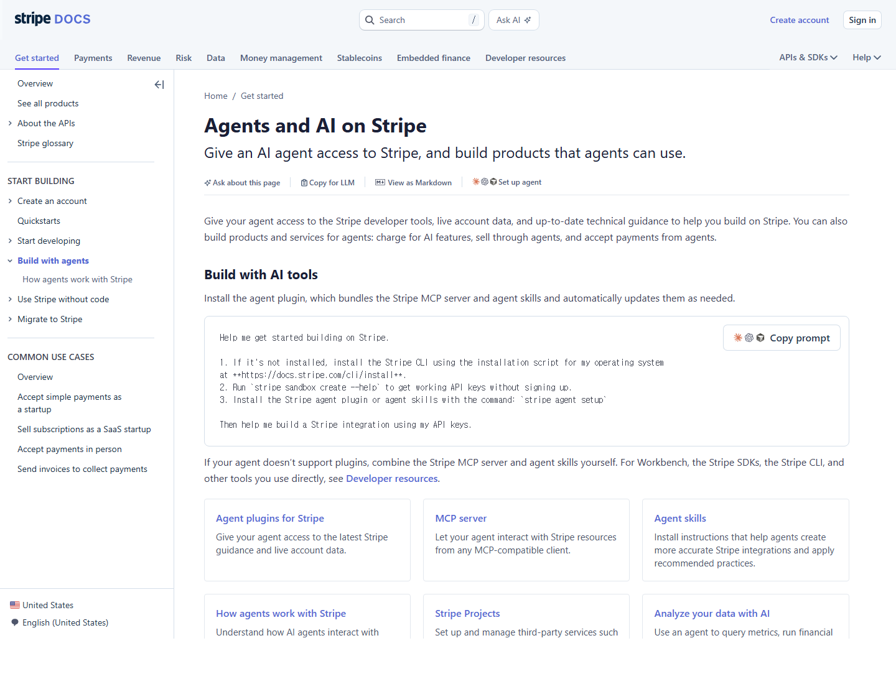⤢

D · AI 주인공 7열 + 문서·18개 언어 작은 카드후보(권고) · 일부 조건부

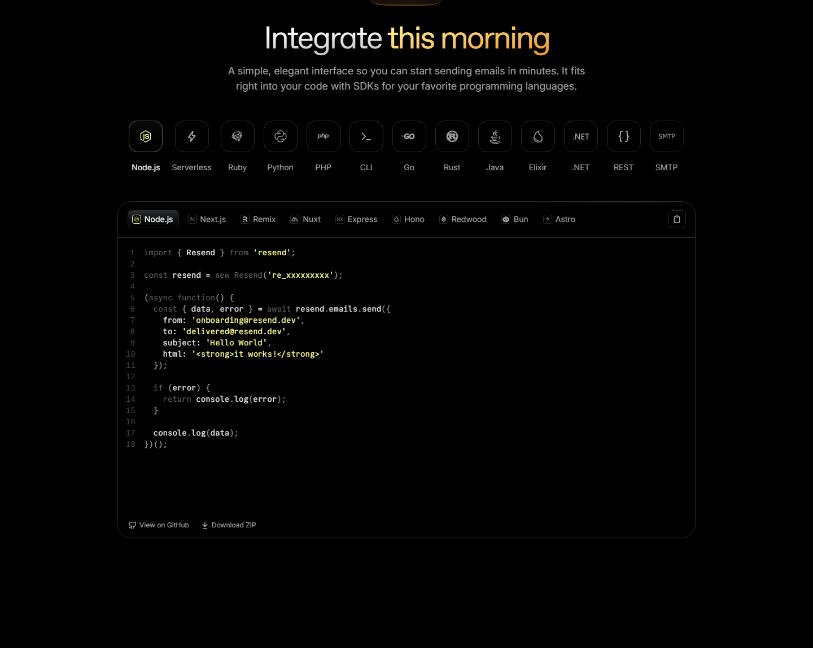⤢

C · 주장 + 코드 + 세로 3단계 (AI 미포함 시 기본)후보

⤢

A · 단계 카드 + 코드 (이전 권고)후보

⤢

B · 시각물 + 단계 아코디언(포트원)후보

⤢

이미지 + 아코디언현재 안

디자이너 주석 · 컨셉 공통

**MCP 포함***off = 1차 기본(MCP 없음) · on = MCP가 들어갈 때 바뀌는 화면·주석*

#### 1 기획 의도

목적

연동이 막히지 않음을 보여줍니다.\
AI가 바로 읽는 문서(마크다운 · llms.txt · OpenAPI)로 개발 시간을 줄이고,MCP로 개발 시간을 줄이고,\
명확한 문서로 이해도를 높이고,\
예제코드 SDK로 시작을 돕고\
막힐 때는 전담 엔지니어가 돕습니다.

주고 싶은 인상

속도감, 간편함

목적 달성을 위한 시각장치

- 왼쪽 큰 이미지: 바로빌 개발자 문서 화면 캡처 위에 터미널 창이 떠 있는 장면 — AI 도구가 바로빌 문서를 읽고 코드를 쓰는 모습 레퍼런스
  - 뒤: 바로빌 개발자 문서 실화면 캡처, 위쪽 오른편 'AI로 열기' 버튼이 보이게
  - 앞: 터미널 창, 가운데 오른쪽 · 세로 가운데쯤(아래 왼쪽 인용 노드와 겹치지 않게) · 그림자로 문서와 층을 나눔
  - 터미널 내용(한국어)
    - 요청: '바로빌 현금영수증 발행 연동 코드 작성해 줘'
    - llms.txt에서 관련 문서 찾음 → 현금영수증 문서(.md) 읽음 → 코드 작성 완료
    - 마지막 줄에 참조한 문서 이름
  - 그리지 않는 것
    - AI 도구 이름·로고(레퍼런스의 도구 이름 자리는 지움)
    - API를 호출하거나 '연동 완료'·PR 생성처럼 결과를 보증하는 줄
    - 개발 서버 주소 — 문서 주소는 운영 주소로
    - 가짜 키·지어낸 필드
  - 02 요약 카드 2(코드 + 연결 노드)와는 '문서 화면 + 터미널' 구도로 구분
  - MCP 포함 여부와 관계없이 같은 이미지(llms.txt · .md는 1차 확정)
- 왼쪽 아래 고객 인용 노드 1개 겹침(html로 표현) — 인용 · 회사·이름 · 조사 시점
  - 회사명 왼쪽 원형 자리: 주식회사 지구하다 파비콘
  - 회사·이름과 조사 시점은 두 줄로, 회사·이름은 진하게 · 조사 시점은 연하게

##### 시각적 우선순위

1. H2 Headline copy
2. 이미지 + 인용 노드
3. 펼친 아코디언 항목(기본 첫 항목)

##### Next Trigger

- 개발자 → 개발문서
- 검토자 → 다음 영역 스크롤

#### 2 동작 명세

- **아코디언**
  - 컴포넌트: Nuxt UI Accordion을 적용 ([ui.nuxt.com/docs/components/accordion](https://ui.nuxt.com/docs/components/accordion))
  - 한 번에 하나만 펼침, 기본은 첫 항목
  - 인용 노드와 지원 안내는 누르는 곳 없음
  - 링크 → API 개발 문서
- **반응형**
  - 1280 미만
    - 인용 노드를 이미지 안쪽으로 좁힘
  - 768 미만
    - 순서: 눈썹·H2·서브 → 아코디언(근거 칸) → 이미지 → 링크
    - 인용 노드는 카드 위 하단 영역에 배치함
    - 아코디언 펼친 문구 text-sm(14/20)
  - 640 미만
    - 인용 노드 파비콘 생략
    - 인용 text-base(16/24), 회사·이름 text-xs(12/16)

컨셉판 상세 · A / B

- **컨셉 A판** 구성: 왼쪽 7열 이미지 자리(어떤 이미지를 넣을지 미정) + 이미지 왼쪽 아래 고객 인용 노드 1개(인용문 · 고객사 로고·이름 · 출처 한 줄(조사 시점만), 누르는 곳 없음) + 오른쪽 눈썹 · H2 · 서브 · 아코디언 3 · 지원 안내 한 줄(작은 아이콘 + Small, 누르는 곳 없음) · 'API 개발 문서 보기 →'. 02-1 A판과 같은 배치, 패널 안 도식은 따르지 않음.
- 인용 출처: 연동 경험 설문 19번 원문 "빠르게 도입하고 운영전환 할 수 있는 서비스."(띄어쓰기만 수정). 11/06 제안서는 주식회사 지구하다로 표기했으나 집계 PDF로는 응답자 연결이 안 됨 → 사용자 확인(2026-11-20): 응답자 주식회사 지구하다 김\*\* 차장, 24번 「회사명·성함 포함 가능」 → 실명 표기. 성함 전체는 디자인 단계에서 원본 응답으로 채움. 원문에 비교(가장 빠름) 표현 없음 — 최상급으로 바꾸지 않음.
- 컨셉 A판 아코디언: 항목을 누르면 그 항목만 펼쳐집니다. 기본은 첫 항목. 'API 개발 문서 보기 →'는 API 개발 문서(#p-docs)로 이동합니다.
- **컨셉 B판** 구성: 머리말 + 점선 칸 셋(AI 도구 문서 그래픽(마크다운 · llms.txt · OpenAPI) X 박스AI 에이전트 창 그래픽 X 박스 · 언어 칩 격자 · 17분, 칸 아래 출처 한 줄) + 근거 칸 셋(아이콘 자리 · 제목 · 설명 · 칩) + 아래 지원 안내 한 줄(작은 아이콘 + Small). 칸은 누르는 곳이 없습니다(정적).
- 시작 절차(가입·인증키 → 테스트 → 운영 전환)는 두 컨셉판에서 빼고 독립 섹션 '시작 절차'(#m02-4)로 옮겼습니다.
- 360 폭: A판은 눈썹 → 제목 → 서브 → 이미지 자리 → 아코디언 → 링크 순서로 쌓입니다. B판은 점선 칸과 근거 칸이 한 줄씩 세로로 쌓입니다.
- 치수: A판 7:5 · 패널 696×712 · 위 카드 360×96 · 아래 카드 200×120 사이 24 · 가로 카드 648×96 · 섹션 952. B판 점선 칸 384×184 × 3 · 근거 칸 280×240 × 4 · 섹션 약 904.

이력: 2026-11-20 사용자 지시 '02-1·02-2·02-3 스타일 통일, 절차 독립' — 컨셉 A판의 실화면 캡처·콜아웃·콘솔 캡처·엔지니어 아바타 구성과 컨셉 B판의 에이전트 미니 UI 카드·3단계 흐름 구성을 02-1 문법으로 다시 짬. 아코디언 네 번째는 '운영과 같은 테스트 환경' 대신 '전담 엔지니어 1:1'(시작 절차 섹션의 02단계와 중복 피함).

2026-11-19 사용자 지시("02-2에 AI 에이전트 개발 경험을")로 D를 추가하고 기본으로 바꿨습니다. D의 AI 요소는 모두 Phase 1 포함 확정 전까지 조건부이며, 확정되지 않으면 C로 되돌립니다. C · A · B는 그대로 남겼습니다.

안 D 상세 · AI 기둥 주인공

- **왜**: 사용자 결정 "AI를 키우는 게 좋겠다". 세 기둥은 유지하고 AI 기둥만 크게 키웠습니다. (3차 재작업 2026-11-19)
- **배치**: 7열 AI 기둥 + 5열 작은 카드 2장(위아래). 예시 화면 안쪽 폭 648 = 요청 말풍선 1줄(16px)과 작업 기록 3행이 줄바꿈 없이 들어가는 폭. AI 기둥이 섹션에서 가장 큰 덩어리. 7:5 분할은 C안(코드 7열 + 단계 5열)과 같음.
- **높이** **1016** = 96 + 머리말 120 + 40 + 기둥 줄 424 + 40 + 사실 띠 88 + 24 + 하단 줄 64 + 8 + 각주 16 + 96.
- **AI 기둥 696×424 (7열)**: 위 시각물 696×256(안쪽 16/24) — 라벨 'AI 에이전트'(Small 14) + 상태 칩 '바로빌 문서 MCP 연결됨'(H24) + '예시' 표시(H24) → 12 → 요청 말풍선 648×44 'Body 16 1줄' → 12 → 작업 기록 3행×24(문서 MCP · 발행 명세 조회 / 문서 MCP · Node.js 샘플 · 오류 코드 확인 / 코드 작성 · 문서대로 작성 + 회색 막대 200) → 12 → 결과 줄 H32 '✓ 코드 작성 완료' + 오른쪽 '참조: 발행 API 명세 · Node.js 샘플 · 오류 코드'. 아래 텍스트 168(안쪽 20/24): 제목 H3 22/32 → 8 → 설명 Body 16/24 최대 2줄 → 12 → 칩 H28. 호출·응답 장면과 OpenAPI는 넣지 않습니다.
- **문서 · 18개 언어 기둥**: 오른쪽 5열에 488×200 텍스트형 작은 카드 2장(사이 24, 안쪽 20/24, 시각물 없음). 문서 카드: 제목 → 설명 2줄 → 칩 3개(아래 붙임). 언어 카드: 제목 → 설명 2줄 → 8 → 언어 이름 줄 Caption 12/16 600 2줄(확인된 9종 이름 + 점선 '나머지 9종 언어 이름 자리') → 8 → 칩 '18개 언어'.
- **2차 시각물 기록**: 문서 기둥 시각물(API 레퍼런스 페이지 해부도: 제목 막대 · 요청 예시 | 응답 예시 · 오류 코드 | 원인 | 조치 표)과 언어 격자(3×6, 확인 9 + 점선 9)는 메인에서 뺐습니다. 해부도는 서브 'API 개발 문서' 소개에 다시 쓸 수 있습니다. 되살릴 때는 backup_20261119_before_0202D_r3.html.
- **함께 두는 것**: 사실 띠 3단계, 지원 한 줄 + 17분 각주, 링크 3개, 머리말 칩 'REST · JSON · SOAP 지원', ⚠ 18종 목록 확인 필요(제안서 9종), ⚠ 출시 조건 마크다운 버전 · llms.txt 칩.
- **360 폭**: 머리말 → AI 카드(시각물 328×auto, 요청 2줄 허용, 참조는 결과 줄 아래로) → 문서 카드 → 언어 카드 → 사실 띠 3행 → 지원 → 링크.

(기록) 안 D 2차 재작업 · 같은 무게 3기둥 (2026-11-19)

- **왜**: 사용자 지적 "카드가 다 AI다". 사용자 표현 "AI 연동 개발도 쉽고, 사람이 읽기에도 문서가 명확하고, 예제 코드도 18개 언어로 지원한다"를 같은 무게의 3기둥으로 나눴습니다. AI는 세 가지 중 하나가 됩니다.
- **높이** 1016 → **984**(실측 984) = 96 + 머리말 120 + 40 + 기둥 줄 392 + 40 + 사실 띠 88 + 24 + 하단 줄 64 + 8 + 각주 16 + 96.
- **기둥 카드** 384×392 × 3(4열씩, 사이 32, 같은 높이 고정): 위 시각물 384×208(테두리 안 꽉 채움, 회색 바탕 #fafafa, 아래 1px 선, 안쪽 16) → 텍스트 영역 안쪽 24: 제목 H3 22/32 1줄 → 8 → 설명 Body 16/24 2줄(높이 48 고정) → 아래 붙임 근거 칩 H28(Caption 12 600, 사이 8). 세 카드는 구조·크기·칩 위치가 같습니다. 시각물만 다릅니다.
- **① AI 에이전트 연동**: 시각물은 예시 화면 축소판입니다. 'AI 에이전트' 라벨 + '예시' 표시 → 요청 말풍선 '바로빌 전자세금계산서 발행 연동 코드를 Node.js로 작성해 줘'(13/20 2줄) → 문서 MCP 2행(발행 명세 조회 / Node.js 샘플 · 오류 코드 확인) → '✓ 코드 작성 완료 · 참조: 발행 API 명세'. 호출·응답 장면은 넣지 않았습니다(MCP는 문서를 읽고 개발을 돕는 용도이며 API를 호출하지 않음). 설명 '문서 MCP로 AI 에이전트가 바로빌 문서를 직접 찾아보며 코드를 쓸 수 있습니다.' (제안) · 칩 '문서 MCP · 마크다운 버전 · llms.txt'.
- ⚠ 출시 조건'마크다운 버전' · 'llms.txt' 칩은 Phase 1 포함 확정 시에만 노출합니다. 빠지면 칩만 지우고 '문서 MCP' 칩 하나만 남깁니다(MCP는 제공 확정, 사용자 확인). OpenAPI는 미정이라 쓰지 않습니다.
- **② 사람이 읽기에도 명확한 문서**: 시각물은 API 레퍼런스 페이지 해부도입니다. 라벨 → 제목 막대 → 요청 예시 | 응답 예시 두 칸(회색 막대 3줄씩) → 오류 코드 | 원인 | 조치 표(머리 + 2행). 설명 'API마다 요청·응답 예시를 두고, 오류 코드마다 원인과 조치를 적습니다.' (제안) · 칩 '요청·응답 예시 · 오류 원인·조치 · 시작 3단계'. 근거는 같은 파일의 API 개발 문서 IA입니다(가이드 › 시작하기 › 시작 3단계 · 오류코드 › 원인과 조치 · REST API 레퍼런스 골격의 요청·응답 예시와 '이 API의 오류코드' 원인/조치 표). 'Try It'은 출시가 확인되지 않아 쓰지 않았습니다.
- **③ 18개 언어 예제 코드**: 시각물은 언어 이름 격자 3열×6행 = 18칸(칸 112×24, 사이 가로 8 · 세로 6)입니다. 확인된 9종(Java · Node.js · Python · .NET · PHP · ASP · Delphi · PowerBuilder · Visual Basic)은 이름을 쓰고, 나머지 9칸은 점선 '언어 이름 자리'로 두었습니다. 현대 언어를 첫 줄에 놓아 'SOAP 레거시?' 의심을 덜고, 레거시 언어 이름도 숨기지 않습니다. 설명 'Java·Node.js부터 Delphi·PowerBuilder까지, 쓰는 언어의 예제 코드로 시작합니다.' (제안) · 칩 '18개 언어'.
- ⚠ 18종 목록 확인 필요사용자는 '18개 언어'라고 했지만 제안서 15쪽에는 9종만 있습니다. 18종 목록이 확인되기 전에는 H2·리드·칩·카드 제목의 '18개'를 쓸 수 없습니다. 확인되지 않으면 '9개 언어'로 바꾸고 격자를 3×3으로 줄입니다(시각물 높이는 그대로, 가운데 정렬).
- **지운 것**: 예시 화면 7열 + 문서·MCP 패널 5열 구성 전체(1차 재작업 안, 아래 기록에 남음), 예시 화면 아래 '샘플 코드 9종' 줄(③과 중복), MCP 연결 주소 줄·제공 도구 자리(메인 밀도를 줄이려 'AI 에이전트 연결 방법' 페이지로 넘김).
- **이전 D(1차 재작업 최종) 문구 기록**: 위 막대 'AI 에이전트 · 예시 화면' / 상태 칩 '바로빌 문서 MCP 연결됨' / 요청 '바로빌 전자세금계산서 발행 연동 코드를 Node.js로 작성해 줘' / 작업 기록 '문서 MCP · 전자세금계산서 발행 명세 조회', '문서 MCP · Node.js 샘플 코드와 오류 코드 확인', '코드 작성 · 문서대로 작성 · 인증키는 환경 변수에서 읽기' / 결과 '✓ 코드 작성 완료 · 참조: 발행 API 명세 · Node.js 샘플 · 오류 코드' / 문서 행 '문서 · AI가 정확하게 읽는 문서 · 문서마다 마크다운 버전과 llms.txt를 두어, AI가 필요한 명세를 찾아 읽게 합니다. · 칩 마크다운 버전 · llms.txt' / MCP 행 '문서 MCP 서버 · MCP 지원 AI 에이전트 · 추측 대신 문서를 확인하는 MCP · AI 에이전트가 바로빌 문서와 명세를 직접 찾아보며 코드를 쓸 수 있습니다. · 연결 주소 자리 · 제공 도구 자리 3' / 창 아래 '샘플 코드 9종: Java · Node.js · Python · .NET · PHP · ASP · Delphi · PowerBuilder · Visual Basic'. 되살릴 때는 백업 backup_20261119_before_0202D_r2.html을 씁니다.
- **유지**: '~~연동 방식 표기 자리'(⚠ 차단)~~ → 칩 'REST · JSON · SOAP 지원'으로 바꿀 예정(사실 해소 2026-11-19 · 화면 반영 2026-11-19), 사실 띠 3단계(03 예외 조건 포함), 지원 한 줄 + 17분 각주, 하단 링크 3개(샘플 코드 보기 · AI 코딩 도구 연결 방법 · API 개발 문서 보기 →). 02 요약 카드 문구는 바꾸지 않았습니다.
- **360 폭**: 머리말 1열 → 기둥 카드 3장 세로(328×auto, 시각물 328×176, ③ 격자는 3열 그대로 칸 폭 98) → 사실 띠 세로 3행 → 지원 한 줄 → 링크 3줄.
- **남은 리스크**: ① '18개 언어'가 근거 없이 나가면 개발자가 가장 먼저 확인하는 숫자가 틀린 것이 됨 ② 시각물 ①이 가장 촘촘해 디자인 단계에서 글자가 13px 아래로 내려가기 쉬움(최소 12 유지) ③ 세 기둥이 같은 무게라 '왜 지금 바로빌인가'의 차별점(경쟁사 대비 AI 문서 열세 해소)이 덜 도드라짐 ④ 연동 방식(⚠ 차단) 미해결.

(기록) 안 D 1차 재작업 · PM 조건부 채택 반영 (2026-11-19) — 아래 '안 D 상세'·'출시 조건' 기록보다 이 항목이 우선

- **높이** 1096 → **1016**(실측 1016). 96 + 머리말 120 + 40 + 본문 줄 424 + 40 + 사실 띠 88 + 24 + 하단 줄 64 + 8 + 각주 16 + 96. 줄인 곳: 예시 화면 472 → 424(작업 기록 4행 → 3행, 문서 MCP 2행 합침 · 안쪽 16 · 사이 8), 오른쪽 카드 2장(224×2 + 24) → 2단 목록 패널 1장 424(테두리·여백 중복 제거), 덩어리 사이 48 → 40, 사실 띠 위 여백 24 → 16(제목·설명 크기와 03 예외 조건은 그대로), 사실 띠 → 하단 줄 32 → 24.
- **H2** '~~AI 코딩 도구가 추측하지 않고, / 바로빌 문서대로 코드를 씁니다~~' → '**AI 코딩 도구가 추측하지 않도록, / 바로빌 문서를 직접 보여 줍니다**'(592 폭 2줄 확인). 타사 도구를 주어로 한 결과 보증을 뺐습니다.
- **리드** '~~문서와 MCP를 AI 코딩 도구에 연결하면, 에이전트가 최신 명세를 직접 확인하고 코드를 씁니다.~~' → '문서와 MCP를 AI 코딩 도구에 연결하면, 바로빌 명세를 직접 찾아보며 코드를 쓸 수 있습니다.'(488 폭 2줄 확인). '최신'은 동기화 정책 미확인이라 뺐습니다.
- **문서 행**(이전 카드 ①): 눈썹 '~~AI가 읽는 문서~~' → '문서' · 제목 유지 · 설명 '~~모든 페이지를 마크다운으로 저장하고, llms.txt와 OpenAPI 명세로 AI가 빠짐없이 읽습니다.~~' → '문서마다 마크다운 버전을 두고, llms.txt와 OpenAPI 명세로 AI가 필요한 명세를 찾아 읽게 합니다.' · 칩 '~~마크다운 저장~~' → '마크다운 버전'.
- **2026-11-19 사용자 확인** — MCP는 제공하기로 함. OpenAPI 명세는 미정이라 화면에서 뺐습니다(설명 · 칩). OpenAPI 미정.
- **2026-11-19 사용자 확인 · MCP 범위** — 우선 출시할 MCP는 문서를 읽고 개발을 돕는 용도이고, API를 호출하지 않습니다. 예시 화면에서 호출 장면을 뺐습니다: 요청 '…발행 1건을 Node.js로 연동하고, 테스트 인증키로 호출해 줘' → '…발행 연동 코드를 Node.js로 작성해 줘', 작업 기록 '테스트 호출' 행 → 문서 MCP 2행 + 코드 작성 1행, 결과 줄 '✓ 테스트 호출 성공 + 결과 코드·승인번호 자리' → '✓ 코드 작성 완료 · 참조: 발행 API 명세 · Node.js 샘플 · 오류 코드'. 테스트 호출은 개발자가 직접 하며 아래 사실 띠 02가 받습니다. 이 항목이 위·아래 기록의 '테스트 호출 성공' 서술보다 우선합니다.
- **MCP 행 → '연결 증거' 행**(이전 카드 ②, 페르소나 지적: 창과 같은 말 반복 · 증거 없음): 제목 유지 · 설명 '~~에이전트가 바로빌의 최신 문서와 명세를 직접 찾아보고 코드를 씁니다.~~' → '에이전트가 바로빌 문서와 명세를 직접 찾아보며 코드를 쓸 수 있습니다.' · 아래에 ① 연결 주소 줄 440×32(라벨 Caption 56 + 점선 주소 자리 + 복사 버튼 32×32) ② 제공 도구 줄 440×24(라벨 + 점선 '도구 이름 자리' 3개). 실제 주소·도구 이름은 MCP 정식 출시 후 넣고 가짜 이름을 쓰지 않습니다. 눈썹 오른쪽 H20 표기 '~~Cursor · Claude Code 등~~' → 'MCP 지원 AI 코딩 도구'.
- 제품명 조건출시 시점에 두 도구(Cursor · Claude Code) 연결 테스트를 마쳤다면 제품명을 텍스트로 표기할 수 있습니다. 로고 금지, '등' 유지.
- **예시 화면**: 위 막대 '~~AI 코딩 도구 · 에이전트 창~~' → 'AI 코딩 도구 · 예시 화면'. 코드 칸 2줄째 '~~인증키 •••• ••••~~' → 점선 '인증키 ← 환경 변수 참조'(작업 기록 '테스트 인증키는 환경 변수에서 읽기'와 일치). 결과 줄에 점선 응답 필드 자리 '결과 코드 자리' · '승인번호 자리' 추가. 특정 도구 UI처럼 보이지 않게 아이콘·창 버튼·파일 트리 없이 회색 상자만 씁니다.
- **용어**: 고객에게 보이는 이름은 'AI 코딩 도구'로 통일했고, '에이전트'는 창과 MCP 행 설명 안에서만 씁니다. 보조 링크 '~~AI 도구 연결 방법~~' → 'AI 코딩 도구 연결 방법'.
- **AI 없는 경로 복구**(ERP 페르소나 이탈 원인): 창 아래 줄 '~~… PHP 외 레거시 언어 4종~~' → '샘플 코드 9종: Java · Node.js · Python · .NET · PHP · ASP · Delphi · PowerBuilder · Visual Basic'. '샘플 코드 보기'를 창 안에서 하단 줄로 올려 'AI 코딩 도구 연결 방법'과 같은 위계(Small 14 600 밑줄, 사이 24)로 두었습니다. 주 CTA 'API 개발 문서 보기 →'(Body 16 700)는 그대로 하나입니다.
- **사실 띠 03** '~~… 조회 상품은 운영 환경에서 한 번 더 신청합니다.~~' → '별도 신청 없이 전환합니다. 조회 상품만 운영 환경에서 다시 신청합니다.'
- **지원 한 줄** → '막히면 사내 개발팀 전담 엔지니어가 1:1로 답합니다 · 업무시간 연동 문의 답변 중앙값 17분¹' · **각주** → '평일 09:00\~18:00 접수 연동 문의 602건 기준, 2026년 11월 10일 집계'. 체계 확인'전담'은 제안서 16쪽 근거입니다. 실제 전담 배정 체계가 있는지 운영팀 확인이 필요합니다.
- 02 요약 카드 문구는 바꾸지 않았습니다(사용자 확정).
- **남은 리스크**: ① ~~연동 방식(⚠ 차단)이 풀리기 전에는 AI 경험과 SOAP 사이의 간극~~ 사실은 해소(REST · JSON 제공 확정, 2026-11-19) · 화면 칩 교체는 미반영 ② 오른쪽 패널이 카드 2장에서 1장으로 바뀌어 두 기둥이 하나의 덩어리로 읽힘. 기둥 구분은 눈썹과 1px 선만 맡음 ③ 하단 줄이 1216 폭에 거의 꽉 참(지원 문장 + 링크 3개). 문구가 길어지면 링크를 아래 줄로 내려야 함.

#### 안 D · 결정 필요

- 체계 확인'전담 엔지니어' 표현 — 운영팀
- ⚠ 출시 조건Phase 1에 문서 md 저장 · llms.txt · OpenAPI 명세 · 문서 MCP 서버가 각각 들어가는지 (현재 '논의 필요'). 아래 '출시 조건 ⚠ 목록'의 블록별 대체안을 따릅니다.
- ~~⚠ 차단SOAP/REST 연동 방식 표기 (D에서도 머리말 아래 회색 상자 유지)~~ → **사실 해소 (2026-11-19 사용자 확인)**: REST · JSON은 리뉴얼과 함께 제공 · OpenAPI는 미정이라 쓰지 않음. 미반영 화면의 회색 상자 '연동 방식 표기 자리'(D · C)를 칩 'REST · JSON · SOAP 지원'으로 바꾸는 편집은 권한이 거부되어 아직 바꾸지 못했습니다
- H2 · 본문 · 카드 제목 (제안) — 카피 검수
- 에이전트 창 '요청 코드 자리'에 넣을 실제 Node.js 샘플 1건 — 개발팀

안 D 상세 · 치수 · 정확도 축 (2026-11-19 · 3차 이전 사양 기록)

- **메시지** — '빠르게·쉽게'가 아니라 '정확하게, 추측 없이'. 기둥 ① AI가 정확하게 읽는 문서(md 저장 · llms.txt · OpenAPI 명세) ② 추측 대신 문서를 확인하는 MCP(에이전트가 최신 문서·명세를 직접 참조). 정확도 수치(n% 향상)와 시간 단축 수치는 근거가 없어 쓰지 않습니다.
- **왜 이 배치** — 개발자가 실제로 겪을 장면(에이전트에게 요청 → 문서 MCP로 명세·샘플 확인 → 코드 → 테스트 호출 성공)을 섹션에서 가장 큰 덩어리로 보여 주고, 오른쪽 카드 2장이 그 장면을 가능하게 하는 두 장치를 이름 붙여 설명합니다. 기존 C의 3단계 사실은 아래 사실 띠 3칸으로 내려 잃지 않습니다.
- **구성 · 높이** 섹션 1440×1096 = 96 + 머리말 120 + 48 + 본문 줄 472 + 48 + 사실 띠 96 + 32 + 하단 줄 64 + 8 + 각주 16 + 96.
- 머리말 1216×120: 좌 6열(눈썹 14/24 → 16 → H2 32/40 2줄 '**AI 에이전트가 추측하지 않고, / 바로빌 문서대로 코드를 씁니다**' (제안)) · 우 8\~12열 본문 Title 18/28 2줄 '문서와 MCP를 AI 에이전트에 연결하면, 에이전트가 최신 명세를 직접 확인하고 코드를 씁니다.' (제안) + 8 + 연동 방식 자리 H24.
- 에이전트 창 696×472(7열): 위 막대 48(좌 '**AI 에이전트 · 작업 화면**' Small 14 600 / 우 상태 칩 H24 '바로빌 문서 MCP 연결됨' Caption 12 700, 검정 점 8) → 본문 384(안쪽 20/24, 덩어리 사이 12): ① 개발자 요청 말풍선 648×68(라벨 Caption + Body 16/24 1줄) ② 작업 기록 4행×24(✓ + 행 머리 Caption mono 88 폭 + Small 14: 문서 MCP·발행 명세 조회 / 문서 MCP·Node.js 샘플 확인 / 코드 작성·인증키는 환경 변수 / 테스트 호출·발행 요청 1건) ③ 코드 칸 648×102(라벨 'Node.js · 요청 코드 자리' + 회색 막대 3줄, 2줄째 인증키 마스킹) ④ 결과 줄 648×32(왼쪽 3px 선, '✓ 테스트 호출 성공' + 응답 자리 막대 120 + 오른쪽 '참조: 발행 API 명세 · Node.js 샘플' Caption) → 아래 줄 40('샘플 코드 9종: Java · Node.js · Python · .NET · PHP 외 레거시 언어 4종' + '샘플 코드 보기 →').
- '참조:' 줄이 정확도 축의 증거 장치입니다. 에이전트가 어느 문서를 보고 썼는지 화면에 남겨 '추측하지 않는다'를 말이 아니라 장면으로 보여 줍니다.
- 기둥 카드 488×224 × 2, 사이 24, 같은 높이 고정: 안쪽 32 · 눈썹 Caption 12 700 → 8 → 제목 H3 22/32 1줄(nowrap, 424 폭에 약 19자까지) → 8 → 설명 Body 16/24 최대 2줄(높이 48 고정) → 아래 붙임 칩 줄 H32(Small 14, 사이 8). MCP 카드의 첫 칩은 점선 '연결 주소 자리'(실제 주소 확정 후 복사 버튼 달린 주소 칸으로).
- 사실 띠 1216×96: 위 1px 선, 3칸 384(번호 Caption mono + 제목 Body 16/24 700 1줄 + 설명 Small 14/20 최대 2줄). 문구는 C의 3단계를 그대로 옮기고 단계 2는 '가입하면 테스트 포인트 1만 점이 자동 지급됩니다'로 문장만 정리.
- 하단 줄: 지원 한 줄(17분¹)은 C와 같음. 링크 2개 — 주 '**API 개발 문서 보기 →**'(Body 16 700) · 보조 'AI 도구 연결 방법'(Small 14 600, 화살표 없음). 주 CTA는 하나입니다.
- **레거시 탭 처리 (페르소나 피드백 반영)** — C의 언어 탭 9개(레거시 4종 노출)를 없애고, 창에는 Node.js 장면 하나만 보입니다. 레거시 언어는 창 아래 줄에 '외 레거시 언어 4종'으로 접어 이름을 지웠습니다. Node 리드의 'SOAP 레거시?' 의심 신호를 줄이되, 지원 범위 자체는 숨기지 않습니다. 에이전시 대표(레거시 스택)에게는 C보다 약하므로, '샘플 코드 보기' 페이지 첫 화면에 9종 탭을 그대로 둡니다.
- **REST/SOAP 의심을 키우지 않는 장치**: 에이전트 창에 엔드포인트·WSDL·메서드명을 쓰지 않고(회색 막대), 'Node.js'와 '테스트 호출 성공'만 보여 줍니다. 단, 연동 방식 자리(⚠ 차단)가 풀리지 않으면 AI 블록이 '현대적 경험'을 약속하는데 실제는 SOAP라는 간극이 더 크게 느껴질 수 있습니다(남은 리스크 1).
- **줄일 때 지킬 것**: ① 에이전트 창이 섹션에서 가장 큰 덩어리 ② 창 안 '참조:' 줄(정확도 증거) ③ 기둥 카드 2장 같은 높이 ④ 사실 띠 3칸(자동 발급 · 테스트 포인트 · 주소만 바꾸는 전환)을 빼지 않기 ⑤ 정확도 수치·속도 수치 넣지 않기.

|  | D | C |
| --- | --- | --- |
| 목적 | 5 | 4 |
| 스캔 | 4 | 4 |
| 콘텐츠 | 2 | 4 |
| 확장 | 4 | 4 |
| 비용 | 4 | 4 |

- D 목적 5: 사용자 지시(AI 에이전트 개발 경험)와 리뉴얼 핵심 과제('AI가 읽는 문서', 볼타·팝빌 대비 열세)를 직접 밉니다. C 목적 4로 내림: 지시한 AI 경험이 없습니다.
- D 콘텐츠 2: 화면의 AI 요소 넷이 모두 아직 없는 기능입니다. Phase 1 확정 전에는 고객 화면에 쓸 수 없습니다. 이 점수가 오르기 전까지 D는 '조건부 권고'입니다(신뢰도: 가설).
- D가 틀릴 수 있는 이유: ① Phase 1에서 MCP가 빠지면 창의 장면 절반(문서 MCP 행·상태 칩)이 사라져 C보다 약해짐 ② OpenAPI 미정 ③ 레거시 고객 비중이 높다면 레거시 이름을 접은 것이 손해 ④ 에이전트 창이 특정 도구 화면처럼 보이면 상표·과장 시비.

#### 360 폭에서

- 머리말 1열 → 기둥 카드 2장(328×auto, 칩 줄 바꿈 허용) → 에이전트 창 328×auto(작업 기록 행 머리 줄바꿈, 코드 칸 가로 스크롤, 결과 줄 '참조'는 아래 줄로) → 사실 띠 세로 3행 → 지원 한 줄 → 링크 2줄. 작은 화면에서는 '무엇이 있는지'(카드)가 장면보다 먼저입니다.

안 D · 출시 조건 ⚠ 목록과 대체안 (6)

- ⚠ 출시 조건**H2 · 본문**: Phase 1 포함 확정 시에만 노출. 아니면 대체안 = C의 H2 '인증키를 기다리지 않고, 바로 개발을 시작합니다'와 C 본문으로 되돌림(갤러리 C).
- ⚠ 출시 조건**에이전트 창 전체**: 문서 MCP 서버 출시 확정 시에만 노출. MCP 없이 md 저장·llms.txt만 나오면 대체안 = 창의 작업 기록을 '문서를 마크다운으로 복사 → AI 도구에 붙여 넣기 → 코드 작성 → 테스트 호출' 4행으로 바꾸고 상태 칩을 지움. AI 요소가 모두 빠지면 창을 지우고 C의 코드 블록(696×360, 탭)으로 교체.
- ⚠ 출시 조건**상태 칩 '바로빌 문서 MCP 연결됨' · 작업 기록의 '문서 MCP' 2행**: MCP 서버 출시 시에만. 대체안 = 위 행 교체안.
- ⚠ 출시 조건**기둥 카드 ① AI가 정확하게 읽는 문서**: md 저장 · llms.txt · OpenAPI 명세 중 Phase 1에 들어간 것만 칩으로 남기고 설명 문장도 그에 맞게 줄임. OpenAPI 미정 — 칩 없음. 셋 다 빠지면 대체안 = 카드를 '샘플 코드 9종'(언어 칩) 카드로 교체.
- ⚠ 출시 조건**기둥 카드 ② 추측 대신 문서를 확인하는 MCP**: MCP 서버 출시(프로토타입 → 정식) 시에만. 대체안 = '막히면 사람이 답합니다' 지원 카드(17분¹ 숫자 + 1:1 전담 엔지니어)로 교체하고 하단 줄의 지원 문장을 지움. '프로토타입' 단계로는 고객 화면에 올리지 않음.
- ⚠ 출시 조건**보조 링크 'AI 도구 연결 방법'**: 연결 가이드 문서(토스페이먼츠 'AI 도구로 결제 연동하기' 같은 페이지)가 있을 때만. 대체안 = 링크 삭제.

- 카피 검토 필요'Cursor · Claude Code 등' 칩과 '에이전트 창' 표현의 타사 제품명 사용 — 법무·브랜드 확인. 대체안 = 'MCP를 지원하는 AI 에이전트'.
- 카피 검토 필요H2 '바로빌 문서대로 코드를 씁니다'는 결과 정확도를 보증하는 말로 읽힐 수 있습니다. 보수안 = '바로빌 문서를 직접 찾아보고 코드를 씁니다'.

참고 레퍼런스 · 안 D (4)

REF-027 · Stripe 'Agents and AI on Stripe' · 채택 근거


차용

에이전트에게 건넬 '요청 문장'을 화면에 그대로 보여 주는 원리(Copy prompt 칸) → 에이전트 창의 개발자 요청 말풍선. Agent skills 카드의 'more accurate integrations' 식 정확도 화법. 문서 상단의 Copy for LLM · View as Markdown 동작(기둥 ①의 근거 장면)

버림

설치 명령·CLI(우리에게 없음), 카드 6장 격자, 에이전트 커머스 묶음

REF-028 · 토스페이먼츠 'AI 도구로 결제 연동하기' · 채택 근거

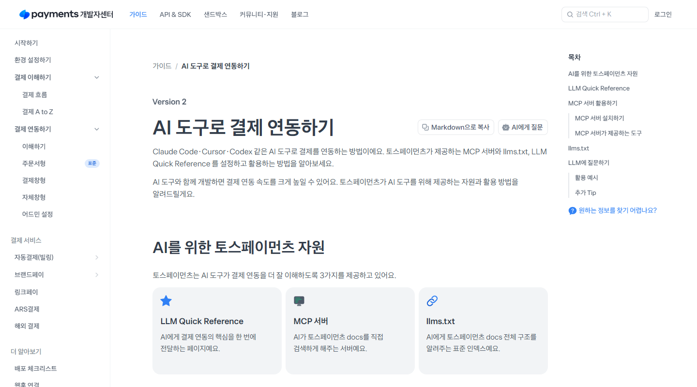

차용

AI용 자원을 이름 + 한 줄 역할로 나눈 카드(LLM Quick Reference · MCP 서버 · llms.txt) → 기둥 카드 2장. 'Markdown으로 복사' 버튼. 'AI가 docs를 직접 검색' 화법

버림

'연동 속도를 크게 높일 수 있어요'(근거 없는 속도 주장), 카드 3장(우리는 2기둥으로 묶음), 회색 둥근 면

REF-030 · Resend MCP Server · 부분 차용

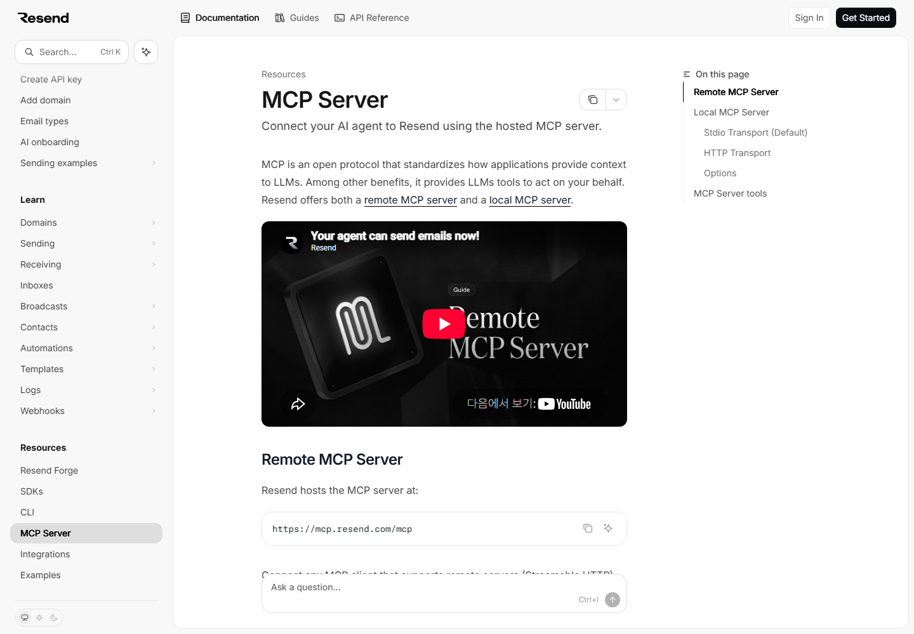

차용

MCP 연결 주소 한 줄 + 도구 이름 탭 → 기둥 ②의 '연결 주소 자리' 칩과 지원 도구 칩(메인은 칩, 상세는 AI 가이드 페이지로)

버림

로컬·원격 설치 설명, 도구 8종 탭(메인에 과함)

REF-029 · Supabase MCP 연결 패널 · 탈락(메인) / AI 가이드 서브 페이지 후보

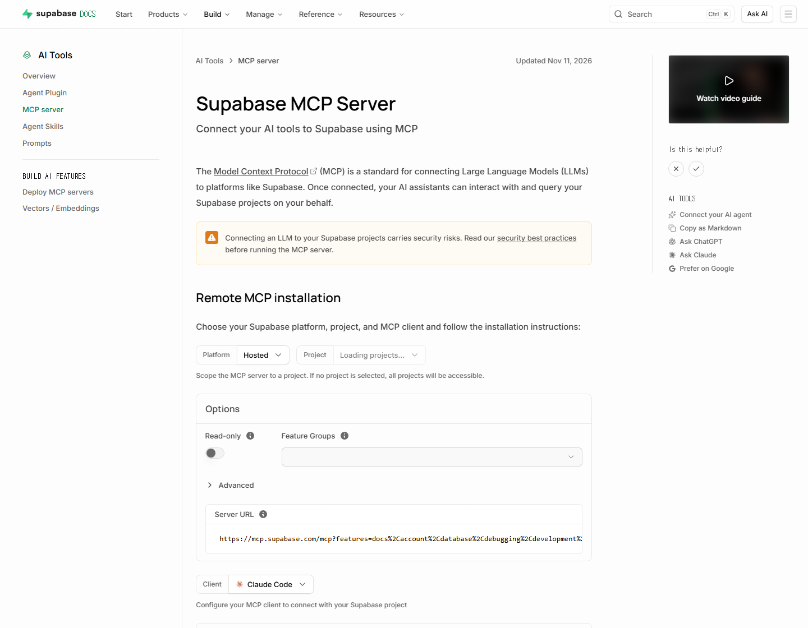

차용

없음(메인). 서브 'AI 도구 연결 방법' 페이지에서 도구 선택 → 주소 → 설정 JSON 순서와 보안 주의 상자를 쓸 만함

버림

옵션·기능 그룹 선택 패널(메인 밀도 초과)

점수(목적·스캔·콘텐츠·확장·비용): REF-027 5·4·3·4·4 · REF-028 4·5·4·4·5 · REF-030 3·4·3·4·4 · REF-029 2·3·2·3·2. 팝빌 개발자센터는 headless 캡처에서 첫 화면이 그려지지 않아 보류, 볼타 docs 첫 페이지는 AI 안내가 아니어서 제외(2026-11-19).

아래부터는 안 C 기록입니다. 2026-11-19 PM 위임으로 C를 기본으로 바꿨습니다. A(2026-11-18 권고)와 B는 남겼습니다. 채택은 사용자가 정합니다. C = REF-019 + REF-021. 아래 '미확정 칸 메모'부터 '카피 검토'까지는 A 기준 기록입니다.

#### 결정 필요

- 02-2 레이아웃 안 (디자이너 권고 C)
- H2 · 본문 · 단계 문구 (제안) — 카피 검수
- 코드 자리에 넣을 실제 샘플(전자세금계산서 발행 1건, 9종) — 개발팀
- '17분' 각주의 업무시간 정의(평일 주간으로 적음) — 운영팀 확인
- 테스트 포인트는 가입하면 1만 점이 자동 지급됩니다(사용자 확인 2026-11-19).

1차 재작업 · PM 조건부 채택 반영 (2026-11-19)

- H2 → '인증키를 기다리지 않고, 바로 개발을 시작합니다'(592 폭 2줄). 본문 → '테스트 인증키로 개발하고, 준비되면 운영 인증키로 바꿔 바로 씁니다.' (A · B · C 같은 문장)
- ~~⚠ 차단SOAP/REST 연동 방식 표기 개발팀 확인. 화면에는 머리말 본문 아래 회색 상자 '연동 방식 표기 자리'(H24, Caption)를 뒀습니다.~~ → **사실 해소 (2026-11-19)**: 칩 'REST · JSON · SOAP 지원'(H24, Caption 700)으로 바꿀 예정 — 반영로 회색 상자가 아직 남아 있음. 개발자 페르소나의 1순위 이탈 요인입니다.
- 언어 탭: Java · Node.js · Python · .NET · PHP │ 레거시: ASP · Delphi · PowerBuilder · Visual Basic. 세로 2px 선 + Caption 라벨 '레거시'로 묶되 숨기지 않습니다. 기본 탭 Java. 근거: 에이전시 대표에게는 레거시 탭이 가장 설득력 있는 요소, Node 리드에게는 'SOAP 레거시' 의심 신호였음. 탭 좌우 여백 12 → 10.
- 코드 블록 해부: 위 요청 영역('요청 · 전자세금계산서 발행 1건' + 메서드 호출 6줄 자리, 2줄째에 인증키 마스킹 표시) → 점선 → 아래 응답 영역('응답' + 결과 코드 4줄 자리) · 오른쪽 위 복사 버튼. 줄은 회색 막대(높이 10, 줄 간격 18)로만 그리고 가짜 메서드명·값은 쓰지 않습니다.
- 단계 1 제목 '파트너 등록하면 인증키 자동 발급' · 단계 2 설명 '가입하면 자동 지급되는 테스트 포인트 1만 점으로…'(사용자 확인 2026-11-19) · 단계 3 설명 '별도 신청 없이 운영으로 전환합니다. 조회 상품은 운영 환경에서 한 번 더 신청합니다.'(432 폭 2줄 확인).
- 지원 줄 각주 → '평일 09:00\~18:00 접수 연동 문의 기준, 2026년 11월 10일 집계'. 출처(PM 원자료 확인): 2. Area of Responsibility/바로빌 개발자센터/연동문의 분석/인사이트/업무시간 외 문의는 반나절을 기다린다.md
- 높이 816 → 856(H2 2줄로 머리말 80 → 120). 아래 '안 C 상세'의 머리말·높이 치수보다 이 항목이 우선합니다.

안 C 상세 · 치수 · 권고 (2026-11-19)

- **왜 바꿨나** — A의 H2는 사용 설명서 문장이고, 단계 카드 세 장의 제목(가입 · 파트너 등록 / 테스트 인증키로 개발 / 운영 전환)은 누구나 아는 절차라 '막힘없다'는 증거가 되지 못합니다. 증거는 '신청 대기 없음 · 운영과 같은 테스트 환경 · 주소만 바꾸는 전환 · 샘플 9종 · 1:1 지원'입니다. C는 H2를 주장으로 바꾸고, 단계 제목 자체에 이 증거를 넣었습니다. 코드 블록 탭은 실제 제공 샘플 9종을 그대로 나열해 레거시 스택(Delphi·PowerBuilder·Visual Basic·ASP) 검토자가 자기 언어를 바로 찾게 합니다.
- **구성** 섹션 1440×816, 상하 96. 머리말 1216×80(02-1과 같은 좌우 분할): 좌 6열 눈썹 → 16 → H2 32/40 1줄(13자) / 우 8\~12열 본문 Title 18/28 2줄 아래 정렬. → 48 → 본문 줄: 좌 7열 코드 블록 696×360(탭 48: Small 14 600, 좌우 12, 9개 합 약 660 · 코드 14/22 약 12줄) + 우 5열 488 세로 3단계(번호 원 40 + 16 + 텍스트 432: 제목 Title 18/28 700 1줄, 설명 Body 16/24 최대 2줄, 단계 사이 32, 번호 사이 세로선 1px). → 48 → 하단 줄 1216×64(위 1px 선): 지원 한 줄 Small 14/20 + 각주 번호 / 링크 'API 개발 문서 보기 →'. → 8 → 각주 1줄 16.
- 높이 합: 96 + 80 + 48 + 360 + 48 + 64 + 8 + 16 + 96 = 816 (A 964 · 이전 A 920).
- **줄일 때 지킬 것**: ① 코드 블록이 섹션에서 가장 큰 덩어리 ② 탭 9개를 줄이지 않기(레거시 언어가 이 섹션의 차별점) ③ 단계 제목에 증거(자동 발급 · 같은 환경 · 주소만 변경)를 남기기 ④ 지원·17분은 단계보다 약하게.

|  | C | A | B |
| --- | --- | --- | --- |
| 목적 | 5 | 4 | 4 |
| 스캔 | 4 | 4 | 3 |
| 콘텐츠 | 4 | 3 | 4 |
| 확장 | 4 | 4 | 4 |
| 비용 | 4 | 4 | 3 |

- 점수 근거 — C 목적 5: 신청 대기·전환 절차·언어 지원 질문에 한 화면에서 답함 · 콘텐츠 4: 사실은 모두 근거가 있으나 코드는 실제 샘플을 받아야 채워짐 · 비용 4: 실화면 캡처 없이 코드 텍스트만 필요. A 콘텐츠 3: 단계 설명 일부가 제목을 되풀이하고 고객 인용 게재 동의가 미확정.
- **권고 · C** (신뢰도: 추정).
- **C가 A보다 못할 수 있는 이유**: ① 단계 카드 세 장(A)이 세로 목록보다 '3단계면 끝'을 더 빨리 보여 줍니다. 세로 단계는 코드 옆에 붙어 덜 눈에 띕니다. ② 고객 인용(「빠르게 도입하고 운영전환 할 수 있는 서비스.」)을 뺐습니다. 동의가 나오면 A의 사회적 증거가 더 셉니다. ③ 코드 자리가 실제 샘플로 채워지지 않으면 섹션 가장 큰 면적이 빈 상자입니다.
- **회의적인 CTO가 떠날 수 있는 지점**: 탭에 REST가 없습니다. 근거 문서의 샘플 목록에 REST·SOAP 표기가 없어 넣지 않았는데, 현대 스택 검토자는 'SOAP 전용인가?'로 읽고 떠날 수 있습니다. 연동 방식(REST/SOAP) 표기를 개발팀에 확인해 탭 앞에 넣는 것이 가장 큰 보강입니다 (2026-11-19 사실 해소: REST · JSON 리뉴얼과 함께 제공 — 머리말 칩 'REST · JSON · SOAP 지원'으로 표기 예정). 또 '17분'은 업무시간 기준이라 야간 문의(26%)는 반나절을 기다린다는 사실을 아는 사람에게는 약합니다.

#### 카피 전후 (제안)

- H2: '테스트 인증키로 개발하고, 준비되면 직접 운영으로 전환합니다' → '기다림 없이 시작하는 연동' (PM 후보) (제안). 이전 H2는 본문으로 내림(마침표 추가) — A · B · C 모두.
- 단계(C 신규): ① 가입하면 인증키 자동 발급 ② 운영과 같은 테스트 환경 ③ 인증키와 API 주소만 바꾸면 운영 전환 + 설명 (제안서 15·16·40쪽) (제안)
- 지원 한 줄(C 신규): '막히면 사내 개발팀 전담 엔지니어가 1:1로 답합니다 · 업무시간 문의 답변 중앙값 17분¹' (제안)
- A·B STEP 1 설명: '가입·파트너 등록 무료'(제목 되풀이) → '가입과 파트너 등록은 무료입니다' (제안)
- B 본문 빈칸 → 이전 H2 문장으로 채움. B H2는 새 H2(13자)라 488 폭 1줄이 되어 3줄 문제가 풀립니다. B 높이는 752 그대로(본문 1줄 → 2줄, H2 3줄 → 1줄로 상쇄되고 남는 높이는 시각물 560이 정함).

#### 360 폭에서

- 머리말 1열 → 세로 3단계 → 코드 블록 328×280(탭 가로 스크롤) → 지원 한 줄 → 링크. 단계가 코드보다 위로 옵니다(작은 화면에서는 절차가 먼저).

참고 레퍼런스 · 안 C (5)

REF-019 · Resend 언어 탭 코드 · 채택 근거


차용

언어 목록을 숨기지 않고 한 줄에 다 보여 주는 탭 + 복사 버튼이 있는 코드 블록

버림

가운데 정렬 큰 아이콘 칩 줄(우리 9종 중 Delphi·PowerBuilder는 아이콘이 없음), 프레임워크 2단 탭, 검정 바탕

REF-021 · Stripe 연동 경로 3열 · 부분 차용

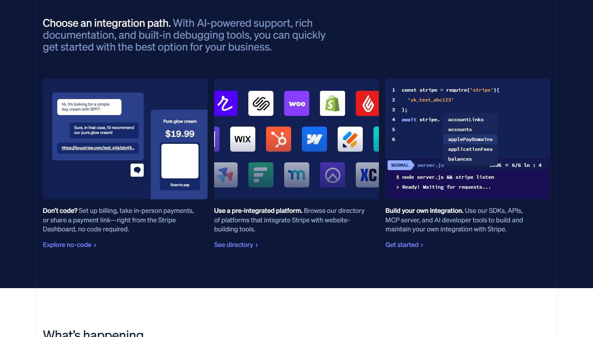

차용

문장형 제목(굵은 주장 + 흐린 설명)과 오른쪽 터미널 칸의 "실제로 돌아가는 코드" 인상

버림

노코드·플랫폼 경로 카드(우리에게 해당 없음), 로고 격자

REF-020 · Resend 테스트 모드 카드 · 탈락

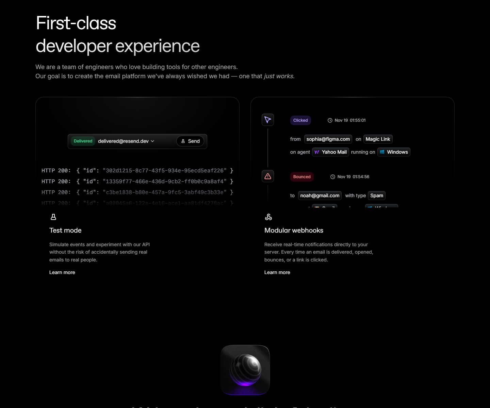

차용

"실제 발송 위험 없이 시험" 메시지 — 단계 2 문장에 반영

버림

시각물 카드 2장(실화면 필요, 가짜 응답 값)

REF-022 · Plaid API 키 코드 블록 · 탈락

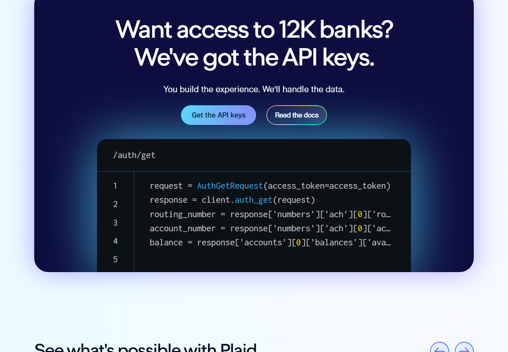

차용

없음(제목 → 버튼 2개 → 코드의 세로 흐름은 C와 다른 방향)

버림

가운데 정렬 큰 제목, 그라데이션 버튼, 둥근 큰 면

REF-023 · Clerk SDK 격자 · 탈락

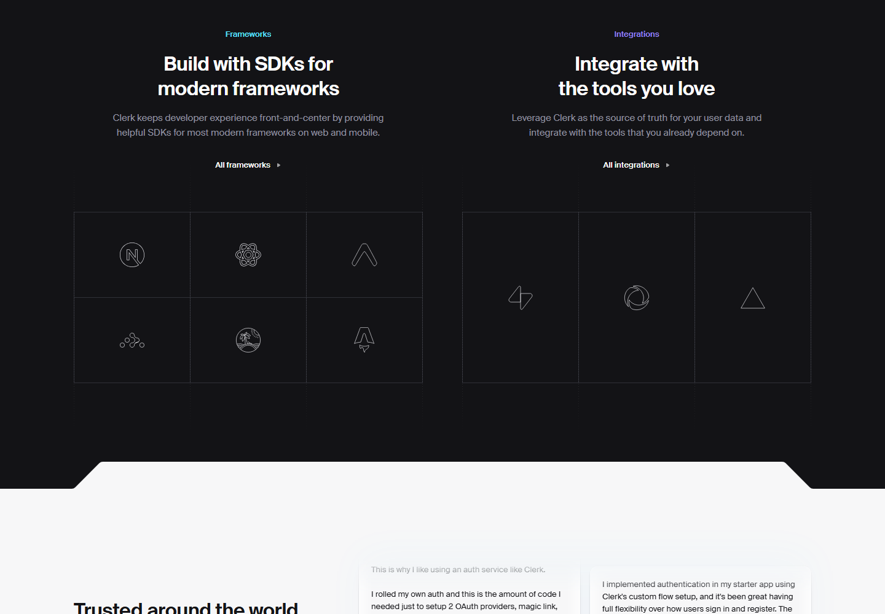

차용

없음

버림

프레임워크 로고 격자(레거시 언어 아이콘 없음, 글자 없는 아이콘은 스캔이 느림)

점수: REF-019 5·5·4·4·3 · REF-021 3·4·2·3·2 · REF-020 4·4·3·3·2 · REF-022 3·5·3·3·3 · REF-023 3·3·3·4·3 · REF-010 4·3·4·4·3.

#### 미확정 칸 메모

- 인용 아래 출처 표기 방식 — 응답자별 공개 동의(실명 3 · 익명 1 · 내부 참고만 3) 확인 후 결정

#### 섹션 의도

- 현행 "단 하루만에" 3단계를 **실제 절차**로 바꿉니다(P4). 고객이 직접 고른 강점(빠른 테스트)을 숫자로 받칩니다.

#### 결정 필요

- 예시 코드 언어 탭 범위(현행 샘플 9종 기준)
- 레이아웃 안 (권고 A 현행) — B는 접힌 단계가 덜 읽히고 코드 블록·17분 스탯·인용이 빠짐

#### 레이아웃 의도

- 절차(3단계) → 실물(코드) → 증거(숫자·인용) 순서입니다.
- 단계 카드는 384×184로 02 머리말 A안 카드와 같은 폭입니다.
- 코드 블록(696×320)이 섹션에서 가장 큰 덩어리입니다. 높이는 고정입니다.

B안 상세 · 포트원 방식

- 구성: 좌 7열 696×560 시각물(단계를 열면 바뀜) + 우 5열 488(눈썹 → H2 → 본문 1줄 → 아코디언 3단계 → 링크). 섹션 752 = 96 + 560 + 96.
- 아코디언: 위아래 1px 선. 열린 단계 = 위 20 · 'STEP n' Caption mono 56 폭 + 타이틀 Title 18/28 700 · 오른쪽 − → 8 → 설명 Body 16/24(번호 폭만큼 들여씀) · 아래 20. 닫힌 단계 = 행 64, 글자 연한 색, 오른쪽 +. 1단계가 기본 열림이고, 와이어프레임에서는 닫힌 단계도 정적 그림으로 그렸습니다.
- 시각물: 1 가입·파트너 등록 화면 → 2 콘솔 인증키 발급 화면 + 테스트 요청 코드 → 3 운영 전환 화면. 실화면 캡처만 쓰고 가짜 값을 넣지 않습니다.
- A와 비교: B는 첫 화면이 단순하지만 2·3단계 설명이 접혀 덜 읽히고, A의 코드 블록·'17분' 스탯·인용이 들어갈 자리가 없습니다(시각물 2단계에 코드를 넣으면 일부 대신함). 점수 4·3·4·4·3(REF-010).
- 360 폭: 텍스트 → 아코디언(행 56) → 열린 단계 시각물 328×264를 해당 단계 아래에 펼침.

REF-010 · 포트원 카드 · B안


차용

좌 큰 시각물 + 우 번호 눈썹·제목·설명 + 아코디언, 열린 단계에 맞춰 시각물 교체

버림

둥근 큰 면·흐린 배경, 화면 속 가짜 키 값(마스킹·실화면만)

- 카피 검토 필요B 본문 1줄(488 폭 약 30자)이 없어 미확정으로 두었습니다. H2(30자)는 488 폭에서 3줄(120)입니다. 포트원처럼 2줄로 하려면 줄당 약 15자로 줄여야 합니다. 단계 문구는 A의 STEP 1\~3을 그대로 썼습니다.

근거

- 설문 소요기간: 1주 이내 5/7 · 2주 1/7 · 1개월 1/7 · **하루 이내 0/7** → '하루' 표현을 쓰지 않습니다
- 확신 순간: 「타사대비 빠르게 테스트가 가능했음.」
- 답변 시간: 업무시간 중앙값 17분, 전체 중앙값 28분, 업무시간 외 문의(26%)는 중앙값 12.4시간 → 사람 없이 시작할 수 있는 동선(문서·테스트 키)이 함께 보여야 합니다
- 설문 시작 방식: 상담 없이 문서·예제로 직접 2/7
- 스탯 "7곳 중 5곳 · 1주 이내 연동 완료"는 설문 표본 7명 수치라 PM-D-10에 따라 고객 화면에서 뺐습니다. 스탯 칸은 2칸에서 1칸으로 줄였습니다.

설문 응답 집계 05·10·11·19 · 업무시간 외 문의는 반나절을 기다린다

레이아웃 상세 · 줄일 때 지킬 것

- "정말 승인 대기가 없나?"에 먼저 절차로 답하고, 개발자에게는 코드를 바로 보여 줍니다.
- 거터 32 가운데의 › 표시로 단계 순서를 보여 줍니다. 번호가 있으니 화살표 장식은 더 키우지 않습니다.
- 코드 블록에는 탭 48 + 코드 10줄(14/22) 정도가 들어갑니다. 실제 발행 요청 예시가 이 높이를 넘으면 접기(더 보기)를 씁니다.
- 오른쪽 5열은 스탯 1장 + 인용입니다. 스탯이 1장이라 488 폭 그대로 씁니다. 다른 스탯이 정해지면 228×152 두 장으로 나눕니다.
- 줄일 때 지킬 것: ① 단계 카드 3장 같은 높이 ② 코드 블록이 화면에서 가장 큰 덩어리 ③ 인용은 스탯보다 약하게.

360 폭에서

- 단계는 세로 타임라인으로 바뀝니다. 왼쪽에 번호와 세로선, 오른쪽에 타이틀과 설명을 두고, 단계 사이는 24입니다. › 표시는 뺍니다.
- 코드 블록은 328×240입니다. 언어 탭은 가로 스크롤로 넘기고, 긴 줄은 줄바꿈 대신 가로 스크롤합니다.
- 스탯 → 인용 → 링크 순서로 쌓습니다.

카피 검토 (3)

- 카피 검토 필요대체 스탯 미정 — 후보: 운영 전환 별도 신청·승인 없음
- 카피 검토 필요새 H2는 1216 폭 1줄(약 1,000px)이라 강제 줄바꿈을 뺐습니다. 섹션 높이 960 → 920.
- 카피 검토 필요STEP 1은 타이틀 "가입 · 파트너 등록"과 설명 "가입·파트너 등록 무료"가 같은 말을 되풀이합니다. 설명을 "무료"만 남기거나 타이틀을 바꿀지 정해야 합니다.

반응형

- **xl 미만**: 컨셉 A판 인용 노드는 이미지 좌우 24 안쪽으로 좁힘.
- **lg 미만**: 머리말 H2와 설명을 위아래로, AI 카드 → 작은 카드 2장 → 사실 띠 1열 → 지원 · 링크 세로. 코드 탭은 가로 스크롤, 단계 카드 1열(화살표 숨김), B 시각물 높이 320, 컨셉 A판 이미지 4:3.
- **md 미만 순서**: 눈썹 · H2 · 서브 → 항목(아코디언 · 근거 칸 · 세로 단계) → 이미지 · 그래픽(4:3 · 최대 높이 240, 이미지 위 노드는 이미지 바로 아래에 붙여 함께) → CTA · 근거 줄 · 각주. DOM 순서는 그대로 두고 보이는 순서만 바꿈. md 이상은 그대로. 안 D는 기둥 글 3개 → AI 예시 창 → 사실 띠 → 지원 줄.
- **md 미만**: AI 예시 창의 작업 줄 · 결과 줄은 줄바꿈 허용(코드 자리 막대 숨김). 컨셉 A판 인용 노드는 이미지 아래로 내려 흐름 배치. B판 근거 칸 1열.

C03 비용 경쟁력

H2월 기본료 없이, 필요한 만큼만 냅니다

B월 비용은 처리한 건수와 등록한 계좌·카드 수로 정해집니다.

**0원**연동비 · 도입비 · 유지보수비 · 기술지원비서비스 이용료는 아래 방식대로 냅니다

H3처리한 건수만큼

전자세금계산서 · 현금영수증 발행 · 사업자등록상태조회 · 문자 전송 · 카카오 메시지 전송 · 팩스 전송(장당)

H3등록한 수만큼 매월

홈택스 매입매출조회 · 계좌 통합 조회(계좌당) · 카드 통합 조회(카드당). 신청한 달은 무료입니다.

**바로빌**

**A사**

**B사**

비교 조건: 홈택스 매입매출조회 1개 + 계좌 통합 조회 2계좌, 월 요금, 부가세 별도. 조회 주기 등 세부 조건은 회사마다 다릅니다.

파트너 등록 후 콘솔에서 단가를 확인하실 수 있습니다.

요금 안내 보기테스트 시작하기

C03 비용 경쟁력

H2월 기본료 없이, 필요한 만큼만

B월 비용은 처리한 건수와 등록한 계좌·카드 수로 정해집니다.

0원월 기본료

무료가입·파트너 등록

무료조회 상품 신청한 달

H3발행·전송 건수만큼

전자세금계산서 · 현금영수증 발행 · 팩스 전송(장당) · 사업자등록상태조회\
문자 전송 · 카카오 메시지 전송

H3등록한 수만큼 매월

홈택스 매입매출조회 · 계좌 통합 조회(계좌당) · 카드 통합 조회(카드당)\
신청한 달은 무료

**바로빌**

**A사**

**B사**

비교 조건: 홈택스 매입매출조회 1개 + 계좌 통합 조회 2계좌, 월 요금, 부가세 별도. 조회 주기 등 세부 조건은 회사마다 다릅니다.

파트너 등록 후 콘솔에서 단가를 확인하실 수 있습니다.

요금 안내 보기테스트 시작하기

C03 비용 경쟁력

H2월 기본료 없이, 필요한 만큼만

B월 비용은 처리한 건수와 등록한 계좌·카드 수로 정해집니다.

월 비용 = 발행·전송 건수 + 등록한 계좌·카드 수

**발행·전송 건수만큼**

전자세금계산서 · 현금영수증 발행 · 팩스 전송(장당) · 사업자등록상태조회 · 문자 전송 · 카카오 메시지 전송

**등록한 수만큼 매월**

홈택스 매입매출조회 · 계좌 통합 조회(계좌당) · 카드 통합 조회(카드당)\
신청한 달은 무료

0원월 기본료

무료가입·파트너 등록\
조회 상품 신청한 달

**바로빌**

**A사**

**B사**

비교 조건: 홈택스 매입매출조회 1개 + 계좌 통합 조회 2계좌, 월 요금, 부가세 별도. 조회 주기 등 세부 조건은 회사마다 다릅니다.

파트너 등록 후 콘솔에서 단가를 확인하실 수 있습니다.

요금 안내 보기테스트 시작하기

**바로빌을 선택한 이유** **1**단가**2**개발 환경**3**서비스 범위 2026년 10월 연동 경험 설문

C03 비용 경쟁력

H2도입 비용은 ZERO\
운영은 경제적으로

B합리적인 이용 단가는 물론, 별도의 도입비·유지보수비·기술지원비도 없습니다. 비용의 차이를 경험하세요.

**월 기본료 0원***−*

사용하지 않아도 내야하는 월 기본료는 없습니다.

**연동비 · 도입비 · 유지보수비 · 기술지원비 0원***+*

연동부터 기술 지원까지, API 사용료 외에 추가로 드는 비용은 없습니다.

**필요한 만큼만 내는 종량제***+*

업무량이 늘거나 줄어도, 처리한 건수와 등록한 계좌·카드 수에 맞춰 비용이 정해집니다.

파트너 등록 후 콘솔에서 단가를 확인할 수 있습니다.

요금 안내 보기 →

02-3 비용 경쟁력 · S1 요금 구조

#### 레이아웃 안 · 누르면 화면이 바뀜

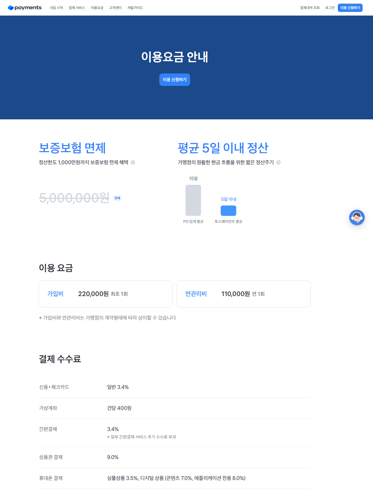⤢

C · 주장 + 0원 띠 + 과금 | 비교후보(권고)

⤢

A · 0원 카드 + 과금 + 긴 막대 (이전 권고)후보

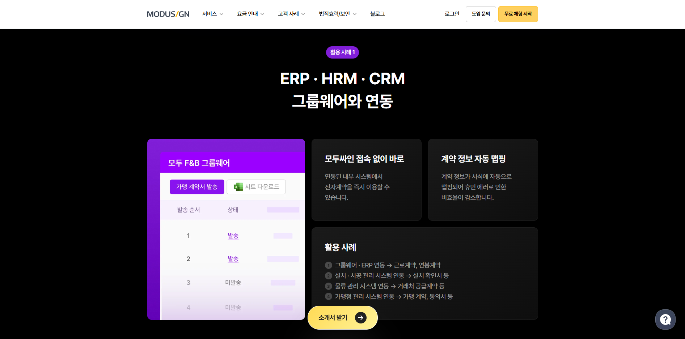⤢

B · 벤토(모두싸인)후보

⤢

과금 카드 패널 + 아코디언현재 안

디자이너 주석 · 컨셉 공통

#### 1 기획 의도

목적

고객이 바로빌을 선택하는 이유 1위가 단가일만큼, 바로빌은 합리적인 단가를 제공한다는 것을 보여준다.\
단, 단순히 "싸다"라는 인상은 피하고 합리성, 투명성을 강조합니다.

주고 싶은 인상

합리성, 투명성

목적 달성을 위한 시각장치

- 왼쪽 패널의 설문 결과 카드(html로 표현)
  - 1\~3위 막대, 숫자 없이 길이만
  - 비율은 6:3:1
  - 1위 단가는 굵게, 진하게
  - 조사 출처 필수 표기
- 파트너 등록 후 콘솔에서 단가를 확인할 수 있다는 안내와 바로가기
  - '요금 안내 보기 →'를 누르면 요금 안내 페이지로 이동

##### 시각적 우선순위

1. H2 Headline copy
2. 설문 결과 카드(1위 단가)
3. 펼친 아코디언 항목(기본 첫 항목)

##### Next Trigger

- '요금 안내 보기 →' → 요금 안내 페이지

#### 2 동작 명세

- **아코디언**
  - 컴포넌트: Nuxt UI Accordion을 적용 ([ui.nuxt.com/docs/components/accordion](https://ui.nuxt.com/docs/components/accordion))
  - 한 번에 하나만 펼침, 기본은 첫 항목
- **반응형**
  - 1280 미만
    - 설문 카드는 패널 가운데 유지
  - 768 미만
    - 순서: 눈썹·H2·서브 → 아코디언 → 설문 결과 패널 → 단가 안내 · 링크 (02-1 · 02-2와 같음)
    - 아코디언 펼친 문구 text-sm(14/20)

컨셉판 상세 · A / B

- **컨셉 A판** 구성: 왼쪽 7열 이미지 자리(어떤 이미지를 넣을지 미정) + 이미지 왼쪽 아래 설문 노드 1개('바로빌을 선택한 이유' 1\~3위 막대 · 숫자 없이 길이만 · 출처 한 줄(조사 시점만), 누르는 곳 없음) + 오른쪽 눈썹 · H2 · 서브 · 아코디언 · 단가 안내 한 줄 · '요금 안내 보기 →'. 02-1 A판과 같은 배치, 패널 안 도식은 따르지 않음.
- 컨셉 A판 아코디언: 항목을 누르면 그 항목만 펼쳐집니다. 기본은 첫 항목. '요금 안내 보기 →'는 요금 안내(#p-pricing)로 이동합니다.
- 설문 막대는 숫자 없이 길이 비율로만 보여 줍니다. 경쟁사 비교 막대는 02 WHY 카드에만 둡니다.
- **컨셉 B판** 구성: 머리말 + 점선 칸 둘(① 0원 · 월 기본료 · 연동비 · 도입비 · 유지보수비 · 기술지원비 + 설명 한 줄 ② 바로빌을 선택한 이유 1\~3위 막대 + 출처 한 줄) + 단가 안내 줄. 칸은 누르는 곳이 없습니다(정적).
- 360 폭: A판은 눈썹 → 제목 → 서브 → 이미지(설문 노드 포함) → 아코디언 → 단가 안내 순서로 쌓입니다. B판은 점선 칸 둘이 세로로 쌓입니다.
- 치수: A판 7:5 · 이미지 696×712 · 설문 노드 440 · 섹션 952. B판 점선 칸 592×자동 × 2 · 섹션 약 728.
- 설문 근거: 연동 경험 설문 09번 선택 기준(복수 선택, 응답 7명) — 단가 6 · 개발 환경 3 · 서비스 범위 1(선택 총 10). 막대 6:3:1. 화면에는 순위와 조사 시점만, 응답 수·복수 선택 표기는 빼기로(사용자 결정 2026-11-20). B판 근거 칸 3개(처리한 건수만큼 · 등록한 수만큼 매월 · 신청한 달은 무료)와 경쟁사 비교 막대는 이날 삭제.

이력: 2026-11-20 사용자 지시 '02-1·02-2·02-3 스타일 통일' — 02-3을 컨셉 공통(C안)에서 컨셉 섹션으로 바꾸고 CA · CB를 추가함. C · A · B 안은 그대로. 아코디언 '건당 요금 · 등록 수별 월정액'은 PM 지시의 '쓴 만큼 과금(조회 상품은 월정액이라 필요한 만큼)'을 화면 문구로 옮긴 것(제안). 비교 막대는 PM-D-16(금액 없음 · 익명 · 길이 비율만) 유지.

이력: 2026-11-20 사용자 피드백(정보 전달 섹션은 단순 카드로)에 따라 컨셉판을 걷고 공통으로 둠. 사진으로 금액 차이를 보여 줄 수 없고 비교 막대는 원래 공통 컴포넌트.

2026-11-19 PM 위임으로 C를 기본으로 바꿨습니다. A(2026-11-18 권고)와 B는 남겼습니다. 채택은 사용자가 정합니다. C = REF-024 + REF-025. 아래 '화면 메모'부터는 A 기준 기록입니다.

#### 결정 필요

- 02-3 레이아웃 안 (디자이너 권고 C)
- 0원 네 칸(연동비 · 도입비 · 유지비 · 기술지원비)의 전 상품 적용 — 근거는 제안서 11쪽·각 상품 쪽. 2026-11-18 카피 검수는 '운영팀 확인 전 월 기본료만'이었으므로 운영팀 최종 확인 권장
- 비교 막대 역산 위험(공개 요금 × 길이 비율) — 법무 확인(기존)
- 홈택스 매입매출조회 과금 단위 — 확인 전이라 단위 표기 없이 이름만 둠(운영팀)
- 전자문서 과금 단위 — 확인 전이라 과금 목록에서 뺌(운영팀)

1차 재작업 · PM 조건부 채택 반영 (2026-11-19)

- H2 → '월 기본료 없이, 필요한 만큼만 냅니다'. 본문 → '월 비용은 처리한 건수와 등록한 홈택스·계좌·카드 수로 정해집니다.' (A · B · C 같은 문장)
- 0원 띠: 네 칸(1216×120)을 세 페르소나 모두 '같은 말 네 번 · 가장 촌스러움'으로 꼽아 한 줄 띠 1216×64로 줄였습니다. 왼쪽 '0원'(H3 22/32 800) → 16 → '연동비 · 도입비 · 유지보수비 · 기술지원비'(Body 16/24) → 오른쪽 끝 Caption '서비스 이용료는 아래 방식대로 냅니다'. '유지비' → '유지보수비'(월 과금과 혼동 방지, 요금 페이지와 맞춤). 확인0원 네 항목 전 상품 적용 운영팀 확인(제안서 11쪽 총론 근거).
- 과금 카드 H3 1 → '처리한 건수만큼'.
- 홈택스 매입매출조회: 과금 단위 미확정이라 카드 목록은 이름만, 비교 조건은 '1개'로 맞췄습니다(A · B · C).
- CTA 문구 → '파트너 등록 후 콘솔에서 단가를 확인할 수 있습니다.' (A · B · C)
- 비교 막대는 그대로 둡니다. 사용자 결정페르소나 3명 모두 금액 없는 익명 막대를 불신 → 단가 공개 or 막대 삭제를 사용자 결정 대기.
- 높이 888 → 832(0원 띠 120 → 64). 아래 '안 C 상세'의 0원 띠 치수·높이보다 이 항목이 우선합니다.

안 C 상세 · 치수 · 권고 (2026-11-19)

- **왜 바꿨나** — A의 H2는 요금 약관 문장이고, 0원 카드 세 장('0원 월 기본료 · 무료 가입 · 무료 신청한 달')은 서로 다른 성격(요금·가입·조회 특례)이 같은 무게로 섞여 있습니다. 검토자의 질문은 '숨은 비용이 있나, 월 비용은 무엇으로 정해지나, 다른 곳보다 비싼가'입니다. C는 ① H2로 '월 기본료 없음'을 주장하고 ② 0원 네 칸으로 숨은 비용(연동비 · 도입비 · 유지비 · 기술지원비)을 한 줄에 지우고 ③ 과금 두 갈래와 비교 막대를 같은 높이의 두 카드로 나란히 둡니다. 토스페이먼츠 요금 페이지(REF-024)처럼 '면제·0원 → 업계 대비 막대 → 요금 표' 순서입니다.
- **구성** 섹션 1440×888, 상하 96. 머리말 1216×80(02-1·02-2와 같은 좌우 분할). → 48 → 0원 띠 1216×120: 3열씩 280 네 칸, 위 1px 진한 선 · 아래 1px 선, 칸 사이 세로선. 칸 안 위 24 → 숫자 H2 32/40 800 → 8 → 라벨 Body 16/24 → 아래 24. → 48 → 카드 줄 1216×304: 좌 6열 과금 카드 592×304(안쪽 32: H3 22/32 → 8 → Body 16/24 최대 3줄 → 24 · 1px 선 · 24 → H3 → 8 → Body 최대 3줄) + 우 6열 비교 카드 592×304(안쪽 32: H3 → 24 → 막대 3행(이름 72 + 막대, 행 32, 사이 16) → 24 → 비교 조건 Caption 12/16 최대 3줄). → 48 → CTA 줄 48(문구 Title 18/28 + 외곽선 버튼 2개).
- 높이 합: 96 + 80 + 48 + 120 + 48 + 304 + 48 + 48 + 96 = 888 (A 1164 · 이전 A 1120).
- 막대: B사 416 기준, A사 238, 바로빌 43\~50(연한 끝이 범위). 비율 3.6\~4.2 : 20 : 35. 금액 · 회사 이름 없음(PM-D-16).
- **줄일 때 지킬 것**: ① 0원 네 칸 같은 크기 ② 과금 카드와 비교 카드 같은 높이 ③ 막대 비율 ④ 채운 버튼 금지(주 CTA는 GNB).

|  | C | A | B |
| --- | --- | --- | --- |
| 목적 | 5 | 4 | 4 |
| 스캔 | 5 | 4 | 4 |
| 콘텐츠 | 4 | 3 | 3 |
| 확장 | 4 | 4 | 3 |
| 비용 | 5 | 5 | 3 |

- 점수 근거 — C 스캔 5: H2 → 0원 네 칸 → 두 카드로 세 질문이 위에서 아래로 한 번씩 풀림 · 콘텐츠 4: 0원 네 칸은 제안서 근거, 운영팀 최종 확인 남음 · 비용 5: 자산 없음. A 콘텐츠 3: 0원 카드 성격이 섞였고 '쓴 건수만큼'이 금지 워딩에 가까움.
- **권고 · C** (신뢰도: 추정).
- **C가 A보다 못할 수 있는 이유**: ① 비교 막대가 1216 → 592 카드 안(최대 416)으로 짧아져 차이가 덜 극적입니다(A는 최대 816). 비용 섹션에서 가장 강한 증거가 작아집니다. ② '조회 상품 신청한 달 무료'가 0원 띠에서 빠져 과금 카드 문장 안으로 들어갔습니다. ③ 0원 네 칸이 운영팀 확인에서 하나라도 빠지면 띠가 3칸이 되어 그리드가 바뀝니다(3칸이면 4열씩 384로 바꿈).
- **회의적인 CTO가 떠날 수 있는 지점**: 금액이 하나도 없습니다. '0원'과 막대는 있는데 실제 단가는 등록 뒤에만 보이므로 "결국 영업 상담형인가"로 읽힐 수 있습니다. CTA 문구 '등록하면 콘솔에서 단가를 바로 확인'이 이 의심을 푸는 유일한 장치라, 버튼보다 이 문장을 약하게 만들면 안 됩니다. 또 막대 비교 조건(조회 2종)이 자기 사용 구성(발행 위주)과 다르면 막대를 믿지 않습니다.

#### 카피 전후 (제안)

- H2: '월 비용은 발행 건수와 등록한 계좌·카드 수로 정해집니다' → '월 기본료 없이, 필요한 만큼만' (PM 후보) (제안). 이전 H2는 본문으로 내림 — A · B · C 모두. '쓴 만큼만'은 쓰지 않았습니다.
- 0원 띠(C 신규): 연동비 · 도입비 · 유지비 · 기술지원비 0원 (제안서 11쪽) (제안)
- 과금 카드 제목: '쓴 건수만큼' → '발행·전송 건수만큼' (A · B · C) (제안)
- B 도식 노드 빈칸 '월 비용 미확정' → '월 비용 = 발행·전송 건수 + 등록한 계좌·카드 수' (제안)
- 빈칸 정리: '전자문서 미확정' 삭제(과금 단위 근거 없음), '홈택스 매입매출조회 미확정' → 단위 없이 이름만.

#### 360 폭에서

- 0원 띠 2×2(156 폭, 숫자 24/32). 과금 카드 → 비교 카드(막대 최대 264, 이름은 막대 위 줄) 1열. CTA 문구 → 버튼 2개 세로(폭 328).

참고 레퍼런스 · 안 C (3)

REF-024 · 토스페이먼츠 이용요금 · 채택 근거


차용

큰 혜택 문장(면제·평균 5일) → 업계 평균 대비 막대 2개 → 요금 카드 2장의 순서. 우리 쪽 막대만 색으로 강조, 이름은 글자로

버림

파란 배너 히어로, 금액 표기(우리는 금액 비공개), 상담 아이콘

REF-025 · Vercel 요금 · 부분 차용

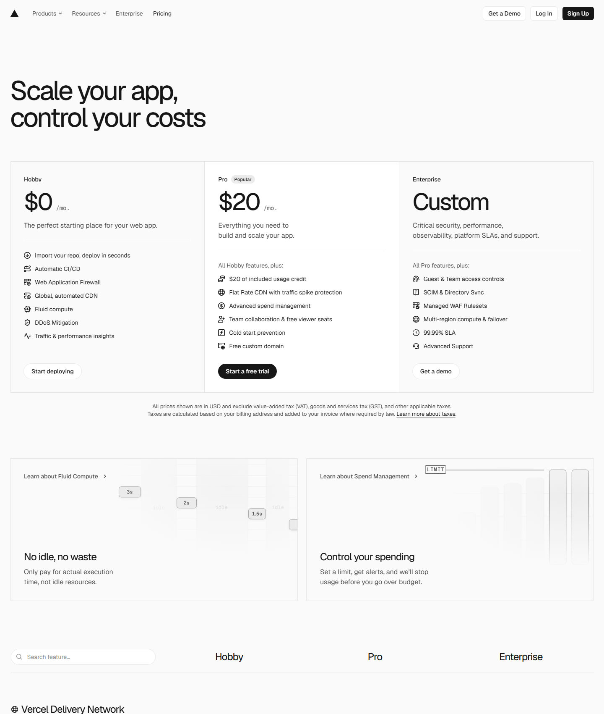

차용

요금표 아래 같은 높이 원칙 카드 2장(No idle / Control your spending) — 과금 카드 | 비교 카드 나란히

버림

플랜 3단 표(우리는 플랜 없음), 시각물 애니메이션

REF-026 · Resend 요금 · 탈락

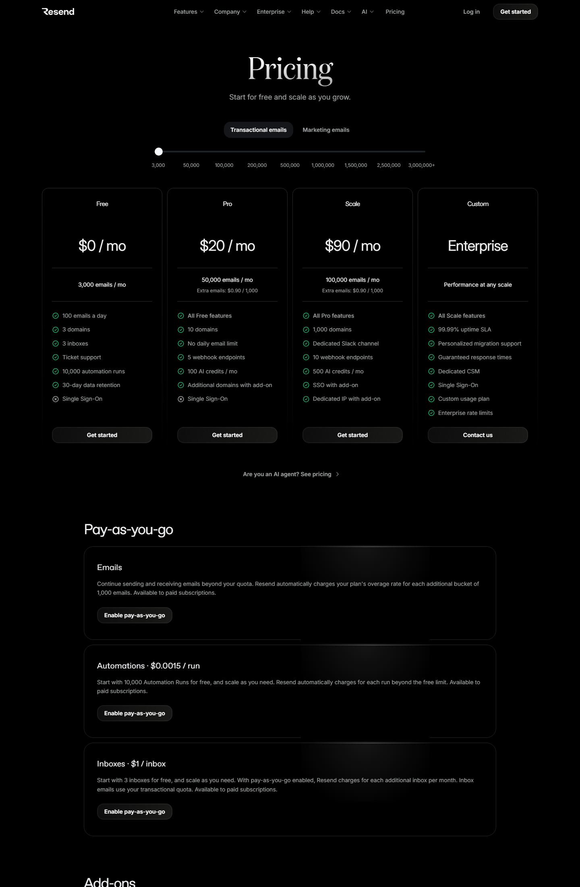

차용

없음(종량 항목을 카드 목록으로 세우는 것은 우리 과금 두 갈래보다 길어짐)

버림

플랜 4단, 금액, 사용량 슬라이더

점수: REF-024 5·5·4·4·4 · REF-025 4·4·3·4·3 · REF-026 2·3·2·3·4 · REF-009 4·4·3·3·3. Twilio 요금 페이지는 쿠키 동의 창이 화면을 가려 캡처하지 못했습니다.

#### 화면 메모

- 막대에는 금액을 쓰지 않습니다(PM-D-16). 경쟁사는 A사·B사로 씁니다.
- '요금 안내 보기'는 요금 안내 페이지, '테스트 시작하기'는 가입으로 이동합니다.

#### 레이아웃 의도

- 없는 것(0원·무료) → 드는 것(과금 방식) → 비교(막대) → 다음 행동 순서입니다.
- 막대는 길이 비율만 보여 줍니다. B사 = 816px 기준, A사 466, 바로빌 84\~98(범위는 연한 끝).
- 버튼 두 개는 외곽선입니다. 메인의 주 CTA보다 약해야 합니다.

B안 상세 · 모두싸인 방식

- 구성: 머리말(눈썹 → H2 1줄) → 48 → 벤토 1216×480: 좌 5열 488×480 과금 구조 도식 카드 + 우 7열 696(위 글 카드 332×224 두 장, 사이 32 · 아래 비교 카드 696×224) → 8 → 비교 조건 각주 → 48 → CTA 줄. 섹션 920.
- 도식 카드: 노드 '월 비용'에서 두 갈래(쓴 건수만큼 / 등록한 수만큼 매월)로 나뉨. 상품 목록은 A의 과금 카드 문구와 같음.
- 글 카드 2장: 0원 월 기본료 / 무료 가입·파트너 등록 · 조회 상품 신청한 달.
- 비교 카드는 PM-D-16을 지킵니다: 금액 없음, A사·B사, 길이 비율만(B사 560 · A사 320 · 바로빌 58\~67, A와 같은 비율). 바로빌만 진하게, 이름을 글자로 함께.
- A와 비교: B는 비용 근거 세 갈래가 한 화면 벤토에 모여 덜 길지만(1120 → 920), 비교 막대가 696 폭으로 짧아져 차이가 덜 극적입니다. 점수 4·4·3·3·3(REF-009).
- 360 폭: 도식 카드 → 글 카드 2장(2열 156) → 비교 카드(막대 최대 264) 순서로 1열.

REF-009 · 모두싸인 카드 · B안


차용

큰 시각물 카드 1 + 짧은 글 카드 2 + 넓은 목록 카드 1의 벤토 배치

버림

보라 면 강조, 떠 있는 자료 받기 버튼, 화면 속 가짜 표

- 카피 검토 필요도식 노드 '월 비용'은 새 문구라 미확정입니다. 나머지는 A 문구를 그대로 썼습니다.

레이아웃 상세 · 줄일 때 지킬 것

- 0원 카드는 02-1 스탯 카드와 같은 컴포넌트(152), 폭 384 세 장입니다. 숫자 자리에 '0원'·'무료'가 섞입니다.
- 비교 블록 264 = H3 32 + 16 + 막대 192(3행) + 8 + 각주 16. 막대 행이 4 → 3이 되어 240 → 192로 줄었습니다.
- 최대 막대(816)는 B사입니다.
- 막대는 바로빌만 진하게 칠하고 나머지는 같은 회색입니다. 이름을 글자로 함께 둬 색만으로 구분하지 않습니다.
- 줄일 때 지킬 것: ① 막대 길이 비율 ② 0원·무료 3장 같은 크기 ③ 채운 버튼 금지.
- 막대 비교를 빼면 섹션 높이 792 (비교 블록 264 + 위 간격 64 제거).

근거

- 비용·견적 문의 363/500건(72.6%) · 설문 도입 전 걱정 1위 '비용이 예상보다 커지지 않을까' 4/7
- 답변으로 확인된 조건: 팩스 초기 연동비·월 기본료·의무 사용기간 없음(3838) · 조회 서비스 월정액, 신청 달 무료, 다음 달 1일 과금(3401·3396) · 계좌는 계좌당, 카드는 카드당(3396·3398) · 사업자 상태조회 건당 차감(3431)
- 막대 비율 출처: 비교 조건 기준 바로빌 3.6\~4.2 : A사 20 : B사 35 (단위 만 원, 화면에는 쓰지 않음)

고객 문제와 미충족 니즈 §1·§4 · 설문 04 · 제안서 03 · PM-D-16

360 폭에서

- 0원·무료 3장은 3열을 유지합니다(약 98 폭, 숫자 24, 라벨 2줄).
- 과금 카드는 1열, 높이 자동. 막대는 이름을 막대 위 줄로 올리고 최대 폭 328(바로빌 약 34\~39px).
- CTA 줄은 문구 → 버튼 2개(전폭 328, 사이 8) 세로 순서.

카피 검토 (2)

- 카피 검토 필요0원 카드 라벨 '조회 상품 신청한 달'은 384 카드 안 1줄이지만, 360 폭(98)에서는 3줄로 넘칩니다.
- 카피 검토 필요2026-11-19: '전자문서'는 과금 단위가 정해질 때까지 과금 목록에서 뺐습니다. 정해지면 '발행·전송 건수만큼'이나 '등록한 수만큼 매월'에 넣습니다. 신규 두 상품(예금주 성명·실명 조회, 제3자세금계산서발급사실조회)은 과금 단위 미확정이라 과금 카드에 없습니다.

반응형

- **xl 미만**: 비교 막대는 1440 비율 그대로 칸 폭에 맞춰 줄어듦. 컨셉 A판 설문 노드는 이미지 안쪽으로 좁힘.
- **lg 미만**: 머리말 H2와 설명을 위아래로, 0원 띠는 문구 아래 줄바꿈, 과금 카드 → 비교 카드 1열, 벤토는 1열, 단가 안내와 버튼은 세로.
- **md 미만 순서**: 눈썹 · H2 · 서브 → 항목(아코디언 · 근거 칸 · 세로 단계) → 이미지 · 그래픽(4:3 · 최대 높이 240, 이미지 위 노드는 이미지 바로 아래에 붙여 함께) → CTA · 근거 줄 · 각주. DOM 순서는 그대로 두고 보이는 순서만 바꿈. md 이상은 그대로.
- **md 미만**: 막대 이름 칸 64, 벤토 안 두 갈래 1열, 컨셉 A판 설문 노드는 이미지 아래로.

C시작도 간단하게

H2테스트부터 운영까지,\
간편하게 바로 시작하세요

B파트너 등록하면 테스트·운영 인증키가 바로 발급됩니다. 연동 상담이 필요하시면 운영팀이 신속하게 도와드립니다.

1**파트너 등록 즉시 인증키 발급**

테스트·운영 인증키가 함께 발급됩니다.등록만으로 과금되거나 운영 연동이 시작되지 않습니다.

2**운영과 같은 테스트 환경**

테스트 포인트 1만 점이 자동 지급됩니다.실제 데이터·과금 없이 안전하게 연동을 테스트할 수 있습니다.

3**인증키만 바꿔서 운영 전환**

별도 승인 없이 전환합니다.

테스트 시작하기연동 상담 →

02-4 시작 절차 (컨셉 공통)

디자이너 주석 · 컨셉 공통

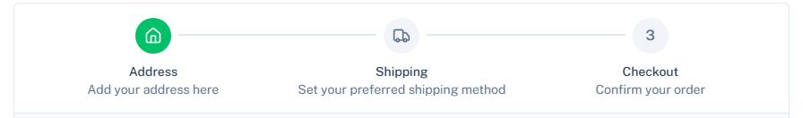⤢

REF-048 · Nuxt UI Stepper

#### 1 기획 의도

목적

시작 절차도 간단하다는 것을 보여줍니다.\
대기도 없고 영업 상담도 없이 시작할 수 있지만 도움이 필요하면 신속히 돕는다는 것을 안내합니다.

주고 싶은 인상

간단함

목적 달성을 위한 시각장치

- 3단계로 처리된다는 stepper 3단계

##### 시각적 우선순위

1. 헤드라인 카피
2. Stepper 번호, 제목
3. CTA (채움)

##### Next Trigger

- '테스트 시작하기' → 회원가입
- '연동 상담 →' → 문의 창구

#### 2 동작 명세

- **단계**
  - 컴포넌트: Nuxt UI Stepper를 적용 ([ui.nuxt.com/docs/components/stepper](https://ui.nuxt.com/docs/components/stepper))
  - 정적
  - 진행 상태(활성·완료) 표현과 단계 전환 동작은 쓰지 않음
- **버튼 상태**
  - hover
- **반응형**
  - 768\~1023
    - H2와 오른쪽 설명 문단을 좌우 배치에서 위아래로 바꿈(H2 → 설명)
    - Stepper 가로 유지
  - 768 미만
    - 세로 Stepper(번호·선 왼쪽, 글 오른쪽)
    - 640\~767: 버튼은 내용 크기, 링크와 가로로 나란히
    - 640 미만: 버튼은 폭 전체, 그 아래 링크 가운데

컨셉 공통 섹션: 연한 면 위 Nuxt UI Stepper(UStepper, 가로) 3단계 — 원형 표시(번호 또는 아이콘) · 표시 사이 연결선 · 제목 · 설명. 컨셉 A·B가 같습니다.

#### 참고 레퍼런스


REF-048 · Nuxt UI Stepper (ui.nuxt.com/docs/components/stepper). 차용: 가로 배치, 원형 표시 + 연결선, 표시 아래 제목·설명 가운데 정렬. 버림: 초록 강조색, 진행 상태(활성·완료) 표현 — 여기서는 안내용이라 세 단계를 같은 무게로 보여 줍니다.

#### 화면 메모

- 단계는 누르는 곳이 없습니다(정적). Stepper의 단계 전환 동작은 쓰지 않고 세 단계를 모두 같은 상태로 보여 줍니다.
- Stepper 아래 한 줄: '테스트 시작하기'(채움 버튼)는 회원가입(#p-signup)으로, '연동 상담 →'(텍스트 링크)은 문의 창구(#p-contact)로 이동합니다.
- 360 폭: Stepper를 세로 방향(orientation vertical)으로 바꿔 표시 · 연결선이 왼쪽에 세로로 놓이고 제목 · 설명은 오른쪽에 붙습니다. 서브와 버튼은 제목 아래로 내려갑니다.

반응형

- **lg 이상(≥1024)**: 지금 배치(머리말 좌우 분할 · 가로 Stepper 3칸 균등).
- **md(768–1023)**: 머리말을 쌓고(H2 → 16 → 서브), Stepper는 가로 3칸 그대로.
- **md 미만(\<768)**: 세로 Stepper — 원형 표시 40을 왼쪽에, 표시 사이 세로 연결선 2px, 제목 18/28 · 설명 · 안심 문구는 오른쪽(왼쪽 정렬). 머리말 → 48 → Stepper → 48 → '테스트 시작하기' 폭 전체 버튼, 그 아래 '연동 상담 →' 가운데. 섹션 상하 64.

레이아웃 상세

- 섹션 1440×약 780 = 120 + 머리말(왼쪽 눈썹·H2 / 오른쪽 서브·버튼) + 80 + Stepper(표시 56 + 20 + 제목 28 + 8 + 설명 최대 72) + 64 + 링크 24 + 120. 단계 3칸 균등, 연결선은 표시 사이 2px. 섹션 CTA 1개(채움).

이력: 2026-11-20 사용자 지시 — 시작 3단계를 02-2에서 빼서 약간 떨어진 별도 섹션으로 시원시원하게. 위치는 WHY 묶음(02 \~ 02-3)이 끝난 뒤 · 03 앞(기본안 채택). 이유: 02-2 · 02-3에서 연동 편의와 비용을 확인한 방문자가 바로 '어떻게 시작하나'로 넘어가는 순서이고, 03(상황별 솔루션)은 탐색 성격이라 절차 뒤가 자연스럽습니다. 연한 면으로 앞뒤 흰 섹션과 떨어뜨림. H2는 02-2 C안 H2(기존 문구), 눈썹 '시작 절차'와 섹션 CTA 배치는 (제안). 02-2 안 D의 사실 띠는 지우지 않았습니다(기존 안 유지).

C상황별 솔루션

H2우리 회사에 필요한 API, 업무 목적에 맞게 선택하세요

H3업무 자동화

ERP에 계좌·카드·홈택스 내역 연동

은행사, 카드사, 홈택스 개별 접속 없이 우리 시스템에 자동 수집

계좌카드홈택스

회계·경비 데이터 수집 →

세금계산서·현금영수증 발행 연동

주문·청구 시스템에서 바로 발행

세금계산서현금영수증

매출증빙 발행 →

입금 내역 확인·정산

흩어진 계좌의 입금 내역을 한 번에 통합 조회

계좌

입금 확인·정산 →

H3고객·거래처 서비스 제공

우리 서비스에 탑재

SaaS·플랫폼 안에서 고객사가 발행·조회

SaaS·플랫폼에 탑재 →

API 재판매로 수익 확장

판매가는 직접 정하고 매월 정산

재판매로 수익화(리셀) →

고객사 시스템 구축

SI·외주로 납품하고 고객사에 이관

SI·외주 구축 →

03 상황별 솔루션 · S2 연동 구조 · S4 수익 구조

#### 레이아웃 안 · 누르면 화면이 바뀜

⤢

현행 · 텍스트 카드 6 (lo-fi)현행

디자이너 주석 · 컨셉 공통 · 톤만 다름

#### 1 기획 의도

목적

- 상품 이름이 아니라 "내 상황"으로 입구를 찾게 합니다.
- 두 묶음은 누가 쓰나로 나눕니다: 자사 업무 자동화 / 고객·거래처 서비스 제공

주고 싶은 인상

나에게 맞음, 업무 고민 해결

목적 달성을 위한 시각장치

- 단순 텍스트 카드 6장(3열 × 2묶음)
- 카드 제목은 고객 표현, 상품 칩, 끝에 솔루션 이름 →

##### 시각적 우선순위

1. H2 Headline copy
2. 묶음 제목 2개
3. 카드 제목 6개

##### Next Trigger

- 카드의 '… →' → 각 솔루션 페이지

#### 2 동작 명세

- **컴포넌트**
  - 카드: Nuxt UI [PageCard](https://ui.nuxt.com/docs/components/page-card)
  - 배치: Nuxt UI [PageGrid](https://ui.nuxt.com/docs/components/page-grid), 묶음마다 하나씩(묶음 제목은 그리드 위에 따로)
  - 상품 칩: Nuxt UI [Badge](https://ui.nuxt.com/docs/components/badge)
    - 뱃지 컬러는 연하게, 모두 동일한 컬러로
    - 상품 칩은 선택되지 않음 — 클릭 요소가 아닌 것처럼 표현
- **클릭**
  - 카드 전체가 링크, 누르면 솔루션 페이지로 이동
  - '솔루션 이름 →'은 링크 모양 글자만(링크 안에 링크를 겹치지 않음)
- **상태**
  - hover: PageCard spotlight 효과 사용
  - 클릭할 수 있음을 알림
    - 커서가 손가락 모양으로 바뀜
    - '솔루션 이름 →'은 평소 밑줄 없음, 마우스를 올리면 밑줄이 생김
    - '→'는 오른쪽으로 살짝(약 4px) 이동
- **반응형**
  - 768 이상
    - 3열 × 2묶음(열 폭만 줄어듦)
  - 768 미만
    - 1열, 묶음 제목 아래 3장씩

컨셉 공통 섹션: 컨셉 A·B 모두 텍스트 카드 6장(3열 × 2묶음)입니다. 톤: 컨셉 B는 카드 왼쪽 위에 아이콘, 컨셉 A는 아이콘 없음.

이력: 2026-11-20 사용자 피드백(정보 전달 섹션은 단순 카드로)에 따라 사진 타일(A)·미니 흐름 카드(B) 판을 걷고 공통으로 둠. 카드의 일은 '내 상황 찾기'라 사진·도식이 고르는 속도를 높이지 않음.

#### 섹션 의도

- 현행 '파트너 유형(수익형/할인형)' 입구를 **고객 상황** 입구로 바꿉니다(P3).
- 두 묶음은 '누가 쓰나'로 나눕니다. 자사용과 플랫폼형은 묻는 것이 다르기 때문입니다.

#### 근거 (카드 순서)

- 용도 확인 443건: 자사 업무 66.6% · 고객사 연결 서비스 25.7% · 재판매 7.7%
- 상황(602건, 중복): 회계자료 수집 54.5% · 세금계산서 발행 36.9% · 법인카드·경비 20.6% · 현금영수증 10.5% · 입금 확인·정산 6.5%
- 구조: 고객 제공 14.3% · 재판매 4.7% · 구축 대행 3.3%
- 카드 제목은 고객 표현으로 씁니다: '자동화'보다 "우리 ERP에 ○○ 내역을 연동해서 조회"
- 입금 확인 문장: "입금 여부를 계좌마다 따로 확인하는 번거로움"(3778)

누가 쓰나 602건 · 솔루션 메뉴용 고객 분류 · 고객은 자동화가 아니라 연동·조회로 말한다

반응형

- **md 이상(≥768)**: 카드 3열 × 2묶음 그대로(md에서는 열 폭만 줄어듦).
- **md 미만(\<768)**: 카드 1열 — 묶음 제목(H3) 아래로 3장씩 쌓습니다.

C고객 사례

H2고객이 직접 경험한 효과를\
도입 사례로 확인하세요

실제 고객 이미지(인물 우선 · 없으면 제품, 로고 이미지)\
**이미지 2종 준비**\
640 이상: 14:9 (1920×1234 제작)\
14:9는 아래쪽 절반을 글 상자가 덮으니 단순한 배경으로, 인물·로고는 위쪽 가운데에 (1024\~1279는 좌우가 잘림)\
640 미만: 16:9 (1280×720 제작)

H3“…당사가 사용하고있는 사이트와 연동되어 사이트에서 바로 세금계산서 발행되어 수 천 건에 해당하는 세금계산서를 편리하게 발행하고 있습니다.”

로고

**㈜더블유컨셉코리아** · 이커머스(패션 플랫폼)

도입 시기 2012년

B“API연동 경험이 없더라도 바로빌 개발자센터를 통한다면 어렵지 않게, 문제없이 구현이 가능할 것 입니다.”

로고

**㈜비락** · 식음료 제조(유제품·음료)

도입 시기 2022년

B“…월 마감 후 계산서 맞추는 작업 시간을 대폭 감소시켜 업무 효율을 향상 시켰습니다.”

로고

**학교법인 인제학원** · 교육·의료(인제대·백병원)

도입 시기 2020년

고객사 레퍼런스 더보기 →

C고객 사례

H2고객이 직접 경험한 효과를\
도입 사례로 확인하세요

로고

H3“…당사가 사용하고있는 사이트와 연동되어 사이트에서 바로 \
세금계산서 발행되어 수 천 건에 해당하는 세금계산서를 \
편리하게 발행하고 있습니다.”

B**㈜더블유컨셉코리아** · 이커머스(패션 플랫폼)

도입 시기 2012년

인터뷰 전체 보기 →

㈜더블유컨셉코리아

㈜카카오

㈜아성다이소

국가철도공단

고객사 레퍼런스 더보기 →

04 고객 사례

#### 레이아웃 안 · 누르면 화면이 바뀜

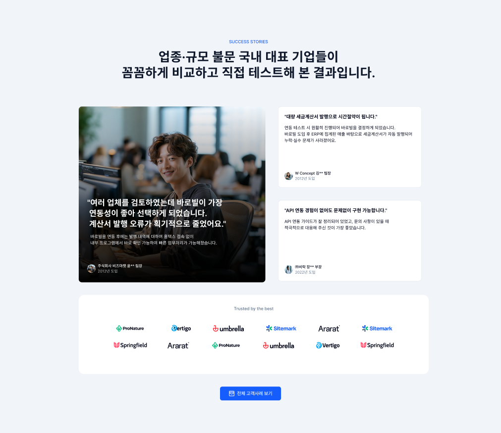⤢

피처 1 + 인터뷰 카드 2현재 안

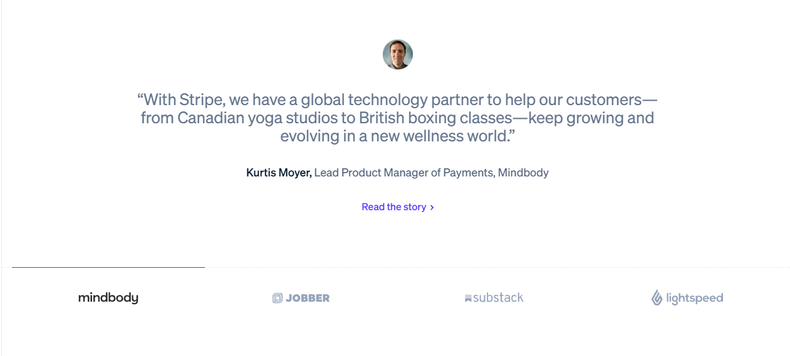⤢

큰 인용 + 고객사 로고(스트라이프)현재 안

디자이너 주석 · 상단 컨셉 토글에 따라 A판 / B판

#### 1 기획 의도

목적

네임밸류 있는 고객 사례(인터뷰, 사례)를 보여줌으로써 생동감을 줍니다.

주고 싶은 인상

실재감, 신뢰

컨셉 A판 · 피처 1 + 인터뷰 카드 2

목적 달성을 위한 시각장치

- 왼쪽 큰 피처 카드 — 실제 고객 이미지(인물 이미지가 가장 좋으나 확보 못하면 제품 이미지, 로고 이미지로 대체)
  - 이미지가 카드 전체를 채우고, 인용 글 상자는 이미지 아래쪽에 겹침(어두운 그라데이션 + 흰 글자)
- 오른쪽 작은 인용 카드 2장
- 고객 로고, 도입 시기

##### 시각적 우선순위

1. H2 Headline copy
2. 왼쪽 피처카드
3. 고객사 로고

##### Next Trigger

- 인터뷰 카드 → 블로그 고객 인터뷰 페이지
- '고객사 레퍼런스 더보기 →' → 고객사 로고 나열 페이지
- 다음 영역으로 스크롤

컨셉 B판 · 큰 인용 + 고객사 로고 탭

목적 달성을 위한 시각장치

- 인용구 텍스트
- 아래 고객사 로고

##### 시각적 우선순위

1. 인용구
2. 고객사 로고

##### Next Trigger

- 로고 탭 → 다른 고객사 사례
- '인터뷰 전체 보기 →'(W컨셉 탭) → 블로그 고객 인터뷰 페이지
- '고객사 레퍼런스 더보기 →' → 고객사 로고 나열 페이지
- 다음 영역으로 스크롤

#### 2 동작 명세

- **클릭**
  - 인터뷰 카드 3장은 카드 전체가 링크, 누르면 블로그 고객 인터뷰 페이지로 이동
  - '고객사 레퍼런스 더보기 →'는 고객사 로고 나열 페이지로 이동
- **hover**
  - 피처 카드: 시각물이 천천히 살짝 확대(약 1.03배), 카드 밖으로 넘치지 않게 자름 (제안)
  - 작은 카드: 테두리가 한 단계 진해지고 그림자가 살짝 생김 (제안)
  - 세 카드 같은 속도(약 0.2\~0.3초)
  - 모션 최소화 설정이면 확대 없이 테두리만 바뀜
- **반응형**
  - 1024 미만
    - 1열
    - 피처 카드는 14:9 유지, 글 상자는 계속 이미지 위에 겹침
  - 768 미만
    - 인용 글자 한 단계 낮춤
  - 640 미만
    - 피처 카드의 겹친 글 상자를 이미지 아래로, 이미지는 16:9

- **로고 탭**
  - 누르면 위 내용(문장 · 동그란 로고 · 회사 · 도입 시기)이 그 고객사로 바뀜
  - 선택된 탭은 위에 진한 선, 나머지 로고는 흐리게
  - 자동 넘김 없음
  - 탭을 바꿔도 아래 로고 탭과 링크 위치가 움직이지 않게 함
    - 인용·사례 문장 영역은 네 탭 중 가장 긴 문장(줄 수가 가장 많은 탭) 높이로 고정, 짧은 문장은 그 안에서 세로 가운데
    - '인터뷰 전체 보기 →'가 없는 탭에서도 그 줄 높이만큼 비워 둠
    - 폭이 바뀌면(특히 768 미만) 다시 계산
- **클릭**
  - '인터뷰 전체 보기 →'는 W컨셉 탭에만, 블로그 고객 인터뷰 페이지로 이동
  - '고객사 레퍼런스 더보기 →'는 로고 탭 아래 가운데, 고객사 로고 나열 페이지로 이동
- **반응형**
  - 768 미만
    - 로고 탭은 한 줄, 선택한 로고가 가운데에 오고 양옆 로고는 일부만 보여 더 있음을 알림
    - 스와이프로 넘기지 않음, 바로 옆 로고만 누를 수 있음, 누르면 그 로고가 가운데로 이동
    - 동그란 로고 40, 타이틀 → 로고 48 · 로고 → 인용 16
    - 인용·사례 문장은 줄바꿈 없이 이어 붙임(768 이상은 정해진 위치에서 줄바꿈)
    - 640\~767은 인용·사례 문장 폭을 최대 512로 묶어 가운데에(Tailwind max-w-lg)

디자인 화면 · 컨셉 A판 / B판

- 04는 상단 컨셉 토글을 따릅니다. 컨셉 A판 = 피처 1 + 인터뷰 카드 2, 컨셉 B판 = 큰 인용 + 고객사 로고.

2026-11-20 사용자 결정: 04는 안 D · 안 A만 남김. 안 B · 안 C · 컨셉 A판 · 컨셉 B판 삭제(컨셉에 억지로 맞춘 시안).

D = REF-014(사내 시안), A = REF-011, B = REF-012, C = REF-013. A·B·C는 추천 카드 4개를 다 씁니다(인용 하나를 크게 + 회사 이름 4개). D는 피처 1 + 카드 2 구조라 3장(더블유컨셉코리아 · 애터미 · 조선내화)만 씁니다. **순서(2026-11-19 사용자 지시): W컨셉 → 애터미 → 조선내화 → 인제학원.** 인제학원은 네임밸류가 약해 마지막으로 두고, D에서는 뺐습니다. 조선내화는 지원·응대 인용(Q6) 대신 업무 장면이 있는 연동 경험 인용(Q4, 적합도 상)으로 바꿨습니다. 채택은 사용자가 정합니다.

#### 결정 필요

- 04 레이아웃 안 (디자이너 권고 D)
- 안 D 피처 카드 시각물 — 실제 고객 사진을 쓸지(동의·자산 필요), 로고 면으로 갈지. 사내 시안의 스톡 인물 사진은 고객으로 오인되므로 쓰지 않습니다.
- **게재 동의** — 2021-06 질문지 표지에 "고객사례 콘텐츠와 마케팅에 활용" 문구는 있지만, 로고·실명 게재 동의인지는 불명확합니다. 배포 전에 확인합니다(PM-D-12).
- **현재 이용 여부** — 인터뷰가 2020\~2021년이라 지금도 쓰는지 배포 전에 확인합니다.
- **도입 연도** — 연동사 등록일로 확인(사용자·운영팀). 네 곳 모두 '도입 시기 20XX년 미확정'으로 두었습니다. 원문에 있는 것은 상대 표현뿐입니다: 인제학원 "바로빌 연동서비스를 이용한지 아직 1년이 지나지 않았지만"(2021-06-17), 조선내화 "현재 2년째 바로빌을 사용하고 있는 고객으로"(2021-06-17). 연도로 바꾸지 않았습니다.
- 2026-11-20 사용자: 더블유컨셉 도입 2012년 확인(안 D · 안 A 반영). 안 A 탭 4개를 더블유컨셉 · ㈜카카오 · ㈜아성다이소 · 국가철도공단으로 교체(사용자는 '국가철도공사'로 말함 — 제안서 표기 '국가철도공단'으로 씀, 확인 필요). 세 곳은 인터뷰 인용이 없고 제안서 32\~37쪽 회사 요약만 있음(연동 시작: 국가철도공단 2015-03 · 카카오 2021-08 · 아성다이소 2023-05). 탭을 눌렀을 때 보일 인용·로고 사용 동의 확인 필요. H2는 사용자 문장 '바로빌 API로 변화를 만든 / 실제 도입 사례를 확인하세요'로 교체(2026-11-20).
- **애터미 문서** — 날짜("2021년 06월 00일")와 회사란("㈜OOO")이 비어 있습니다. 회사는 파일명(과 Q1 본문)으로만 판단했습니다.
- **Q5 예시 문장** — 더블유컨셉·조선내화 질문지 Q5 답변이 질문지 예시 문장과 거의 같습니다. 그래서 두 회사 모두 Q5가 아닌 고유 문장만 골랐습니다.
- **'인터뷰 전체 읽기' 링크** — 블로그 게재 여부가 12개 문서 어디에도 확인되지 않습니다. 이동할 곳이 없으면 링크를 뺍니다(안 A 높이 −48).

#### 화면 메모

- 업무 시간 변화 띠("4\~5시간 → 1시간 이내" 등)는 지웠습니다(PM-D-30: 맥락 없음). 인터뷰에도 업무명·전후·단위를 모두 갖춘 수치가 없습니다.
- 직함은 문서에 없어 넣지 않았습니다. 인용 옆 사람 사진(레퍼런스의 아바타·영상)도 없습니다.
- 안 A는 첫 탭(더블유컨셉코리아)이 선택된 상태입니다. 나머지 회사의 카드 내용은 아래 '카드 내용 4개'에 있습니다. 안 D는 탭 없이 3개가 한꺼번에 보입니다.

안 비교 · 권고 상세

|  | D | A | B | C |
| --- | --- | --- | --- | --- |
| 목적 | 5 | 4 | 4 | 3 |
| 스캔 | 4 | 5 | 4 | 3 |
| 콘텐츠 | 4 | 4 | 4 | 2 |
| 확장 | 3 | 5 | 3 | 3 |
| 비용 | 4 | 5 | 4 | 2 |

- **D 사내 시안** — 목적 5: 클릭 없이 고객 말 3개가 한 화면에 보여 "달라진 업무"를 세 번 증명하고, 피처 카드가 첫 시선을 잡습니다. 회사명이 글자라 로고 동의가 늦어도 성립합니다. 스캔 4: 큰 카드 → 작은 카드 2개로 위계가 분명하지만 읽을 글이 A보다 많습니다. 콘텐츠 4: 인용 3개가 각 칸 줄 수 안에 들어갑니다(아래 실측). 사진은 없어도 로고 면으로 대신합니다. 확장 3: 사례가 3개 있어야 모양이 나옵니다. 상품 페이지는 피처 카드 1장만 씁니다. 비용 4: 사진을 안 쓰면 로고뿐입니다.
- **A 스트라이프** — 목적 4: 로고 4개가 한 줄로 보여 '어떤 회사들이 쓰나'가 1초에 읽히지만, 한 번에 인용은 1개뿐이고 핵심 요소인 로고 줄이 게재 동의(미확인)에 달려 있습니다. 스캔 5: H2 → 인용 → 로고 줄 한 방향. 콘텐츠 4: 인용 길이(최대 약 80자)가 800 폭 3줄 안에 들어갑니다. 사진·직함이 없어도 성립합니다. 확장 5: 상품 페이지는 인용 1개 + 로고 줄을 빼고 그대로 씁니다. 비용 5: 시각 자산은 로고뿐입니다.
- **B 모두싸인** — 목적 4: 회사 이름이 글자 목록이라 로고보다 덜 눈에 띕니다. 카드 안에 태그·도입 시기·링크가 넉넉히 들어갑니다. 확장 3: 회사가 3곳 이상이어야 목록이 성립합니다. 비용 4: 영상 대신 로고만 두면 카드 왼쪽 위가 비어 보일 수 있습니다.
- **C 포트원** — 목적 3: 한 번에 회사 하나만 보이고 나머지는 점 3개로만 존재합니다. 콘텐츠 2 · 비용 2: 왼쪽 592×432 시각물을 채울 고객 사진·제품 이미지가 없습니다. 528 폭이라 인용이 4줄까지 길어집니다.

#### 권고 · 안 D (신뢰도: 추정)

- 점수 합계는 A(23)가 높지만, 가장 무겁게 보는 목적 적합에서 D가 앞섭니다. 고객 말 3개를 클릭 없이 보여 주고, 로고 동의가 늦어져도 깨지지 않습니다.
- 사내 디자이너 시안이라 디자인팀이 이 골격을 이어 갈 가능성이 높습니다. 같은 기준 점수에서 목적이 가장 높은 안이 팀의 방향과도 같아, 넘김 뒤 재작업이 가장 적습니다. 점수에 가산하지는 않았고, 동점·근소 차이일 때의 판단 근거로만 썼습니다.
- 시안에서 구조만 받고 내용은 버렸습니다: 요약 헤드라인 인용(원문이 아님), 마스킹된 이름·직함(문서에 없음), '2012년 도입' 같은 연도(미확인), W컨셉 본문(질문지 Q5 예시 문장과 같음), 스톡 인물 사진, 가짜 로고 벽, 파란 '전체 고객사례 보기' 버튼(주 CTA와 경쟁).
- 실패 조건: ① 사례 4곳을 모두 보여야 한다면 → A ② 로고·실명 동의가 확보되고 '이름값'을 우선하면 → A ③ 디자인팀이 피처 카드에 스톡 사진을 넣으려 하면 이 안의 신뢰가 오히려 깎입니다. 실제 고객 사진을 못 구하면 로고 면으로 둡니다.

섹션 높이: 안 D 856 · 안 A 720 · 안 B 696 · 안 C 832 (현행 저배율 · 띠 포함)

레이아웃 상세 · 줄일 때 지킬 것

- 안 D 856 = 96 + 80 + 64 + 448 + 48 + 링크 24 + 96. 피처 카드 7열 696×448(시각물 전체 + 아래 텍스트 박스 안쪽 40: 인용 22/32 최대 3줄 → 16 → 회사 24 → 16 → 칩·도입 시기 32) + 작은 카드 5열 488×208 두 장(사이 32, 안쪽 32: 인용 Body 16/24 600 최대 4줄 96 → 아래 끝에 회사 Small + 도입 시기 Caption 왼쪽, API 칩 오른쪽). 와이어프레임에서는 텍스트 박스를 면색으로 그렸고, 실제는 사진·로고 면 위 어두운 그라데이션 + 흰 글자입니다.
- 안 A 720 = 96 + 눈썹 24 + 16 + H2 40 + 64 + 인용 96(3줄 고정) + 24 + 회사 24 + 16 + 메타 32 + 24 + 링크 24 + 48 + 로고 탭 96 + 96. 인용 칸은 3줄 높이로 고정하고 세로 가운데 정렬해, 탭을 바꿔도 아래가 움직이지 않습니다.
- 안 A 로고 탭: 3열(280)×4, 높이 96, 로고 160×40 가운데. 선택 탭은 위 선 2px + 로고 진하게, 나머지는 흐리게. 자동 넘김은 쓰지 않습니다(읽는 중에 바뀌지 않게).
- 세 안 공통 카드 요소: 로고 자리(회사명 표기) · 인용 · 회사명·업종 · 사용 API 태그 · 도입 시기. 인용은 원문 그대로이고 앞뒤 “ ”만 붙였습니다.
- 줄일 때 지킬 것: ① 인용 칸 높이 고정(탭 전환 시 흔들림 없음) ② 인용 > 회사명 > 태그 크기 차이 ③ 회사 이름 4개가 한 화면에 함께 보일 것(A·B).

카드 내용 4개

| 회사 · 업종 | 인용(원문) | API |
| --- | --- | --- |
| ㈜더블유컨셉코리아 · 이커머스(패션 플랫폼) | "…당사가 사용하고있는 사이트와 연동되어 사이트에서 바로 세금계산서 발행되어 수 천 건에 해당하는 세금계산서를 편리하게 발행하고 있습니다." | 전자세금계산서 · 휴폐업조회 |
| 애터미 주식회사 · 유통(직접판매) | "현업 담당자는 기존 보다 훨씬 빠르고 정확해 졌다고 상당히 만족하고 있으며, 해당 업무 시간이 줄어듦에 따라 타 업무에 집중할 수 있는 시간이 생겼다고 합니다." | 휴폐업조회 |
| 조선내화 주식회사 · 제조(내화물) | "전자(세금)계산서의 경우, 연동 프로그램에서 월말결산표 기준 매입내역을 집계하고 전자(세금)계산서를 역발행 하는데 사용하고 있습니다." (Q4 · 2026-11-19 교체, 이전 Q6 지원·응대) | 전자세금계산서 역발행 |
| 학교법인 인제학원 · 교육·의료(인제대·백병원) | "…홈택스 연동 후 세금계산서를 출력하지 않아 종이를 절약하고, 월 마감 후 계산서 맞추는 작업 시간을 대폭 감소시켜 업무효율을 향상 시켰습니다." | 홈택스연동 |

도입 시기는 네 곳 모두 '20XX년 미확정'. 순서: 업무 변화가 가장 구체적인 인제학원을 첫 탭으로. 실측(Chrome, 네 인용을 칸마다 넣어 봄): 가장 긴 인용(애터미 약 85자)도 A 800 폭 3줄 · B 808 폭 3줄 · C 528 폭 4줄 · D 작은 카드 424 폭 4줄 안에 들어가고 넘침이 없습니다. D 피처 인용(인제학원)은 616 폭 3줄입니다.

근거

- 인용·업종·API·도입 시기 원문은 정본 노트 '메인 고객 사례 카드 추천 3\~4개' 표를 그대로 옮겼습니다.
- 업종 4개(교육·의료 · 이커머스 · 유통 · 제조)와 API 4종이 겹치지 않습니다.

조사/고객 인터뷰 인용 후보.md (기준일 2026-11-18) · 원문: 바로빌 인터뷰 docx 12개

360 폭에서

- 안 D: 피처 카드 328×자동(시각물 328×184 위, 텍스트 아래) → 작은 카드 2장 세로(사이 16). 인용 크기는 그대로.
- 안 A: 인용 328 폭 22/32 → 18/28로 낮춰 5줄 안, 로고 탭은 가로 스크롤 한 줄(로고 120×32) 또는 2×2.
- 안 B: 목록이 가로 스크롤 탭 한 줄로 카드 위에 붙고, 카드는 328×자동 높이.
- 안 C: 시각물 328×246(4:3) → 텍스트 순, 페이저는 아래 그대로.

참고 레퍼런스 (2)

REF-014 · 사내 시안 고객 사례 · 안 D


차용

가운데 머리말, 왼쪽 큰 피처 카드(시각물 위 인용) + 오른쪽 작은 카드 2장 세로, 카드 아래 끝에 회사·도입 시기

버림

요약 헤드라인 인용, 마스킹 이름·직함, 미확인 도입 연도, 스톡 인물 사진, 로고 벽(히어로 로고 띠와 중복 · 가짜 로고), 파란 주 버튼

REF-011 · 스트라이프 고객 사례 · 안 A


차용

가운데 정렬 큰 인용 하나 + 출처 한 줄 + 약한 링크, 아래 로고 줄이 곧 탭(선택 탭 위 선)

버림

인물 사진(자산 없음), 이름·직함 출처(직함 없음), 연한 글자색 인용(대비 부족)

카피 검토 (4)

- 카피 검토 필요인제학원·더블유컨셉 인용이 "…"로 시작합니다. 22px 큰 글자에서 첫머리 말줄임이 어색할 수 있습니다. 원문을 자르는 위치를 정해야 합니다(문구는 그대로 두었습니다).
- **2026-11-19 H2 재교체 (사용자: 사례 섹션인데 세금계산서·업무 효과 헤드카피는 맞지 않음)** — H2 '~~API는 개발팀이 붙이고, 달라진 점은 현업이 말합니다~~' → '패션 플랫폼부터 제조사까지, 바로빌로 연동한 기업들'(제안). 사례 모음의 틀(누가 쓰나 · 업종의 폭)로 말하고, 인용 내용(세금계산서)에 묶지 않음. 현재 이용 미확인이라 '쓰는' 대신 '연동한'. 대표 사례가 바뀌면 앞 구절만 교체. 대안: '연동한 기업들이 직접 말하는 바로빌' · '업종은 달라도, 연동은 바로빌로'.
- ~~**2026-11-19 H2 교체 (사용자: '도입 뒤 달라진 업무'가 심심함 → 카피라이터 안 8개 중 PM 선택)**~~ — 눈썹 '~~고객 사례~~' → '고객 인터뷰', H2 '~~도입한 뒤 달라진 업무~~' → 'API는 개발팀이 붙이고, 달라진 점은 현업이 말합니다'(제안). 선택 이유: 독자인 개발 리드가 현업·결재자를 설득해야 하는 상황을 짚고, 인용 4개가 모두 실무 쪽 말이라는 사실을 그대로 쓰며 새 효과를 약속하지 않음. 1440에서 1줄. 대안: ② '수천 건의 세금계산서도 / 쓰던 사이트에서 바로 발행합니다'(W컨셉 한정) ③ '연동하고 써 본 뒤 / 고객이 남긴 말'(가장 안전). 위험: '현업'을 명시한 인용은 애터미뿐.
- ~~조선내화 인용은 업무 변화가 아니라 지원·응대 만족이라 H2와 결이 다릅니다.~~ → Q4(월말결산 매입 집계 · 역발행)로 교체해 해소.
- 카피 검토 필요업종 표기(예: "교육·의료(인제대·백병원)")는 노트 표의 업종 칸을 그대로 썼습니다. 카드용 표기를 정해야 합니다.
- 카피 검토 필요안 C 버튼은 기존 링크 문구 '인터뷰 전체 읽기'를 그대로 썼습니다. 블로그가 없으면 버튼 자체가 빠집니다. 새 문구는 넣지 않았습니다.

반응형

- **lg 미만(\<1024)**: D는 피처 카드 → 작은 카드 2장 1열. 피처 카드는 사진 위 겹친 글 상자를 풀어 사진(240) 아래로. A는 인용 폭 800 제한을 풀고 로고 탭 4칸은 칸 폭만 줄어듦.
- **md 미만**: 인용 18/28, 카드 안쪽 24, 업종 칩 줄바꿈, A 로고 탭 2열 × 2줄.

C자주 묻는 질문

H2시작하기 전에 많이 묻는 것

**요금은 어떻게 정해지나요?***−*

상품마다 다릅니다. 세금계산서·문자처럼 처리한 건수만큼 내는 상품이 있고, 계좌·카드·홈택스 조회처럼 등록한 계좌·카드·사업자 수만큼 매월 내는 상품이 있습니다. 상품별 단가는 파트너 등록 후 콘솔에서 확인할 수 있습니다.

**월 기본료나 초기 연동비가 있나요?***+*

월 기본료와 초기 연동비는 없습니다. 언제든 해지할 수 있습니다.

**어디까지 테스트할 수 있나요?***+*

운영과 같은 테스트 환경에서 연동을 미리 확인할 수 있습니다. 세금계산서·현금영수증은 국세청으로 실제 전송하는 단계만 빠집니다. 파트너 등록하면 테스트 포인트 1만 점이 지급됩니다.

**가입부터 운영 전환까지 얼마나 걸리나요?***+*

파트너로 등록하면 승인을 기다리지 않고 바로 테스트를 시작할 수 있습니다. 운영 적용까지 걸리는 기간은 연동 개발과 테스트 진행에 따라 다릅니다. 테스트를 마치면 운영용 인증키로 바꾸고, 필요한 서비스를 신청해 이용하시면 됩니다.

**사용자 수나 계정 수에 제한이 있나요? 늘리면 비용이 드나요?***+*

계정 수에 제한이 없고, 계정을 늘려도 추가 요금은 없습니다. 요금은 이용한 서비스만큼만 포인트에서 차감됩니다.

질문 전체 보기 →

05 자주 묻는 질문

디자이너 주석 · 컨셉 공통

#### 1 기획 의도

목적

시작 전에 걸리는 질문(요금 · 기본료 · 테스트 범위 · 운영 전환 기간 · 계정 수)을 한 줄씩 풀어 망설임을 없앱니다.

주고 싶은 인상

**담백 · 투명** — "물어볼 것이 미리 답해져 있다."

목적 달성을 위한 시각장치

- 질문 행 리스트
- 첫 질문이 펼쳐진 상태

##### 시각적 우선순위

1. H2 Headline copy
2. 질문 행
3. 펼친 답

##### Next Trigger

- '질문 전체 보기 →' → 이동 위치는 기획 확인
- 다음 영역으로 스크롤

#### 2 동작 명세

- **아코디언**
  - 컴포넌트: Nuxt UI Accordion을 적용 ([ui.nuxt.com/docs/components/accordion](https://ui.nuxt.com/docs/components/accordion))
  - 한 번에 하나만 펼침, 기본은 첫 항목이 열려 있음
  - 행을 누르면 답이 부드럽게 펼쳐지고 오른쪽 화살표가 돌아감
- **반응형**
  - 모든 폭
    - 1열
    - 긴 질문은 줄바꿈, 화살표는 오른쪽 끝 고정
    - 좌우 여백만 바뀜

컨셉 공통 섹션: 질문 목록은 컨셉 A·B가 같은 리스트입니다. 톤 차이 없음.

#### 섹션 의도

- 연동 문의 상위 질문(요금 · 기본료 · 테스트)과 운영팀 답변(운영 전환 기간 · 계정 수)으로 5개를 둡니다. '계약' 주제는 운영팀 요청(2026-11-18, "계약 없이"를 공론화하지 않음)으로 뺐습니다.

#### 근거와 답의 출처

- 요금 · 기본료: 3838 답변(기본료·의무기간 없음) · 상품별 고객 질문
- 운영 전환 기간 · 계정 수: 운영팀 답변

#### 질문 선정 (2026-11-25 · 사용자 결정 A\~E)

|  | 질문 | 근거 | 판단 |
| --- | --- | --- | --- |
| A | 요금은 어떻게 정해지나요? | 문의 1위 단가·과금 단위(계좌 105 · 카드 91 · 세금계산서 71) | 채택 |
| B | 월 기본료나 초기 연동비가 있나요? | 문의 2위 가입비·기본료·최소이용료(계좌 44 · 카드 38) | 채택 |
| C | 어디까지 테스트할 수 있나요? | 문의 3위 테스트 환경(계좌 39 · 카드 31) | 채택 |
| D | 가입부터 운영 전환까지 얼마나 걸리나요? | 운영팀 답변(5번) · 설문 11번(7명 중 5명 1주 이내) | 채택. 답에서 "계약 체결 없이"는 운영팀 요청(공론화하지 않음)에 따라 뺌 |
| E | 사용자 수나 계정 수에 제한이 있나요? 늘리면 비용이 드나요? | 운영팀 답변(이용 인원·계정 정책) | 채택. '사용한 건수만큼'은 월정액 상품에 맞지 않아 '이용한 서비스만큼'으로 씀 |
| F | 계약 기간이나 해지 조건이 있나요? | 운영팀 답변(4번) · 문의 2위에 약정 질문 포함 | 메인 제외 → 요금 안내 FAQ. "계약 없이" 공론화 회피 · 자동 해지 안내는 요금 맥락 |
| G | 우리 고객에게 다시 팔 수 있나요? | 제안서 11-2(회사 메시지) · 용도 확인 443건 중 재판매 7.7% | 메인 제외 → 03 재판매 솔루션 페이지 FAQ |

#### 결정 필요

- 테스트 비용의 답: 테스트베드 호출 과금 여부 확인 필요. 확인된 것은 '조회 서비스는 신청한 달 무료'뿐입니다.
- 비용 답(월 기본료·초기 연동비 없음, 건수·계좌·카드 수 과금)이 전 상품에 해당하는지 — 운영팀 확인. 3838 답변은 팩스 기준입니다.

반응형

- 모든 폭: 질문 행 1열 그대로. 질문이 길면 줄바꿈하고 +/− 표시는 오른쪽 끝에 둡니다. 좌우 여백만 바뀝니다(모바일 20 · 태블릿 32 · 1280 이상 1216 가운데).

H2바로빌 API\
지금 무료로 시작하세요

바로 시작하기문의하기소개자료 요청하기

문서부터 보고 싶다면 API 개발 문서

06 하단 CTA DARK

디자이너 주석 · 컨셉 공통 · 톤만 다름 · DARK

#### 1 기획 의도

목적

끝까지 읽은 방문자를 세 출구로 보냅니다: 바로 시작(주), 문의 · 소개자료(보조)

주고 싶은 인상

**결단 · 초대** — "지금 시작하면 된다."

목적 달성을 위한 시각장치

- 다크 면 가운데 문구
- 버튼 3개 — 같은 크기, 주 버튼만 채움 · 나머지 2개는 외곽선
- 아래 문서 링크 한 줄
- 톤: 컨셉 B판만 배경 연결 선 패턴(명도 차 1단계), A판은 면색만

##### 시각적 우선순위

1. H2 Headline copy
2. CTA 주(채움) > 보조(외곽선)
3. 문서 텍스트 링크 한 줄

##### Next Trigger

- '바로 시작하기' → 가입
- '문의하기' → 이용문의 페이지
- '소개자료 요청하기' → 제안서 다운로드 페이지
- 문서 링크 → API 개발 문서

#### 2 동작 명세

- **버튼 상태**
  - hover를 다크 면 기준으로
- **반응형**
  - 768 이상
    - 가운데 정렬, 버튼 3개 가로
  - 768 미만
    - 버튼 폭 전체로 세로(바로 시작하기 → 문의하기 → 소개자료 요청하기)

컨셉 공통 섹션: 가운데 정렬 문구 + 버튼 세 개로 컨셉 A·B가 같습니다. 톤만 맞춤: B는 배경에 연결 선 패턴(명도 차 1단계)을 둘 수 있고, A는 무늬 없이 면색만.

#### 근거

- 설문 시작 방식: 먼저 문의하고 테스트 4/7 · 문서로 직접 2/7 · 담당자 안내 1/7 → 테스트·문의 두 출구를 모두 둡니다

설문 응답 집계 05

#### 화면 메모

- '문의하기'는 이용문의 페이지(#p-contact), '소개자료 요청하기'는 제안서 다운로드 페이지(#p-proposal)로 이동합니다.
- 보조문구('등록 무료')는 없앴습니다.

반응형

- **md 이상(≥768)**: 가운데 정렬 · 버튼 3개 가로, 같은 크기.
- **md 미만(\<768)**: 버튼 3개를 폭 전체로 세로로 쌓습니다(바로 시작하기가 맨 위).

T바로빌 API 라인업

문서 발행

- 전자세금계산서 발행
- 전자세금계산서 구축형
- 현금영수증 발행
- 전자문서

데이터 조회·수집

- 계좌 통합 조회
- 카드 통합 조회
- 홈택스 매입매출조회
- 사업자등록상태조회
- 예금주 성명·실명 조회
- 제3자세금계산서발급사실조회

메시지·팩스 전송

- 카카오 메시지 전송
- 문자 전송
- 팩스 전송

T사이트맵

상황별 솔루션

- 회계·경비 데이터 수집
- 매출증빙 발행
- 입금 확인·정산
- SaaS·플랫폼에 탑재
- 재판매로 수익화
- SI·외주 구축

개발자 문서

- REST API 가이드
- REST API 레퍼런스
- SOAP API 가이드
- SOAP API 레퍼런스
- 오류코드 조회
- 샘플 다운로드

요금·고객지원

- 요금 안내
- 이용문의
- FAQ
- 고객사례
- 공지사항
- 소개자료 요청

약관·정책

- 이용약관
- 파트너 이용약관
- 개인정보처리방침

barobill Developers 로고

바로빌은 ERP·솔루션·쇼핑몰 등 사내 시스템에 전자세금계산서·현금영수증·홈택스 수집·계좌·카드 조회를 연결하는 비즈니스 데이터 API 서비스입니다.

국세청 지정 시스템사업자(41000022) · 전자세금계산서 표준인증(v3.0) · 2009년부터 API 제공

바로빌 블로그유튜브

고객센터

1544-9256

이메일

barobill@knetbiz.com

운영시간

평일 09:00\~18:00(점심 12:00\~13:00) / 주말·공휴일 제외

(주)케이넷 · 대표 이천호 · 사업자등록번호 416-81-38772 · 통신판매업신고 제2010-75호

광주광역시 북구 첨단과기로208번길 43-22, B1901\~1903 (오룡동, 와이어스파크(지식산업센터))

© 2026 BAROBILL (KNET Co., Ltd.) All rights reserved.

푸터 (공통)

디자이너 주석 · 컨셉 공통 · 사이트 공통 틀

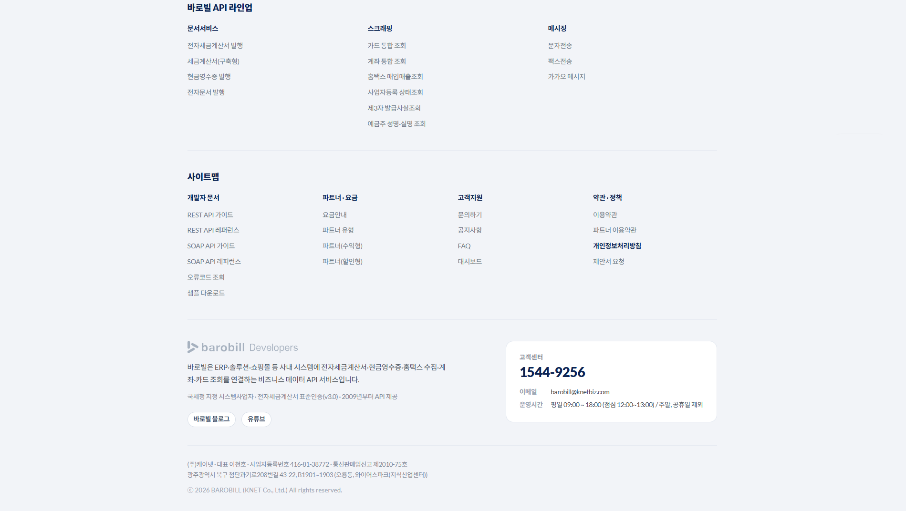⤢

REF-051 · 자사 이전 푸터 시안

#### 1 기획 의도

목적

- 끝까지 내려온 방문자가 한 화면에서 찾게 합니다: 상품 13개 → 문서·지원·약관 → 회사 신뢰 정보·고객센터 → 법적 고지
- 주 CTA는 두지 않습니다.

주고 싶은 인상

**정돈 · 믿을 만한 회사** — "운영 주체가 분명하다."

목적 달성을 위한 시각장치

- 연한 회색 면, 4묶음 사이 가는 선
- 4열 공통 격자
- 고객센터 흰 카드에 전화번호 크게
- 인증 줄

##### 시각적 우선순위

1. 라인업(상품 13개, 메가메뉴와 같은 그룹·순서)
2. 사이트맵
3. 고객센터 전화번호

##### Next Trigger

- 상품·솔루션 링크 → 각 페이지
- 고객센터 전화 → 모바일에서 전화 걸기

#### 2 동작 명세

- **링크**
  - 블로그·유튜브는 새 창
  - 링크는 1줄(말줄임 없음)
  - hover 상태 정의
- **반응형**
  - 768\~1023
    - 사이트맵 2열 × 2줄
    - 고객센터 카드는 회사 소개 아래 폭 전체
  - 768 미만
    - 그룹을 메가메뉴 모바일과 같은 접힌 아코디언 행으로
    - 사업자 정보는 접지 않음

컨셉 공통 섹션: 사이트 공통 틀로 컨셉 A·B와 메인·서브가 같습니다. 자사 이전 푸터 시안(REF-051)을 실배율로 옮기고 아래처럼 조정했습니다.

#### 목적

- 페이지 끝까지 내려온 방문자가 ① 상품 13개 ② 문서 · 지원 · 약관 ③ 회사 신뢰 정보 · 고객센터를 한 화면에서 찾게 합니다. 위에서 아래로 '무엇을 파나 → 어디로 가나 → 누가 운영하나 → 법적 고지' 순서입니다.
- 푸터에는 주 CTA를 두지 않습니다(바로 위 06 하단 CTA가 맡음). 고객센터 카드는 행동이 아니라 연락처 안내입니다.

#### 참고 레퍼런스


REF-051 · 자사 이전 시안(사용자 제작) · 채택.

- **차용**: 4묶음 순서(라인업 → 사이트맵 → 회사 소개 + 고객센터 카드 → 사업자 정보), 연한 회색 면, 묶음 사이 가는 선, 왼쪽 로고 · 소개 2줄 · 인증 줄 · 알약 링크 / 오른쪽 흰 카드(전화번호 크게), 개인정보처리방침 굵게.
- **조정**: 라인업 그룹명을 메가메뉴와 통일(문서서비스 · 스크래핑 · 메시징 → 문서 발행 · 데이터 조회·수집 · 메시지·팩스 전송), 항목 이름 · 순서도 메가메뉴와 같게(13개). 사이트맵에 상황별 솔루션 열 추가. 파트너 유형 · 수익형 · 할인형 · 대시보드 제외(파트너 · 콘솔 기획은 이번 범위 밖). 제안서 요청 → 고객지원 '소개자료 요청'. 고객사례 추가. 표준인증 v3.0 표기.
- **요금**: '요금 안내' 한 항목만 단독 열로 두면 열이 비어 보여 고객지원과 합쳐 '요금·고객지원'으로 둡니다(시안의 '파트너·요금' 묶음과 같은 방식). 카피 검토 필요열 제목 '요금·고객지원'.
- **격자**: 시안은 라인업 3열 · 사이트맵 4열 폭이 달랐습니다. 여기서는 둘 다 4열 공통 격자(280 · 사이 32)에 얹어 그룹 시작선을 세로로 맞췄습니다. 라인업은 3열을 쓰고 4번째 칸은 비웁니다.

#### 화면 메모

- 라인업 항목은 각 상품 페이지로(전자세금계산서 구축형 → #p-onprem), 상황별 솔루션은 각 솔루션 페이지로 이동합니다. 메가메뉴와 이름 · 순서가 같아야 합니다 — 상품이 늘면 두 곳을 함께 고칩니다.
- ⚠ 개발팀개발자 문서 열의 링크는 개발팀 문서 주소입니다. 개발 문서는 개발팀 주관이라 항목 이름 · 주소는 개발팀 문서 체계에 맞춥니다.
- 블로그 · 유튜브 알약 링크는 새 창으로 엽니다. 고객센터 전화번호는 모바일에서 전화 걸기(tel:)입니다.
- 약관은 요청 2(마케팅 이용약관)·3(계약서·날인 조항 정리)을 반영해 정리합니다.
- ⚠ 법무·운영사업자 정보(상호 · 대표 · 사업자등록번호 · 통신판매업신고 · 주소)와 copyright는 시안 그대로입니다. 배포 전 법무·운영 확인.
- 인증 줄: 41000022는 지금 푸터 값, 표준인증(v3.0)은 사용자 확인 2026-11-23(증빙 문서 위치 확인 필요). 사실 기준표에 같은 행이 있습니다.

레이아웃 상세 · 줄일 때 지킬 것

- 섹션 1440×1241 = 64 + 라인업(제목 28 + 24 + 그룹 제목 20 + 8 + 행 32×6 = 272) + 97 + 사이트맵 272 + 97 + 회사 소개 · 카드(카드 202가 더 김) + 97 + 사업자 정보(22×2 + 16 + 16 = 76) + 64.
- 글자: 묶음 제목 Title 18/28 700 · 그룹 제목 Small 14/20 700 · 링크 Small 14/20 ink2(행 32 = 위아래 6) · 회사 소개 Body 16/24 · 인증 줄 Small 14/20 ink3 · 전화번호 H2 32/40 800 · 사업자 정보 Small 14/22 ink3 · copyright Caption 12/16.
- 회사 소개 7열(696) | 카드 5열(488). 운영시간 값(약 351)은 '평일 … (점심 …)'과 '주말·공휴일 제외' 두 덩어리로 끊어 좁아지면 '/' 뒤에서 줄바꿈합니다.
- 줄일 때 지킬 것: ① 묶음 순서 ② 라인업 그룹명 · 항목 = 메가메뉴 ③ 링크 1줄(말줄임 없음) ④ 사업자 정보는 접지 않음(법적 고지).

반응형

- **lg 이상(≥1024)**: 지금 배치. 4열 격자 그대로(1024에서 열 216 — 최장 링크 '제3자세금계산서발급사실조회' 약 190이 1줄). 회사 소개 7 | 카드 5(1024에서 카드 약 381, 운영시간은 2줄).
- **md(768–1023)**: 라인업 3열 유지(768에서 열 213), 사이트맵 2열 × 2줄(상황별 솔루션 | 개발자 문서 / 요금·고객지원 | 약관·정책). 고객센터 카드는 회사 소개 아래 폭 전체(위 32).
- **md 미만(\<768)**: 라인업 · 사이트맵의 그룹을 메가메뉴 모바일과 같은 접힌 아코디언 행(48 · Body 16/24 600 · 오른쪽 ▾ · 아래 선)으로 둡니다. 누르면 그 그룹 링크가 펼쳐집니다(와이어프레임은 접힌 상태만). 묶음 제목은 남깁니다. 회사 소개 → 카드(안쪽 24, 라벨 위 · 값 아래로 쌓기) 세로. 사업자 정보는 항목 단위로 줄바꿈(주소는 어절 단위). 묶음 사이 32 + 선 + 32.

이력: 2026-11-23 사용자 결정 — 자사 이전 푸터 시안(REF-051) 적용: 그룹명 메가메뉴와 통일, 상황별 솔루션 열 추가, 파트너 유형·대시보드 제외, 제안서 요청 → 고객지원 '소개자료 요청', 고객사례 추가, 표준인증 v3.0 표기

이력: 2026-11-23 문서 발행 그룹에 전자세금계산서 구축형 추가(상품 13개) — 메가메뉴와 같은 순서. (이전 lo-fi 4열: API 소개 · 개발 · 고객지원·리소스 · 회사)

## 1. API 상품 소개 · 공통 규칙

/api/\*

API 상품 소개 13종(일반형 12종 + 전자세금계산서 구축형)이 같은 골격을 씁니다. 1-1 전자세금계산서부터 1-12 전자문서까지 일반형, 1-13은 구축형 골격입니다. (제안서 11-2 · 2026-11-19 상품 13종)

| 순서 | 섹션 | 담는 것 |
| --- | --- | --- |
| Hero | 이 API로 하는 일 | 눈썹 = 공식 상품명('○○ API') · H1 = 고객이 얻는 결과를 담은 메시지 문장(최대 2줄, 과장 없이) · 한 줄 · **정의 문장** "바로빌 ○○ API는 …하는 API입니다. ○○ 단위로 과금합니다." · 버튼 '테스트 시작하기 / API 개발 문서' · **근거 띠**(실명 고객사 로고 — 공개 동의 후 · 시스템사업자 41000022는 전자세금계산서만) |
| 01 | 왜 바로빌인가 | 운영 안정성 · 막힘없는 연동 · 부담 없는 비용을 한 줄씩 · 운영 안정성 칸에 전 상품 공통 보안 한 줄 "금융·공공기관도 쓰는 API"(→ 03-2) · **부담 없는 비용 칸은 요금 안내 페이지로 이어지는 브릿지 역할** |
| 02 | 이런 상황에 씁니다 | 이 API를 쓰는 상황 시나리오, 업무 플로우 · **자사활용 · 회원연계 · 수익화** 3가지 유형 소개. 유형 카드를 누르면 오른쪽에 그 유형의 업무 플로우 |
| 03 | 주요 기능 | 기능 + **사양 표** · **인프라 특징** · **인증서 관리 툴킷**(인증서를 쓰는 상품). 사양 표는 항목 · 내용 2열. '과금' 행은 과금 구조(건당 · 월정액 · 포인트 차감 · 기본료 유무)만 쓰고 끝에 '단가는 파트너 등록 후 확인 →' 링크 |
| 03-2 | 보안 | 전 상품 공통 블록 · 인증정보 보관 · 통신 암호화 · DB 암호화 · 인프라 + '인증·보안 자세히' 링크. 출시 예정 상품은 블록 없이 링크만 |
| 04 | 시작 절차 · 코드 | 유형별 단계(아래 표) + 코드 블록(REST · SOAP 전환, 기본 REST · 샘플 언어 탭). Hero의 '코드 바로 보기 ↓' 도착점. 운영 전환 문구는 두 가지만: 발행·발송·검증 '인증키와 API 주소만 바꾸면 운영 · 별도 신청 없음' / 조회 '인증키 · API 주소를 바꾸고 운영 환경에서 다시 신청' |
| 05 | 함께 쓰는 API | 같이 많이 쓰는 상품 3개 카드(누르면 그 상품 페이지) |
| 06 | FAQ | 많이 묻는 순서 · **비용 → 지원 범위 → 연동 구조 → 테스트 → 시점·주기**. 답은 질문 없이 읽어도 통하는 완결 문장(FAQ 구조화 데이터로 그대로 씀) |
| 끝 | 하단 CTA | 공통 컴포넌트: '테스트 시작하기 / 견적 문의 (등록 없이)' + '가입과 파트너 등록은 무료입니다'. 출시 예정은 '출시 알림 받기' |

페이지 골격 · 모든 상품 동일

#### GEO 규칙

- 상품명은 공식 명칭 하나만 씁니다. 메뉴 · 눈썹 · 정의 문장 · title이 같아야 같은 상품으로 묶입니다(H1은 메시지 문장으로 바뀌었으므로 title은 '○○ API | 바로빌 개발자센터'처럼 상품명 기준). 이전: ~~메뉴 · H1 · 정의 문장 · title~~
- 숫자 · 목록 · 조건은 표와 완결 문장으로. 카드 문구에만 있는 사실은 인용되기 어렵습니다
- **요금 비공개**: 사이트에 단가를 공개하지 않습니다. 파트너 등록 후 콘솔에서 확인합니다. 과금 '구조'(건당 · 월정액 · 포인트 충전 · 기본료 유무)와 '파트너 등록 후 단가 확인' CTA만 둡니다. 숫자 단가 자리 · 예상 금액 자리 · '대표 단가 공개' 제안은 모두 지웁니다. 이전: ~~단가 금액은 넣지 않습니다(proto D-13)~~
- **국세청 시스템사업자(41000022)와 표준인증은 전자세금계산서에만 해당합니다.** 다른 상품 페이지에는 쓰지 않습니다. 현금영수증 시스템사업자는 따로 있고 바로빌은 등록되어 있지 않습니다(사용자 확인 2026-11-18). 01의 '운영 안정성'은 회사 전체 수치인 월 약 700만 건 API 호출(2026 상반기 월평균)로 씁니다
- **2026-11-19 용어 정리**: 01 첫 기둥 이름 '~~검증된 운영~~' → '운영 안정성'(메인 02-1 눈썹 '01 운영 안정성'과 같게). 띠 문구 '~~AWS 인프라~~' → 'AWS 서울 리전 운영'(메인 02-1 칩과 같게)

#### H1 규칙 · 사용자 결정: 메시지형 H1 (2026-11-19)

- 사용자: 상품명만 쓰면 심심하다 → 1-1 형태를 기준으로 13개 상품에 모두 적용합니다. **눈썹 = 공식 상품명 · H1 = 고객이 얻는 결과 메시지(최대 2줄, 과장 없이) · 정의 문장 유지**
- 1-2\~1-13 새 H1은 모두 (제안). 각 페이지 Hero 주석에 이전 H1을 취소선으로 남겼습니다
- H1 문형: '\[대상·시점\]을/에 + \[결과 동사\]하세요'. '가장 · 최고 · 완벽' 같은 최상급, 근거 없는 속도('실시간 · 즉시')는 쓰지 않습니다. 실시간이 아닌 조회 상품(홈택스 하루 1회 · 계좌 주기 수집)은 '정한 주기로 · 매일'처럼 사실대로
- 이전: ~~'H1 = 공식 상품명'. 1-1만 메시지 문장이라 어느 쪽으로 맞출지 결정 필요~~

**Tailwind 대응 · 상품 골격 전체** — Hero: Nuxt UI **UPageHero**(headline = 눈썹 상품명 · title = 메시지 H1 · description = 리드 · 기본 슬롯 = 정의 문장 · links = 버튼 · #bottom 슬롯 = 사실 띠) / Tailwind Plus Marketing › Hero Sections의 왼쪽 정렬 단순형. 01 3기둥: **UPageSection** features(UPageFeature ×3, 아이콘 없음) / Feature Sections 3열 단순형. 02 · 함께 쓰는 API: **UPageGrid + UPageCard**(variant outline). 03 사양 표: Application UI › Description Lists 2열(Nuxt UI 전용 컴포넌트 없음 → UTable 2열 또는 \<dl>). 04 단계: **UStepper**(가로 3\~4단) · 코드: **UTabs** 2단(REST·SOAP → 언어) + ProseCodeGroup. 05 FAQ(펼친 채): **UAccordion** type multiple · 전부 열림 · `:unmount-on-hide="false"`(닫힌 답도 DOM에 남겨 GEO 유지) / FAQs › Offset with supporting text. 하단 CTA: **UPageCTA**(variant subtle) / CTA Sections › Simple centered. 출처: ui.nuxt.com/components (2026-11-19 확인) · Tailwind Plus 블록 페이지는 로그인 필요라 카테고리 이름만 적음

반응형

- **본문 여백**: 좌우 여백 모바일 20 · 태블릿 32 · 1280 이상 1216 가운데. 섹션 상하 80 → 태블릿 64 · 모바일 48.
- **xl 미만(\<1280)**: 문서 셸은 오른쪽 목차가 본문 아래로(메뉴 240 + 본문).
- **lg 미만(\<1024)**: 카드 · 기능 3\~4열 → 2열, 4단계 → 2열, 왜 바로빌 띠 3기둥 → 1열, FAQ 답의 오른쪽 빈칸(416) 없앰, 앵커 탭 · 코드 탭은 가로 스크롤, 목록 행(공지)은 세로로 쌓음. 문서 셸은 메뉴 → 본문 → 목차 1열.
- **md 미만(\<768)**: 카드 · 단계 · 2열 입력 모두 1열, 카드 안쪽 24. H1 28/36 · H2 24/32 · H3 20/28. 사양 표(항목 | 내용)는 항목 위 · 내용 아래로 쌓고, 여러 열 표는 표 안에서 가로 스크롤.

| 유형 | 상품 | 과금 방식 | 04 시작 절차 |
| --- | --- | --- | --- |
| 발행 | 현금영수증 발행 | 건당 | 가입 → 테스트 발행 → 운영 전환 |
| 발행 | 전자문서 | 건당 | 가입 → 테스트 발행 → 운영 전환 |
| 조회(수집) | 홈택스 매입매출조회 | 월정액 · 신청한 달 무료 | 가입 → 홈택스에서 부서사용자 아이디 생성 → 등록(신청) → 수집 확인 → 운영 전환 |
| 카드 통합 조회 | 가입 → 등록(신청) → 수집 확인 → 운영 전환 |  |  |
| 계좌 통합 조회 | 가입 → 은행 빠른조회서비스 신청(은행마다 명칭 다름) → 등록(신청) → 수집 확인 → 운영 전환 |  |  |
| 발송 | 문자 전송 | 건(장)당 | 가입 → 발신번호 사용 권한 신청 · 발신번호 등록 신청 → 테스트 발송 → 운영 전환 |
| 카카오 메시지 전송 | 가입 → 카카오 비즈니스 채널 생성 → 템플릿 등록 · 심사 → 테스트 발송 → 운영 전환 |  |  |
| 팩스 전송 | 가입 → 발송 준비(발신번호 등) → 테스트 발송 → 운영 전환 |  |  |
| 검증 | 사업자등록상태조회 · 예금주 성명·실명 조회 · 제3자세금계산서발급사실조회 | 건당 (예금주 성명·실명 조회 · 제3자세금계산서발급사실조회는 출시 전 확인) | 가입 → 테스트 호출 → 운영 전환 |
| 구축형 | 전자세금계산서 구축형 (세금계산서 발행 모듈 · 홈택스 연동 모듈) | 견적 상담 · 월정액(구축비 무료 · 월 이용료 · 유지보수·관리 비용) / 완납형(초기 구축비만 · 구축 이후 서비스 무료 · 유지보수·이용관리 별도) / 분납형(초기 구축비 분할납부 · 구축 이후 서비스 무료 · 유지보수·이용관리 별도) | 상담 → 견적 → 구축 → 운영 (확인 필요) |

유형별 차이

#### 근거

- 조회 월정액·신청 달 무료: 답변 3401·3396 · 건당: 3360·3518(현금영수증) · 3838(팩스) · 3431(사업자등록상태조회)
- 호출형·신청형 구분: 퍼널 정의와 판정 기준
- 사용자 확인 2026-11-25: 사업자등록상태조회 · 전자문서 건당, 전자문서 · 구축형은 기존 상품(신규 아님), 문자 · 카카오 · 홈택스 · 계좌의 사전 준비 단계, 구축형 비용 방식 3가지(3. Resource/바로빌/상품별 도입 준비와 과금 방식.md)

## 1-1. 전자세금계산서

/api/tax-invoice

이 페이지가 푸는 질문: 얼마이고, 어떤 인증서로, 어떻게 시작하나. 관심 API 1위(55.3%)라 골격의 기준 페이지입니다. (제안서 11-2)

API 소개 › API 상품 소개 › 발행

C전자세금계산서 API

H1주문·청구 시스템에서\
전자세금계산서를 바로 발행하세요

B정발행·역발행·위수탁 발행과 국세청 전송까지 한 번의 연동으로 처리합니다.

정의 바로빌 전자세금계산서 API는 기업의 주문·청구 시스템에서 전자세금계산서를 정발행·역발행·위수탁 발행하고 국세청에 전송하는 API입니다. 발행 건당 과금하며 월 기본료는 없습니다. (제안)

테스트 시작하기API 개발 문서코드 바로 보기 ↓

전자세금계산서 국세청 시스템사업자 410000222009년 10월 전자세금계산서 표준인증고객사 로고 자리 3\~4 · 공개 동의 후

Hero · 이 API로 하는 일

#### 2026-11-19 변경

- 정의 문장 추가 (제안): 공통 규칙 'Hero = 상품명 + 한 줄 + 정의 문장'인데 1-1에만 없었습니다. 1-2\~1-11과 같은 문형('바로빌 ○○ API는 …하는 API입니다. ○○ 단위로 과금합니다')
- 띠 '~~국세청 시스템사업자 41000022~~' → '전자세금계산서 국세청 시스템사업자 41000022'(푸터 · 메인 02-1과 같은 명칭) · '~~\[실명 고객사 로고 3\~4\]~~' → 점선 자리(가짜 고객명 금지)
- ⚠ 확인 '2009년 10월 표준인증'과 '41000022 시스템사업자'가 같은 등록인지 — 같다면 띠 칸 하나로 합칩니다(제안서는 41000022를 '표준인증'이라 적음, 사이트는 '시스템사업자'로 통일)
- **사용자 결정: 메시지형 H1 (2026-11-19)** — 1-1의 '눈썹 상품명 + 메시지 H1' 형태가 13개 상품의 기준이 됐습니다. H1 문구는 그대로. 이전: ~~결정 필요 H1이 상품명이 아니라 메시지 문장입니다(공통 규칙과 다름). 손대지 않음~~

**Tailwind 대응** UPageHero(headline = 눈썹 상품명 · title = 메시지 H1 · description = 리드 · 기본 슬롯 = 정의 문장 · links = 버튼 2 + 링크 · #bottom = 사실 띠) / Hero Sections 왼쪽 정렬 단순형. 변형: 로고 자리는 UPageLogos(공개 동의 후)

#### 근거

- 상황 B '자사 시스템에서 세금계산서 자동 발행' 117건(23.4%) — "당사 주문관리 시스템에 전자세금계산서 API를 연동하려고 합니다"(3713)
- 발행 유형 3종은 현행 페이지 탭을 이어받습니다.

고객 상황 순위 · 페르소나 15 #3

반응형

- 서브 공통 반응형 규칙(1. 공통 규칙 첫 섹션 주석)을 따릅니다.

**운영 안정성** 월 약 700만 건 API 호출 · AWS 서울 리전 운영 · 금융·공공기관도 쓰는 API 보안 자세히 ↓**막힘없는 연동** 인증키 자동 발급 · 인증키와 API 주소만 바꾸면 운영 전환**부담 없는 비용** 발행 건당 과금 · 연동비·도입비 0원 요금 안내 →

01 왜 바로빌인가

**Tailwind 대응** UPageSection features → UPageFeature ×3(아이콘 없음) / Feature Sections 3열 단순형. 13개 상품 같은 컴포넌트

#### 섹션 의도

- 검색으로 이 페이지에 바로 들어온 사람에게 메인 02의 세 기둥을 한 줄씩 다시 보여 줍니다.
- 운영 안정성 칸의 '보안 자세히 ↓'는 03-2 보안으로 내려갑니다.
- 부담 없는 비용 칸은 요금 안내 페이지로 이어지는 브릿지 역할 — '요금 안내 →'(#p-pricing).

#### 확인 필요

- '금융·공공기관도 쓰는 API' 근거 — 대체안 '2009년부터 운영한 API'

H2이런 상황에 씁니다

**자사활용**

우리 회사 매출을 발행할 때

주문·전표가 생기면 자동 발행 · 입금 확인 후 발행

**회원연계**

고객사 명의로 대신 발행할 때

우리 서비스 안에서 고객사(회원사) 이름으로 발행

**수익화**

고객에게 제공하고 수익을 낼 때

판매가를 직접 정해 우리 고객에게 제공

선택한 유형의 업무 플로우 도식\
자사활용: 주문·전표 발생 → 우리 시스템이 발행 요청 → 바로빌 → 국세청 전송 → 승인번호 확인\
회원연계: 회원사 등록 · 인증서 등록 → 회원사 명의 발행\
수익화: 우리 고객 → 우리 서비스(판매가) → 바로빌(공급단가)

상황별 솔루션 보기 →

02 이런 상황에 씁니다 · S2 연동 구조 · S4 수익 구조

**Tailwind 대응** UPageSection orientation="horizontal"(왼쪽 = 유형 카드 세로 3장, 오른쪽 = 업무 플로우 도식) / Feature Sections › with product screenshot(분할형)

#### 섹션 의도

- 이 API를 쓰는 상황 시나리오와 업무 플로우를 자사활용 · 회원연계 · 수익화 3가지 유형으로 소개합니다.

#### 동작

- 유형 카드를 누르면 오른쪽 도식이 그 유형의 업무 플로우로 바뀜 · 기본 = 자사활용(굵은 테두리)
- 유형 이름(자사활용 · 회원연계 · 수익화)은 카드 위 작은 라벨, 13개 상품 같은 이름
- 768 미만: 카드 3장 → 도식 순서로 세로

#### 근거

- 세금계산서 발행 문의는 자사용(41.8%)과 플랫폼형(45.5%) 양쪽에 고르게 있음 · 대신 발행 예: "앱에서 기사님 명의로 대신 발행"(3888)

H2주요 기능

기능 화면

정발행

공급자가 발행

기능 화면

역발행

공급받는 자가 요청

기능 화면

위수탁 발행

위탁받아 대신 발행

수정발행

거래처 폐업 등으로 이미 발행한 건을 고칠 때 · 일괄 처리 미확정

국세청 전송 상태 조회

발행 요청 후 승인번호·전송 결과를 상태 조회로 확인

인증서 관리 툴킷

공동인증서(사업자범용·전자세금용·특목용) · 등록 화면 URL을 API로 받아 바로빌 사이트를 거치지 않고 등록 · 만료일 조회

| 항목 | 내용 |
| --- | --- |
| 발행 유형 | 정발행, 역발행, 위수탁 발행 |
| 국세청 전송 | 전송 시점(즉시 · 익일)을 설정하고, 승인번호와 전송 결과는 상태 조회 API로 확인 |
| 쓸 수 있는 인증서 | 공동인증서(사업자범용 · 전자세금용 · 특목용). 금융인증서 · 간편인증으로는 발행할 수 없음 |
| 인증서 등록 | 등록 화면 URL을 API로 받아 등록(URL 60초 유효) · 만료일 조회 제공 · 갱신은 회원사가 직접 |
| 과금 | 발행 건당, 충전한 포인트에서 차감 · 월 기본료 없음 · 단가는 파트너 등록 후 확인 → |
| 테스트 | 테스트 환경 무료 · 국세청 실전송만 빠짐 · 테스트 호출에 쓰는 포인트 1만 점 가입 시 자동 지급 |
| 인프라 | AWS 서울 리전 운영 · 테스트 환경과 운영 환경 분리 |
| 국세청 시스템사업자 | 전자세금계산서 국세청 시스템사업자 41000022 |
| 수정발행 · 발행 취소 | 미확정 |

03 주요 기능

**Tailwind 대응** UPageGrid(3열×2행) + UPageCard(위 3장만 #header 시각물) · 사양 표 Description Lists 2열(UTable 2열)

#### 섹션 의도

- 기능 + 사양 표 · 인프라 특징 · 인증서 관리 툴킷을 한 섹션에 둡니다.
- 인증서 관리 툴킷: 등록 화면 URL을 API로 받아 바로빌 사이트를 거치지 않고 등록 · 만료일 조회
- 인프라 특징은 사양 표 '인프라' 행 — 보안 상세는 03-2

#### 근거

- 전송 상태: 설문 「발행 요청 성공 시에 바로 국세청 승인번호를 응답해주지 않고 별도 상태조회를 해야만 알 수 있는게 어색」 → 동작 방식을 기능 설명에서 미리 밝힘
- 인증서: 사용 가능 종류(3741), 등록 URL 60초 유효 · 만료일 제공, 갱신은 각자(3432·3524), 발행은 공동인증서만(3588)
- 수정발행: 공급받는자 폐업으로 약 800건 일괄 수정발행 요구(3570)

H2보안

B맡긴 인증정보와 데이터를 어떻게 다루는지 밝힙니다.

인증정보 보관

등록한 공동인증서 보관 방식

미확정

통신 암호화

우리 시스템 ↔ 바로빌 구간

미확정

DB 암호화

저장 데이터 암호화

미확정

인프라

AWS 서울 리전에서 운영하고, 내부망 분리와 접근 통제로 서버를 보호합니다

API 개발 문서 › 인증·보안 자세히 보기 →

03-2 보안 · S5 인증·보안 · 전 상품 공통 블록

**Tailwind 대응** UPageSection(title + description) + UPageGrid(4열) + UPageCard / Feature Sections 4열 그리드

#### 섹션 의도

- 전 상품 공통 블록 — 인증정보 보관 · 통신 암호화 · DB 암호화 · 인프라 네 칸. 13개 상품 같은 칸, 설명만 상품에 맞춤(조회 상품은 '홈택스·카드·계좌 로그인정보').
- 01 운영 안정성 칸의 '보안 자세히 ↓' 도착점

#### 확인 필요

- 인증정보 보관 · 통신 암호화 · DB 암호화 문구 — 개발팀. 확정 전 점선 칸
- 인프라 문장은 서비스 제안서 15·19쪽 근거(조사/서비스 제안서 운영·보안 근거.md)

H2승인 대기 없이, 바로 시작하세요

1

가입 · 파트너 등록

테스트·운영 인증키 자동 발급

2

테스트 환경에서 발행 테스트

공동인증서 등록 → 발행 → 상태 조회 · 국세청 실전송만 빠짐

3

운영 전환

인증키와 API 주소만 바꾸면 운영 · 별도 신청 없음

RESTSOAP언어JavaNode.jsPython.NETPHPASPDelphiPowerBuilderVisual Basic

```
// REST · JSON 요청 예시 자리 — 발행 요청 → 상태 조회 2단 (가짜 엔드포인트 · 메서드명 금지)
```

막혔을 때 · 오류코드

원인과 조치 →

막혔을 때 · FAQ

자주 묻는 질문 →

막혔을 때 · 이용문의

업무시간 연동 문의 답변 중앙값 17분¹

¹ 평일 09:00\~18:00 접수 연동 문의 602건 기준, 2026년 11월 10일 집계

04 시작 절차 · S3 테스트 절차

**Tailwind 대응** UStepper(가로 3단) · 코드 UTabs 2단 + ProseCodeGroup(커스텀) · '막혔을 때' UPageGrid + UPageCard(variant soft, to 링크)

#### 2026-11-19 변경

- 3단계 '~~인증키만 바꾸면 운영 \[미확정\]~~' → '인증키와 API 주소만 바꾸면 운영 · 별도 신청 없음'(사실 확정) · 2단계에 '국세청 실전송만 빠짐'
- ~~코드 탭 'REST · SOAP' → 'SOAP' 라벨 + 확인된 샘플 9종(메인 02-2와 같은 순서). REST는 출시 준비 중이라 탭을 두지 않습니다~~ → 2026-11-19 사실 변경(REST · JSON 리뉴얼과 함께 제공): 'REST · SOAP' 전환(기본 REST) + 샘플 9종 언어 탭 · 코드 자리 'REST · JSON 요청 예시 자리'
- 이용문의 카드 '~~평일 9\~18시 답변~~' → '업무시간 연동 문의 답변 중앙값 17분¹' + 각주(메인과 같은 사실 · 각주) (제안)
- 아래 '결정 필요(운영 전환)'는 해소됐습니다

#### 근거

- "API 개발을 위한 테스트, 운영 환경(명세서포함) 및 Key 발급 절차"(3427) · 테스트·개발 자료 질문 86건(17.2%)
- 인증키는 유효기간이 없어 예전 키로 다시 테스트할 수 있습니다(3448 답변)

페르소나 15 #15 · 고객 문제와 미충족 니즈 §4

#### 결정 필요

- 운영 전환에 인증키 교체 외 필요한 것 — 개발팀 확인

H2함께 쓰면 좋은 API

홈택스 매입매출조회

발행한 계산서와 받은 계산서를 한곳에서

계좌 통합 조회

입금을 확인하고 발행

현금영수증 발행

개인 고객 매출 증빙까지

05 함께 쓰는 API

**Tailwind 대응** UPageGrid + UPageCard(to 링크)

#### 동작

- 카드를 누르면 그 상품 페이지로 이동

#### 근거

- 함께 체크한 쌍: 세금계산서+홈택스 230 · 세금계산서+계좌 201 · 세금계산서+현금영수증 129

H2자주 묻는 질문

발행 건당 요금은 얼마인가요?

발행 1건마다 충전한 포인트에서 차감합니다. 단가는 파트너 등록 후 콘솔에서 확인할 수 있습니다.

가입비나 월 기본료가 있나요?

가입비와 월 기본료는 없습니다. 연동비·도입비·유지보수비·기술지원비도 받지 않으며, 발행한 건수만큼 냅니다.

많이 발행하면 단가가 내려가나요?

미확정

수정세금계산서 발행과 발행 취소도 API로 되나요?

미확정

API 문서와 샘플 코드가 있나요?

API 개발 문서와 언어별 샘플 코드를 제공합니다.

우리 고객에게 다시 팔 수 있나요?

네. 판매가를 직접 정해 차액을 받거나, 정해진 요율로 정산받을 수 있습니다. 정산은 매월 합니다. (제안)

무료로 테스트할 수 있나요?

네. 테스트 환경은 무료입니다. 테스트 호출에 쓰는 포인트 1만 점이 가입하면 자동 지급됩니다. 세금계산서·현금영수증은 국세청 실전송만 빠집니다.

도입 절차와 기간은 어떻게 되나요?

가입하고 파트너로 등록하면 테스트·운영 인증키가 자동 발급되고, 테스트를 마치면 별도 신청 없이 운영으로 전환합니다.

테스트 시작하기견적 문의 (등록 없이)

가입과 파트너 등록은 무료입니다

06 FAQ · 하단 CTA

**Tailwind 대응** FAQ UAccordion(type multiple · 전부 열림 · `:unmount-on-hide="false"`로 답을 DOM에 유지 = GEO) · 하단 CTA UPageCTA(variant subtle, links 2개)

#### 순서

- 비용(요금 · 기본료 · 대량) → 지원 범위(수정발행·취소 · 문서·샘플) → 연동 구조(다시 팔기) → 테스트 → 시점·주기(도입 절차와 기간)

#### 질문별 문의 건수

- 요금 71 · 기본료 30 · 대량 23 · 수정발행·취소 14 · 문서·샘플 14 · 다시 팔기 19 · 테스트 23 · 도입 절차 20 (상품별 고객 질문, 기준일 2026-10-27)

#### 확인 필요

- 대량 단가 기준(답변마다 월 3,000건/5,000건으로 다름) · 수정발행·발행 취소 API 지원 범위

## 1-2. 현금영수증 발행

/api/cash-receipt

이 페이지가 푸는 질문: 얼마이고, 국세청에는 언제 들어가나.

API 소개 › API 상품 소개 › 발행

C현금영수증 발행 API

H1결제가 끝나면\
현금영수증도 바로 발행하세요 (제안)

B주문·결제 시스템에서 현금영수증을 발행하고 국세청 전송까지 처리합니다.

정의 바로빌 현금영수증 발행 API는 기업의 주문·결제 시스템에서 소득공제용·지출증빙용 현금영수증을 발행하고 국세청에 전송하는 API입니다. 발행 건당 과금하며 월 기본료는 없습니다.

테스트 시작하기API 개발 문서코드 바로 보기 ↓

월 기본료 없음발행 건당 과금

Hero

#### 사용자 결정: 메시지형 H1 (2026-11-19)

- H1 '~~현금영수증 발행 API~~' → '결제가 끝나면 / 현금영수증도 바로 발행하세요'(제안) · 상품명은 눈썹으로. '바로'는 발행 요청 시점 기준 — 국세청 전송은 다음 날(사양 표)

**Tailwind 대응** UPageHero(headline 상품명 · title 메시지 H1 · 기본 슬롯 정의 문장 · #bottom 사실 띠) / Hero Sections 왼쪽 정렬 단순형

#### 근거

- 건당 과금 · 월정액·기본료 없음: 답변 3360·3518
- "가격이 궁금합니다. 월 30\~50건 정도 발급"(3670) → 과금 방식을 첫 화면에

반응형

- 서브 공통 반응형 규칙(1. 공통 규칙 첫 섹션 주석)을 따릅니다.

**운영 안정성** 월 약 700만 건 API 호출 · AWS 서울 리전 운영 · 금융·공공기관도 쓰는 API 보안·인증 자세히 ↓**막힘없는 연동** 인증키 자동 발급 · 같은 인증키로 다른 API도 연동**부담 없는 비용** 월 기본료 0원 · 발행 건당

01 왜 바로빌인가

**Tailwind 대응** UPageSection features → UPageFeature ×3(아이콘 없음, orientation vertical) / Feature Sections 3열 단순형. 변형: 카드 테두리 없이 위 1px 선만, 첫 칸 끝에 '보안·인증 자세히 ↓' 링크

#### 2026-11-19 변경

- 기둥 이름 '~~검증된 운영~~' → '운영 안정성' · '~~AWS 인프라~~' → 'AWS 서울 리전 운영'(메인 02-1과 같게) · 3칸 띠를 메인 02-1 문법(위 1px 선 + Title 18 + Body 16)으로
- ⚠ 근거 대기 '금융·공공기관도 쓰는 API'는 사용자 답 대기로 남겼습니다. 대체안은 1. 공통 규칙 › 사실 기준표

#### 근거

- 월 약 700만 건: 2026 상반기 월평균, 테스트 호출 제외, 자사 집계(제안서) · 같은 키로 추가: v1 "사용하던 인증키 그대로, 별도 신청 없이"

H2이런 상황에 씁니다

자사몰에서 결제 직후 발행

주문이 끝나면 바로 발행

입금을 확인하고 발행

계좌 통합 조회와 함께

플랫폼 판매자 명의로 발행

→ SaaS·플랫폼에 탑재

02 이런 상황에 씁니다

**Tailwind 대응** UPageGrid(3열) + UPageCard(variant outline, title + description) / Feature Sections 3열 카드형. 변형: 시각물 없음 · 다른 페이지로 가는 카드만 to 링크 + hover 테두리

#### 근거

- 쇼핑몰 발행 기능 구현(대기업·중견 문의) · 커머스 문의 중 현금영수증 21% \[문의500\]
- 입금 확인 후 발행 수작업(3349) · 플랫폼 경유 자동 연동 문제(3387)

H2주요 기능

기능 화면

소득공제·지출증빙

기능 화면

취소·부분취소

기능 화면

상태·이력 조회

| 항목 | 내용 |
| --- | --- |
| 과금 | 발행 건당. 월정액·기본료 없음 · 단가는 파트너 등록 후 확인 → |
| 용도 | 소득공제용, 지출증빙용 |
| 신분 확인 수단 | 휴대폰번호, 카드번호, 사업자번호 |
| 국세청 전송 | 발행 다음 날 새벽\~오후에 일괄 전송. 전송 결과는 다음 날 14시 이후 확정 |
| 취소 | 취소, 부분취소 |
| 조회 | 건별·다건 상태·이력 조회 |
| 하지 않는 것 | 받은 현금영수증으로 결제·취소 여부를 확인하는 조회 |
| 중복 발행 방지 | 미확정 |

03 주요 기능 · 사양

**Tailwind 대응** 기능 카드 UPageGrid + UPageCard(#header 슬롯에 168 높이 시각물) / Feature Sections 이미지 그리드형 · 사양 표 Application UI › Description Lists 2열(Nuxt UI 전용 컴포넌트 없음 → UTable 2열 또는 \<dl>). 변형: 과금 행 끝 '단가는 파트너 등록 후 확인 →'

#### 사양 표 출처

- 과금 — 답변 3360·3518
- 용도 — v1
- 신분 확인 수단 — v1
- 국세청 전송 — 답변 3360·3518
- 취소 — v1
- 조회 — v1
- 하지 않는 것 — 답변 3636

#### 섹션 의도

- '다음 날 확정'을 사양 표에 둡니다. 발행 직후 상태 조회가 '완료'가 아닌 이유를 미리 알립니다

H2시작 절차

1

가입 · 파트너 등록

테스트·운영 인증키 자동 발급

2

테스트 발행

발행 → 취소 → 상태 조회 · 국세청 실전송만 빠짐

3

운영 전환

인증키와 API 주소만 바꾸면 운영 · 별도 신청 없음

RESTSOAP언어JavaNode.jsPython.NETPHPASPDelphiPowerBuilderVisual Basic

```
// REST · JSON 요청 예시 자리 — 발행 → 상태 조회 (가짜 엔드포인트 · 메서드명 금지)
```

04 시작 절차

**Tailwind 대응** UStepper(가로 3단) · 코드 UTabs 2단 + ProseCodeGroup(커스텀). 1-1과 같은 컴포넌트

#### 근거

- 테스트베드는 운영환경과 같고 무료: barobill-v1 service.md (사용자 확인 2026-10-12)

H2보안

B맡긴 인증정보와 데이터를 어떻게 다루는지 밝힙니다.

인프라

AWS 서울 리전에서 운영하고 내부망을 분리합니다

인증키 관리

테스트 인증키와 운영 인증키를 따로 발급합니다

통신 암호화

우리 시스템 ↔ 바로빌 구간

미확정

인증키가 유출되면

미확정

API 개발 문서 › 인증·보안 자세히 보기 →

04-2 보안 · 공통 컴포넌트 (발행·발송·검증형)

**Tailwind 대응** UPageSection(title + description) + UPageGrid(4열) + UPageCard / Feature Sections 4열 그리드. 변형: 미확정 칸 점선은 시안 전용 상태 — 출시 화면에서는 확정 칸만 남김

- 1-1 보안 주석과 같은 블록입니다(위치 · 칸 기준 · ⚠ 개발팀 확인 · 대체안 1순위 ② '2009년부터 운영한 API')

H2함께 쓰면 좋은 API

전자세금계산서

사업자 고객에게는 세금계산서로

계좌 통합 조회

입금 확인 후 발행

홈택스 매입매출조회

신고된 현금영수증 내역 수집

H3자주 묻는 질문

건당 요금은 얼마인가요?

발행 1건마다 충전한 포인트에서 차감합니다. 단가는 파트너 등록 후 콘솔에서 확인할 수 있습니다.

무료로 테스트할 수 있나요?

네. 테스트 환경은 무료입니다. 테스트 호출에 쓰는 포인트 1만 점이 가입하면 자동 지급됩니다. 세금계산서·현금영수증은 국세청 실전송만 빠집니다.

가입비나 월 기본료가 있나요?

가입비와 월 기본료는 없습니다. 연동비·도입비·유지보수비·기술지원비도 받지 않으며, 발행한 건수만큼 냅니다.

많이 발행하면 단가가 내려가나요?

미확정

우리 고객에게 다시 팔 수 있나요?

네. 판매가를 직접 정해 차액을 받거나, 정해진 요율로 정산받을 수 있습니다. 정산은 매월 합니다. (제안)

우리 고객사 이름으로도 쓸 수 있나요?

고객사는 파트너 아래 회원사로 등록하고, 각 회원사 이름으로 이용합니다.

고객사마다 따로 가입해야 하나요?

회원가입 API로 고객사를 회원사로 가입시킬 수 있습니다.

테스트 시작하기견적 문의 (등록 없이)

가입과 파트너 등록은 무료입니다

05 함께 쓰는 API · FAQ · 하단 CTA

**Tailwind 대응** 함께 쓰는 API UPageGrid + UPageCard(to 링크) · FAQ UAccordion(type multiple · 전부 열림 · `:unmount-on-hide="false"`로 답을 DOM에 유지 = GEO) / FAQs › Offset with supporting text · 하단 CTA UPageCTA(variant subtle, links 2개) / CTA Sections › Simple centered

#### 1차 재작업 (2026-11-19)

- 하단 CTA 공통 컴포넌트(1-1\~1-11 같음): '테스트 시작하기 / 견적 문의 (등록 없이)' + '가입과 파트너 등록은 무료입니다'(출시 예정 상품은 '출시 알림 받기') (제안) · 이전: 1-1만 버튼 2개, 나머지는 하단 CTA 없음

#### FAQ 순서와 건수

- 상품별 고객 질문(문의 500건 중 이 상품 '글' 근거 48건, 기준일 2026-10-27) 많은 순
- 공통 4문항(단가 · 기본료·약정 · 테스트 · 대량) + 상품 고유 질문

#### 질문별 건수

- 건당 요금은 얼마인가요? — 27
- 무료로 테스트할 수 있나요? — 17 (테스트·운영 전환 포함)
- 가입비나 월 기본료가 있나요? — 15 (+종량제만 되나 5)
- 많이 발행하면 단가가 내려가나요? — 9
- 우리 고객에게 다시 팔 수 있나요? — 6
- 우리 고객사 이름으로도 쓸 수 있나요? — 6
- 고객사마다 따로 가입해야 하나요? — 4

#### 답의 근거

- 기본료 없음: 제안서 PILLAR 03(셋업비·월 기본료·유지보수비 0원) · 팩스 3838 · 현금영수증 3360·3518
- 2026-11-19 답 문구 (제안): '~~셋업비·월 기본료·유지보수비는 없습니다.~~' → '연동비·도입비·유지보수비·기술지원비와 월 기본료는 없습니다.'(메인 02-3 · 요금 안내와 같은 이름) ⚠ 운영팀 전 상품 적용 확인 · 테스트 답: '~~테스트베드는 운영 환경과 같은 조건이며 무료입니다. 가입하고 파트너로 등록하면…~~' → 테스트 포인트 1만 점 자동 지급을 더함(사실 확정 2026-11-19). 세금계산서 · 현금영수증은 '국세청 실전송만 빠집니다'를 더함
- **1차 재작업 (제안)** 기본료 질문 '~~가입비나 약정이 있나요?~~' → '가입비나 월 기본료가 있나요?' · 답을 표준 문구로: '가입비와 월 기본료는 없습니다. 연동비·도입비·유지보수비·기술지원비도 받지 않…'(조회: '신청한 달은 무료이고, 언제든 해지… 환불되지 않습니다' / 건당·장당: '…○○한 건수만큼 냅니다'). 테스트 답 '~~테스트베드는 무료이고 운영 환경과 같은 조건…~~' → 발행·발송·검증 '테스트 환경은 무료입니다. 테스트 호출에 쓰는 포인트 1만 점이 가입하면 자동 지급됩니다.' / 조회 '…운영으로 옮길 때 조회 신청을 운영 환경에서 다시 합니다.'('운영과 같은 조건' 삭제, '무료인데 왜 포인트' 혼선 제거)
- 신청 달 무료·해지·환불 없음: 답변 3401·3396 · 테스트 무료: service.md(사용자 확인 2026-10-12) · 인증키 자동 발급·운영 전환: 제안서 PILLAR 02
- 단가는 콘솔에서: 요금 안내 페이지와 같은 원칙(proto D-13)
- 재판매: 제안서 11-2 · 회원사: 답변 3474·3524 · 과금 주체: service.md §5.5

#### 근거

- 세금계산서와 동시 체크 129건 \[문의602\]
- 포인트 차감: service.md §5.5 결제 방식

## 1-3. 홈택스 매입매출조회

/api/hometax

이 페이지가 푸는 질문: 실시간으로 받을 수 있나, 공동인증서가 꼭 있어야 하나.

API 소개 › API 상품 소개 › 조회

C홈택스 매입매출조회 API

H1홈택스 매입·매출 자료를\
매일 우리 시스템으로 받으세요 (제안)

B홈택스에 신고된 매입·매출 자료를 매일 우리 시스템으로 받아 옵니다.

정의 바로빌 홈택스 매입매출조회 API는 홈택스에 신고된 매입·매출 세금계산서와 현금영수증 자료를 하루 한 번 수집해 제공하는 API입니다. 공동인증서 또는 홈택스 부서사용자 아이디로 연동하며, 월정액으로 과금합니다.

테스트 시작하기API 개발 문서코드 바로 보기 ↓

하루 1회 수집공동인증서 또는 부서사용자 아이디월정액 · 신청한 달 무료

Hero

#### 사용자 결정: 메시지형 H1 (2026-11-19)

- H1 '~~홈택스 매입매출조회 API~~' → '홈택스 매입·매출 자료를 / 매일 우리 시스템으로 받으세요'(제안). '실시간'이 아니라 하루 1회 수집이라 '매일'로 씀 · 카피 검토 필요 리드('…매일 우리 시스템으로 받아 옵니다')와 겹침 — 리드는 손대지 않음

**Tailwind 대응** UPageHero(headline 상품명 · title 메시지 H1 · 기본 슬롯 정의 문장 · #bottom 사실 띠) / Hero Sections 왼쪽 정렬 단순형

#### 근거

- 수집 방식 · 인증 수단: 답변 3522·3473
- '홈택스 api' 235클릭 · 평균 10.3위, '사용법·개발' 검색어는 25\~31위에 클릭 0 \[GSC12\] → 정의 문장과 사양 표로 검색 결과에 보일 내용을 채웁니다

반응형

- 서브 공통 반응형 규칙(1. 공통 규칙 첫 섹션 주석)을 따릅니다.

**운영 안정성** 월 약 700만 건 API 호출 · AWS 서울 리전 운영 · 금융·공공기관도 쓰는 API 보안·인증 자세히 ↓**막힘없는 연동** 공동인증서가 없어도 부서사용자 아이디로**부담 없는 비용** 월정액 · 조회 건수와 무관

01 왜 바로빌인가

**Tailwind 대응** UPageSection features → UPageFeature ×3(아이콘 없음, orientation vertical) / Feature Sections 3열 단순형. 변형: 카드 테두리 없이 위 1px 선만, 첫 칸 끝에 '보안·인증 자세히 ↓' 링크

#### 2026-11-19 변경

- 기둥 이름 '~~검증된 운영~~' → '운영 안정성' · '~~AWS 인프라~~' → 'AWS 서울 리전 운영'(메인 02-1과 같게) · 3칸 띠를 메인 02-1 문법(위 1px 선 + Title 18 + Body 16)으로
- ⚠ 근거 대기 '금융·공공기관도 쓰는 API'는 사용자 답 대기로 남겼습니다. 대체안은 1. 공통 규칙 › 사실 기준표

#### 근거

- 공동인증서 없는 사용자 문제 반복(3695·3675) → 둘째 칸
- 조회 건수와 무관: v1

H2이런 상황에 씁니다

홈택스 엑셀을 옮겨 적을 때

매입·매출 자료를 ERP로 바로

흩어진 세금계산서를 한곳에서 볼 때

발행한 것과 받은 것을 함께

부가세 신고 자료를 모을 때

계좌·카드 내역과 함께

02 이런 상황에 씁니다

**Tailwind 대응** UPageGrid(3열) + UPageCard(variant outline, title + description) / Feature Sections 3열 카드형. 변형: 시각물 없음 · 다른 페이지로 가는 카드만 to 링크 + hover 테두리

#### 근거

- 3586 · 3731 · 상황 A 회계자료 수집 201건(40.2%) \[문의500\]

H2주요 기능

하루 1회 정기 수집

인증 수단 2가지

자료 유형별 신청

| 항목 | 내용 |
| --- | --- |
| 수집 주기 | 하루 1회 |
| 수집 시점 | 세금계산서 오전 5시, 현금영수증 오전 7시 이후 |
| 호출할 때 새로 수집 | 하지 않음. 하루 1회 수집한 자료를 돌려줌 |
| 인증 수단 | 공동인증서, 홈택스 부서사용자 아이디 |
| 수집 자료 | 매입·매출 세금계산서, 현금영수증. 자료별로 각각 신청 |
| 과금 | 월정액. 신청한 달 무료, 다음 달 1일 과금. 중도 해지 가능, 일할계산·환불 없음 · 단가는 파트너 등록 후 확인 → |
| 과금 단위 | 미확정 |
| 과거 자료 범위 | 미확정 |

03 주요 기능 · 사양

**Tailwind 대응** 기능 카드 UPageGrid + UPageCard(#header 슬롯에 168 높이 시각물) / Feature Sections 이미지 그리드형 · 사양 표 Application UI › Description Lists 2열(Nuxt UI 전용 컴포넌트 없음 → UTable 2열 또는 \<dl>). 변형: 과금 행 끝 '단가는 파트너 등록 후 확인 →'

#### 사양 표 출처

- 수집 주기 — 답변 3522
- 수집 시점 — 답변 3522·3473
- 호출할 때 새로 수집 — 답변 3522
- 인증 수단 — 답변 3522·3473
- 수집 자료 — v1
- 과금 — 답변 3401·3396

#### 근거

- v1은 "설정한 주기에 맞춰 수집"이라 쓰지만 답변은 하루 1회 → 답변을 따름
- 실시간 요구 17건 중 대부분은 하루 1회\~수 시간이면 충분 \[문의500\]

H2시작 절차

1

가입 · 파트너 등록

테스트·운영 인증키 자동 발급

2

홈택스 연동 등록

인증서 또는 부서사용자 아이디

3

다음 날 수집 확인

4

운영 전환

인증키 · API 주소를 바꾸고 운영 환경에서 다시 신청

RESTSOAP언어JavaNode.jsPython.NETPHPASPDelphiPowerBuilderVisual Basic

```
// REST · JSON 요청 예시 자리 (가짜 엔드포인트 · 메서드명 금지)
```

04 시작 절차 · 코드

**Tailwind 대응** 단계 UStepper(가로, 클릭 비활성) · 코드 UTabs + ProseCodeGroup. 변형: REST·SOAP → 언어 9종 2단 탭은 기본 블록에 없음(UTabs 두 개를 겹치는 커스텀). Tailwind Plus에 대응 블록 없음. 단계 카드 높이를 맞춰야 하면 UPageGrid + UPageCard로 바꿀 수 있음

#### 1차 재작업 (2026-11-19)

- 04 코드 블록: REST · SOAP 전환(기본 REST) + 샘플 9종 탭 · 보안 섹션 위. Hero 보조 링크 '코드 바로 보기 ↓'의 도착점 (제안) · 이전: SOAP + 샘플 9종 탭, 보안 아래(2026-11-19 변경, 페르소나: 코드까지 스크롤이 길다)

#### 근거

- 3단계 '다음 날'은 하루 1회 수집에서 나온 순서입니다
- 2026-11-19: 4단계에 '운영 환경에서 다시 신청'(조회 상품 사실 확정) · 1단계에 인증키 자동 발급. 이 줄은 1-4 · 1-5와 같습니다

H2보안

B맡긴 인증정보와 데이터를 어떻게 다루는지 밝힙니다.

인프라

AWS 서울 리전에서 운영하고 내부망을 분리합니다

인증키 관리

테스트 인증키와 운영 인증키를 따로 발급합니다

인증정보 보관

홈택스 · 은행 · 카드 로그인 정보, 공동인증서

미확정

통신 암호화

우리 시스템 ↔ 바로빌 구간

미확정

DB 암호화

수집해 저장한 데이터

미확정

인증키가 유출되면

미확정

API 개발 문서 › 인증·보안 자세히 보기 →

04-2 보안 · 공통 컴포넌트 (조회형)

**Tailwind 대응** UPageSection + UPageGrid + UPageCard / Feature Sections 그리드. 변형: 조회형은 칸이 6개라 3열×2행 · 미확정 칸 점선은 시안 전용

- 조회 상품(홈택스 · 카드 · 계좌)은 고객의 로그인 정보 · 인증서를 맡기므로 미확정 4칸(점선)을 둡니다. 확정 2칸은 발행형과 같습니다. 위치 · ⚠ 개발팀 확인 · 대체안 1순위 ② '2009년부터 운영한 API'는 1-1 보안 주석과 같음
- 근거: "은행 조회 비밀번호가 자사 서버·DB를 거치지 않게"(3554) · 인증서·정보 보관 방식 질문에 정형 답변만(3586)

H2함께 쓰면 좋은 API

전자세금계산서

발행과 수집을 한곳에서

계좌 통합 조회 · 카드 통합 조회

회계 자료를 한 번에

사업자등록상태조회

매입 거래처 휴폐업 확인

H3자주 묻는 질문

요금은 얼마인가요?

조회 건수와 관계없는 월정액입니다. 단가는 파트너 등록 후 콘솔에서 확인할 수 있습니다.

가입비나 월 기본료가 있나요?

가입비와 월 기본료는 없습니다. 연동비·도입비·유지보수비·기술지원비도 받지 않습니다. 신청한 달은 무료이고, 언제든 해지할 수 있습니다. 해지한 달 요금은 환불되지 않습니다.

하루에 몇 번, 몇 시에 수집되나요?

하루 1회 수집합니다. 세금계산서는 오전 5시, 현금영수증은 오전 7시 이후에 수집하며, API를 호출해도 그 자리에서 새로 수집하지 않습니다.

무료로 테스트할 수 있나요?

네. 테스트 환경은 무료입니다. 운영으로 옮길 때 조회 신청을 운영 환경에서 다시 합니다.

공동인증서가 꼭 있어야 하나요?

아니요. 공동인증서 또는 홈택스 부서사용자 아이디로 연동할 수 있습니다.

현금영수증 매입·매출도 수집되나요?

네. 매입·매출 세금계산서와 현금영수증을 수집하며, 자료별로 각각 신청합니다.

처음 등록하면 과거 자료는 언제부터 가져오나요?

미확정

사업자가 많으면 단가가 내려가나요?

미확정

테스트 시작하기견적 문의 (등록 없이)

가입과 파트너 등록은 무료입니다

05 함께 쓰는 API · FAQ · 하단 CTA

**Tailwind 대응** 함께 쓰는 API UPageGrid + UPageCard(to 링크) · FAQ UAccordion(type multiple · 전부 열림 · `:unmount-on-hide="false"`로 답을 DOM에 유지 = GEO) / FAQs › Offset with supporting text · 하단 CTA UPageCTA(variant subtle, links 2개) / CTA Sections › Simple centered

#### 1차 재작업 (2026-11-19)

- 하단 CTA 공통 컴포넌트(1-1\~1-11 같음): '테스트 시작하기 / 견적 문의 (등록 없이)' + '가입과 파트너 등록은 무료입니다'(출시 예정 상품은 '출시 알림 받기') (제안) · 이전: 1-1만 버튼 2개, 나머지는 하단 CTA 없음

#### FAQ 순서와 건수

- 상품별 고객 질문(문의 500건 중 이 상품 '글' 근거 120건, 기준일 2026-10-27) 많은 순
- 공통 4문항(단가 · 기본료·약정 · 테스트 · 대량) + 상품 고유 질문

#### 질문별 건수

- 요금은 얼마인가요? — 59 (+과금 단위 13)
- 가입비나 약정이 있나요? — 27 (+약정 9)
- 하루에 몇 번, 몇 시에 수집되나요? — 23
- 무료로 테스트할 수 있나요? — 22
- 공동인증서가 꼭 있어야 하나요? — 16
- 현금영수증 매입·매출도 수집되나요? — 14
- 처음 등록하면 과거 자료는 언제부터 가져오나요? — 13
- 사업자가 많으면 단가가 내려가나요? — 13

#### 답의 근거

- 기본료 없음: 제안서 PILLAR 03(셋업비·월 기본료·유지보수비 0원) · 팩스 3838 · 현금영수증 3360·3518
- 2026-11-19 답 문구 (제안): '~~셋업비·월 기본료·유지보수비는 없습니다.~~' → '연동비·도입비·유지보수비·기술지원비와 월 기본료는 없습니다.'(메인 02-3 · 요금 안내와 같은 이름) ⚠ 운영팀 전 상품 적용 확인 · 테스트 답: '~~테스트베드는 운영 환경과 같은 조건이며 무료입니다. 가입하고 파트너로 등록하면…~~' → 테스트 포인트 1만 점 자동 지급을 더함(사실 확정 2026-11-19). 세금계산서 · 현금영수증은 '국세청 실전송만 빠집니다'를 더함
- **1차 재작업 (제안)** 기본료 질문 '~~가입비나 약정이 있나요?~~' → '가입비나 월 기본료가 있나요?' · 답을 표준 문구로: '가입비와 월 기본료는 없습니다. 연동비·도입비·유지보수비·기술지원비도 받지 않…'(조회: '신청한 달은 무료이고, 언제든 해지… 환불되지 않습니다' / 건당·장당: '…○○한 건수만큼 냅니다'). 테스트 답 '~~테스트베드는 무료이고 운영 환경과 같은 조건…~~' → 발행·발송·검증 '테스트 환경은 무료입니다. 테스트 호출에 쓰는 포인트 1만 점이 가입하면 자동 지급됩니다.' / 조회 '…운영으로 옮길 때 조회 신청을 운영 환경에서 다시 합니다.'('운영과 같은 조건' 삭제, '무료인데 왜 포인트' 혼선 제거)
- 신청 달 무료·해지·환불 없음: 답변 3401·3396 · 테스트 무료: service.md(사용자 확인 2026-10-12) · 인증키 자동 발급·운영 전환: 제안서 PILLAR 02
- 단가는 콘솔에서: 요금 안내 페이지와 같은 원칙(proto D-13)
- 재판매: 제안서 11-2 · 회원사: 답변 3474·3524 · 과금 주체: service.md §5.5

#### 근거

- 동시 체크: 세금계산서 230 · 계좌 214 · 카드 204건 \[문의602\]

## 1-4. 카드 통합 조회

/api/card

이 페이지가 푸는 질문: 우리 카드가 되나.

API 소개 › API 상품 소개 › 조회

C카드 통합 조회 API

H1카드사 12곳의 승인·매입 내역을\
한 번에 모아 받으세요 (제안)

B여러 카드사의 승인·매입 내역을 카드사 사이트에 들어가지 않고 한 번에 수집합니다.

정의 바로빌 카드 통합 조회 API는 등록한 카드의 승인내역과 매입내역을 카드사별로 자동 수집해 제공하는 API입니다. 카드 1장당 월정액으로 과금합니다.

테스트 시작하기API 개발 문서코드 바로 보기 ↓

지원 카드사 12곳승인·매입 내역카드당 월정액 · 신청한 달 무료

Hero

#### 사용자 결정: 메시지형 H1 (2026-11-19)

- H1 '~~카드 통합 조회 API~~' → '카드사 12곳의 승인·매입 내역을 / 한 번에 모아 받으세요'(제안) · 카드사 12곳은 사용자 확정(2026-11-19)
- 띠 '~~지원 카드사 \[미확정\]~~' → '지원 카드사 12곳'. 명단은 개발팀 확인 후 API 개발 문서 표로

**Tailwind 대응** UPageHero(headline 상품명 · title 메시지 H1 · 기본 슬롯 정의 문장 · #bottom 사실 띠) / Hero Sections 왼쪽 정렬 단순형

#### 근거

- 검색어 "카드 결제 내역 api", "법인카드 스크래핑"(설문 인지경로)
- 비교한 경쟁사 중 볼타·팝빌은 카드 조회가 없음(제안서 05) → 메인의 커버리지 주장을 받치는 페이지
- 카드당 과금: 답변 3396

반응형

- 서브 공통 반응형 규칙(1. 공통 규칙 첫 섹션 주석)을 따릅니다.

**운영 안정성** 월 약 700만 건 API 호출 · AWS 서울 리전 운영 · 금융·공공기관도 쓰는 API 보안·인증 자세히 ↓**막힘없는 연동** 계좌·홈택스와 같은 인증키**부담 없는 비용** 카드당 월정액

01 왜 바로빌인가

**Tailwind 대응** UPageSection features → UPageFeature ×3(아이콘 없음, orientation vertical) / Feature Sections 3열 단순형. 변형: 카드 테두리 없이 위 1px 선만, 첫 칸 끝에 '보안·인증 자세히 ↓' 링크

#### 2026-11-19 변경

- 기둥 이름 '~~검증된 운영~~' → '운영 안정성' · '~~AWS 인프라~~' → 'AWS 서울 리전 운영'(메인 02-1과 같게) · 3칸 띠를 메인 02-1 문법(위 1px 선 + Title 18 + Body 16)으로
- ⚠ 근거 대기 '금융·공공기관도 쓰는 API'는 사용자 답 대기로 남겼습니다. 대체안은 1. 공통 규칙 › 사실 기준표

H2이런 상황에 씁니다

카드사 CSV를 내려받아 올릴 때

지출결의·영수증 처리를 줄일 때

고객사 법인카드 내역을 보여 줄 때

→ SaaS·플랫폼에 탑재

02 이런 상황에 씁니다

**Tailwind 대응** UPageGrid(3열) + UPageCard(variant outline, title + description) / Feature Sections 3열 카드형. 변형: 시각물 없음 · 다른 페이지로 가는 카드만 to 링크 + hover 테두리

#### 근거

- 3481 · 3685·3770 · 3774
- 법인카드·경비 상황 20.6% \[문의602\]

H2주요 기능

승인·매입 선택

경비 처리엔 승인, 정산엔 매입

카드 대량 등록

국내·해외 카드 승인내역

| 항목 | 내용 |
| --- | --- |
| 지원 카드사 | 12곳 · 명단 확인 필요 |
| 수집 자료 | 승인내역, 매입내역 중 선택 |
| 해외 | 국내·해외 카드 승인내역 수집 |
| 대량 등록 | 1회 요청에 최대 100장 |
| 수집 주기 | 미확정 |
| 수집되지 않는 것 | 체크카드, 카드 청구내역, 신한 하이패스 카드, 현대카드 개인카드 |
| 등록 후 변경 | 카드사 코드는 등록 후 수정 불가 |
| 과금 | 카드당 월정액. 신청한 달 무료 · 단가는 파트너 등록 후 확인 → |
| 취소·부분취소 반영 | 미확정 |

03 주요 기능 · 사양

**Tailwind 대응** 기능 카드 UPageGrid + UPageCard(#header 슬롯에 168 높이 시각물) / Feature Sections 이미지 그리드형 · 사양 표 Application UI › Description Lists 2열(Nuxt UI 전용 컴포넌트 없음 → UTable 2열 또는 \<dl>). 변형: 과금 행 끝 '단가는 파트너 등록 후 확인 →'

#### 사양 표 출처

- 지원 카드사 — 제안서 · v1
- 수집 자료 — v1
- 해외 — 답변 3396
- 대량 등록 — v1
- 수집 주기 — v1
- 수집되지 않는 것 — 답변 3779·3694·3565 · v1
- 등록 후 변경 — v1
- 과금 — 답변 3396·3401
- 지원 카드사: 제안서 10개 · v1 12개(BC·신한·삼성·현대·KB·롯데·농협·하나SK·우리·수협·광주·전북)
- 수집 주기: v1에는 6시간·24시간

#### 섹션 의도

- '수집되지 않는 것'은 답변으로 거절이 확인된 항목입니다. 카드가 3건으로 상품 중 가장 많습니다

H2시작 절차

1

가입 · 파트너 등록

테스트·운영 인증키 자동 발급

2

카드 등록(신청)

신청한 달 무료

3

수집 확인

4

운영 전환

인증키 · API 주소를 바꾸고 운영 환경에서 다시 신청

RESTSOAP언어JavaNode.jsPython.NETPHPASPDelphiPowerBuilderVisual Basic

```
// REST · JSON 요청 예시 자리 (가짜 엔드포인트 · 메서드명 금지)
```

04 시작 절차 · 코드

**Tailwind 대응** 단계 UStepper(가로, 클릭 비활성) · 코드 UTabs + ProseCodeGroup. 변형: REST·SOAP → 언어 9종 2단 탭은 기본 블록에 없음(UTabs 두 개를 겹치는 커스텀). Tailwind Plus에 대응 블록 없음. 단계 카드 높이를 맞춰야 하면 UPageGrid + UPageCard로 바꿀 수 있음

#### 1차 재작업 (2026-11-19)

- 04 코드 블록: REST · SOAP 전환(기본 REST) + 샘플 9종 탭 · 보안 섹션 위. Hero 보조 링크 '코드 바로 보기 ↓'의 도착점 (제안) · 이전: SOAP + 샘플 9종 탭, 보안 아래(2026-11-19 변경, 페르소나: 코드까지 스크롤이 길다)

H2보안

B맡긴 인증정보와 데이터를 어떻게 다루는지 밝힙니다.

인프라

AWS 서울 리전에서 운영하고 내부망을 분리합니다

인증키 관리

테스트 인증키와 운영 인증키를 따로 발급합니다

인증정보 보관

홈택스 · 은행 · 카드 로그인 정보, 공동인증서

미확정

통신 암호화

우리 시스템 ↔ 바로빌 구간

미확정

DB 암호화

수집해 저장한 데이터

미확정

인증키가 유출되면

미확정

API 개발 문서 › 인증·보안 자세히 보기 →

04-2 보안 · 공통 컴포넌트 (조회형)

**Tailwind 대응** UPageSection + UPageGrid + UPageCard / Feature Sections 그리드. 변형: 조회형은 칸이 6개라 3열×2행 · 미확정 칸 점선은 시안 전용

- 1-3 보안 주석과 같은 블록입니다(조회형 6칸)

H2함께 쓰면 좋은 API

계좌 통합 조회

자금 흐름을 한곳에

홈택스 매입매출조회

부가세 신고 자료까지

사업자등록상태조회

가맹점 과세유형 확인

H3자주 묻는 질문

카드 1장당 요금은 얼마인가요?

카드 1장당 월정액이며 조회 횟수로는 과금하지 않습니다. 단가는 파트너 등록 후 콘솔에서 확인할 수 있습니다.

가입비나 월 기본료가 있나요?

가입비와 월 기본료는 없습니다. 연동비·도입비·유지보수비·기술지원비도 받지 않습니다. 신청한 달은 무료이고, 언제든 해지할 수 있습니다. 해지한 달 요금은 환불되지 않습니다.

무료로 테스트할 수 있나요?

네. 테스트 환경은 무료입니다. 운영으로 옮길 때 조회 신청을 운영 환경에서 다시 합니다.

얼마나 자주 수집되나요? 실시간으로 되나요?

미확정

어느 카드사를 지원하나요?

미확정 체크카드와 카드 청구내역은 제공하지 않습니다.

카드를 등록할 때 무엇이 필요한가요?

미확정

카드가 많으면 단가가 내려가나요?

미확정

부가세가 포함된 금액인가요?

미확정

처음 등록하면 과거 내역은 언제부터 가져오나요?

미확정

테스트 시작하기견적 문의 (등록 없이)

가입과 파트너 등록은 무료입니다

05 함께 쓰는 API · FAQ · 하단 CTA

**Tailwind 대응** 함께 쓰는 API UPageGrid + UPageCard(to 링크) · FAQ UAccordion(type multiple · 전부 열림 · `:unmount-on-hide="false"`로 답을 DOM에 유지 = GEO) / FAQs › Offset with supporting text · 하단 CTA UPageCTA(variant subtle, links 2개) / CTA Sections › Simple centered

#### 1차 재작업 (2026-11-19)

- 하단 CTA 공통 컴포넌트(1-1\~1-11 같음): '테스트 시작하기 / 견적 문의 (등록 없이)' + '가입과 파트너 등록은 무료입니다'(출시 예정 상품은 '출시 알림 받기') (제안) · 이전: 1-1만 버튼 2개, 나머지는 하단 CTA 없음

#### FAQ 순서와 건수

- 상품별 고객 질문(문의 500건 중 이 상품 '글' 근거 140건, 기준일 2026-10-27) 많은 순
- 공통 4문항(단가 · 기본료·약정 · 테스트 · 대량) + 상품 고유 질문

#### 질문별 건수

- 카드 1장당 요금은 얼마인가요? — 91 (+과금 단위 19)
- 가입비나 약정이 있나요? — 38
- 무료로 테스트할 수 있나요? — 31
- 얼마나 자주 수집되나요? 실시간으로 되나요? — 22
- 어느 카드사를 지원하나요? — 20
- 카드를 등록할 때 무엇이 필요한가요? — 20
- 카드가 많으면 단가가 내려가나요? — 17
- 부가세가 포함된 금액인가요? — 14
- 처음 등록하면 과거 내역은 언제부터 가져오나요? — 13

#### 답의 근거

- 기본료 없음: 제안서 PILLAR 03(셋업비·월 기본료·유지보수비 0원) · 팩스 3838 · 현금영수증 3360·3518
- 2026-11-19 답 문구 (제안): '~~셋업비·월 기본료·유지보수비는 없습니다.~~' → '연동비·도입비·유지보수비·기술지원비와 월 기본료는 없습니다.'(메인 02-3 · 요금 안내와 같은 이름) ⚠ 운영팀 전 상품 적용 확인 · 테스트 답: '~~테스트베드는 운영 환경과 같은 조건이며 무료입니다. 가입하고 파트너로 등록하면…~~' → 테스트 포인트 1만 점 자동 지급을 더함(사실 확정 2026-11-19). 세금계산서 · 현금영수증은 '국세청 실전송만 빠집니다'를 더함
- **1차 재작업 (제안)** 기본료 질문 '~~가입비나 약정이 있나요?~~' → '가입비나 월 기본료가 있나요?' · 답을 표준 문구로: '가입비와 월 기본료는 없습니다. 연동비·도입비·유지보수비·기술지원비도 받지 않…'(조회: '신청한 달은 무료이고, 언제든 해지… 환불되지 않습니다' / 건당·장당: '…○○한 건수만큼 냅니다'). 테스트 답 '~~테스트베드는 무료이고 운영 환경과 같은 조건…~~' → 발행·발송·검증 '테스트 환경은 무료입니다. 테스트 호출에 쓰는 포인트 1만 점이 가입하면 자동 지급됩니다.' / 조회 '…운영으로 옮길 때 조회 신청을 운영 환경에서 다시 합니다.'('운영과 같은 조건' 삭제, '무료인데 왜 포인트' 혼선 제거)
- 신청 달 무료·해지·환불 없음: 답변 3401·3396 · 테스트 무료: service.md(사용자 확인 2026-10-12) · 인증키 자동 발급·운영 전환: 제안서 PILLAR 02
- 단가는 콘솔에서: 요금 안내 페이지와 같은 원칙(proto D-13)
- 재판매: 제안서 11-2 · 회원사: 답변 3474·3524 · 과금 주체: service.md §5.5

#### 근거

- 동시 체크: 계좌 225 · 홈택스 204건 \[문의602\]
- 승인·매입 용도 구분: v1

## 1-5. 계좌 통합 조회

/api/bank-account

이 페이지가 푸는 질문: 어느 은행이, 얼마나 자주, 계좌당 어떻게 과금되나.

API 소개 › API 상품 소개 › 조회

C계좌 통합 조회 API

H1은행 20곳의 입출금 내역을\
정한 주기로 모아 받으세요 (제안)

B여러 은행 계좌의 입출금 내역을 정한 주기로 수집해 우리 ERP에서 조회합니다.

정의 바로빌 계좌 통합 조회 API는 등록한 은행 계좌의 입출금 내역을 정한 주기로 수집해 제공하는 조회 전용 API입니다. 이체·출금은 할 수 없으며, 계좌 1개당 월정액으로 과금합니다.

테스트 시작하기API 개발 문서코드 바로 보기 ↓

조회 전용외화계좌 지원계좌당 월정액 · 신청한 달 무료

Hero

#### 사용자 결정: 메시지형 H1 (2026-11-19)

- H1 '~~계좌 통합 조회 API~~' → '은행 20곳의 입출금 내역을 / 정한 주기로 모아 받으세요'(제안) · 은행 20곳은 사용자 확정(2026-11-19). 실시간이 아니라 신청한 주기(1일\~10분)라 '정한 주기로'
- 띠 '조회 전용'을 '은행 20곳'으로 바꿀지는 카피 검토에 넘김(띠 문구는 그대로)

**Tailwind 대응** UPageHero(headline 상품명 · title 메시지 H1 · 기본 슬롯 정의 문장 · #bottom 사실 띠) / Hero Sections 왼쪽 정렬 단순형

#### 근거

- 글에 언급 193건으로 상품 중 최다, '계좌만' 문의 47건 \[문의500\]
- 지원 범위 질문 128건(25.6%) \[문의500\] → 둘째 버튼

반응형

- 서브 공통 반응형 규칙(1. 공통 규칙 첫 섹션 주석)을 따릅니다.

**운영 안정성** 월 약 700만 건 API 호출 · AWS 서울 리전 운영 · 금융·공공기관도 쓰는 API 보안·인증 자세히 ↓**막힘없는 연동** 카드·홈택스와 같은 인증키**부담 없는 비용** 계좌당 월정액 · 조회 건수와 무관

01 왜 바로빌인가

**Tailwind 대응** UPageSection features → UPageFeature ×3(아이콘 없음, orientation vertical) / Feature Sections 3열 단순형. 변형: 카드 테두리 없이 위 1px 선만, 첫 칸 끝에 '보안·인증 자세히 ↓' 링크

#### 2026-11-19 변경

- 기둥 이름 '~~검증된 운영~~' → '운영 안정성' · '~~AWS 인프라~~' → 'AWS 서울 리전 운영'(메인 02-1과 같게) · 3칸 띠를 메인 02-1 문법(위 1px 선 + Title 18 + Body 16)으로
- ⚠ 근거 대기 '금융·공공기관도 쓰는 API'는 사용자 답 대기로 남겼습니다. 대체안은 1. 공통 규칙 › 사실 기준표

#### 근거

- 건당 과금 없음: 답변 3398

H2이런 상황에 씁니다

통장 내역을 회계 프로그램에 옮길 때

입금을 계좌마다 따로 확인할 때

→ 입금 확인·정산

고객의 계좌 내역을 서비스로 보여 줄 때

→ SaaS·플랫폼에 탑재

02 이런 상황에 씁니다

**Tailwind 대응** UPageGrid(3열) + UPageCard(variant outline, title + description) / Feature Sections 3열 카드형. 변형: 시각물 없음 · 다른 페이지로 가는 카드만 to 링크 + hover 테두리

#### 근거

- 3586 · 3778 · 3660

H2주요 기능

수집 주기 선택

외화계좌

조회 전용

대량 계좌 등록

| 항목 | 내용 |
| --- | --- |
| 지원 은행 | 20곳 · 명단 확인 필요 |
| 수집 주기 | 10분, 30분, 1시간, 4시간, 1일 중 선택. 주기에 따라 요금이 다름 |
| 수집 계좌 | 입출금 계좌, 외화계좌 |
| 외화계좌 | 31개 통화 중 계좌당 최대 5개. 원화계좌와 같은 요금 |
| 수집되지 않는 것 | 예적금·대출·MMF 계좌, 카카오뱅크 |
| 하지 않는 것 | 이체·송금 |
| 새 거래 알림(웹훅) | 제공하지 않음. 정한 주기로 조회 |
| 계좌 변경 | 등록한 계좌는 바꿀 수 없음. 해지 후 새로 신청하며 해지한 달 요금은 환불되지 않음 |
| 과금 | 계좌당 월정액, 건당 과금 없음. 신청한 달 무료, 다음 달 1일 과금 · 단가는 파트너 등록 후 확인 → |
| 과거 내역 범위 · 첫 수집까지 걸리는 시간 | 미확정 |

03 주요 기능 · 사양

**Tailwind 대응** 기능 카드 UPageGrid + UPageCard(#header 슬롯에 168 높이 시각물) / Feature Sections 이미지 그리드형 · 사양 표 Application UI › Description Lists 2열(Nuxt UI 전용 컴포넌트 없음 → UTable 2열 또는 \<dl>). 변형: 과금 행 끝 '단가는 파트너 등록 후 확인 →'

#### 사양 표 출처

- 지원 은행 — v1
- 수집 주기 — v1 · 답변 3689
- 수집 계좌 — 답변 3396
- 외화계좌 — v1
- 수집되지 않는 것 — 답변 3396·3812
- 하지 않는 것 — 답변 3653·3817
- 새 거래 알림(웹훅) — 답변 3816 · service.md §6
- 계좌 변경 — 답변 3483
- 과금 — 답변 3398·3401
- 지원 은행: v1에는 20개

#### 근거

- 외화계좌는 되는데 정형 답변만 받은 문의(3840·3508) → 표에 분명히
- 웹훅 요청: 최근 102건 중 8건(7.8%), 이전 500건 중 7건(1.4%) \[최근102\]. 입금 알림 요청이 중심(3893·3902·3898)

H2시작 절차

1

가입 · 파트너 등록

테스트·운영 인증키 자동 발급

2

계좌 등록(신청)

신청한 달 무료

3

수집 확인

4

운영 전환

인증키 · API 주소를 바꾸고 운영 환경에서 다시 신청 · 다음 달 1일부터 과금

RESTSOAP언어JavaNode.jsPython.NETPHPASPDelphiPowerBuilderVisual Basic

```
// REST · JSON 요청 예시 자리 (가짜 엔드포인트 · 메서드명 금지)
```

04 시작 절차 · 코드

**Tailwind 대응** 단계 UStepper(가로, 클릭 비활성) · 코드 UTabs + ProseCodeGroup. 변형: REST·SOAP → 언어 9종 2단 탭은 기본 블록에 없음(UTabs 두 개를 겹치는 커스텀). Tailwind Plus에 대응 블록 없음. 단계 카드 높이를 맞춰야 하면 UPageGrid + UPageCard로 바꿀 수 있음

#### 1차 재작업 (2026-11-19)

- 04 코드 블록: REST · SOAP 전환(기본 REST) + 샘플 9종 탭 · 보안 섹션 위. Hero 보조 링크 '코드 바로 보기 ↓'의 도착점 (제안) · 이전: SOAP + 샘플 9종 탭, 보안 아래(2026-11-19 변경, 페르소나: 코드까지 스크롤이 길다)

#### 근거

- 홈택스·카드 무료 조회 신청자 결제율 43\~45% \[퍼널\] → 2단계를 가볍게

H2보안

B맡긴 인증정보와 데이터를 어떻게 다루는지 밝힙니다.

인프라

AWS 서울 리전에서 운영하고 내부망을 분리합니다

인증키 관리

테스트 인증키와 운영 인증키를 따로 발급합니다

인증정보 보관

홈택스 · 은행 · 카드 로그인 정보, 공동인증서

미확정

통신 암호화

우리 시스템 ↔ 바로빌 구간

미확정

DB 암호화

수집해 저장한 데이터

미확정

인증키가 유출되면

미확정

API 개발 문서 › 인증·보안 자세히 보기 →

04-2 보안 · 공통 컴포넌트 (조회형)

**Tailwind 대응** UPageSection + UPageGrid + UPageCard / Feature Sections 그리드. 변형: 조회형은 칸이 6개라 3열×2행 · 미확정 칸 점선은 시안 전용

- 1-3 보안 주석과 같은 블록입니다(조회형 6칸) · '계좌 조회 전용(이체 불가)'은 03 사양 표에 있습니다

H2함께 쓰면 좋은 API

카드 통합 조회

자금 흐름을 한곳에

홈택스 매입매출조회

부가세 신고 자료까지

현금영수증 발행

입금 확인 후 발행

H3자주 묻는 질문

계좌 1개당 요금은 얼마인가요?

계좌 1개당 월정액이며 조회 횟수로는 과금하지 않습니다. 수집 주기에 따라 단가가 다르고, 단가는 파트너 등록 후 콘솔에서 확인할 수 있습니다.

가입비나 월 기본료가 있나요?

가입비와 월 기본료는 없습니다. 연동비·도입비·유지보수비·기술지원비도 받지 않습니다. 신청한 달은 무료이고, 언제든 해지할 수 있습니다. 해지한 달 요금은 환불되지 않습니다.

무료로 테스트할 수 있나요?

네. 테스트 환경은 무료입니다. 운영으로 옮길 때 조회 신청을 운영 환경에서 다시 합니다.

계좌가 많으면 단가가 내려가나요?

미확정

계좌를 등록할 때 무엇이 필요한가요?

미확정

어느 은행 계좌를 연동할 수 있나요?

미확정 카카오뱅크 계좌는 지원하지 않습니다.

부가세가 포함된 금액인가요?

미확정

얼마나 자주 수집되나요? 실시간으로 되나요?

10분, 30분, 1시간, 4시간, 1일 중에서 수집 주기를 고릅니다. 새 거래를 바로 알려 주는 웹훅은 제공하지 않습니다.

우리 고객사 이름으로도 쓸 수 있나요?

고객사는 파트너 아래 회원사로 등록하고, 각 회원사 이름으로 이용합니다.

테스트 시작하기견적 문의 (등록 없이)

가입과 파트너 등록은 무료입니다

05 함께 쓰는 API · FAQ · 하단 CTA

**Tailwind 대응** 함께 쓰는 API UPageGrid + UPageCard(to 링크) · FAQ UAccordion(type multiple · 전부 열림 · `:unmount-on-hide="false"`로 답을 DOM에 유지 = GEO) / FAQs › Offset with supporting text · 하단 CTA UPageCTA(variant subtle, links 2개) / CTA Sections › Simple centered

#### 1차 재작업 (2026-11-19)

- 하단 CTA 공통 컴포넌트(1-1\~1-11 같음): '테스트 시작하기 / 견적 문의 (등록 없이)' + '가입과 파트너 등록은 무료입니다'(출시 예정 상품은 '출시 알림 받기') (제안) · 이전: 1-1만 버튼 2개, 나머지는 하단 CTA 없음

#### FAQ 순서와 건수

- 상품별 고객 질문(문의 500건 중 이 상품 '글' 근거 191건, 기준일 2026-10-27) 많은 순
- 공통 4문항(단가 · 기본료·약정 · 테스트 · 대량) + 상품 고유 질문

#### 질문별 건수

- 계좌 1개당 요금은 얼마인가요? — 105 (+과금 단위 27 · 주기별 요금 13)
- 가입비나 약정이 있나요? — 44
- 무료로 테스트할 수 있나요? — 39
- 계좌가 많으면 단가가 내려가나요? — 25
- 계좌를 등록할 때 무엇이 필요한가요? — 23 (+빠른조회 10)
- 어느 은행 계좌를 연동할 수 있나요? — 22
- 부가세가 포함된 금액인가요? — 20
- 얼마나 자주 수집되나요? 실시간으로 되나요? — 20
- 우리 고객사 이름으로도 쓸 수 있나요? — 19

#### 답의 근거

- 기본료 없음: 제안서 PILLAR 03(셋업비·월 기본료·유지보수비 0원) · 팩스 3838 · 현금영수증 3360·3518
- 2026-11-19 답 문구 (제안): '~~셋업비·월 기본료·유지보수비는 없습니다.~~' → '연동비·도입비·유지보수비·기술지원비와 월 기본료는 없습니다.'(메인 02-3 · 요금 안내와 같은 이름) ⚠ 운영팀 전 상품 적용 확인 · 테스트 답: '~~테스트베드는 운영 환경과 같은 조건이며 무료입니다. 가입하고 파트너로 등록하면…~~' → 테스트 포인트 1만 점 자동 지급을 더함(사실 확정 2026-11-19). 세금계산서 · 현금영수증은 '국세청 실전송만 빠집니다'를 더함
- **1차 재작업 (제안)** 기본료 질문 '~~가입비나 약정이 있나요?~~' → '가입비나 월 기본료가 있나요?' · 답을 표준 문구로: '가입비와 월 기본료는 없습니다. 연동비·도입비·유지보수비·기술지원비도 받지 않…'(조회: '신청한 달은 무료이고, 언제든 해지… 환불되지 않습니다' / 건당·장당: '…○○한 건수만큼 냅니다'). 테스트 답 '~~테스트베드는 무료이고 운영 환경과 같은 조건…~~' → 발행·발송·검증 '테스트 환경은 무료입니다. 테스트 호출에 쓰는 포인트 1만 점이 가입하면 자동 지급됩니다.' / 조회 '…운영으로 옮길 때 조회 신청을 운영 환경에서 다시 합니다.'('운영과 같은 조건' 삭제, '무료인데 왜 포인트' 혼선 제거)
- 신청 달 무료·해지·환불 없음: 답변 3401·3396 · 테스트 무료: service.md(사용자 확인 2026-10-12) · 인증키 자동 발급·운영 전환: 제안서 PILLAR 02
- 단가는 콘솔에서: 요금 안내 페이지와 같은 원칙(proto D-13)
- 재판매: 제안서 11-2 · 회원사: 답변 3474·3524 · 과금 주체: service.md §5.5

#### 근거

- 동시 체크: 카드 225 · 홈택스 214건 \[문의602\]
- 회원사 등록: 답변 3474

## 1-6. 사업자등록상태조회

/api/business-status

이 페이지가 푸는 질문: 무엇을 돌려주나, 확인한 다음엔 무엇을 하나.

API 소개 › API 상품 소개 › 조회

C사업자등록상태조회 API

H1거래를 시작하기 전에\
거래처의 휴폐업 여부를 확인하세요 (제안)

B거래하기 전에 거래처의 휴폐업 여부와 과세유형을 확인합니다.

정의 바로빌 사업자등록상태조회 API는 사업자번호로 사업자등록상태(계속·휴업·폐업)와 사업자유형·과세유형을 조회하는 API입니다. 조회 건당 과금합니다.

테스트 시작하기API 개발 문서코드 바로 보기 ↓

조회 건당 과금별도 신청 없이 바로 호출사업자만 이용

Hero

#### 사용자 결정: 메시지형 H1 (2026-11-19)

- H1 '~~사업자등록상태조회 API~~' → '거래를 시작하기 전에 / 거래처의 휴폐업 여부를 확인하세요'(제안) · 카피 검토 필요 리드('거래하기 전에 거래처의 휴폐업 여부와 과세유형을 확인합니다')와 거의 같음 — 리드를 '과세유형 · 사업자유형까지 한 번에 돌려줍니다' 쪽으로 바꿀지 카피 검토

**Tailwind 대응** UPageHero(headline 상품명 · title 메시지 H1 · 기본 슬롯 정의 문장 · #bottom 사실 띠) / Hero Sections 왼쪽 정렬 단순형

#### 근거

- 건당 차감: 답변 3431
- 첫 호출 결제율 39%(11/28)로 상품 중 최저 \[퍼널\] → 05에서 다음 API로 잇는 것이 이 페이지의 목적
- 사업자 조회 계열 검색 노출 6월 2,578 → 10월 425, `/services/corpState` 평균 순위 8.7 → 16.4 \[GSC6-10\] → 정의 문장과 사양 표로 검색 결과 내용을 보강

반응형

- 서브 공통 반응형 규칙(1. 공통 규칙 첫 섹션 주석)을 따릅니다.

**운영 안정성** 월 약 700만 건 API 호출 · AWS 서울 리전 운영 · 금융·공공기관도 쓰는 API 보안·인증 자세히 ↓**막힘없는 연동** 별도 신청 없이 바로 호출**부담 없는 비용** 조회 건당

01 왜 바로빌인가

**Tailwind 대응** UPageSection features → UPageFeature ×3(아이콘 없음, orientation vertical) / Feature Sections 3열 단순형. 변형: 카드 테두리 없이 위 1px 선만, 첫 칸 끝에 '보안·인증 자세히 ↓' 링크

#### 2026-11-19 변경

- 기둥 이름 '~~검증된 운영~~' → '운영 안정성' · '~~AWS 인프라~~' → 'AWS 서울 리전 운영'(메인 02-1과 같게) · 3칸 띠를 메인 02-1 문법(위 1px 선 + Title 18 + Body 16)으로
- ⚠ 근거 대기 '금융·공공기관도 쓰는 API'는 사용자 답 대기로 남겼습니다. 대체안은 1. 공통 규칙 › 사실 기준표

H2이런 상황에 씁니다

세금계산서 발행 직전

폐업한 거래처로 발행하지 않게

회원 가입·입점 심사

거래처 전수 점검

대량 일괄 조회

02 이런 상황에 씁니다

**Tailwind 대응** UPageGrid(3열) + UPageCard(variant outline, title + description) / Feature Sections 3열 카드형. 변형: 시각물 없음 · 다른 페이지로 가는 카드만 to 링크 + hover 테두리

#### 근거

- "공급받는자 폐업으로 기발행 약 800건을 일괄 수정발행"(3570)
- 상황 K '가입·거래처 검증' 15건 · 체크 포함 48 \[문의500\]

H2주요 기능

대량 일괄 조회

상태·유형 함께 반환

발행·가입 흐름에 넣기

| 항목 | 내용 |
| --- | --- |
| 입력 | 사업자번호 |
| 사업자등록상태 | 계속, 휴업, 폐업 |
| 사업자유형 | 4종 값 목록 미확정 |
| 과세유형 | 8종 값 목록 미확정 |
| 1회 최대 조회 | 1,000건 |
| 과금 | 조회 건당 · 단가는 파트너 등록 후 확인 → |
| 실패한 조회의 과금 | 미확정 |
| 하지 않는 것 | 상호·대표자 등 기업정보 조회 |
| 이용 대상 | 사업자만 (개인은 가입 불가) |

03 주요 기능 · 사양

**Tailwind 대응** 기능 카드 UPageGrid + UPageCard(#header 슬롯에 168 높이 시각물) / Feature Sections 이미지 그리드형 · 사양 표 Application UI › Description Lists 2열(Nuxt UI 전용 컴포넌트 없음 → UTable 2열 또는 \<dl>). 변형: 과금 행 끝 '단가는 파트너 등록 후 확인 →'

#### 사양 표 출처

- 입력 — v1
- 사업자등록상태 — v1
- 사업자유형 — v1
- 과세유형 — v1
- 1회 최대 조회 — v1
- 과금 — 답변 3431
- 하지 않는 것 — 제안서 05
- 이용 대상 — 답변 3780·3632·3525

#### 근거

- v1의 처리 시간 "약 2초"는 확인된 수치가 아니라 뺐습니다
- 유형 값 목록은 AI가 가장 많이 인용할 정보라 꼭 채웁니다

H2시작 절차

1

가입 · 파트너 등록

테스트·운영 인증키 자동 발급

2

테스트 호출

3

운영 전환

인증키와 API 주소만 바꾸면 운영 · 별도 신청 없음

RESTSOAP언어JavaNode.jsPython.NETPHPASPDelphiPowerBuilderVisual Basic

```
// REST · JSON 요청 예시 자리 (가짜 엔드포인트 · 메서드명 금지)
```

04 시작 절차 · 코드

**Tailwind 대응** 단계 UStepper(가로, 클릭 비활성) · 코드 UTabs + ProseCodeGroup. 변형: REST·SOAP → 언어 9종 2단 탭은 기본 블록에 없음(UTabs 두 개를 겹치는 커스텀). Tailwind Plus에 대응 블록 없음. 단계 카드 높이를 맞춰야 하면 UPageGrid + UPageCard로 바꿀 수 있음

#### 1차 재작업 (2026-11-19)

- 04 코드 블록: REST · SOAP 전환(기본 REST) + 샘플 9종 탭 · 보안 섹션 위. Hero 보조 링크 '코드 바로 보기 ↓'의 도착점 (제안) · 이전: SOAP + 샘플 9종 탭, 보안 아래(2026-11-19 변경, 페르소나: 코드까지 스크롤이 길다)

H2보안

B맡긴 인증정보와 데이터를 어떻게 다루는지 밝힙니다.

인프라

AWS 서울 리전에서 운영하고 내부망을 분리합니다

인증키 관리

테스트 인증키와 운영 인증키를 따로 발급합니다

통신 암호화

우리 시스템 ↔ 바로빌 구간

미확정

인증키가 유출되면

미확정

API 개발 문서 › 인증·보안 자세히 보기 →

04-2 보안 · 공통 컴포넌트 (발행·발송·검증형)

**Tailwind 대응** UPageSection(title + description) + UPageGrid(4열) + UPageCard / Feature Sections 4열 그리드. 변형: 미확정 칸 점선은 시안 전용 상태 — 출시 화면에서는 확정 칸만 남김

- 1-1 보안 주석과 같은 블록입니다(위치 · 칸 기준 · ⚠ 개발팀 확인 · 대체안 1순위 ② '2009년부터 운영한 API')

H2확인했다면, 다음은

전자세금계산서

확인한 거래처로 발행

홈택스 매입매출조회

매입 거래처를 함께 검증

예금주 성명·실명 조회

출시 예정 · 지급 계좌까지 확인

H3자주 묻는 질문

요금은 어떻게 나가나요?

조회 1건마다 충전한 포인트에서 차감합니다. 단가는 파트너 등록 후 콘솔에서 확인할 수 있습니다.

많이 조회하면 단가가 내려가나요?

미확정

우리 고객사 이름으로도 쓸 수 있나요?

고객사는 파트너 아래 회원사로 등록하고, 각 회원사 이름으로 이용합니다.

무료로 테스트할 수 있나요?

네. 테스트 환경은 무료입니다. 테스트 호출에 쓰는 포인트 1만 점이 가입하면 자동 지급됩니다.

과세유형과 휴폐업 일자도 나오나요?

사업자등록상태(계속·휴업·폐업), 사업자유형, 과세유형을 함께 돌려줍니다. 휴폐업 일자는 미확정

상호·대표자 같은 기업정보도 나오나요?

나오지 않습니다. 등록상태와 사업자유형·과세유형만 돌려줍니다.

사업자등록 진위확인도 되나요?

미확정

테스트 시작하기견적 문의 (등록 없이)

가입과 파트너 등록은 무료입니다

05 확인한 다음에 · FAQ · 하단 CTA

**Tailwind 대응** '확인한 다음에' UPageGrid + UPageCard(to 링크) · FAQ UAccordion(전부 열림, :unmount-on-hide="false") · 하단 CTA UPageCTA(variant subtle)

#### 1차 재작업 (2026-11-19)

- 하단 CTA 공통 컴포넌트 추가(1-1\~1-11 공통) (제안)

#### FAQ 순서와 건수

- 상품별 고객 질문(문의 500건 중 이 상품 '글' 근거 15건, 기준일 2026-10-27) 많은 순
- 공통 4문항(단가 · 기본료·약정 · 테스트 · 대량) + 상품 고유 질문

#### 질문별 건수

- 요금은 어떻게 나가나요? — 11 (+과금 단위 3)
- 많이 조회하면 단가가 내려가나요? — 6
- 우리 고객사 이름으로도 쓸 수 있나요? — 6
- 무료로 테스트할 수 있나요? — 6
- 과세유형과 휴폐업 일자도 나오나요? — 2
- 상호·대표자 같은 기업정보도 나오나요? — 2
- 사업자등록 진위확인도 되나요? — 2

#### 답의 근거

- 기본료 없음: 제안서 PILLAR 03(셋업비·월 기본료·유지보수비 0원) · 팩스 3838 · 현금영수증 3360·3518
- 2026-11-19 답 문구 (제안): '~~셋업비·월 기본료·유지보수비는 없습니다.~~' → '연동비·도입비·유지보수비·기술지원비와 월 기본료는 없습니다.'(메인 02-3 · 요금 안내와 같은 이름) ⚠ 운영팀 전 상품 적용 확인 · 테스트 답: '~~테스트베드는 운영 환경과 같은 조건이며 무료입니다. 가입하고 파트너로 등록하면…~~' → 테스트 포인트 1만 점 자동 지급을 더함(사실 확정 2026-11-19). 세금계산서 · 현금영수증은 '국세청 실전송만 빠집니다'를 더함
- **1차 재작업 (제안)** 기본료 질문 '~~가입비나 약정이 있나요?~~' → '가입비나 월 기본료가 있나요?' · 답을 표준 문구로: '가입비와 월 기본료는 없습니다. 연동비·도입비·유지보수비·기술지원비도 받지 않…'(조회: '신청한 달은 무료이고, 언제든 해지… 환불되지 않습니다' / 건당·장당: '…○○한 건수만큼 냅니다'). 테스트 답 '~~테스트베드는 무료이고 운영 환경과 같은 조건…~~' → 발행·발송·검증 '테스트 환경은 무료입니다. 테스트 호출에 쓰는 포인트 1만 점이 가입하면 자동 지급됩니다.' / 조회 '…운영으로 옮길 때 조회 신청을 운영 환경에서 다시 합니다.'('운영과 같은 조건' 삭제, '무료인데 왜 포인트' 혼선 제거)
- 신청 달 무료·해지·환불 없음: 답변 3401·3396 · 테스트 무료: service.md(사용자 확인 2026-10-12) · 인증키 자동 발급·운영 전환: 제안서 PILLAR 02
- 단가는 콘솔에서: 요금 안내 페이지와 같은 원칙(proto D-13)
- 재판매: 제안서 11-2 · 회원사: 답변 3474·3524 · 과금 주체: service.md §5.5

#### 근거

- 05 제목을 '함께'가 아닌 '다음은'으로: "사업자상태 조회로 시작한 회사에 연관 API를 함께 권하기"(첫 호출 API 종류와 결제, 제안)

## 1-7. 문자 전송

/api/sms

이 페이지가 푸는 질문: 고객사 번호로 보낼 수 있나. 답이 아직 없어 미확정 항목을 채우기 전에는 공개하기 어렵습니다.

API 소개 › API 상품 소개 › 발송

C문자 전송 API

H1고객 안내 문자를\
우리 시스템에서 바로 보내세요 (제안)

BSMS·LMS·MMS를 시스템에서 대량·예약 발송합니다.

정의 바로빌 문자 전송 API는 기업 시스템에서 SMS·LMS·MMS 문자를 보내는 API입니다. 발신번호는 보내기 전에 등록해야 하며, 발송 건당 과금합니다.

테스트 시작하기API 개발 문서코드 바로 보기 ↓

SMS · LMS · MMS발신번호 사전 등록발송 건당 과금

Hero

#### 사용자 결정: 메시지형 H1 (2026-11-19)

- H1 '~~문자 전송 API~~' → '고객 안내 문자를 / 우리 시스템에서 바로 보내세요'(제안). 발신번호 사전 등록이 필요해 '등록 없이'는 쓰지 않음

**Tailwind 대응** UPageHero(headline 상품명 · title 메시지 H1 · 기본 슬롯 정의 문장 · #bottom 사실 띠) / Hero Sections 왼쪽 정렬 단순형

#### 근거

- 메시지 종류 · 발신번호 사전 등록: v1 · 건당: 퍼널 정의(호출형)
- 문자 체크 비율이 최근 102건 23.5%, 이전 500건 14.2%로 늘었음 \[최근102\]
- 첫 호출 결제율 67%(4/6, 표본 적음) \[퍼널\]

반응형

- 서브 공통 반응형 규칙(1. 공통 규칙 첫 섹션 주석)을 따릅니다.

**운영 안정성** 월 약 700만 건 API 호출 · AWS 서울 리전 운영 · 금융·공공기관도 쓰는 API 보안·인증 자세히 ↓**막힘없는 연동** 세금계산서·팩스와 같은 인증키**부담 없는 비용** 발송 건당 과금 ⚠ 기본료 확인

01 왜 바로빌인가

**Tailwind 대응** UPageSection features → UPageFeature ×3(아이콘 없음, orientation vertical) / Feature Sections 3열 단순형. 변형: 카드 테두리 없이 위 1px 선만, 첫 칸 끝에 '보안·인증 자세히 ↓' 링크

#### 2026-11-19 변경

- 기둥 이름 '~~검증된 운영~~' → '운영 안정성' · '~~AWS 인프라~~' → 'AWS 서울 리전 운영'(메인 02-1과 같게) · 3칸 띠를 메인 02-1 문법(위 1px 선 + Title 18 + Body 16)으로
- ⚠ 근거 대기 '금융·공공기관도 쓰는 API'는 사용자 답 대기로 남겼습니다. 대체안은 1. 공통 규칙 › 사실 기준표

#### 근거

- 월 기본료 없음은 팩스(3838)·현금영수증 답변으로만 확인. 문자는 미확정

H2이런 상황에 씁니다

주문·예약·정산 알림

고객사 ERP·EMR에서 고객사별 발송

고객사에 문자를 팔 때

→ 재판매로 수익화

02 이런 상황에 씁니다

**Tailwind 대응** UPageGrid(3열) + UPageCard(variant outline, title + description) / Feature Sections 3열 카드형. 변형: 시각물 없음 · 다른 페이지로 가는 카드만 to 링크 + hover 테두리

#### 근거

- "고객사가 ERP서비스에서 문자 포인트 충전을 하고, 고객사 발신번호로 문자 발송"(3802) · 치과 EMR 치과별 발송(최근 문의)
- 고객사 문자 도입, 수익형(3879)

H2주요 기능

발신번호 등록 화면

대량 발송

예약 발송

| 항목 | 내용 |
| --- | --- |
| 메시지 종류 | SMS, LMS, MMS |
| 발신번호 | 전기통신사업법에 따라 사전 등록 필수. 전용 등록 화면 제공 |
| 예약 발송 | 발송 시각 지정 |
| 결과 자동 통지(웹훅) | 제공하지 않음 |
| 1회 최대 발송 · 종류별 과금 단위 | 미확정 |
| 고객사 발신번호로 발송 | 미확정 |
| 발송 결과 조회 방식 · 080 수신거부 | 미확정 |

03 주요 기능 · 사양

**Tailwind 대응** 기능 카드 UPageGrid + UPageCard(#header 슬롯에 168 높이 시각물) / Feature Sections 이미지 그리드형 · 사양 표 Application UI › Description Lists 2열(Nuxt UI 전용 컴포넌트 없음 → UTable 2열 또는 \<dl>). 변형: 과금 행 끝 '단가는 파트너 등록 후 확인 →'

#### 사양 표 출처

- 메시지 종류 — v1
- 발신번호 — v1
- 예약 발송 — v1
- 결과 자동 통지(웹훅) — service.md §6

#### 근거

- v1 "수천·수만 건" 표현은 근거 수치가 없어 뺐습니다

H2시작 절차

1

가입 · 파트너 등록

테스트·운영 인증키 자동 발급

2

발신번호 등록

3

테스트 발송

4

운영 전환

인증키와 API 주소만 바꾸면 운영 · 별도 신청 없음

RESTSOAP언어JavaNode.jsPython.NETPHPASPDelphiPowerBuilderVisual Basic

```
// REST · JSON 요청 예시 자리 (가짜 엔드포인트 · 메서드명 금지)
```

04 시작 절차 · 코드

**Tailwind 대응** 단계 UStepper(가로, 클릭 비활성) · 코드 UTabs + ProseCodeGroup. 변형: REST·SOAP → 언어 9종 2단 탭은 기본 블록에 없음(UTabs 두 개를 겹치는 커스텀). Tailwind Plus에 대응 블록 없음. 단계 카드 높이를 맞춰야 하면 UPageGrid + UPageCard로 바꿀 수 있음

#### 1차 재작업 (2026-11-19)

- 04 코드 블록: REST · SOAP 전환(기본 REST) + 샘플 9종 탭 · 보안 섹션 위. Hero 보조 링크 '코드 바로 보기 ↓'의 도착점 (제안) · 이전: SOAP + 샘플 9종 탭, 보안 아래(2026-11-19 변경, 페르소나: 코드까지 스크롤이 길다)

H2보안

B맡긴 인증정보와 데이터를 어떻게 다루는지 밝힙니다.

인프라

AWS 서울 리전에서 운영하고 내부망을 분리합니다

인증키 관리

테스트 인증키와 운영 인증키를 따로 발급합니다

통신 암호화

우리 시스템 ↔ 바로빌 구간

미확정

인증키가 유출되면

미확정

API 개발 문서 › 인증·보안 자세히 보기 →

04-2 보안 · 공통 컴포넌트 (발행·발송·검증형)

**Tailwind 대응** UPageSection(title + description) + UPageGrid(4열) + UPageCard / Feature Sections 4열 그리드. 변형: 미확정 칸 점선은 시안 전용 상태 — 출시 화면에서는 확정 칸만 남김

- 1-1 보안 주석과 같은 블록입니다(위치 · 칸 기준 · ⚠ 개발팀 확인 · 대체안 1순위 ② '2009년부터 운영한 API')

H2함께 쓰면 좋은 API

카카오 메시지 전송

팩스 전송

서류는 팩스로

전자세금계산서

발행 안내 문자

H3자주 묻는 질문

SMS·LMS 건당 요금은 얼마인가요?

미확정

가입비나 월 기본료가 있나요?

가입비와 월 기본료는 없습니다. 연동비·도입비·유지보수비·기술지원비도 받지 않으며, 보낸 건수만큼 냅니다. ⚠ 문자 월 기본료 확인 전

무료로 테스트할 수 있나요?

네. 테스트 환경은 무료입니다. 테스트 호출에 쓰는 포인트 1만 점이 가입하면 자동 지급됩니다.

많이 보내면 단가가 내려가나요?

미확정

우리 고객에게 다시 팔 수 있나요?

네. 판매가를 직접 정해 차액을 받거나, 정해진 요율로 정산받을 수 있습니다. 정산은 매월 합니다. (제안)

고객사 발송 요금은 누가 내나요?

파트너가 한꺼번에 내거나, 회원사가 각자 냅니다. 인증키마다 정합니다.

고객사 발신번호로 보낼 수 있나요?

미확정

테스트 시작하기견적 문의 (등록 없이)

가입과 파트너 등록은 무료입니다

05 함께 쓰는 API · FAQ · 하단 CTA

**Tailwind 대응** 함께 쓰는 API UPageGrid + UPageCard(to 링크) · FAQ UAccordion(type multiple · 전부 열림 · `:unmount-on-hide="false"`로 답을 DOM에 유지 = GEO) / FAQs › Offset with supporting text · 하단 CTA UPageCTA(variant subtle, links 2개) / CTA Sections › Simple centered

#### 1차 재작업 (2026-11-19)

- 하단 CTA 공통 컴포넌트(1-1\~1-11 같음): '테스트 시작하기 / 견적 문의 (등록 없이)' + '가입과 파트너 등록은 무료입니다'(출시 예정 상품은 '출시 알림 받기') (제안) · 이전: 1-1만 버튼 2개, 나머지는 하단 CTA 없음

#### FAQ 순서와 건수

- 상품별 고객 질문(문의 500건 중 이 상품 '글' 근거 37건, 기준일 2026-10-27) 많은 순
- 공통 4문항(단가 · 기본료·약정 · 테스트 · 대량) + 상품 고유 질문

#### 질문별 건수

- SMS·LMS 건당 요금은 얼마인가요? — 20 (문자·알림톡 합산)
- 가입비나 월 기본료가 있나요? — 8
- 무료로 테스트할 수 있나요? — 8
- 많이 보내면 단가가 내려가나요? — 6
- 우리 고객에게 다시 팔 수 있나요? — 5
- 고객사 발송 요금은 누가 내나요? — 3
- 고객사 발신번호로 보낼 수 있나요? — 2

#### 답의 근거

- 기본료 없음: 제안서 PILLAR 03(셋업비·월 기본료·유지보수비 0원) · 팩스 3838 · 현금영수증 3360·3518
- 2026-11-19 답 문구 (제안): '~~셋업비·월 기본료·유지보수비는 없습니다.~~' → '연동비·도입비·유지보수비·기술지원비와 월 기본료는 없습니다.'(메인 02-3 · 요금 안내와 같은 이름) ⚠ 운영팀 전 상품 적용 확인 · 테스트 답: '~~테스트베드는 운영 환경과 같은 조건이며 무료입니다. 가입하고 파트너로 등록하면…~~' → 테스트 포인트 1만 점 자동 지급을 더함(사실 확정 2026-11-19). 세금계산서 · 현금영수증은 '국세청 실전송만 빠집니다'를 더함
- **1차 재작업 (제안)** 기본료 질문 '~~가입비나 약정이 있나요?~~' → '가입비나 월 기본료가 있나요?' · 답을 표준 문구로: '가입비와 월 기본료는 없습니다. 연동비·도입비·유지보수비·기술지원비도 받지 않…'(조회: '신청한 달은 무료이고, 언제든 해지… 환불되지 않습니다' / 건당·장당: '…○○한 건수만큼 냅니다'). 테스트 답 '~~테스트베드는 무료이고 운영 환경과 같은 조건…~~' → 발행·발송·검증 '테스트 환경은 무료입니다. 테스트 호출에 쓰는 포인트 1만 점이 가입하면 자동 지급됩니다.' / 조회 '…운영으로 옮길 때 조회 신청을 운영 환경에서 다시 합니다.'('운영과 같은 조건' 삭제, '무료인데 왜 포인트' 혼선 제거)
- 신청 달 무료·해지·환불 없음: 답변 3401·3396 · 테스트 무료: service.md(사용자 확인 2026-10-12) · 인증키 자동 발급·운영 전환: 제안서 PILLAR 02
- 단가는 콘솔에서: 요금 안내 페이지와 같은 원칙(proto D-13)
- 재판매: 제안서 11-2 · 회원사: 답변 3474·3524 · 과금 주체: service.md §5.5

#### 근거

- 회원사 과금 시 회원사가 충전: service.md §5.5 (사용자 확인 2026-10-14)
- "문자·계산서·팩스를 여러 업체에 나눠 쓰는 불편"(3744)

## 1-8. 카카오 메시지 전송

/api/kakao

이 페이지가 푸는 질문: 알림톡과 브랜드 메시지 중 무엇을 쓰나.

API 소개 › API 상품 소개 › 발송

C카카오 메시지 전송 API

H1주문·결제 알림은 알림톡으로,\
마케팅은 브랜드 메시지로 보내세요 (제안)

B정보성 알림은 알림톡으로, 채널 친구 대상 마케팅은 브랜드 메시지로 보냅니다.

정의 바로빌 카카오 메시지 전송 API는 카카오 알림톡과 브랜드 메시지를 기업 시스템에서 보내는 API입니다. 알림톡은 주문·결제·발행 같은 정보성 알림에, 브랜드 메시지는 채널 친구 대상 마케팅에 씁니다.

테스트 시작하기API 개발 문서코드 바로 보기 ↓

알림톡브랜드 메시지공용 템플릿발송 건당 과금

Hero

#### 사용자 결정: 메시지형 H1 (2026-11-19)

- H1 '~~카카오 메시지 전송 API~~' → '주문·결제 알림은 알림톡으로, / 마케팅은 브랜드 메시지로 보내세요'(제안) · 카피 검토 필요 리드('정보성 알림은 알림톡으로, 채널 친구 대상 마케팅은 브랜드 메시지로')와 구조가 같음 — 리드를 다른 정보(공용 템플릿 등)로 바꿀지 카피 검토

**Tailwind 대응** UPageHero(headline 상품명 · title 메시지 H1 · 기본 슬롯 정의 문장 · #bottom 사실 띠) / Hero Sections 왼쪽 정렬 단순형

#### 근거

- 평균 순위: '메시지 전송' 6.9위 · '카톡 api' 8위 · '알림톡 api' 9.4위 \[GSC12\]
- 첫 호출 결제율 64%(7/11) \[퍼널\]
- v1 "SMS 대비 절반 이하 비용"은 근거 수치가 없고 단가 비교라(D-13) 뺐습니다

반응형

- 서브 공통 반응형 규칙(1. 공통 규칙 첫 섹션 주석)을 따릅니다.

**운영 안정성** 월 약 700만 건 API 호출 · AWS 서울 리전 운영 · 금융·공공기관도 쓰는 API 보안·인증 자세히 ↓**막힘없는 연동** 공용 템플릿으로 검수 대기 없이**부담 없는 비용** 발송 건당

01 왜 바로빌인가

**Tailwind 대응** UPageSection features → UPageFeature ×3(아이콘 없음, orientation vertical) / Feature Sections 3열 단순형. 변형: 카드 테두리 없이 위 1px 선만, 첫 칸 끝에 '보안·인증 자세히 ↓' 링크

#### 2026-11-19 변경

- 기둥 이름 '~~검증된 운영~~' → '운영 안정성' · '~~AWS 인프라~~' → 'AWS 서울 리전 운영'(메인 02-1과 같게) · 3칸 띠를 메인 02-1 문법(위 1px 선 + Title 18 + Body 16)으로
- ⚠ 근거 대기 '금융·공공기관도 쓰는 API'는 사용자 답 대기로 남겼습니다. 대체안은 1. 공통 규칙 › 사실 기준표

H2이런 상황에 씁니다

주문·결제 완료 알림

세금계산서 발행 안내

고객사 서비스에 발송 기능 넣기

→ SaaS·플랫폼 · 재판매

02 이런 상황에 씁니다

**Tailwind 대응** UPageGrid(3열) + UPageCard(variant outline, title + description) / Feature Sections 3열 카드형. 변형: 시각물 없음 · 다른 페이지로 가는 카드만 to 링크 + hover 테두리

#### 근거

- "문자·팩스·카톡을 수익형으로 설정"(3845)
- 카카오톡 체크 19.3% \[문의602\] · 최근 102건 24.5%, 이전 500건 18.2% \[최근102\]

H2알림톡과 브랜드 메시지 비교

|  | 알림톡 | 브랜드 메시지 |
| --- | --- | --- |
| 메시지 성격 | 정보성 (주문·결제·발행 알림) | 마케팅 (쿠폰·프로모션·카탈로그) |
| 받는 사람 | 미확정 | 채널 친구 |
| 형식 | 공용 템플릿 | 텍스트형, 이미지형, 와이드이미지형 |
| 사전 검수 | 공용 템플릿은 검수·승인 대기 없음 | 미확정 |
| 야간 발송 제한 | 미확정 | 미확정 |

| 항목 | 내용 |
| --- | --- |
| 결과 자동 통지(웹훅) | 제공하지 않음 |
| 과금 단위 · 결과 조회 방식 · 문자 대체 발송 | 미확정 |

03 알림톡 vs 브랜드 메시지 · 사양

**Tailwind 대응** 비교 표 UTable 3열(항목 · 알림톡 · 브랜드 메시지). UPricingTable은 요금제 비교용이고 가격 행이 중심이라, 단가 비공개인 이 표에는 맞지 않음 → UTable

#### 사양 표 출처

- 결과 자동 통지(웹훅) — service.md §6

#### 근거

- 비교표 행·값: v1 kakaoHero · kakaoCompare. v1에 값이 없는 칸은 비웠습니다

H2시작 절차

1

가입 · 파트너 등록

테스트·운영 인증키 자동 발급

2

채널 · 발신 프로필 준비

미확정

3

템플릿 선택 · 테스트 발송

4

운영 전환

인증키와 API 주소만 바꾸면 운영 · 별도 신청 없음

RESTSOAP언어JavaNode.jsPython.NETPHPASPDelphiPowerBuilderVisual Basic

```
// REST · JSON 요청 예시 자리 (가짜 엔드포인트 · 메서드명 금지)
```

04 시작 절차 · 코드

**Tailwind 대응** 단계 UStepper(가로, 클릭 비활성) · 코드 UTabs + ProseCodeGroup. 변형: REST·SOAP → 언어 9종 2단 탭은 기본 블록에 없음(UTabs 두 개를 겹치는 커스텀). Tailwind Plus에 대응 블록 없음. 단계 카드 높이를 맞춰야 하면 UPageGrid + UPageCard로 바꿀 수 있음

#### 1차 재작업 (2026-11-19)

- 04 코드 블록: REST · SOAP 전환(기본 REST) + 샘플 9종 탭 · 보안 섹션 위. Hero 보조 링크 '코드 바로 보기 ↓'의 도착점 (제안) · 이전: SOAP + 샘플 9종 탭, 보안 아래(2026-11-19 변경, 페르소나: 코드까지 스크롤이 길다)

H2보안

B맡긴 인증정보와 데이터를 어떻게 다루는지 밝힙니다.

인프라

AWS 서울 리전에서 운영하고 내부망을 분리합니다

인증키 관리

테스트 인증키와 운영 인증키를 따로 발급합니다

통신 암호화

우리 시스템 ↔ 바로빌 구간

미확정

인증키가 유출되면

미확정

API 개발 문서 › 인증·보안 자세히 보기 →

04-2 보안 · 공통 컴포넌트 (발행·발송·검증형)

**Tailwind 대응** UPageSection(title + description) + UPageGrid(4열) + UPageCard / Feature Sections 4열 그리드. 변형: 미확정 칸 점선은 시안 전용 상태 — 출시 화면에서는 확정 칸만 남김

- 1-1 보안 주석과 같은 블록입니다(위치 · 칸 기준 · ⚠ 개발팀 확인 · 대체안 1순위 ② '2009년부터 운영한 API')

H2함께 쓰면 좋은 API

문자 전송

전자세금계산서

발행 안내

팩스 전송

서류는 팩스, 알림은 카카오

H3자주 묻는 질문

알림톡 건당 요금은 얼마인가요?

미확정

가입비나 월 기본료가 있나요?

가입비와 월 기본료는 없습니다. 연동비·도입비·유지보수비·기술지원비도 받지 않으며, 보낸 건수만큼 냅니다.

무료로 테스트할 수 있나요?

네. 테스트 환경은 무료입니다. 테스트 호출에 쓰는 포인트 1만 점이 가입하면 자동 지급됩니다.

많이 보내면 단가가 내려가나요?

미확정

우리 고객에게 다시 팔 수 있나요?

네. 판매가를 직접 정해 차액을 받거나, 정해진 요율로 정산받을 수 있습니다. 정산은 매월 합니다. (제안)

카카오 채널과 템플릿은 어떻게 등록하나요?

공용 템플릿을 쓰면 검수·승인을 기다리지 않고 바로 보낼 수 있습니다. 채널(발신 프로필) 등록 절차는 미확정

알림톡이 실패하면 문자로 대신 보내지나요?

미확정

테스트 시작하기견적 문의 (등록 없이)

가입과 파트너 등록은 무료입니다

05 함께 쓰는 API · FAQ · 하단 CTA

**Tailwind 대응** 함께 쓰는 API UPageGrid + UPageCard(to 링크) · FAQ UAccordion(type multiple · 전부 열림 · `:unmount-on-hide="false"`로 답을 DOM에 유지 = GEO) / FAQs › Offset with supporting text · 하단 CTA UPageCTA(variant subtle, links 2개) / CTA Sections › Simple centered

#### 1차 재작업 (2026-11-19)

- 하단 CTA 공통 컴포넌트(1-1\~1-11 같음): '테스트 시작하기 / 견적 문의 (등록 없이)' + '가입과 파트너 등록은 무료입니다'(출시 예정 상품은 '출시 알림 받기') (제안) · 이전: 1-1만 버튼 2개, 나머지는 하단 CTA 없음

#### FAQ 순서와 건수

- 상품별 고객 질문(문의 500건 중 이 상품 '글' 근거 37건, 기준일 2026-10-27) 많은 순
- 공통 4문항(단가 · 기본료·약정 · 테스트 · 대량) + 상품 고유 질문

#### 질문별 건수

- 알림톡 건당 요금은 얼마인가요? — 20 (문자·알림톡 합산)
- 가입비나 월 기본료가 있나요? — 8
- 무료로 테스트할 수 있나요? — 8
- 많이 보내면 단가가 내려가나요? — 6
- 우리 고객에게 다시 팔 수 있나요? — 5
- 카카오 채널과 템플릿은 어떻게 등록하나요? — 3
- 알림톡이 실패하면 문자로 대신 보내지나요? — 3

#### 답의 근거

- 기본료 없음: 제안서 PILLAR 03(셋업비·월 기본료·유지보수비 0원) · 팩스 3838 · 현금영수증 3360·3518
- 2026-11-19 답 문구 (제안): '~~셋업비·월 기본료·유지보수비는 없습니다.~~' → '연동비·도입비·유지보수비·기술지원비와 월 기본료는 없습니다.'(메인 02-3 · 요금 안내와 같은 이름) ⚠ 운영팀 전 상품 적용 확인 · 테스트 답: '~~테스트베드는 운영 환경과 같은 조건이며 무료입니다. 가입하고 파트너로 등록하면…~~' → 테스트 포인트 1만 점 자동 지급을 더함(사실 확정 2026-11-19). 세금계산서 · 현금영수증은 '국세청 실전송만 빠집니다'를 더함
- **1차 재작업 (제안)** 기본료 질문 '~~가입비나 약정이 있나요?~~' → '가입비나 월 기본료가 있나요?' · 답을 표준 문구로: '가입비와 월 기본료는 없습니다. 연동비·도입비·유지보수비·기술지원비도 받지 않…'(조회: '신청한 달은 무료이고, 언제든 해지… 환불되지 않습니다' / 건당·장당: '…○○한 건수만큼 냅니다'). 테스트 답 '~~테스트베드는 무료이고 운영 환경과 같은 조건…~~' → 발행·발송·검증 '테스트 환경은 무료입니다. 테스트 호출에 쓰는 포인트 1만 점이 가입하면 자동 지급됩니다.' / 조회 '…운영으로 옮길 때 조회 신청을 운영 환경에서 다시 합니다.'('운영과 같은 조건' 삭제, '무료인데 왜 포인트' 혼선 제거)
- 신청 달 무료·해지·환불 없음: 답변 3401·3396 · 테스트 무료: service.md(사용자 확인 2026-10-12) · 인증키 자동 발급·운영 전환: 제안서 PILLAR 02
- 단가는 콘솔에서: 요금 안내 페이지와 같은 원칙(proto D-13)
- 재판매: 제안서 11-2 · 회원사: 답변 3474·3524 · 과금 주체: service.md §5.5

## 1-9. 팩스 전송

/api/fax

이 페이지가 푸는 질문: 장당 얼마이고, 가입비·기본료가 있나.

API 소개 › API 상품 소개 › 발송

C팩스 전송 API

H1PDF·엑셀·HWP 문서를\
변환 없이 팩스로 보내세요 (제안)

BPDF·엑셀·HWP 문서를 변환하지 않고 그대로 팩스로 보냅니다.

정의 바로빌 팩스 전송 API는 PDF·엑셀·HWP 등 문서 파일을 그대로 팩스로 보내는 API입니다. 장당 과금하며 월 기본료가 없습니다. 언제든 해지할 수 있습니다.

테스트 시작하기API 개발 문서코드 바로 보기 ↓

월 기본료 없음장당 과금발송량과 관계없이 같은 단가

Hero

#### 사용자 결정: 메시지형 H1 (2026-11-19)

- H1 '~~팩스 전송 API~~' → 'PDF·엑셀·HWP 문서를 / 변환 없이 팩스로 보내세요'(제안) · 카피 검토 필요 리드('PDF·엑셀·HWP 문서를 변환하지 않고 그대로 팩스로 보냅니다')와 겹침 — 리드를 '월 기본료 없이 보낸 장수만큼'처럼 비용 쪽으로 바꿀지 카피 검토

**Tailwind 대응** UPageHero(headline 상품명 · title 메시지 H1 · 기본 슬롯 정의 문장 · #bottom 사실 띠) / Hero Sections 왼쪽 정렬 단순형

#### 근거

- 요금 조건: 답변 3838
- 첫 호출 결제율 71%(10/14)로 상품 중 최고 \[퍼널\] · 사용금액 서비스별 2위 11.3% \[매출\]

#### 사용자 확정: 요금 비공개 (2026-11-19)

- 장당 금액은 띠에 넣지 않습니다. 띠는 과금 구조(월 기본료 없음 · 장당 과금 · 발송량과 관계없이 같은 단가)만 두고, 단가는 파트너 등록 후 콘솔에서 확인합니다
- 이전: ~~결정 필요 — 장당 금액을 띠에 넣을지. 페르소나 '서류 발송'(팩스·알림톡 21건)은 "요금 정보 노출이 핵심", D-13은 비공개. 팩스는 발송량과 관계없이 단가가 하나라(3838) 공개 부담이 가장 작습니다~~

반응형

- 서브 공통 반응형 규칙(1. 공통 규칙 첫 섹션 주석)을 따릅니다.

**운영 안정성** 월 약 700만 건 API 호출 · AWS 서울 리전 운영 · 금융·공공기관도 쓰는 API 보안·인증 자세히 ↓**막힘없는 연동** 세금계산서·문자와 같은 인증키**부담 없는 비용** 월 기본료 0원 · 장당

01 왜 바로빌인가

**Tailwind 대응** UPageSection features → UPageFeature ×3(아이콘 없음, orientation vertical) / Feature Sections 3열 단순형. 변형: 카드 테두리 없이 위 1px 선만, 첫 칸 끝에 '보안·인증 자세히 ↓' 링크

#### 2026-11-19 변경

- 기둥 이름 '~~검증된 운영~~' → '운영 안정성' · '~~AWS 인프라~~' → 'AWS 서울 리전 운영'(메인 02-1과 같게) · 3칸 띠를 메인 02-1 문법(위 1px 선 + Title 18 + Body 16)으로
- ⚠ 근거 대기 '금융·공공기관도 쓰는 API'는 사용자 답 대기로 남겼습니다. 대체안은 1. 공통 규칙 › 사실 기준표

#### 근거

- 3개 회선사: v1 · 제안서 05 커버리지 대조

H2이런 상황에 씁니다

쓰던 팩스 서비스에 API가 없을 때

대량 팩스를 시스템에서 자동으로 보낼 때

보험 청구 앱에 팩스 발송 넣기

→ SaaS·플랫폼에 탑재

02 이런 상황에 씁니다

**Tailwind 대응** UPageGrid(3열) + UPageCard(variant outline, title + description) / Feature Sections 3열 카드형. 변형: 시각물 없음 · 다른 페이지로 가는 카드만 to 링크 + hover 테두리

#### 근거

- "KT인터넷팩스 사용중이나 API 미지원"(3785)
- 월 56만 장 비용 절감(3568) · 하루 평균 1,000장 이상 예상(대기업·중견 문의)
- 금융·보험 문의 18건 중 8건이 팩스 \[문의500\] · 보험금 청구 기능에 웹팩스 추가(대기업·중견 문의)

H2주요 기능

문서 그대로 전송

동보 전송

전송 결과 추적

| 항목 | 내용 |
| --- | --- |
| 과금 | 장당. 발송량과 관계없이 같은 단가 · 단가는 파트너 등록 후 확인 → |
| 연동비 · 월 기본료 | 없음 · 언제든 해지할 수 있음 |
| 최소 충전 금액 | 11,000원 |
| 포인트 유효기간 | 5년 |
| 파일 형식 | PDF, 엑셀, HWP 등 |
| 동보 전송 | 1회 최대 1,000건 |
| 회선 | 3개 회선사 분산 |
| 결과 상태 | 18개 상태 코드 |
| 팩스 수신 · 쓰던 번호 사용 · 발신번호 요건 | 미확정 |

03 주요 기능 · 사양

**Tailwind 대응** 기능 카드 UPageGrid + UPageCard(#header 슬롯에 168 높이 시각물) / Feature Sections 이미지 그리드형 · 사양 표 Application UI › Description Lists 2열(Nuxt UI 전용 컴포넌트 없음 → UTable 2열 또는 \<dl>). 변형: 과금 행 끝 '단가는 파트너 등록 후 확인 →'

#### 사양 표 출처

- 과금 — 답변 3838
- 초기 연동비 · 월 기본료 · 의무 사용기간 — 답변 3838

이력: 2026-11-23 사용자 결정 — '원본 즉시 삭제' 삭제(REST·SOAP 모두 원본 내려받기 API 있음, 보관 기간은 개발팀 확인 Q11). 이전: 사양 표 '원본 파일 — 전송 완료 후 업로드 원본 즉시 삭제' 행.

#### 1차 재작업 (2026-11-19, 제안)

- '의무 사용기간'('약정'류 표현)을 모두 바꿈 — 정의 '~~초기 연동비·월 기본료·의무 사용기간이 없습니다.~~' → '월 기본료가 없습니다. 언제든 해지할 수 있습니다.' · Hero 띠 '~~초기 연동비 없음 · 월 기본료 없음 · 의무 사용기간 없음 · 장당 과금~~' → '월 기본료 없음 · 장당 과금 · 발송량과 관계없이 같은 단가' · 사양 표 '~~초기 연동비 · 월 기본료 · 의무 사용기간 / 없음~~' → '연동비 · 월 기본료 / 없음 · 언제든 해지할 수 있음' · FAQ 답 '~~없습니다. 초기 연동비, 월 기본료, 의무 사용기간이 없습니다.~~' → 표준 문구
- 상황 카드 '~~대량 팩스 비용을 줄일 때~~' → '대량 팩스를 시스템에서 자동으로 보낼 때' · 01 막힘없는 연동 '~~3개 회선사 분산 발송~~' → '세금계산서·문자와 같은 인증키'(회선 분산은 사양 표에만) · 비용 '~~기본료 0원~~' → '월 기본료 0원' · 시작 3단계 '~~포인트 충전 · 운영 / 최소 11,000원~~' → 운영 전환 표준 문구 + 충전 안내
- 최소 충전 금액 — 답변 3838
- 포인트 유효기간 — 답변 3838
- 파일 형식 — v1
- 동보 전송 — v1
- 회선 — v1 · 제안서
- 결과 상태 — v1
- 원본 파일 — v1

H2시작 절차

1

가입 · 파트너 등록

테스트·운영 인증키 자동 발급

2

테스트 전송

3

운영 전환

인증키와 API 주소만 바꾸면 운영 · 별도 신청 없음 · 포인트 충전 후 발송(최소 11,000원)

RESTSOAP언어JavaNode.jsPython.NETPHPASPDelphiPowerBuilderVisual Basic

```
// REST · JSON 요청 예시 자리 (가짜 엔드포인트 · 메서드명 금지)
```

04 시작 절차 · 코드

**Tailwind 대응** 단계 UStepper(가로, 클릭 비활성) · 코드 UTabs + ProseCodeGroup. 변형: REST·SOAP → 언어 9종 2단 탭은 기본 블록에 없음(UTabs 두 개를 겹치는 커스텀). Tailwind Plus에 대응 블록 없음. 단계 카드 높이를 맞춰야 하면 UPageGrid + UPageCard로 바꿀 수 있음

#### 1차 재작업 (2026-11-19)

- 04 코드 블록: REST · SOAP 전환(기본 REST) + 샘플 9종 탭 · 보안 섹션 위. Hero 보조 링크 '코드 바로 보기 ↓'의 도착점 (제안) · 이전: SOAP + 샘플 9종 탭, 보안 아래(2026-11-19 변경, 페르소나: 코드까지 스크롤이 길다)

#### 근거

- 발신번호 등록 단계는 요건을 확인하지 못해 넣지 않았습니다

H2보안

B맡긴 인증정보와 데이터를 어떻게 다루는지 밝힙니다.

인프라

AWS 서울 리전에서 운영하고 내부망을 분리합니다

인증키 관리

테스트 인증키와 운영 인증키를 따로 발급합니다

통신 암호화

우리 시스템 ↔ 바로빌 구간

미확정

인증키가 유출되면

미확정

API 개발 문서 › 인증·보안 자세히 보기 →

04-2 보안 · 공통 컴포넌트 (발행·발송·검증형)

**Tailwind 대응** UPageSection(title + description) + UPageGrid(4열) + UPageCard / Feature Sections 4열 그리드. 변형: 미확정 칸 점선은 시안 전용 상태 — 출시 화면에서는 확정 칸만 남김

- 1-1 보안 주석과 같은 블록입니다(위치 · 칸 기준 · ⚠ 개발팀 확인 · 대체안 1순위 ② '2009년부터 운영한 API')
- 2026-11-23 사용자 결정 — '팩스 원본 삭제는 03 사양 표에 있습니다' 문장 삭제(원본 즉시 삭제가 아님 · REST·SOAP 원본 내려받기 API 있음, 보관 기간은 개발팀 확인 Q11)

H2함께 쓰면 좋은 API

문자 전송

서류는 팩스, 안내는 문자

전자세금계산서

카카오 메시지 전송

H3자주 묻는 질문

장당 요금은 얼마인가요?

보낸 장수만큼 과금합니다. 단가는 파트너 등록 후 콘솔에서 확인할 수 있습니다.

많이 보내면 단가가 내려가나요?

아니요. 발송량과 관계없이 같은 장당 단가가 적용됩니다.

가입비나 월 기본료가 있나요?

가입비와 월 기본료는 없습니다. 연동비·도입비·유지보수비·기술지원비도 받지 않으며, 보낸 장수만큼 냅니다. 포인트는 최소 11,000원부터 충전하며 5년 동안 쓸 수 있습니다.

무료로 테스트할 수 있나요?

네. 테스트 환경은 무료입니다. 테스트 호출에 쓰는 포인트 1만 점이 가입하면 자동 지급됩니다.

PDF 여러 개를 한 번에 보낼 수 있나요? 용량 제한은요?

미확정

팩스 API만 따로 쓸 수 있나요?

네. 필요한 API만 골라 쓸 수 있습니다.

테스트 시작하기견적 문의 (등록 없이)

가입과 파트너 등록은 무료입니다

05 함께 쓰는 API · FAQ · 하단 CTA

**Tailwind 대응** 함께 쓰는 API UPageGrid + UPageCard(to 링크) · FAQ UAccordion(type multiple · 전부 열림 · `:unmount-on-hide="false"`로 답을 DOM에 유지 = GEO) / FAQs › Offset with supporting text · 하단 CTA UPageCTA(variant subtle, links 2개) / CTA Sections › Simple centered

#### 1차 재작업 (2026-11-19)

- 하단 CTA 공통 컴포넌트(1-1\~1-11 같음): '테스트 시작하기 / 견적 문의 (등록 없이)' + '가입과 파트너 등록은 무료입니다'(출시 예정 상품은 '출시 알림 받기') (제안) · 이전: 1-1만 버튼 2개, 나머지는 하단 CTA 없음

#### FAQ 순서와 건수

- 상품별 고객 질문(문의 500건 중 이 상품 '글' 근거 29건, 기준일 2026-10-27) 많은 순
- 공통 4문항(단가 · 기본료·약정 · 테스트 · 대량) + 상품 고유 질문

#### 질문별 건수

- 장당 요금은 얼마인가요? — 15
- 많이 보내면 단가가 내려가나요? — 5
- 가입비나 월 기본료가 있나요? — 4
- 무료로 테스트할 수 있나요? — 4
- PDF 여러 개를 한 번에 보낼 수 있나요? 용량 제한은요? — 2
- 팩스 API만 따로 쓸 수 있나요? — 2

#### 답의 근거

- 기본료 없음: 제안서 PILLAR 03(셋업비·월 기본료·유지보수비 0원) · 팩스 3838 · 현금영수증 3360·3518
- 2026-11-19 답 문구 (제안): '~~셋업비·월 기본료·유지보수비는 없습니다.~~' → '연동비·도입비·유지보수비·기술지원비와 월 기본료는 없습니다.'(메인 02-3 · 요금 안내와 같은 이름) ⚠ 운영팀 전 상품 적용 확인 · 테스트 답: '~~테스트베드는 운영 환경과 같은 조건이며 무료입니다. 가입하고 파트너로 등록하면…~~' → 테스트 포인트 1만 점 자동 지급을 더함(사실 확정 2026-11-19). 세금계산서 · 현금영수증은 '국세청 실전송만 빠집니다'를 더함
- **1차 재작업 (제안)** 기본료 질문 '~~가입비나 약정이 있나요?~~' → '가입비나 월 기본료가 있나요?' · 답을 표준 문구로: '가입비와 월 기본료는 없습니다. 연동비·도입비·유지보수비·기술지원비도 받지 않…'(조회: '신청한 달은 무료이고, 언제든 해지… 환불되지 않습니다' / 건당·장당: '…○○한 건수만큼 냅니다'). 테스트 답 '~~테스트베드는 무료이고 운영 환경과 같은 조건…~~' → 발행·발송·검증 '테스트 환경은 무료입니다. 테스트 호출에 쓰는 포인트 1만 점이 가입하면 자동 지급됩니다.' / 조회 '…운영으로 옮길 때 조회 신청을 운영 환경에서 다시 합니다.'('운영과 같은 조건' 삭제, '무료인데 왜 포인트' 혼선 제거)
- 신청 달 무료·해지·환불 없음: 답변 3401·3396 · 테스트 무료: service.md(사용자 확인 2026-10-12) · 인증키 자동 발급·운영 전환: 제안서 PILLAR 02
- 단가는 콘솔에서: 요금 안내 페이지와 같은 원칙(proto D-13)
- 재판매: 제안서 11-2 · 회원사: 답변 3474·3524 · 과금 주체: service.md §5.5

#### 근거

- FAQ 1·2번: 페르소나 '서류 발송' 테스트 과제 "하루 3장 팩스의 월 비용과 가입비 유무 찾기"

## 1-10. 예금주 성명·실명 조회 출시 예정

/api/account-holder

이 페이지가 푸는 질문: 언제 나오고, 무엇을 확인할 수 있나.

API 소개 › API 상품 소개 › 조회

C예금주 성명·실명 조회 API

H1돈을 보내기 전에\
계좌의 예금주를 확인하세요 (제안)

B돈을 보내기 전에 계좌의 예금주를 확인합니다.

정의 바로빌 예금주 성명·실명 조회 API는 은행코드와 계좌번호로 예금주 성명을 확인하거나, 실명번호(생년월일·사업자번호)까지 대조해 명의가 일치하는지 확인하는 API입니다. 출시 일정은 알림 신청 시 안내합니다.

출시 알림 받기계좌 통합 조회 보기

출시 일정은 알림 신청 시 안내과금 미확정

Hero · 출시 전

#### 사용자 결정: 메시지형 H1 (2026-11-19)

- H1 '~~예금주 성명·실명 조회 API~~' → '돈을 보내기 전에 / 계좌의 예금주를 확인하세요'(제안) · 카피 검토 필요 리드('돈을 보내기 전에 계좌의 예금주를 확인합니다')와 같은 문장 — 리드를 '성명 확인과 실명번호 대조, 두 가지로 확인합니다'처럼 바꿀지 카피 검토

**Tailwind 대응** UPageHero + UBadge('출시 예정', headline 옆) · 주 버튼 '출시 알림 받기' → UModal + UForm(이메일)

#### 근거

- 배포 예정: 답변 3616
- 문의 4건(3817·3616·3590·3515) \[문의500\]
- 경쟁사: 팝빌·볼타 제공, 스마트빌 없음(제안서 05) → 차별점이 아니라 따라잡는 항목입니다. 우위 표현을 쓰지 않습니다

반응형

- 서브 공통 반응형 규칙(1. 공통 규칙 첫 섹션 주석)을 따릅니다.

H2이런 상황에 씁니다

정산·지급 계좌를 등록받을 때

통장사본을 눈으로 대조할 때

급여·정산 계좌를 한꺼번에 확인할 때

| 항목 | 성명조회 | 실명조회 |
| --- | --- | --- |
| 입력 | 은행코드, 계좌번호 | 은행코드, 계좌번호, 실명번호(생년월일·사업자번호) |
| 반환 | 예금주 성명 | 예금주 성명, 실명 일치 여부 |

| 항목 | 내용 |
| --- | --- |
| 하지 않는 것 | 이체·송금, 증명서 발급 |
| 대량 조회 한도 · 과금 · 개인 계좌 조회 | 미확정 |

02 이런 상황에 씁니다 · 03 사양

**Tailwind 대응** UPageGrid + UPageCard(점선 = v1 시안 상태) · 사양 UTable. 출시 전이라 01 · 04 섹션 없이 축약

#### 사양 표 출처

- 하지 않는 것 — 답변 3817·3653

#### 근거

- 상황 카드 · 입력·반환 표: v1 accountHolderHero
- 3817은 예금주 조회와 이체·증명서를 함께 물었습니다 → 같은 화면에서 범위를 알립니다
- 01 · 04는 출시 후 검증형 공통으로 채웁니다

H2자주 묻는 질문

언제 쓸 수 있나요?

출시 일정은 알림 신청 시 안내합니다.

예금주를 확인한 뒤 바로 송금할 수 있나요?

바로빌은 이체·송금을 제공하지 않습니다.

API 개발 문서 › 인증·보안 자세히 보기 →

출시 알림 받기계좌 통합 조회 보기

가입과 파트너 등록은 무료입니다

05 FAQ · 보안 링크 · 하단 CTA

**Tailwind 대응** FAQ UAccordion(전부 열림) · 하단 CTA UPageCTA — 주 버튼 '출시 알림 받기'는 UModal 안 UForm(이메일 1칸)으로

#### 1차 재작업 (2026-11-19)

- FAQ 답 '~~2026년 4분기에 배포할 예정입니다.~~' → '출시 일정은 알림 신청 시 안내합니다.'(출시 약속 표현 정리) (제안)
- 출시 전 상품이라 보안 블록(6칸)을 숨기고 'API 개발 문서 › 인증·보안' 링크만 둡니다. 이전: 03-2 보안 블록 전체
- 하단 CTA 공통 컴포넌트 — 출시 예정이라 주 버튼은 '출시 알림 받기'

## 1-11. 제3자세금계산서발급사실조회 출시 예정

/api/third-party-issuance

이 페이지가 푸는 질문: 언제 나오고, 무엇을 검증할 수 있나. 문의 데이터에 이 API를 찾은 사례가 없어 상황 카드는 모두 v1 시안입니다.

API 소개 › API 상품 소개 › 조회

C제3자세금계산서발급사실조회 API

H1받은 세금계산서가\
국세청에 발행됐는지 확인하세요 (제안)

B거래처에서 받은 세금계산서가 국세청에 실제로 발행됐는지 확인합니다.

정의 바로빌 제3자세금계산서발급사실조회 API는 거래처로부터 받은 세금계산서의 국세청 발급사실을 조회하고, 승인번호·공급가액·세액이 국세청 기록과 일치하는지 대조하는 API입니다.

출시 알림 받기홈택스 매입매출조회 보기

출시 시점 미확정과금 미확정

Hero · 출시 전

#### 사용자 결정: 메시지형 H1 (2026-11-19)

- H1 '~~제3자세금계산서발급사실조회 API~~' → '받은 세금계산서가 / 국세청에 발행됐는지 확인하세요'(제안) · 카피 검토 필요 리드와 겹침 — 리드를 '승인번호 · 공급가액 · 세액이 국세청 기록과 맞는지 대조합니다'로 바꿀지 카피 검토

**Tailwind 대응** UPageHero + UBadge('출시 예정') · 주 버튼 '출시 알림 받기' → UModal + UForm(이메일)

#### 근거

- 제안서 운영 요청 7 "신규 API 추가" P1
- 경쟁 3사(팝빌·볼타·스마트빌) 제공 여부는 모두 '미확인'(제안서 05, 경쟁사 상품 조사 2026-10-30) → 우위·유일 표현을 쓰지 않습니다

#### 결정 필요

- 출시 전에 페이지를 공개할지, 메뉴에 '출시 예정' 표시만 둘지

반응형

- 서브 공통 반응형 규칙(1. 공통 규칙 첫 섹션 주석)을 따릅니다.

H2이런 상황에 씁니다

매입 세금계산서를 처리하기 전

세무 대리인의 대사 업무

홈택스 수집 자료와 대조

| 항목 | 내용 |
| --- | --- |
| 조회 | 국세청 발급사실 |
| 일치 검증 항목 | 승인번호, 공급가액, 세액 |
| 대량 일괄 검증 | 지원 한도 미확정 |
| 현금영수증 포함 여부 | 미확정 |

02 이런 상황에 씁니다 · 03 사양

**Tailwind 대응** UPageGrid + UPageCard(점선 = v1 시안 상태) · 사양 UTable. 출시 전이라 01 · 04 섹션 없이 축약

#### 사양 표 출처

- 조회 — v1
- 일치 검증 항목 — v1
- 대량 일괄 검증 — v1

#### 근거

- 세무·회계 대행 상황 7건(1.4%) \[문의500\] — 근거가 약합니다
- 현금영수증 진위 조회 질문(3604·3636)이 이 API로 풀리는지 확인 필요

H2자주 묻는 질문

어떤 항목을 검증하나요?

국세청 발급사실과 함께 승인번호·공급가액·세액이 국세청 기록과 일치하는지 대조합니다.

API 개발 문서 › 인증·보안 자세히 보기 →

출시 알림 받기홈택스 매입매출조회 보기

가입과 파트너 등록은 무료입니다

05 FAQ · 보안 링크 · 하단 CTA

**Tailwind 대응** FAQ UAccordion(전부 열림) · 하단 CTA UPageCTA — 주 버튼 '출시 알림 받기'는 UModal 안 UForm(이메일 1칸)으로

#### 1차 재작업 (2026-11-19)

- 출시 전 상품이라 보안 블록을 숨기고 'API 개발 문서 › 인증·보안' 링크만 둡니다. 이전: 03-2 보안 블록 전체
- 하단 CTA 공통 컴포넌트 — 출시 예정이라 주 버튼은 '출시 알림 받기'

## 1-12. 전자문서 2라운드 신규

/api/e-document

이 페이지가 푸는 질문: 무엇을 발행하고, 어떻게 과금하나. 공식 상품(프로젝트 규칙)이지만 상품 사실 근거가 거의 없어 대부분 '확인 필요'로 둔 골격입니다. 문의 본문 근거 5건(소표본).

API 소개 › API 상품 소개 › 발행

C전자문서 API

H1문서 발행을\
우리 시스템 안에서 끝내세요 (제안)

B리드 한 줄 — 발행하는 문서 종류 확인 후

정의 바로빌 전자문서 API는 무엇을 · 어떻게 발행하는지 확인 필요하는 API입니다. 과금 단위 확인 필요로 과금합니다.

테스트 시작하기API 개발 문서코드 바로 보기 ↓

과금 단위 확인 필요발행 문서 종류 확인 필요같은 인증키로 다른 API도 연동

Hero · 2라운드 신규

**Tailwind 대응** UPageHero(headline 상품명 · title 메시지 H1 · 기본 슬롯 정의 문장 · #bottom 사실 띠) / Hero Sections 왼쪽 정렬 단순형. 1-1\~1-11과 같은 골격

#### 사용자 결정 반영

- 메시지형 H1(2026-11-19): '문서 발행을 / 우리 시스템 안에서 끝내세요'(제안) — 상품 범위를 모르는 상태라 문서 종류를 특정하지 않은 문형입니다. 범위가 확인되면 '\[문서 종류\]를 / \[결과\]하세요'로 바꿉니다
- 상품 13종에 포함(사용자 확정 2026-11-19) · 그룹 = 발행(프로젝트 규칙, PM 제안 · 사용자 확인 전)

#### 근거

- 관심 API 체크 '전자문서 발급' 57건 9.5% \[문의602\] · 본문 언급 5건(3819 · 3795 · 3764 · 3664 · 3524), 체크만 25/30 — 체크 수로 수요를 판단하면 부풀려집니다(상품별 고객 질문)
- '같은 인증키로 다른 API도 연동'은 1-2 띠와 같은 공통 사실(v1)

#### 확인 필요

- 발행 문서 종류 · 발행 방식 · 과금 단위 · 테스트 범위 — 운영팀 · 개발팀. 이 값 없이 공개하지 않습니다

반응형

- 서브 공통 반응형 규칙(1. 공통 규칙 첫 섹션 주석)을 따릅니다.

**운영 안정성** 월 약 700만 건 API 호출 · AWS 서울 리전 운영 · 금융·공공기관도 쓰는 API 보안·인증 자세히 ↓**막힘없는 연동** 인증키 자동 발급 · 같은 인증키로 다른 API도 연동**부담 없는 비용** 과금 단위 확인 필요 · 연동비·도입비 0원

01 왜 바로빌인가 · 전자문서

**Tailwind 대응** UPageSection features → UPageFeature ×3(아이콘 없음) / Feature Sections 3열 단순형

#### 메모

- 첫 기둥은 전 상품 공통(⚠ '금융·공공기관도 쓰는 API' 근거 대기 — 공통 규칙 › 사실 기준표). '연동비·도입비 0원' 전 상품 적용은 ⚠ 운영팀

H2이런 상황에 씁니다

상황 1 — 문의 원문 5건 확인 후

근거 문의 3819 · 3795

상황 2 — 문의 원문 확인 후

근거 문의 3764 · 3664

상황 3 — 문의 원문 확인 후

근거 문의 3524 (SaaS·파트너 구조)

02 이런 상황에 씁니다 · 전자문서

**Tailwind 대응** UPageGrid(3열) + UPageCard(variant outline)

#### 메모

- 상황 문장을 지어내지 않았습니다. 문의 본문 5건을 읽고 PM이 상황 3개로 묶어야 합니다. 3장이 안 되면 2열(592)로 줄입니다

H2주요 기능

| 항목 | 내용 |
| --- | --- |
| 발행 문서 종류 | 확인 필요 |
| 발행 · 전달 방식 | 확인 필요 |
| 보관 · 열람 | 확인 필요 |
| 과금 | 확인 필요 · 단가는 파트너 등록 후 확인 → |
| 테스트 | 테스트 환경 무료 · 테스트 호출에 쓰는 포인트 1만 점 가입 시 자동 지급 |

03 주요 기능 · 사양 · 전자문서

**Tailwind 대응** 사양 표 Description Lists 2열(UTable 2열). 기능 카드는 사실이 확인되면 UPageGrid + UPageCard로 추가

#### 메모

- 기능 카드 3장은 근거가 없어 그리지 않고 사양 표만 두었습니다(섹션 높이 줄어듦)
- 테스트 행은 전 상품 공통 사실(사실 기준표)

H2시작 절차

1

가입 · 파트너 등록

테스트·운영 인증키 자동 발급

2

테스트 발행

테스트 범위 확인 필요

3

운영 전환

인증키와 API 주소만 바꾸면 운영 · 별도 신청 없음

RESTSOAP언어JavaNode.jsPython.NETPHPASPDelphiPowerBuilderVisual Basic

```
// REST · JSON 요청 예시 자리 — 발행 요청 → 상태 조회 (가짜 엔드포인트 · 메서드명 금지)
```

04 시작 절차 · 코드 · 전자문서

**Tailwind 대응** UStepper(가로 3단) · 코드 UTabs 2단 + ProseCodeGroup(커스텀)

#### 메모

- 발행형으로 가정해 운영 전환 표준 문구 '인증키와 API 주소만 바꾸면 운영 · 별도 신청 없음'을 썼습니다. ⚠ 개발팀 전자문서도 발행형 전환 규칙인지 확인
- 샘플 9종이 전자문서에도 있는지 확인 필요

H2보안

B맡긴 인증정보와 데이터를 어떻게 다루는지 밝힙니다.

인프라

AWS 서울 리전에서 운영하고 내부망을 분리합니다

인증키 관리

테스트 인증키와 운영 인증키를 따로 발급합니다

통신 암호화

우리 시스템 ↔ 바로빌 구간

미확정

인증키가 유출되면

미확정

API 개발 문서 › 인증·보안 자세히 보기 →

04-2 보안 · 공통 컴포넌트 (발행형) · 전자문서

**Tailwind 대응** UPageSection + UPageGrid(4열) + UPageCard

- 1-1 보안 블록과 같습니다. 문서 보관을 맡는 상품이면 '문서 보관' 칸이 더 필요할 수 있음 — 확인 필요

H2함께 쓰면 좋은 API

전자세금계산서

세금계산서 발행까지 한 인증키로

카카오 메시지 전송

발행 안내를 알림톡으로 확인 필요

팩스 전송

문서를 팩스로도 확인 필요

H3자주 묻는 질문

요금은 어떻게 나가나요?

확인 필요 과금 단위가 정해지면 표준 문구('○○ 1건마다 충전한 포인트에서 차감합니다. 단가는 파트너 등록 후 콘솔에서 확인할 수 있습니다.')로 씁니다.

무료로 테스트할 수 있나요?

네. 테스트 환경은 무료입니다. 테스트 호출에 쓰는 포인트 1만 점이 가입하면 자동 지급됩니다.

가입비나 월 기본료가 있나요?

확인 필요

많이 발행하면 단가가 내려가나요?

확인 필요

테스트 시작하기견적 문의 (등록 없이)

가입과 파트너 등록은 무료입니다

05 함께 쓰는 API · FAQ · 하단 CTA · 전자문서

**Tailwind 대응** UPageGrid + UPageCard · FAQ UAccordion(전부 열림, :unmount-on-hide="false") · 하단 CTA UPageCTA

#### 메모

- FAQ는 공통 4문항만 두었습니다. 상품 고유 질문은 문의 본문 5건으로는 순위를 매길 수 없습니다
- 함께 쓰는 API 2 · 3번째는 PM 가설(근거 없음) — 관심 API 동시 체크로 확인 후 교체

## 1-13. 전자세금계산서 구축형 2라운드 신규 · 구축형 골격

/api/tax-invoice-onpremise

이 페이지가 푸는 질문: 일반형 API와 무엇이 다르고, 어떻게 견적을 받나. 셀프 테스트가 아니라 상담·견적으로 들어오는 상품이라 일반형 골격(01\~05) 대신 구축형 골격(비교 → 맞는 경우 → 도입 절차 → FAQ)을 씁니다.

API 소개 › API 상품 소개 › 발행

C전자세금계산서 구축형

H1전자세금계산서 발행과 국세청 전송을\
우리 회사 시스템 안에 구축하세요 (제안)

B쓰던 세금계산서 전송 모듈을 바꿀 때, 월정액 · 완납형 · 분납형 중 맞는 방식으로 견적을 받을 수 있습니다. (제안)

정의 바로빌 전자세금계산서 구축형은 세금계산서 발행 모듈과 홈택스 연동 모듈을 기업 시스템에 구축하는 상품입니다. 비용은 견적으로 안내합니다. (제안)

구축 견적 문의일반형 API 보기

견적으로 안내구축비 방식 · 월 사용료 방식 제공 여부 확인 필요일반형 API와 같은 국세청 전송 확인 필요

Hero · 구축형 · 2라운드 신규

**Tailwind 대응** UPageHero(headline 상품명 · title 메시지 H1 · 기본 슬롯 정의 문장 · links 2 · #bottom 사실 띠) / Hero Sections 왼쪽 정렬 단순형. 일반형과 같은 컴포넌트, 주 버튼만 다름

#### 설계 판단

- 주 CTA '구축 견적 문의' · 보조 링크는 일반형(1-1)으로 보내 '건당 API로도 충분한' 방문자를 돌려보냅니다. 하단 CTA 순서도 공통 하단 CTA와 반대(견적 문의가 앞)입니다. 구축형은 가입 → 셀프 테스트 경로가 없을 가능성이 높습니다(추정).
- 메시지형 H1(사용자 결정 2026-11-19) — '구축하세요'는 설치형(온프레미스)을 전제한 문장입니다. ⚠ 운영팀 구축형의 실제 범위(고객사 서버 설치 · 전용 환경 · 전송 모듈 제공 중 무엇인지) 확인 후 H1 확정
- '전자세금계산서 국세청 시스템사업자 41000022'는 사실 기준표상 1-1과 푸터에만 씁니다. 구축형에도 쓸지는 확인 필요 — 지금은 넣지 않았습니다

#### 근거

- 대기업 문의: 은행업 1곳 '전자세금계산서 국세청 전송 구축형 견적. 초기 구축비가 있는 방식과 월 사용료 방식 비교' · 그룹 IT 1곳 '쓰던 국세청 XML 세금계산서 전송모듈 서비스 종료에 따른 대체 검토'(대기업·중견기업 문의 · 인사이트 '대기업은 교체 시점에 들어온다')
- 범위 '구축형 1p · 템플릿 2종(일반형 · 구축형)'(개발자센터 리뉴얼 한눈에 보기)

반응형

- 서브 공통 반응형 규칙(1. 공통 규칙 첫 섹션 주석)을 따릅니다.

H2일반형 API와 무엇이 다른가요

| 항목 | 일반형 API (1-1) | 구축형 |
| --- | --- | --- |
| 도입 방식 | API 연동 · 가입하면 바로 테스트 | 상담 후 구축 확인 필요 |
| 비용 | 발행 건당 · 월 기본료 없음 · 단가는 파트너 등록 후 확인 | 견적 · 구축비 방식 / 월 사용료 방식 확인 필요 |
| 국세청 전송 | 바로빌이 전송 | 확인 필요 |
| 운영 · 유지보수 | 바로빌 운영 · 유지보수비 0원 | 확인 필요 |
| 시작까지 | 가입 → 테스트 → 운영 전환 | 상담 → 견적 → 구축 → 운영 기간 확인 필요 |

01 일반형과 비교

**Tailwind 대응** UTable 3열(항목 · 일반형 · 구축형). Pricing Sections › Comparison table 문법을 차용하되 가격 행 없음(요금 비공개). UPricingTable은 금액 행이 핵심이라 쓰지 않음

#### 섹션 의도

- 방문자가 먼저 묻는 것은 '굳이 구축형이어야 하나'입니다. 비교 표를 첫 섹션에 두어 일반형으로 충분한 사람을 1-1로 돌려보냅니다
- 일반형 열은 사실 기준표의 확정 사실만 썼습니다. 구축형 열은 모두 확인 필요

H2이런 경우에 검토합니다

쓰던 전송 모듈 서비스가 끝날 때

기존 세금계산서 전송 모듈을 대체해야 하는 경우

구축비와 월 사용료를 비교해야 할 때

초기 구축비 방식과 월 사용료 방식을 견적으로 비교

세 번째 경우 — 운영팀 상담 사례 확인 후

02 맞는 경우

**Tailwind 대응** UPageGrid(3열) + UPageCard(variant outline) / Feature Sections 3열 카드형

#### 근거

- 카드 1: 그룹 IT 문의(전송모듈 서비스 종료 대체) · 카드 2: 은행업 문의(구축비 방식 vs 월 사용료 방식) — 고객명은 쓰지 않음
- 세 번째 칸은 근거가 없어 점선으로 둠. 끝까지 없으면 2열(592)로 줄임

H2도입 절차

1

상담

현재 발행 방식 · 물량 · 일정 확인

2

견적

구축비 방식 / 월 사용료 방식 확인 필요

3

구축 · 검수

확인 필요

4

운영

확인 필요

03 도입 절차

**Tailwind 대응** UStepper(가로 4단) — 일반형 시작 절차와 같은 부품, 단계 수만 4 (단계 카드 280 · 최소 H184)

#### 메모

- 단계 이름은 일반적인 구축 영업 흐름으로 PM이 둔 가설입니다(제안). 실제 절차 · 기간은 운영팀 확인
- 코드 블록은 두지 않았습니다 — 구축형은 코드보다 상담이 먼저(설계 판단, 신뢰도: 추정)

H2자주 묻는 질문

구축비 방식과 월 사용료 방식 중에 고를 수 있나요?

확인 필요

쓰던 전송 모듈에서 옮겨 올 수 있나요?

확인 필요

구축까지 얼마나 걸리나요?

확인 필요

일반형 API로 먼저 테스트해 볼 수 있나요?

일반형 API는 가입하면 바로 테스트할 수 있습니다. 테스트 호출에 쓰는 포인트 1만 점이 가입하면 자동 지급됩니다. 구축형과 같은 기능인지는 확인 필요

구축 견적 문의일반형으로 테스트 시작하기

견적 문의는 가입 없이 보낼 수 있습니다

04 FAQ · 하단 CTA

**Tailwind 대응** FAQ UAccordion(전부 열림, :unmount-on-hide="false") · 하단 CTA UPageCTA — 공통 컴포넌트와 같은 치수, 버튼 순서만 '견적 → 테스트'로 바꿈

#### 근거

- 질문 1: 은행업 문의 · 질문 2: '쓰던 발행 서비스에서 옮겨 올 수 있나요? → 전환 가이드 확인 필요'(1-1 빠진 질문) · 인사이트 '대기업은 교체 시점에 들어온다'의 제안 '전환 가이드 · 구축형 견적'

## 2. 상황별 솔루션 · 업무 상황 — 회계·경비 데이터 수집

/solutions/accounting-data

업무 상황 3종(회계·경비 데이터 수집 · 매출증빙 발행 · 입금 확인·정산)이 같은 골격을 씁니다. 문의가 가장 많은 상황으로 채웠습니다. (제안서 11-2 NEW PAGE, Stripe 활용 사례 참고)

API 소개 › 상황별 솔루션 › 우리 회사 업무

C회계·경비 데이터 수집

H1우리 ERP에 계좌·카드·홈택스\
내역을 자동으로 가져오세요

B통장 입출금, 법인카드 승인·매입, 홈택스 매입매출 자료를 사람이 옮겨 적지 않고 우리 회사 시스템으로 가져옵니다.

테스트 시작하기견적 문의

계좌 · 카드 · 홈택스를 한 곳에서카드사 12곳 승인·매입 내역은행 20곳 입출금 내역

Hero · 누가, 무엇을 얻나

#### 근거

- 가장 많은 상황: 회계자료 수집 54.5%(602건) / 40.2%(수작업 500건)
- 제목은 고객 표현 기반 이름 "ERP 연동 · 계좌·카드·홈택스 내역 조회"를 따랐습니다. '경리·회계 자동화'는 회사 쪽 말이라 제목에 쓰지 않습니다.
- **카드사 12곳 · 은행 20곳**: 띠 '카드사 12곳 승인·매입 내역' · '은행 20곳 입출금 내역'. 다른 값(카드사 10 · 11곳, 은행 19곳)은 쓰지 않습니다. ⚠ 개발팀 명단(표) 확인 필요
- 사용자 확정 2026-11-19: 띠 '카드사 ○○곳 자리 · 은행 ○○곳 자리'를 확정 수치로 채움.
- **2026-11-19 사실 충돌 수정**: 띠 '~~국세청 시스템사업자~~' 삭제 — 41000022는 전자세금계산서 페이지와 푸터에만 씁니다(이 페이지는 계좌 · 카드 · 홈택스 조회)

**Tailwind 대응** UPageHero(headline = 상황 이름 · title · description · links 2 · #bottom 사실 띠) / Hero Sections 왼쪽 정렬 단순형. 상품 Hero와 같은 컴포넌트, 정의 문장만 없음

솔루션 메뉴용 고객 분류 · 고객 상황 순위

반응형

- 서브 공통 반응형 규칙(1. 공통 규칙 첫 섹션 주석)을 따릅니다.

H2이런 일을 하고 계신가요?

"홈택스 엑셀, 통장, 카드 내역을 직접 옮겨 적다 보니 누락·중복이 생기고 맞춰 보는 데 시간이 듭니다."

"카드사에서 내역을 내려받아 CSV로 다시 올립니다."

"회계 프로그램에 엑셀을 손으로 올립니다."

"법인·지점이 여러 곳이라 계좌와 카드가 흩어져 있습니다."

01 이런 상황이라면

**Tailwind 대응** UPageGrid(2열) + UPageCard(variant soft, 인용문만) / Testimonials › Grid 문법 차용(사람 · 사진 · 회사 없이 문장만). 변형: 고객 말이지만 '추천사'가 아니라 불편이므로 인용 부호만 쓰고 출처는 숨김

#### 섹션 의도

- 지금 겪는 문제를 고객의 말로 적습니다(원칙 01). 회사명은 쓰지 않고 문장만 둡니다.

#### 근거 (문의에 직접 적힌 불편)

- 3586 홈택스 엑셀·통장·카드 수기 → 누락·중복·대사 · 3481 카드사 CSV 업로드 · 3711 회계 프로그램 엑셀 수동 업로드 · 3685 지출결의서 수작업
- 다법인·그룹 단서 36건(회계자료 30건) · 다중 법인 페르소나 19건

고객 문제와 미충족 니즈 §2 · 규모는 직원 수보다 단계와 법인 수로 갈린다

H2업무 순서 위에 쓰는 API

흐름 도식\
\[통장 입출금 → 계좌 통합 조회 API\] \[법인카드 승인·매입 → 카드 통합 조회 API\] \[매입매출 세금계산서·현금영수증 → 홈택스 조회 API\]\
→ 우리 ERP: 전표 · 대사 · 경영 대시보드\
(각 API 블록을 누르면 API 상품 소개로)

H3언제 얼마나 자주 가져오나요

| API | 수집 주기 | 가져오는 범위 | 못 가져오는 것 |
| --- | --- | --- | --- |
| 홈택스 매입매출 | 하루 1회 (세금계산서 오전 5시, 현금영수증 오전 7시 이후). 호출할 때 새로 수집하지 않음 · 인증: 공동인증서 또는 홈택스 부서사용자 아이디 | 매입·매출 세금계산서 · 현금영수증 | 실시간 수집 |
| 계좌 | 주기를 골라 신청 (1일 \~ 10분) · 주기마다 단가 다름 | 국내 계좌 · 외화계좌 | 예적금 · 대출 · MMF · 카카오뱅크 |
| 카드 | 미확정 | 국내·해외 카드 승인내역 · 매입 | 체크카드 · 카드 청구내역 · 신한 하이패스 카드 · 현대카드 개인카드 |
| 공통 | 과거 내역 범위 · 갱신 요청 후 반영 시간 · 취소·정정 처리 미확정 |  |  |

02 업무 흐름으로 보는 API

**Tailwind 대응** UPageSection(title) + 기본 슬롯 흐름 도식(이미지 · SVG) + UTable(수집 주기 표). 흐름 도식은 기본 블록 없음 — 이미지 자산으로 만들고 API 블록 클릭은 이미지 맵 대신 아래 UPageGrid 링크 카드로 구현(제안)

#### 근거

- 수집 주기·과거 내역 질문 66건(13.2%) · 지원 은행·카드사 범위 128건(25.6%)
- 홈택스 주기·인증 수단: 3522·3473 답변 · 수집 범위: 3396 답변 · 안 되는 것: 3812(카카오뱅크), 3779(체크카드), 3694(청구내역), 3565(하이패스)
- 계좌 주기: 제안서 03 비용 각주(1일 주기\~10분 주기), 30분·1일 주기 단가 답변(3689)
- 10/27 이후 문의에서 늘어난 질문: 갱신 요청 후 반영 시간, 과거 내역 범위, 늦게 들어온 취소·정정, 거래 고유번호 · 설문 「카드 부분취소 건… 매입자료까지 같이 받아야 하나」

고객 문제와 미충족 니즈 §1·§3·§4 · 문의가 요금에서 연동 설계로 옮겨가고 있다

#### 결정 필요

- 카드 수집 주기와 공통 행 — 개발팀이 채울 칸

H2우리 회사 기준 연동 구조와 과금

자사 기준 도식\
우리 회사(파트너) — 인증키 — 바로빌\
└ 우리 법인·지점(회원사) A · B · C\
각 회원사에 계좌·카드·홈택스 등록

H3과금

- 계좌는 계좌당, 카드는 카드당 매월 정액 · 홈택스는 월정액(단위 확인 후 표기) ⚠ 운영팀
- 신청한 달은 무료, 다음 달 1일부터 자동 과금
- 안 쓰는 계좌·카드는 언제든 해지 (해지한 달 요금은 환불되지 않음)

예: 계좌 1 · 카드 1 · 홈택스 1이면?

계좌 1개 월정액 + 카드 1장 월정액 + 홈택스 월정액이 매월 1일에 나갑니다. 신청한 달은 무료입니다. (제안)

파트너 등록하고 단가 확인 →

요금 안내 → 고객에게 제공한다면 →

03 연동 구조와 과금 · S2 · S1

**Tailwind 대응** UPageSection orientation="horizontal"(왼쪽 도식 · 오른쪽 과금 목록 + UPageCard) / Feature Sections › with product screenshot on left. 변형: 스크린샷 대신 구조 도식

#### 사용자 확정: 요금 비공개 (2026-11-19)

- 구성 예시 카드 '~~월 예상 금액 자리 \[미확정\]~~' → 과금 구조 문장 + '파트너 등록하고 단가 확인 →'(제안). 점선 → 실선(채울 값이 남지 않음)
- 페르소나 #1 과제 '월 요금을 1분 안에 찾기'는 사이트에서 금액까지는 못 풀고 '무엇이 몇 번 나가는지'까지만 풉니다. 금액은 등록 뒤 콘솔 — 이탈 위험은 남은 확인 사항으로 보고
- 이전 메모: ~~구성 예시와 월 예상 금액 자리 → 단가 공개 범위 결정 필요~~

#### 근거

- 추가 사업자는 기존 파트너의 하위 회원사로 등록(3474 답변) · 법인별로 따로 계약하는지 질문(3749)
- 과금 조건: 3401·3396·3398·3483 답변
- 계좌 80개 중 60개는 거의 안 쓰는데 같은 단가라 부담(3447)
- 페르소나 #1 테스트 과제 "계좌 1개·카드 1장·홈택스 1개의 월 요금을 1분 안에 찾기" · 이탈 신호 "요금을 직접 계산해야 할 때"

고객 문제와 미충족 니즈 §2·§4 · 페르소나 15 #1·#13

H2시작 절차

1

테스트 키로 개발

가입·파트너 등록하면 자동 발급

2

계좌·카드·홈택스·인증서 등록

회원사별로 등록 · 공동인증서 또는 홈택스 부서사용자 아이디

3

운영 전환

인증키 · API 주소를 바꾸고 운영 환경에서 다시 신청

코드 예시는 각 API 상품 소개 페이지에서 → 계좌 통합 조회 · 카드 통합 조회 · 홈택스 조회

04 시작 절차 · S3 · S5

**Tailwind 대응** UStepper(가로 3단) · 아래 링크 줄은 UPageLinks(가로)

#### 2026-11-19 사실 충돌 수정

- 3단계 '~~신청·승인 없이 전환~~' → '인증키 · API 주소를 바꾸고 계좌 · 카드 · 홈택스는 운영 환경에서 다시 신청'. 이 페이지의 API 3종은 모두 조회 상품이라 운영에서 다시 신청합니다(사실 확정)

#### 근거

- 제안서 11-2 업무 상황 골격 "테스트 → 계좌·카드·홈택스·인증서 등록 → 운영 전환 · 코드는 API 상품 소개로"
- 퍼널: 홈택스·카드 무료 조회 신청자의 결제율 43\~45% → 2단계 등록을 쉽게 보이게

무료 조회 체험은 결제 진입로

H2이 상황의 고객사

고객사 로고 자리

「홈택스 매입 내역을 수시로 ERP업로드 하였으나 현재는 연동으로 자동업로드 됨.」

홈택스

고객사 로고 자리

「매달 경비 전표를 수작업으로 입력하느라 거의 하루동안 입력만 했는데…」

카드

05 이 상황의 고객사

**Tailwind 대응** UPageGrid(2열) + UPageCard(로고 #header · 인용 · UBadge 칩) / Testimonials › Grid. 로고 동의 전에는 회사명 글자로

#### 결정 필요

- 설문 원문 공개 동의 확인(메인 04와 같음). 성과 숫자는 인터뷰로 확보

설문 15

H2이 상황에서 자주 묻는 질문

**Q. 어떤 은행과 카드사를 지원하나요?**지원 목록 표 링크

**Q. 외화계좌나 해외 카드 승인내역도 되나요?**됩니다

**Q. 홈택스 자료는 실시간으로 조회되나요?**하루 1회 수집

**Q. 법인이 여러 개면 따로 계약하나요?**한 파트너 아래 회원사로

**Q. 등록한 계좌를 다른 계좌로 바꿀 수 있나요?**해지 후 새로 신청

H3바로빌이 하지 않는 것

계좌 이체·송금 · 개인(비사업자) 이용 · 예적금·대출·MMF 계좌 · 체크카드 · 카드 청구내역 · 신한 하이패스 카드 · 현대카드 개인카드 · 결과 자동 통지(웹훅) — 제공하지 않습니다. 주기 조회로 확인합니다.

테스트 시작하기견적 문의 (등록 없이)

가입과 파트너 등록은 무료입니다

매출증빙 발행 → 입금 확인·정산 →

06 FAQ · 바로빌이 하지 않는 것

**Tailwind 대응** UAccordion(오른쪽 요약은 #trailing 슬롯) / FAQs › Centered accordion · '하지 않는 것' UAlert(variant outline, color neutral) · 하단 CTA UPageCTA

#### 2라운드 레이아웃 변경 (2026-11-19, Tailwind 정리)

- 버튼 줄 '~~테스트 시작하기 · 매출증빙 발행 → · 입금 확인·정산 →~~'(주 버튼과 이동 버튼이 같은 줄, 기본 블록 없음) → 상품 페이지와 같은 하단 CTA 공통 컴포넌트(UPageCTA) '테스트 시작하기 / 견적 문의 (등록 없이)' + 다른 상황 이동은 아래 텍스트 링크로 분리. 주 CTA 하나 원칙도 함께 지킴

#### 섹션 의도

- 안 되는 것을 미리 밝혀 문의 왕복을 줄입니다. 업무시간 외 문의는 답까지 반나절을 기다립니다.

#### 근거 ("안 된다" 답변 23건)

- 이체·송금 3653·3561·3817 · 개인 3780·3632·3525 · 웹훅 3816(미제공, 주기 조회 안내) · 계좌 변경 3483 · 회원사 등록 3474
- 외화계좌는 되는데 답이 확인되지 않은 문의(3840·3508) → 문서에 분명히 씁니다
- 웹훅 요청 7건(1.4%) → 최근 102건 중 8건(7.8%), 입금 알림이 중심

반복되는 미충족 니즈 · 웹훅 요청이 빠르게 늘고 있다

## 3. 상황별 솔루션 · 고객에게 제공하는 상황 — SaaS·플랫폼에 탑재

/solutions/platform

제공 상황 3종(SaaS·플랫폼 · 재판매 · SI·외주)이 같은 골격을 씁니다. 03 섹션만 페이지마다 다릅니다. (제안서 11-2)

API 소개 › 상황별 솔루션 › 고객에게 제공

CSaaS·플랫폼에 탑재

H1우리 서비스 안에서 고객사가\
바로 발행하고 조회하게

B고객사마다 바로빌에 따로 가입시키지 않아도 됩니다. 한 번 연동하면 고객사가 늘어도 같은 구조로 붙입니다.

테스트 시작하기견적 문의

로고

로고

로고

로고

Hero · 누가, 무엇을 얻나

**Tailwind 대응** UPageHero + #bottom 슬롯에 UPageLogos(로고 4, 공개 동의 후) / Hero Sections + Logo Clouds › Simple

#### 근거

- "사용자가 별도 가입 없이 쓰게 하고 싶음"(3734) · "고객사가 바로빌에 따로 가입·충전해야 해서 도입 장벽"(3620) · "고객에게 바로빌 별도 결제를 요구하면 안 됨"(3716)
- 회원가입 API가 있습니다(3524 답변) → 본문 첫 문장의 근거
- 플랫폼형 비중 20.8%(500건) → 29.4%(최근 102건)로 늘고 있음

고객 문제와 미충족 니즈 §2·§4 · 플랫폼형 고객은 구조 메뉴로 따로 묶어야 한다

반응형

- 서브 공통 반응형 규칙(1. 공통 규칙 첫 섹션 주석)을 따릅니다.

H2이런 서비스를 만들고 있다면

ERP·장부 SaaS

업종을 가리지 않는 경리·장부 서비스

업종 전용 플랫폼

부동산·임대관리커머스·셀러의료·요양기관건설·인테리어물류

출시를 준비 중인 서비스

테스트 키로 먼저 만들고 출시에 맞춰 운영 전환

우리 회사 업무에 쓰려는 거라면 → 회계·경비 데이터 수집

01 이런 고객에게 맞습니다

**Tailwind 대응** UPageGrid(3열) + UPageCard(업종 칩은 UBadge 묶음) / Feature Sections 3열 카드형

#### 근거

- 플랫폼형 134건 중 업종 무관 범용 52건 · 부동산·임대관리 8 · 커머스 7 · 건설·인테리어 5 · 의료·요양 5 · 물류 5
- 신규 서비스 준비 상황이 플랫폼형 문의의 31.3%(자사용은 2.6%) · 예비창업·초기 단서 문의의 65%가 플랫폼형

솔루션 메뉴용 고객 분류 §1·§2·§4

H2누가 가입하고, 누가 비용을 내나요

구조 도식\
우리 서비스 = 파트너 (인증키)\
├ 고객사 A = 회원사 (사업자번호 · 인증서 · A 명의로 발행)\
├ 고객사 B = 회원사\
└ 고객사 C = 회원사\
지불: 파트너가 한꺼번에 / 회원사가 각자

고객사가 따로 가입해야 하나요?

회원가입 API로 우리 서비스 안에서 처리

고객사 인증서는 어떻게 받나요?

인증서 등록 화면 URL을 API로 받아 바로빌 사이트를 거치지 않고 등록

비용은 누가 내나요?

파트너가 한꺼번에 내거나, 회원사가 각자 냅니다. 인증키마다 정합니다

02 연동 구조 · S2 · S1

**Tailwind 대응** UPageSection(기본 슬롯 = 구조 도식 1216) + UPageGrid(3열) + UPageCard(질문형 제목) / Feature Sections › Centered 2x2·3열 응용. 재판매 페이지 02와 같은 도식 컴포넌트

#### 섹션 의도

- 파트너·회원사 구조를 **그림 한 장**으로 설명합니다. 제안서 P5의 가장 큰 막힘입니다.

#### 근거

- 연동·계약 구조 문의 142/602건(23.6%) · 설문 가장 막힌 곳 '바로빌 구조 이해' 3/7
- 고객 제공 페르소나가 먼저 찾는 것 '우리 구조로 되나' 46.0%, 재판매는 84.8%
- 최근 질문: 하위 회원사별 월정액인지 파트너 기준인지(3903·3910), 파트너 과금 vs 회원사 과금 단가 비교(3901)
- 과금 대상은 인증키 단위로 정합니다(proto 도메인 규칙 A안)

연동·계약 구조 문의 602건 · 제안서 04 · 설문 12

H3고객에게 받는 요금은 직접 정할 수 있습니다

한 줄 소개 → 재판매로 수익화

03 수익 (페이지마다 다름) · S4

**Tailwind 대응** UPageCard(orientation horizontal, to = 재판매로 수익화) — 한 줄 브릿지 카드. 요금 안내 06 브릿지와 같은 컴포넌트

#### 메모

- 재판매 페이지: 마진 구조·매월 정산 · SI 페이지: 납품과 이관 (제안서 11-2)

H2시작 절차

1

테스트 키로 개발

2

회원사 · 인증서 등록

회원가입 API · 인증서 등록 URL API

3

운영 전환

인증키와 API 주소만 바꾸면 운영 · 별도 신청 없음

H3개발 전에 확인할 것

| 확인할 것 | 답 |
| --- | --- |
| 고객사 발신번호로 문자·알림톡 보내기 | 미확정 |
| 고객사별 080 수신거부 분리 | 미확정 |
| 발행·발송 결과 받기 | 결과 자동 통지(웹훅)는 제공하지 않습니다. 상태 조회로 확인합니다 · 권장 조회 주기 미확정 |
| 고객사가 그만둘 때 | 회원사 탈회는 바로빌에 신청합니다. |

04 시작 절차 · S3 · S5

**Tailwind 대응** UStepper(가로 3단) · '개발 전에 확인할 것' UTable 2열(Description Lists로도 가능)

#### 근거

- 플랫폼형이 먼저 묻는 것: 회원사 등록, 고객사별 과금, 발신번호·수신거부 분리, 출시 일정
- "고객사 발신번호로 문자 발송하는 기능이 있을까요?"(3802) · 고객사별 발신번호·080 수신거부 분리(최근 CRM 문의)
- 웹훅 요청 대상: 입금 알림, 발행·국세청 전송 결과, 문자 발송 결과, 080 수신거부 목록
- 탈회는 바로빌에 신청(3524 답변) · 회원사 연결 해제는 유관부서 요청 15(P2)

플랫폼형 고객은 구조 메뉴로 따로 묶어야 한다 · 웹훅 요청이 빠르게 늘고 있다 · 페르소나 15 #8

고객사 카드\
(재판매 고객사는 비공개)

고객사 카드

고객사 카드

H2이 구조에서 자주 묻는 질문

**Q. 회원사마다 월정액이 따로 붙나요?**미확정

**Q. 고객사 물량을 합쳐서 대량 단가를 받을 수 있나요?**미확정

**Q. 고객사가 100곳이 되면 월 원가는 어떻게 계산하나요?**상품별 과금 단위 × 수량 · 단가는 파트너 등록 후 확인 (제안) · 합산 기준 확인 필요

**Q. 테스트하다가 그대로 출시할 수 있나요?**인증키 · API 주소만 교체 (조회 상품은 운영에서 다시 신청)

테스트 시작하기견적 문의 (등록 없이)

가입과 파트너 등록은 무료입니다

05 이 구조의 고객사 · 06 FAQ

**Tailwind 대응** 고객사 UPageGrid + UPageCard / Testimonials › Grid · FAQ UAccordion(#trailing 요약) · 하단 CTA UPageCTA

#### 2라운드 변경 (2026-11-19)

- 요금 비공개(사용자 확정): Q '~~고객사가 100곳이 되면 월 원가는 얼마인가요? \[미확정\]~~' → '…월 원가는 어떻게 계산하나요?' + 요약 '상품별 과금 단위 × 수량 · 단가는 파트너 등록 후 확인'(제안). 금액을 묻는 질문을 계산 구조 질문으로 바꿈
- 버튼 줄 '~~테스트 시작하기 · 견적 문의~~' → 하단 CTA 공통 컴포넌트(UPageCTA)

#### 미확정 칸 메모

- Q. 회원사마다 월정액이 따로 붙나요? → 답 정리 필요
- Q. 고객사 물량을 합쳐서 대량 단가를 받을 수 있나요? → 기준 확정 필요
- Q. 고객사 100곳 계산의 회원사 합산 기준 → 확인 필요

#### 근거

- 구간·대량 단가 요청 66건 중 56%가 파트너·회원사·SaaS 언급 · 고객사 물량 합산 질문 8건
- 답변 기준이 흩어져 있습니다: "수량은 회원사 합산 집계"(3763), "카드·계좌 회원사 합산 100개 이상"(3648), "구간별 할인 적용 안 됨"(3901), "예상 규모가 아니라 실제 수량 기준"(3944)
- 페르소나 #5 테스트 과제 "우리 고객사 100곳이 쓸 때의 계약·요금 구조 설명 찾기"

구간 요금은 고객사에 붙이려는 회사가 묻는다 · 대량 단가 기준이 답변마다 다르다

#### 결정 필요

- 회원사 합산 기준표를 공개할지(인사이트 제안: 고객사 10·100·1,000곳 예시)

## 4. 재판매로 수익화

/solutions/resell

현행 '파트너(수익형)' 페이지를 이어받습니다. 파트너 유형 구분 없이 "파트너 하나, 누구나 재판매" 방침으로 다시 씁니다. (제안서 11-2 NEW PAGE)

C재판매로 수익화

H1우리 고객에게 팔고 수익까지

B판매가를 직접 정해 차액을 받거나, 정해진 요율로 정산받을 수 있습니다. 정산은 매월 합니다. (제안)

테스트 시작하기견적 문의

Hero · 누가, 무엇을 얻나

#### 사용자 확정: 재판매 정산 2가지 (2026-11-19)

- 리드 '~~공급단가 위에 판매가를 직접 정하고, 차액은 매월 정산받습니다.~~' → '판매가를 직접 정해 차액을 받거나, 정해진 요율로 정산받을 수 있습니다. 정산은 매월 합니다.'(제안). 차액형 · 요율형 모두 가능 — Hero와 FAQ '정산 요율' 충돌 해소

**Tailwind 대응** UPageHero(headline · title · description · links 2) / Hero Sections 왼쪽 정렬 단순형

#### 근거

- 재판매 34/443건(7.7%) · 먼저 찾는 것 '우리 구조로 되나' 84.8% · '수익은 어떻게 내나' 84.8%
- "고객들에게 추가금액을 받을예정인데"(3660) · "수익형으로 이용하려는데, 가격이 궁금합니다"(3517)

제안서 04 · 페르소나 15 #6

반응형

- 서브 공통 반응형 규칙(1. 공통 규칙 첫 섹션 주석)을 따릅니다.

SaaS·플랫폼 운영사

SI·외주 업체

세무·회계 대행

의뢰인 여러 곳을 한 계정으로

H2누가 가입하고, 누가 내나요

SaaS 페이지 02와 같은 구조 도식 재사용 (공통 컴포넌트)\
지불: 파트너가 한꺼번에 / 회원사가 각자

01 맞는 고객 · 02 연동 구조

**Tailwind 대응** 01 UPageGrid(3열) + UPageCard · 02 UPageSection + 구조 도식(SaaS 페이지 02와 같은 자산)

#### 근거

- 세무·회계 대행은 고객사를 연결해 쓰는 문의로 분류(2026-11-10 사용자 결정) · 다만 표본 7건이라 가설 수준

누가 쓰나 602건 · 페르소나 15 #9

H2정산 방식은 두 가지입니다 (제안)

막대 도식 592×168: 공급단가 | + 판매마진 | = 파트너 판매가 → 차액 정산

판매가를 직접 정하고 차액을 받습니다

공급단가 위에 판매가를 정해 고객에게 받고, 판매가와 공급단가의 차액을 매월 정산받습니다. (제안)

차액형

막대 도식 592×168: 판매 금액 × 정해진 요율 → 요율 정산

정해진 요율로 정산받습니다

판매 금액에 정해진 요율을 적용해 매월 정산받습니다. 요율 기준은 파트너 등록 후 안내합니다. (제안)

요율형

파트너 등록하고 공급단가 · 요율 확인 →

03 정산 방식 2가지 · S4

**Tailwind 대응** UPageGrid(2열) + UPageCard(#header 168 도식 · title · description · UBadge) / Feature Sections 2열 카드형. Pricing Sections › Two tiers도 검토했으나 금액 행이 핵심인 블록이라 단가 비공개와 맞지 않아 버림

#### 사용자 확정: 차액형 · 요율형 (2026-11-19) — 2라운드 레이아웃 변경

- H2 '~~수익 구조~~' → '정산 방식은 두 가지입니다'(제안) · 막대 도식 1개 + 제목만 있는 카드 2장('~~공급단가 + 판매마진~~' · '~~판매가는 직접 결정~~') → 방식별 카드 2장(도식 · 제목 · 설명 · 칩). 카드 W 592 · 시각물 168 · 안쪽 32 · 제목 Title 18 · 설명 Body 16 최대 3줄 · 칩 H32
- 요율 숫자는 넣지 않습니다(요금 비공개 · 사용자 확정). ⚠ 운영팀 요율형 설명 문장('판매 금액에 정해진 요율을 적용') — 요율의 기준 금액이 판매 금액인지 공급 금액인지 확인 필요

#### 이전 결정 필요 (보존)

- '계약 없이 운영' 카드는 운영팀 요청(2026-11-18)으로 뺐습니다.
- '계약단가'는 '공급단가'로 바꿨습니다(사용자 결정 2026-11-18). 뜻: 바로빌이 파트너에게 주는 단가(barobill-v1 service.md §5.5)

H2매월 정산

1

매월 집계

2

역발행 세금계산서

3

마감

4

지급

정산 내역은 파트너 관리 페이지(콘솔)에서 확인

H2시작 절차

1

테스트

2

단가·정산 정보 전달

3

운영 전환

인증키와 API 주소만 바꾸면 운영 · 별도 신청 없음

04 정산 · 05 시작 절차

**Tailwind 대응** 정산 4단계 · 시작 3단계 모두 UStepper(가로, .steps). 같은 역할(순서)은 같은 부품으로 · 2라운드 변경: 정산 4단계 '카드 4장 + 작은 숫자'를 단계 컴포넌트로 교체

#### 근거

- 정산 4단계는 현행 수익형 페이지 그대로(제안서 11-2 BEFORE)
- "전월 정산계산서가 확인되지 않음"(3467) → 콘솔 확인 위치를 함께 적습니다

**Q. 예전의 수익형·할인형은 어떻게 되나요?**파트너 하나로 통합

**Q. 처음엔 우리 회사만 쓰다가 나중에 재판매해도 되나요?**미확정

**Q. 지불 방식을 '회원사가 각자'에서 '파트너가 한꺼번에'로 바꿀 수 있나요?**미확정

**Q. 정산 요율을 조정할 수 있나요?**차액형 · 요율형 중 선택 가능 (제안) · 요율 조정 기준 확인 필요

테스트 시작하기견적 문의 (등록 없이)

가입과 파트너 등록은 무료입니다

06 FAQ · 하단 CTA

**Tailwind 대응** FAQ UAccordion(#trailing 요약) / FAQs › Centered accordion · 하단 CTA UPageCTA. 2라운드 변경: 버튼 줄 → 하단 CTA 공통 컴포넌트

#### 사용자 확정 2026-11-19 (정산 방식)

- Q '정산 요율을 조정할 수 있나요?' 요약 '~~미확정 · ⚠ 결정 필요~~' → '차액형 · 요율형 중 선택 가능'(제안) + 요율 조정 기준 확인 필요(3882 정산 0% 조정 문의)

#### 1차 재작업 (2026-11-19, 제안)

- 과금 주체 표현 통일 '파트너가 한꺼번에 / 회원사가 각자'(1-7 · 3 · 4 · 6 공통): FAQ '~~'사용자 지불'에서 '파트너 지불'로~~' · 02 도식 '~~지불: 최종 사용자가 / 파트너가~~' · Hero '~~바로빌 단가 위에~~' → '공급단가 위에' · 05 시작 3단계 '~~운영~~' → 운영 전환 표준 문구
- ~~⚠ 결정 필요 Hero는 '차액은 매월 정산'(파트너가 판매가를 정하고 차액을 받음)인데 FAQ는 '정산 요율'(바로빌이 정하는 비율)을 묻습니다. 정산 구조가 차액형인지 요율형인지 사용자 결정 전까지 두 문구가 충돌합니다~~ → **사용자 확정 2026-11-19**: 둘 다 가능. Hero · 03 · FAQ를 두 방식 안내로 바꿈

#### 미확정 칸 메모

- Q. 처음엔 우리 회사만 쓰다가 나중에 재판매해도 되나요? → 답 정리 필요
- Q. 지불 방식을 '사용자 지불'에서 '파트너 지불'로 바꿀 수 있나요? → 절차 확인 필요

#### 근거

- 내부용으로 시작 후 재판매 시 요금 구조(3943) · 파트너 과금 전환 절차(3944·3904) · 정산 0% 조정(3882) · 할인형·수익형 차이(3854)
- 유관부서 요청 8: 수익형·할인형 워딩 제거

연동·계약 구조 문의 602건

## 5. API 개발 문서 · 가이드 › 기본구조

/docs/guides/structure

탭 3개(가이드 · REST API · SOAP API), 왼쪽 메뉴 고정, 오른쪽 목차. 라이트/다크 전환은 문서에만 둡니다. (제안서 11-2 · 12)

BAROBILL

API 소개**API 개발 문서**요금 안내고객지원·리소스

문서 검색 ⌘K◐테스트 시작하기

가이드REST APISOAP API

시작하기

기본구조

시작 3단계

운영 전환 체크리스트

연동하기

테스트 환경

AI 에이전트 연결 (문서 MCP)

오류코드

원인과 조치

서비스 가이드

공통 기능

회원가입

요금결제

공동인증서 등록

서비스별 가이드

전자세금계산서 · 계좌 · 카드 · 홈택스 …

가이드 › 시작하기 › 기본구조

H1바로빌 연동 기본구조

B파트너, 회원사, 인증키가 무엇이고 어떻게 이어지는지 한 장으로 설명합니다.

페이지 md로 저장 · 출시 조건AI 도구에서 열기 · 출시 조건AI 에이전트 연결 (문서 MCP) →

H2한눈에 보는 구조

그림 한 장\
개발자 계정 → 파트너(인증키: 테스트 · 운영) → 회원사(사업자번호 단위, 인증서, 명의 발행) → 바로빌 API → 국세청·은행·카드사

H2용어

| 용어 | 뜻 |
| --- | --- |
| 파트너 | 바로빌 API를 연동하는 회사. 인증키를 받습니다 |
| 회원사 | 파트너 아래에서 실제로 발행·조회하는 사업자. 사업자번호 단위입니다 |
| 인증키 | 테스트용과 운영용이 함께 발급됩니다. 유효기간이 없습니다 |
| 연동 방식 | REST(JSON)와 SOAP를 함께 제공합니다 |
| 테스트 환경 / 운영 | 테스트 환경에서 개발하고, 인증키와 API 주소만 바꿔 운영으로 전환합니다. 별도 신청은 없습니다. 조회 상품(홈택스 · 카드 · 계좌)은 운영 환경에서 다시 신청합니다. 테스트에서는 세금계산서 · 현금영수증의 국세청 실전송만 빠집니다 |

H2내 경우는 어느 쪽인가요

우리 회사만 쓴다

우리 회사 = 파트너, 우리 법인·지점 = 회원사

우리 고객에게 제공한다

우리 서비스 = 파트너, 고객사 = 회원사

H2자주 막히는 곳

**가입코드에는 무엇을 넣나요?** 미확정

**"이미 등록된" 오류가 나요** 미확정

**사업자가 여러 개예요** — 같은 파트너 아래 회원사로 추가합니다

**사업자번호가 바뀌었어요** — 새로 가입하고 아이디도 새로 만들어야 합니다

← 이전 없음

다음: 시작 3단계 →

H3파트너 등록만 하면 인증키 바로 발급

테스트 시작하기

**이 페이지**

한눈에 보는 구조

용어

내 경우는 어느 쪽인가요

자주 막히는 곳

**도움이 되었나요?**\
\[예\] \[아니요\]

**답을 못 찾았다면**\
이용문의 →

문서 셸 · 가이드 › 기본구조

**Tailwind 대응** Nuxt UI 문서 셸 그대로: UHeader(UNavigationMenu · UContentSearchButton ⌘K · UColorModeButton) · 탭 UNavigationMenu(가이드 · REST · SOAP) · UPage + UPageAside(UContentNavigation) + UPageHeader + UPageBody + UContentToc · 자주 막히는 곳 ProseCallout(UAlert) · 이전/다음 UContentSurround · 끝 CTA UPageCTA. Tailwind Plus Marketing에는 문서 블록이 없음 → Nuxt UI 기본 문서 템플릿이 기준. '도움이 되었나요?'만 커스텀(UButton 2개)

#### 미확정 칸 메모

- "이미 등록된" 오류 → 원인·조치를 개발팀에 확인(3548)
- 가입코드 답변 → 요청 13-2 간소화 후 문구 확정

#### 섹션 의도

- 현행 문제: 가이드와 레퍼런스 혼동 · 오류코드가 레퍼런스 개요 안에 숨음 · 첫 화면부터 SOAP·방화벽 설명 · 페이지 끝 CTA 없음(제안서 11-2)
- 가이드 첫 페이지를 '기본구조 그림 한 장'으로 바꿉니다(S2).
- 모든 페이지 끝에 테스트 시작하기를 둡니다.

#### 근거

- 가입코드에서 막힘(3405·3393·3353) · "이미 등록" 오류(3548) · 여러 사업자 연결(3861·3872·3936) · 사업자번호 변경(3480 답변) · 추가 사업자는 하위 회원사(3474)
- AI로 직접 만드는 사람 9건 — 「클로드 코드로 자체 ERP를 구축」(3822), 「바이브코딩으로 개발중인 플랫폼」(3666) · 이탈 신호 "로그인해야 볼 수 있을 때"

고객 문제와 미충족 니즈 §2·§3 · 페르소나 15 #12 · 제안서 02 P7

#### 결정 필요

- ~~Phase 1에 넣을 AI 도구 범위: md 저장 · OpenAPI · llms.txt · MCP (제안서 14)~~ → 2026-11-19 사실 반영: **문서 MCP는 제공 확정**(문서를 읽고 개발을 돕는 용도, API 호출 안 함) · 메뉴 이름 '~~MCP 서버 연결 (프로토타입)~~' → 'AI 코딩 도구 연결 (문서 MCP)'(메인 02-2 링크 'AI 코딩 도구 연결 방법'과 같게) · OpenAPI는 미정이라 언급하지 않음
- ⚠ 출시 조건 '페이지 md로 저장' 버튼 · llms.txt는 1차 출시 포함이 확정되지 않았습니다. 확정 전에는 버튼을 시안에서 빼거나 점선으로 둡니다(사용자 결정)
- **문서 셸 사양**: 실선 버튼 자리 = 점선 '출시 조건' · 문서 MCP 링크 'AI 에이전트 연결 (문서 MCP) →' · GNB 오른쪽 '테스트 시작하기'(로그인 상태 '콘솔 바로가기' — 화면 메모) · 메뉴 '테스트 환경' · '운영 전환 체크리스트' · 용어 표 '테스트 환경 / 운영' · 레퍼런스 'Try It'은 점선 '출시 조건' (제안)
- 1차 재작업 (2026-11-19, 제안): '페이지 md로 저장 · AI 도구에서 열기 ▾' 실선 버튼, GNB '콘솔 바로가기', 메뉴 '테스트베드' · '운영환경 전환 체크리스트', 용어 '테스트베드 / 운영'을 위 사양으로 바꿈
- **해소 (2026-11-19 사용자 확인: REST · JSON은 리뉴얼과 함께 제공)** 탭 '~~가이드 · SOAP API · REST API · 출시 준비 중(회색)~~' → '가이드 · REST API · SOAP API' · 용어 표에 연동 방식 행 추가 · OpenAPI 미정
- ~~결정 필요 문서 탭 'REST API · 출시 준비 중'을 출시 전에 보일지, 탭을 숨길지. 지금은 회색 글자로 '출시 준비 중'을 붙였습니다(REST를 현재 기능처럼 보이지 않게).~~ (위 '해소' 참조) 이전: 탭 '가이드 · REST API · SOAP API'

반응형

- 서브 공통 반응형 규칙(1. 공통 규칙 첫 섹션 주석)을 따릅니다.
- **xl 미만**: 메뉴 240 + 본문, 목차는 본문 아래. **lg 미만**: 문서 탭 가로 스크롤, 메뉴 → 본문 → 목차 1열(실서비스는 메뉴를 햄버거 · 목차를 접기로).

가이드 › 서비스 가이드 › 계좌 통합 조회

H2계좌 통합 조회 동작 방식

| 항목 | 값 |
| --- | --- |
| 수집 주기 | 신청한 주기 (1일 \~ 10분) |
| 갱신 요청 후 반영 시간 | 미확정 |
| 호출 제한 | 미확정 |
| 과거 내역 범위 | 미확정 |
| 같은 거래가 다른 키로 들어올 때 | 미확정 |
| 결과 알림 | 웹훅 없음 · 권장 조회 주기 미확정 |

같은 표를 카드 · 홈택스 · 세금계산서 가이드에도 둡니다 (취소·정정 처리, 국세청 전송 시점 등 행만 바뀜)

서비스 가이드 · 서비스별 동작 표 (제안)

**Tailwind 대응** 문서 본문 안 마크다운 표(ProseTable) — 별도 컴포넌트 없이 콘텐츠로 관리

#### 근거

- 최근 102건에서 늘어난 질문: 갱신 요청 후 반영 시간과 호출 제한, 과거 내역 범위, 늦게 들어온 취소·정정, 거래 고유번호 → 문서로 답할 수 있는 질문입니다
- 설문: 「일시적으로 계좌조회 동일 내역이 refKey 가 다르게 들어오는 경우」

문의가 요금에서 연동 설계로 옮겨가고 있다 · 설문 13

REST API › 전자세금계산서 › 레퍼런스

H2엔드포인트 이름 자리

한 줄 설명 · HTTP 메서드 · 경로 자리 · 요청/응답 JSON

SOAP API 탭: 같은 골격 · 메서드 이름 자리 · 서비스 주소 자리

H3요청 파라미터

| 이름 | 타입 | 필수 | 설명 |
| --- | --- | --- | --- |
| … | … | … | … |

H3이 API의 오류코드

| 코드 | 원인 | 조치 |
| --- | --- | --- |
| … | … | … |

관련 가이드 → · 과금: 건당 차감

요청응답

```
// 요청·응답 예시
```

Try It · 출시 조건

테스트 인증키로 바로 호출 — 제공 여부 확정 전 점선 자리

REST API › 레퍼런스 (골격)

**Tailwind 대응** 왼쪽 설명 · 오른쪽 코드 2단은 Nuxt UI 기본에 없음 → UPageColumns 또는 2열 그리드 커스텀 · 파라미터/오류코드 ProseTable · 요청/응답 ProseCodeGroup(UTabs) · Try It(출시 조건)은 커스텀

#### 2026-11-19 사실 변경

- REST · JSON은 리뉴얼과 함께 제공(사용자 확인) → 레퍼런스 골격을 REST 기준으로 되돌림: '~~SOAP API › … · 메서드 이름 자리 · SOAP 메서드 · 서비스 주소 자리~~' → 'REST API › … · 엔드포인트 이름 자리 · HTTP 메서드 · 경로 자리'. SOAP 골격은 SOAP 탭에 같은 구조로 둡니다(한 줄 표기). 가짜 엔드포인트 · 메서드명은 쓰지 않음 · OpenAPI 미정

#### 2026-11-19 변경

- '~~REST API › 전자세금계산서 › 레퍼런스~~' · '~~\[엔드포인트 이름\]~~' ~~→ 'SOAP API …' · '메서드 이름 자리'(점선). 지금 제공하는 것은 SOAP뿐입니다. REST가 출시되면 같은 골격을 REST 탭에 씁니다~~ (아래 2026-11-19 사실 변경으로 REST 기준 복귀)

#### 섹션 의도

- 오류코드를 눌러야 보이는 곳이 아니라 **본문에 펼쳐** 둡니다. AI가 읽지 못하는 문제(P7)를 해결합니다.

#### 근거

- 사업자등록 상태조회 -10007 오류로 실패했는데 11원이 청구됨(3431) → 오류일 때 과금 여부를 오류코드 표에 적습니다
- 설문: 「rest api 응답은 실패로 떨어졌는데, 실제로는 성공으로 남음」

고객 문제와 미충족 니즈 §2 · 설문 13

## 5-2. API 개발 문서 · 가이드 › AI 에이전트 연결 (문서 MCP) 2라운드 신규

/docs/guides/ai-tools

메인 02-2 링크 'AI 에이전트 연결 방법'과 문서 메뉴 '연동하기 › AI 에이전트 연결 (문서 MCP)'의 도착점입니다. 문서 MCP는 문서를 읽고 개발을 돕는 용도이며 API를 호출하지 않습니다. 문서 셸(5. 기본구조)과 같은 레이아웃을 씁니다.

BAROBILL

API 소개**API 개발 문서**요금 안내고객지원·리소스

문서 검색 ⌘K◐테스트 시작하기

가이드REST APISOAP API

시작하기

기본구조

시작 3단계

운영 전환 체크리스트

연동하기

테스트 환경

AI 에이전트 연결 (문서 MCP)

오류코드

원인과 조치

서비스 가이드

공통 기능

서비스별 가이드

가이드 › 연동하기 › AI 에이전트 연결

H1AI 에이전트 연결 (문서 MCP)

B문서 MCP를 연결하면 AI 에이전트가 바로빌 API 개발 문서를 직접 읽고, 연동 코드를 쓰는 일을 돕습니다. 문서 MCP는 API를 호출하지 않습니다. (제안)

H2문서 MCP가 하는 일과 하지 않는 일

하는 일

AI 에이전트가 바로빌 API 개발 문서(가이드 · REST · SOAP · 오류코드)를 찾아 읽고, 그 내용을 바탕으로 연동 코드 작성을 돕습니다. (제안)

하지 않는 일

바로빌 API를 호출하지 않습니다. 발행 · 조회 · 발송 같은 실제 요청은 우리 코드에서 인증키로 보냅니다. (제안)

H2연결하기

도구 1 · 확인 필요도구 2 · 확인 필요도구 3 · 확인 필요

```
// 연결 설정 예시 자리 — 지원 도구별 설정 파일 위치와 형식
// MCP 서버 주소: 확인 필요 (가짜 주소 · 서버 이름 금지)
```

설정 후 AI 에이전트를 다시 시작하면 연결됩니다. 도구별 절차 확인 필요

H2연결됐는지 확인하기

**예시 질문** — "바로빌 문서에서 전자세금계산서 발행 절차를 찾아서 정리해 줘" · "계좌 통합 조회의 수집 주기 설명을 문서에서 찾아 줘" (제안)

**인증키는 AI 도구 대화에 붙여 넣지 마세요** — 문서 MCP는 인증키가 필요 없습니다. 인증키는 환경 변수 등 우리 코드 쪽에서 관리합니다. (제안 · 개발팀 확인)

H2다른 방법

페이지 마크다운 버전

문서 페이지를 마크다운으로 저장해 AI 도구에 붙여 넣기

⚠ 출시 조건

llms.txt

AI 도구가 읽는 문서 목록 파일

⚠ 출시 조건

← 이전: 테스트 환경

다음: 오류코드 원인과 조치 →

H3파트너 등록만 하면 인증키 바로 발급

테스트 시작하기

**이 페이지**

하는 일과 하지 않는 일

연결하기

연결됐는지 확인하기

다른 방법

**도움이 되었나요?**\
\[예\] \[아니요\]

**답을 못 찾았다면**\
이용문의 →

AI 에이전트 연결 · 문서 MCP (신규)

**Tailwind 대응** 문서 셸(UPage + UPageAside/UContentNavigation + UPageHeader + UPageBody + UContentToc) · 하는 일/하지 않는 일 UPageGrid(2열) + UPageCard · 도구별 설정 ProseCodeGroup(UTabs = 도구 이름) · 확인 예시 · 경고 ProseCallout(UAlert, color neutral / warning) · 출시 조건 칸 UPageCard 점선(시안 전용) · 이전/다음 UContentSurround

#### 사실 범위 (사실 기준표)

- 확정: 문서 MCP 제공 · 문서를 읽고 개발을 돕는 용도 · API를 호출하지 않음
- ⚠ 출시 조건 페이지 마크다운 버전 · llms.txt — 1차 출시 포함 확정 전이라 점선 칸
- OpenAPI는 미정이라 이 페이지에서 언급하지 않습니다

#### 확인 필요

- 지원 도구 목록 · 도구별 설정 형식 · MCP 서버 주소 — 개발팀. 탭 이름 · 코드 자리를 점선으로 둠
- '인증키는 대화에 붙여 넣지 마세요' 경고 문구 — 보안 권고로 PM이 넣은 제안, 개발팀 확인

#### 섹션 의도

- 첫 화면에서 '이것이 API 호출 도구가 아니다'를 리드 한 문장으로 밝힙니다. MCP를 '자동 연동 도구'로 오해하면 인증키를 넘기려 하거나 기대가 어긋납니다
- 근거: AI로 직접 만드는 사람 9건 — 「클로드 코드로 자체 ERP를 구축」(3822), 「바이브코딩으로 개발중인 플랫폼」(3666)

참고 레퍼런스 (4) · 메인 02-2에서 받은 것

REF-027 · Stripe AI 도구 연결


차용

도구별 탭 + 설정 코드 한 블록, 문서 셸 안의 한 페이지

버림

API를 직접 호출하는 에이전트 툴킷 설명(우리 문서 MCP는 호출 안 함)

REF-028 · 토스페이먼츠 AI 가이드


차용

한국어 개발 문서 톤, '연결 후 이렇게 물어보세요' 예시 질문

버림

llms.txt를 확정 기능처럼 앞세우는 구성(우리는 출시 조건)

REF-029 · Supabase MCP 연결


차용

보안 주의 박스(키 · 권한 관련 경고를 본문 중간에)

버림

DB를 직접 다루는 권한 설정(해당 없음)

REF-030 · Resend MCP 서버


차용

짧은 '무엇을 하나' 문단 → 설치 → 확인 순서

버림

메일 발송 같은 실행 기능 목록

반응형

- 서브 공통 반응형 규칙(1. 공통 규칙 첫 섹션 주석)을 따릅니다.
- **xl 미만**: 메뉴 240 + 본문, 목차는 본문 아래. **lg 미만**: 문서 탭 가로 스크롤, 메뉴 → 본문 → 목차 1열(실서비스는 메뉴를 햄버거 · 목차를 접기로).

## 6. 요금 안내

/pricing

요금안내 · 파트너 유형 · 파트너(수익형·할인형)에 흩어진 요금 설명을 한 페이지로 모읍니다. BASIC/BULK 구분은 없앱니다. (제안서 11-2 · 요청 9)

C요금 안내

H1월 기본료와 연동·도입·유지보수·기술지원 비용 없이,\
필요한 만큼만

B서비스마다 건당 또는 월정액으로 냅니다. 단가는 파트너 등록 후 콘솔에서 바로 확인할 수 있습니다.

파트너 등록하고 단가 확인견적 문의 (등록 없이)

Hero · 과금 원리 한 줄

**Tailwind 대응** UPageHero(headline · title · description · links 2) / Pricing Sections의 머리말 부분만 차용(요금제 카드 블록은 제외 — 아래 01 참고)

#### 사용자 확정: 요금 비공개 (2026-11-19)

- 단가는 사이트에 공개하지 않고 파트너 등록 후 확인합니다. 이 페이지는 과금 구조와 '파트너 등록하고 단가 확인' CTA만 둡니다

#### 근거

- 운영 정책: 일반회원 단가 기본 비공개(proto D-13) → 단가 대신 과금 방식을 공개합니다
- "요금 결제를 어디서 하는지 찾을 수 없음"(3539·3537)

고객 문제와 미충족 니즈 §2

반응형

- 서브 공통 반응형 규칙(1. 공통 규칙 첫 섹션 주석)을 따릅니다.
- 요금표처럼 열이 많은 표는 md 미만에서 표 안 가로 스크롤(첫 열 항목명 유지).

H2무엇에 얼마가 나가나요

| 서비스 | 과금 단위 | 언제 나가나 | 알아 둘 것 | 단가 |
| --- | --- | --- | --- | --- |
| 전자세금계산서 | 발행 건당 | 발행할 때 차감 | — | 파트너 등록 후 콘솔에서 확인 등록하고 확인 → |
| 전자세금계산서 구축형 | 견적 확인 필요 | 확인 필요 | 구축비 방식 · 월 사용료 방식 제공 여부 확인 필요 |  |
| 현금영수증 발행 | 발행 건당 | 발행할 때 차감 | 다음 날 국세청 일괄 전송, 결과는 다음 날 14시 이후 확정 |  |
| 전자문서 | 확인 필요 | 확인 필요 | 확인 필요 |  |
| 팩스 전송 | 장당 | 보낼 때 차감 | 보내는 양과 관계없이 같은 단가 |  |
| 사업자등록상태조회 | 조회 건당 | 조회할 때 차감 | 오류 시 과금 미확정 |  |
| 예금주 성명·실명 조회 | 미확정 | 미확정 | 미확정 |  |
| 제3자세금계산서발급사실조회 | 미확정 | 미확정 | 미확정 |  |
| 문자 전송 · 카카오 메시지 전송 | 미확정 |  |  |  |
| 홈택스 매입매출조회 | 월정액 미확정 | 신청한 달 무료, 다음 달 1일 자동 과금 | 중도 해지 가능 · 일할계산·환불 없음 |  |
| 계좌 통합 조회 | 계좌당 월정액 (수집 주기별로 다름) |  |  |  |
| 카드 통합 조회 | 카드당 월정액 |  |  |  |

01 과금 방식 · S1

**Tailwind 대응** UTable(서비스 × 과금 단위 · 시점 · 유의점). UPricingTable · Pricing Sections는 요금제(티어) 가격 비교용이라, 단가 비공개 · 티어 없는 이 표에는 맞지 않음 → UTable 유지. 단가 열 병합 셀은 UTable에서 rowspan이 어려우므로 표 위 UAlert 한 줄('단가는 파트너 등록 후 콘솔에서 확인')로 표기(제안)

#### 2라운드 변경 (2026-11-19, 사용자 확정)

- **상품 13종**: 주석으로 빼 두었던 '전자문서' 행을 다시 넣고 '전자세금계산서 구축형' 행을 더함(12행 = 13종, 문자·카카오는 한 행). 단가 열 rowspan 10 → 12
- 단가 열 '~~등록 후 콘솔에서 확인~~' → '파트너 등록 후 콘솔에서 확인 + 등록하고 확인 →' 링크(요금 비공개 CTA)

#### 미확정 칸 메모

- 문자 전송 · 카카오 메시지 전송 · 전자문서 → 과금 단위 확인 필요
- 전자세금계산서 구축형 → 견적 방식(구축비 · 월 사용료) 제공 여부 확인 필요. 근거는 대기업 문의 1건(구축비 방식과 월 사용료 방식 비교 견적 요청)뿐
- 홈택스 매입매출조회 월정액 → 단위 미확정
- 예금주 성명·실명 조회 · 제3자세금계산서발급사실조회 → 과금 단위·시점·유의점 미확정. "신규 예정" 행을 상품별 2행으로 나눠 사업자등록상태조회 아래에 뒀습니다(PM-D-21, 조회 건당 과금일 가능성 — 추정)

#### 근거 (바로빌 답변으로 확인된 조건)

- 조회 월정액·신청 달 무료·환불 없음: 3401·3396 · 계좌 건당 차감 없음: 3398 · 현금영수증 전송 시점: 3360·3518 · 팩스 발송량 무관: 3838 · 상태조회 오류 후 청구: 3431

고객 문제와 미충족 니즈 §4 · 요금 구간·대량 단가 요청

H2자주 묻는 구성은 이렇게 계산합니다 (제안)

계좌 1 · 카드 1 · 홈택스 1

우리 회사 장부용 · 계좌 1개 월정액 + 카드 1장 월정액 + 홈택스 월정액, 매월 1일. 신청한 달은 무료 (제안)

단가 확인 →

세금계산서 월 300건

주문 시스템 발행 · 발행 300건 × 건당 단가를 충전 포인트에서 차감. 월 기본료 없음 (제안)

단가 확인 →

팩스 하루 3장

서류 발송 · 보낸 장수 × 장당 단가. 보내는 양과 관계없이 같은 단가 (제안)

단가 확인 →

02 이럴 때는 어떻게 계산하나 (제안)

**Tailwind 대응** UPageGrid(3열) + UPageCard(title · description · #footer 링크) / Feature Sections 3열 카드형

#### 사용자 확정: 요금 비공개 (2026-11-19)

- 카드의 금액 자리 '~~\[미확정\]~~' 삭제 → 계산 구조 한 줄 + '단가 확인 →'(파트너 등록) (제안) · H2 '~~자주 묻는 구성~~' → '자주 묻는 구성은 이렇게 계산합니다'(제안) · 섹션 이름 '~~이럴 때는 얼마?~~' → '어떻게 계산하나'
- 이전 메모: ~~구성 예시 카드의 금액 표시 방식 — D-13(단가 기본 비공개)과 함께 결정~~ · ~~결정 필요: 금액 범위만 보일지, 등록 후 콘솔 계산기로 보낼지~~ → 해소(금액은 보이지 않음)

#### 섹션 의도

- 고객이 직접 계산하지 않게, 많이 묻는 구성으로 답합니다.

#### 근거

- 구성 세 개는 페르소나 #1·#3·#4의 테스트 과제 그대로입니다 · 한 줄 문의형 229건(49.2%)의 찾는 것 "숫자 한두 개로 바로 나오는 요금"

페르소나 15 · 첫 질문은 비용이다

#### 남은 위험

- '숫자 한두 개로 바로 나오는 요금'을 찾는 한 줄 문의형은 사이트에서 답을 못 얻습니다. 등록 장벽이 이탈로 이어지는지 퍼널(등록 → 단가 조회)로 확인

H2누가 낼까요

파트너가 한꺼번에

고객사에 바로빌 결제를 따로 요구하지 않아도 됩니다

회원사가 각자

회원사가 직접 충전하고 차감

인증키마다 정할 수 있습니다

H2결제 흐름

충전 → API 호출 → 차감 (월정액은 매월 1일)

- 충전 조건은 콘솔에서 확인
- 이용금액은 사업자번호 기준으로 관리 (아이디별로 나누지 않음)
- 충전금 환불 미확정

03 과금 대상 · 04 결제 흐름

**Tailwind 대응** 2열 UPageColumns 대신 UPageGrid(2열) · 과금 대상 UPageCard ×2(variant outline) · 결제 흐름 UStepper(작은 3단: 충전 → 호출 → 차감) + 목록 · 결제 흐름 도식 자리는 UStepper로 구현(제안 · 이미지 자산 불필요)

#### 1차 재작업 (2026-11-19, 제안)

- '~~최소 충전 11,000원 · 충전 포인트 유효기간 5년~~' → '충전 조건은 콘솔에서 확인'. ⚠ 운영 확인 원문 근거는 팩스 답변 3838 하나뿐이라 전 상품 조건인지 확인 후 다시 공개 여부 결정 (1-9 팩스 사양 표에는 남아 있음)
- '~~연결된 회원사가 각자~~' → '회원사가 각자'(과금 주체 표현 통일: 파트너가 한꺼번에 / 회원사가 각자)

#### 미확정 칸 메모

- 충전금 환불 → 정책 확정 필요

#### 근거

- 최소 충전·유효기간: 3838 · 최소 충전금 조정 불가: 3347 · ID별 구분 불가: 3573 · 차감 주체 변경 요구: 3358
- 환불: 유관부서 요청 18-1(정책·약관 안내는 요금 안내, 정책 확정이 먼저)

고객 문제와 미충족 니즈 §2·§3·§4 · 제안서 08

H2많이 쓰면 단가가 달라지나요

| 서비스 | 대량 기준 | 합산 단위 | 방식 |
| --- | --- | --- | --- |
| 계좌 · 카드 | 미확정 |  |  |
| 홈택스 |  |  |  |
| 세금계산서 |  |  |  |

대량 견적 문의

05 많이 쓰면 (대량 이용)

**Tailwind 대응** UTable + UButton(대량 견적 문의). 기준이 확정되지 않으면 표 대신 UPageCTA 한 줄('대량 이용은 견적으로 안내합니다')로 줄이는 안

#### 미확정 칸 메모

- 계좌 · 카드 → 서비스별 기준 한 장으로 확정 필요

#### 섹션 의도

- BASIC/BULK 카드를 지우고(요청 9), 그 자리에 '대량 기준 표'를 둡니다.

#### 근거

- 구간·대량 단가 요청 66건(11.0%), 7월 5.6% → 11월 16.2%
- 답변이 다릅니다 — 계좌: 50개 이상 우대(3689) / 100개 이상(3648·3898·3944) / 볼륨 할인 없음(3398) · 세금계산서: 월 3,000건(3557) / 5,000건(3588·3786) · 공통: 구간 단가표 없음(3854·3901)
- 고객이 인용한 공개 BULK 조건(카드·계좌 월 50, 세금계산서 월 50,000건)과도 다릅니다

요금 구간·대량 단가 요청 · 대량 단가 기준이 답변마다 다르다

H3재판매로 수익을 내려면

한 줄 소개 → 재판매로 수익화

H3구축형이 필요하다면

한 줄 소개 → 1-13 전자세금계산서 구축형

H2자주 묻는 질문

**Q. 숨은 비용이 있나요?**월 기본료 · 연동비 · 도입비 · 유지보수비 · 기술지원비 없음 · 언제든 해지

**Q. 비용이 예상보다 커지면 어떻게 하나요?**미확정

**Q. 안 쓰는 계좌에도 돈이 나가나요?**해지하면 다음 달부터 안 나감

**Q. 법인이 여러 개면 요금을 합쳐서 계산하나요?**미확정

파트너 등록하고 단가 확인견적 문의 (등록 없이)

가입과 파트너 등록은 무료입니다

06 브릿지 · 07 FAQ · 하단 CTA

**Tailwind 대응** 브릿지 UPageCard ×2(orientation horizontal, to 링크) · FAQ UAccordion(#trailing 요약) / FAQs › Centered accordion · 하단 CTA UPageCTA / CTA Sections › Simple centered = 하단 CTA 공통 컴포넌트(.pcta, 상품 페이지와 같은 치수) + '가입과 파트너 등록은 무료입니다' · 2라운드 변경: 하단 '카드 안 버튼'을 공통 컴포넌트로 교체

#### 2라운드 (2026-11-19)

- '⚠ 전자문서 행' 메모 해소: 사용자 확정 상품 13종 → 01 표에 전자문서 · 구축형 행을 넣음

#### 2026-11-19 변경

- FAQ 요약 '~~기본료·셋업비·유지보수비·의무기간 없음~~' → '월 기본료 · 연동비 · 도입비 · 유지보수비 · 기술지원비 없음 · 언제든 해지'(Hero H1 · 메인 02-3과 같은 이름, '약정·의무기간' 대신 '언제든 해지') (제안) ⚠ 운영팀 전 상품 적용 확인
- ⚠ 01 표의 '~~전자문서~~'는 상품 11종 목록에 없어 1차 재작업에서 본문에서 뺐습니다('문자 전송 · 카카오 메시지 전송 · 전자문서' 행 → '문자 전송 · 카카오 메시지 전송'). 상품으로 다룰지 운영팀 확인
- 하단 주 CTA '~~파트너 등록하기 (단가 확인)~~' → '파트너 등록하고 단가 확인'(Hero와 같게) (제안)

#### 미확정 칸 메모

- Q. 비용이 예상보다 커지면 어떻게 하나요? → 사용량 알림 등 확인 필요
- Q. 법인이 여러 개면 요금을 합쳐서 계산하나요? → 답 정리 필요

#### 근거

- 설문 도입 전 걱정 1위 '비용이 예상보다 커지지 않을까' 4/7 · "소규모·최소비용" 표현 79건(15.8%)
- 구축형: 구축비 방식과 월 사용료 방식 비교 견적(대기업 문의) · 할인형·구축형 방식별 견적(3899)
- 다중 법인 계약·요금 질문 19건(3749 등)

설문 04 · 고객 문제와 미충족 니즈 §5 · 대기업·중견기업 문의 · 페르소나 15 #13

## 7. 고객지원·리소스 · 자주 묻는 질문 / 고객사례

/support/faq · /support/customers

GNB 메뉴 하나에 이용문의 · FAQ · 공지사항 · 제안서 다운로드 · 고객사례 · 블로그(외부 링크)를 둡니다. FAQ는 현행 탭에 검색 · 바로가기 · 출구를 더합니다. (제안서 11-2)

H1무엇이 궁금하세요?

🔍 질문을 검색하세요 (예: 지원 은행, 인증서 등록, 웹훅)

오류코드 조회 →

이용문의 →

제안서 다운로드 →

전체API 상품연동/계약테스트/개발기타

**API 상품 어떤 은행과 카드사를 지원하나요?**−

은행 20곳과 카드사 12곳을 지원합니다. 카카오뱅크는 지원하지 않습니다. 목록 표 (계좌 · 카드 구분) 명단 확인 필요

**API 상품 외화계좌, 예적금 계좌도 조회되나요?**+

**API 상품 체크카드나 하이패스 카드 내역도 가져올 수 있나요?**+

**API 상품 홈택스 자료는 실시간인가요?**+

**연동/계약 사업자(법인)가 여러 개인데 한 계정으로 쓸 수 있나요?**+

**연동/계약 우리 고객사도 바로빌에 따로 가입해야 하나요?**+

**연동/계약 사업자번호가 바뀌면 어떻게 하나요?**+

**테스트/개발 테스트 인증키는 어떻게 받나요? 유효기간이 있나요?**−

가입하고 파트너를 등록하면 테스트·운영 인증키가 자동 발급됩니다. 유효기간이 없어 예전 키로 다시 테스트할 수 있습니다.

**테스트/개발 회원사 공동인증서를 API로 등록할 수 있나요?**+

**테스트/개발 발행·입금 결과를 웹훅으로 받을 수 있나요?**+

**기타 개인(사업자가 아닌 사람)도 쓸 수 있나요?**+

**기타 영문 문서가 있나요?**+

H3답을 못 찾으셨나요?

업무시간 연동 문의 답변 중앙값 17분¹

이용문의

¹ 평일 09:00\~18:00 접수 연동 문의 602건 기준, 2026년 11월 10일 집계

FAQ · 검색 · 바로가기

**Tailwind 대응** UPageHeader(title) + UInput(검색, 아이콘 leading) 또는 UContentSearch · 바로가기 UPageGrid(3열) + UPageCard(to) · 분류 UTabs(variant link) · 질문 UAccordion / FAQs › Centered accordion · '답을 못 찾으셨나요?' UPageCTA(variant outline)

#### 2라운드 변경 (2026-11-19, 사용자 확정)

- 은행 · 카드사 답 '~~목록 표 \[미확정\]~~' → '은행 20곳과 카드사 12곳을 지원합니다.' + 명단 표 자리(확인 필요)

#### 미확정 칸 메모

- 지원 은행·카드사 명단 표 (계좌 · 카드 구분) → 명단 확인 필요(수는 확정)

#### 섹션 의도

- 질문 순서는 문의 빈도순입니다. 바로빌이 '안 된다'고 반복해 답한 것도 FAQ로 올려 문의 전에 답합니다.

#### 근거

- 질문 유형(500건): 비용·견적 72.6% · 지원 은행·카드사 25.6% · 연동·계약 구조 21.2% · 테스트·개발 17.2% · 수집 주기 13.2% · 인증·보안 10.2%
- 답의 출처: 3812·3396·3779·3565·3522·3474·3524·3480·3448·3432·3816 답변 · 개인 이용 불가 6건 · 영문 미지원 3487
- '30분 안' 문구 근거: 업무시간 답변 중앙값 17분, 1시간 안 답변 65%
- **2026-11-19 변경**: '~~평일 9\~18시에는 보통 30분 안에 답합니다~~' → '업무시간 연동 문의 답변 중앙값 17분¹' + 각주(메인 · 상품 페이지와 같은 사실 · 각주). '보통 30분 안'은 중앙값 17분에서 끌어낸 해석이라 근거 밖입니다 (제안)
- H1 인라인 28px → 공통 H1 40/52

고객 문제와 미충족 니즈 · 반복되는 미충족 니즈 · 업무시간 외 문의는 반나절을 기다린다

#### 결정 필요

- 탭에 '요금/결제'를 따로 둘지 — 문의 1위 주제인데 현행 탭에는 없음
- 이용문의 폼 개편(요청 10: 유형·제휴 구분 삭제) · 설문 인사이트: '지금 필요한 것 / 나중에 검토할 것' 나눠 받기

반응형

- 서브 공통 반응형 규칙(1. 공통 규칙 첫 섹션 주석)을 따릅니다.

C고객사례

H1바로빌로 연동한 회사들

전체커머스부동산·임대의료·요양건설·인테리어금융·보험물류

인터뷰 대표 이미지

고객사명 자리 · 업종

한 줄 성과 자리(인터뷰 확보 후) · 사용 API 태그

인터뷰 대표 이미지

고객사명 자리 · 업종

한 줄 성과 자리(인터뷰 확보 후) · 사용 API 태그

인터뷰 대표 이미지

고객사명 자리 · 업종

한 줄 성과 자리(인터뷰 확보 후) · 사용 API 태그

H3함께하는 고객사

로고

로고

로고

로고

로고

로고

테스트 시작하기

고객사례 (신규)

**Tailwind 대응** UPageHeader + UTabs(업종) + UBlogPosts(UBlogPost: image · title · description · badge) / Blog Sections › Three-column cards · 로고 줄 UPageLogos / Logo Clouds › Simple

#### 근거

- 업종 탭은 '필요가 다른 업종'만 세웁니다: 커머스(현금영수증·입금 확인), 부동산·임대관리(12건 중 8건 플랫폼형), 의료·요양(기관에 탑재), 건설·인테리어(현장별 카드·계좌), 금융·보험(팩스), 물류(거래처 검증)
- IT·제조·도소매는 필요가 같아 업종 탭을 만들지 않습니다
- 재판매 고객사는 비공개 · 설문 인터뷰 가능 5/7

산업 메뉴는 필요가 다른 업종만 세운다 · 설문 26

#### 결정 필요

- 업종별로 실제 사례가 있는지 — 없는 탭은 열지 않습니다

## 7-2. 고객지원·리소스 · 이용문의 2라운드 신규

/support/contact

'견적 문의 (등록 없이)'와 FAQ '이용문의'의 도착점. 요청 10(유형 · 제휴 구분 없음)과 설문 인사이트('지금 필요한 것 / 나중에 검토할 것' 나눠 받기)를 반영합니다.

고객지원·리소스 › 이용문의

H1연동 문의

B가입하지 않아도 보낼 수 있습니다. 지금 필요한 것과 나중에 검토할 것을 나눠 적어 주시면 한 번에 답하기 쉽습니다. (제안)

업무시간 연동 문의 답변 중앙값 17분¹

평일 09:00\~18:00 · 업무시간 외 접수는 다음 업무일에 답합니다 (제안)

자주 묻는 질문 먼저 보기 →

API 개발 문서 →

¹ 평일 09:00\~18:00 접수 연동 문의 602건 기준, 2026년 11월 10일 집계

회사명

회사 이름

담당자 이름

이름

이메일

name@company.com

연락처 (선택)

010-0000-0000

관심 있는 API (여러 개 선택)

전자세금계산서전자세금계산서 구축형현금영수증 발행 전자문서홈택스 매입매출조회카드 통합 조회 계좌 통합 조회사업자등록상태조회문자 전송 카카오 메시지 전송팩스 전송예금주 성명·실명 조회 제3자세금계산서발급사실조회

지금 필요한 것

예: 주문 시스템에서 세금계산서를 자동 발행하려고 합니다. 월 발행량은 약 ○○건입니다.

나중에 검토할 것 (선택)

예: 고객사에도 제공할지 검토 중입니다.

개인정보 수집 · 이용에 동의합니다 (필수) 내용 보기

문의 보내기

이용문의 폼 (신규)

**Tailwind 대응** Contact Sections › Split(왼쪽 안내 · 오른쪽 폼) · 폼 UForm + UFormField + UInput · UTextarea · UCheckboxGroup(관심 API 13, orientation 3열) · UCheckbox(동의) · UButton(type submit). 2열 입력 줄은 UFormField 2개를 UPageGrid 대신 grid 2열로

#### 섹션 의도

- 왼쪽 488(5열) = 답변 속도 · 다른 출구, 오른쪽 696(7열) = 폼 카드(안쪽 48). 입력 H48 · 라벨 Small 14/20 600 · 필드 사이 24 · 텍스트 영역 H144
- '유형 · 제휴 구분' 선택을 없앴습니다(요청 10). 관심 API 체크박스로 분류를 대신합니다 — 운영팀 집계(관심 API 체크)와 같은 축
- 본문을 '지금 필요한 것 / 나중에 검토할 것'으로 나눠, 한 줄 문의(229건 49.2%)에서 되묻는 왕복을 줄입니다(설문 인사이트)
- 주 CTA 하나: '문의 보내기'. 왼쪽 링크는 텍스트 링크로만

#### 근거

- 답변 중앙값 17분 · 각주: 사실 기준표 '답변 속도' 그대로
- 요청 10 · 설문 인사이트: 7. 고객지원 FAQ 주석 '결정 필요'

#### 확인 필요

- 필수 · 선택 항목(연락처 · 사업자번호를 받을지) — 운영팀
- 제출 후 화면(접수 완료 · 예상 답변 시간) · 자동 회신 메일
- '업무시간 외 접수는 다음 업무일에 답합니다' 문장 — 운영 정책 확인 (제안)

#### 360 폭

- 왼쪽 안내가 폼 위로, 2열 입력은 1열, 관심 API는 1열 목록(높이 증가 → 접기 '전체 보기')

반응형

- 서브 공통 반응형 규칙(1. 공통 규칙 첫 섹션 주석)을 따릅니다.
- **md 미만**: 폼 카드 안쪽 48 → 24, 2 · 3열 입력은 1열, 왼쪽 안내 · 혜택은 폼 위로.

## 7-3. 고객지원·리소스 · 제안서 다운로드 2라운드 신규

/support/proposal

내부 결재용 자료가 필요한 개발 리드 · 구매 담당이 쓰는 페이지. 이메일을 받고 제안서를 내려줍니다.

고객지원·리소스 › 제안서 다운로드

H1내부 검토에 쓸\
바로빌 API 제안서 (제안)

B도입을 결재받을 때 필요한 내용을 한 문서로 정리했습니다. (제안)

제안서 표지 이미지 384×512 (3:4)\
실제 제안서 파일 확정 후

담긴 내용

목차 확인 필요 실제 제안서 목차를 그대로 옮깁니다(지어내지 않음)

회사명

회사 이름

이름

이름

이메일

name@company.com

이 주소로 제안서를 보냅니다 발송 방식 확인 필요

개인정보 수집 · 이용에 동의합니다 (필수) 내용 보기 바로빌 소식 받기 (선택)

제안서 받기

제안서 다운로드 폼 (신규)

**Tailwind 대응** Contact Sections › Split 응용(왼쪽 표지 이미지 · 오른쪽 목차 카드 + 폼) / Newsletter Sections의 '이메일 1칸 + 버튼' 문법 · UForm + UFormField + UInput + UCheckbox · 표지 NuxtImg

#### 섹션 의도

- 입력은 4칸(회사 · 이름 · 이메일 · 동의)으로 최소화합니다. 연락처는 받지 않습니다 — 영업 전화 우려로 이탈하는 것을 막기 위해서(가설)
- 마케팅 수신은 필수 동의와 분리한 선택 체크(약관 요청 2)

#### 확인 필요

- 제안서 파일 · 목차 · 최신 판 — 운영팀/PM
- 바로 다운로드인지 이메일 발송인지 — 개발팀
- 제안서 안의 숫자(누적 고객사 25만 · 41000022 등)가 사실 기준표와 같은지

#### 360 폭

- 표지 이미지 숨김 → 목차 카드 → 폼 순

반응형

- 서브 공통 반응형 규칙(1. 공통 규칙 첫 섹션 주석)을 따릅니다.
- **md 미만**: 폼 카드 안쪽 48 → 24, 2 · 3열 입력은 1열, 왼쪽 안내 · 혜택은 폼 위로.

## 7-4. 고객지원·리소스 · 공지사항 (목록 · 상세) 2라운드 신규

/support/notices · /support/notices/:id

점검 · 변경 공지를 개발자가 찾아보는 곳. 실제 공지 문구는 지어내지 않고 자리로 둡니다.

고객지원·리소스 › 공지사항

H1공지사항

전체공지점검업데이트

공지 검색

점검실제 공지 제목 — 운영팀 이관2026-00-00

업데이트실제 공지 제목 — 운영팀 이관2026-00-00

공지실제 공지 제목 — 운영팀 이관2026-00-00

점검실제 공지 제목 — 운영팀 이관2026-00-00

공지실제 공지 제목 — 운영팀 이관2026-00-00

‹123›

공지사항 목록 (신규)

**Tailwind 대응** UPageHeader + UTabs(분류, variant link) + UInput(검색) + 목록 UPageList(행 = 분류 UBadge · 제목 · 날짜) 또는 UTable 3열 + UPagination / Application UI › Stacked Lists. 공지를 콘텐츠로 관리하면 UChangelogVersions도 후보(업데이트 공지 위주일 때)

#### 섹션 의도

- 행 H72(최소) · 분류 칩 120 · 날짜 160 · 제목 가변 1줄 말줄임. 한 페이지 10행 · 번호 페이지네이션
- 점검 공지는 개발자에게 장애 대응 정보라 분류로 먼저 걸러 보게 합니다

#### 확인 필요

- 분류 체계(공지 · 점검 · 업데이트) — 현행 공지 게시판 분류를 따름, 운영팀 확인
- 현행 공지 이관 범위 · 고정 공지 유무

#### 360 폭

- 행이 2줄로: 분류 칩 + 날짜 위, 제목 아래 · 탭 가로 스크롤

반응형

- 서브 공통 반응형 규칙(1. 공통 규칙 첫 섹션 주석)을 따릅니다.

고객지원·리소스 › 공지사항 › 상세

점검

H1실제 공지 제목 — 운영팀 이관

2026-00-00 · 바로빌

본문 자리 800폭 · Body 16/24 · 문단 · 표 · 영향 받는 API 목록\
(점검 공지라면: 일시 · 영향 범위 · 대응 방법)

← 이전 공지

다음 공지 →

목록으로

공지사항 상세 (신규)

**Tailwind 대응** UPageHeader(headline = 분류 UBadge · title · description = 날짜) + UPageBody(Prose) + UContentSurround(이전/다음) + UButton(목록) / Blog Sections 상세 문법

#### 섹션 의도

- 본문 최대 800 폭(공통 규칙 정의 문장 폭과 같음). 점검 공지는 '일시 · 영향 범위 · 대응 방법' 순서를 권장 틀로 둡니다(제안)
- 주 CTA 없음 — 정보 페이지라 '목록으로'만 보조 버튼

## 8-1. 계정 · 회원가입 (SSO) 2라운드 신규

/signup

'테스트 시작하기'의 도착점. 바로빌 계정(SSO)으로 가입하고 이어서 파트너를 등록하면 인증키가 발급됩니다. 2단계를 한 흐름으로 보여 줍니다.

H1파트너 등록까지 마치면\
인증키가 바로 발급됩니다 (제안)

01테스트 · 운영 인증키 자동 발급

02테스트 포인트 1만 점 자동 지급

03가입과 파트너 등록은 무료

문서만 보려면 가입하지 않아도 됩니다 · API 개발 문서

1 / 2

바로빌 계정

2 / 2

파트너 등록

바로빌 계정으로 계속하기

바로빌 계정이 없으면 같은 화면에서 만듭니다 SSO 화면 · 항목 확인 필요

2단계 · 파트너 등록

회사명

회사 이름

사업자번호

000-00-00000

어떻게 쓰실 건가요?

우리 회사 업무에

우리 고객에게 제공

나중에 바꿀 수 있습니다 확인 필요

이용약관 · 개인정보처리방침에 동의합니다 (필수) 바로빌 소식 받기 (선택)

파트너 등록하고 인증키 받기

회원가입 · SSO (신규)

**Tailwind 대응** Application UI › Forms › Sign-in and Registration › Split screen · Nuxt UI **UAuthForm**(providers = '바로빌 계정으로 계속하기' 1개, fields 없음) → 2단계는 UForm + UFormField + UInput + URadioGroup(variant card, 2개) + UCheckbox · 단계 표시 UStepper(2단, 작게)

#### 설계 판단

- 가입(SSO)과 파트너 등록을 따로 두지 않고 한 화면 2단계로 보입니다. 인증키는 파트너 등록에서 나오므로(사실 기준표), 계정만 만들고 멈추는 이탈을 줄이는 구조입니다(가설)
- '가입코드' 칸은 그리지 않았습니다 — 가입코드에서 막힘(3405 · 3393 · 3353), 요청 13-2 간소화. 남겨야 하면 2단계에 선택 칸으로
- '어떻게 쓰실 건가요?' 2택은 상황별 솔루션의 두 축(우리 회사 업무 / 고객에게 제공)과 같습니다. 가입 직후 안내 문서를 나누는 데 씁니다(제안)
- 왼쪽 3줄은 사실 기준표의 확정 사실만(인증키 자동 발급 · 테스트 포인트 1만 점 · 무료)

#### 확인 필요

- SSO 범위 — 바로빌 본 사이트 계정과 같은 계정인지, 가입 화면에서 받는 항목(아이디 · 휴대폰 인증 · 사업자 정보) — 개발팀
- 파트너 등록 필수 항목 · 사업자번호 검증 방식 · 2택을 나중에 바꿀 수 있는지
- 약관 묶음(요청 2 · 3 반영 후 확정)

#### 360 폭

- 왼쪽 혜택 3줄이 폼 위 한 덩어리로, 2열 입력은 1열

반응형

- 서브 공통 반응형 규칙(1. 공통 규칙 첫 섹션 주석)을 따릅니다.
- **md 미만**: 폼 카드 안쪽 48 → 24, 2 · 3열 입력은 1열, 왼쪽 안내 · 혜택은 폼 위로.

## 8-2. 계정 · 탈퇴 (SSO) 2라운드 신규

/account/leave

콘솔 › 계정 설정에서 들어오는 페이지. 탈퇴하면 무엇이 사라지는지 먼저 보여 주고, 확인을 받은 뒤 처리합니다.

계정 설정 › 탈퇴

H1개발자센터 탈퇴

B탈퇴하기 전에 아래 내용을 확인해 주세요.

**탈퇴하면**

- 테스트 · 운영 인증키를 더 쓸 수 없습니다 확인 필요
- 남은 충전 포인트 처리 확인 필요
- 연결된 회원사는 자동으로 정리되지 않습니다. 회원사 탈회는 바로빌에 신청합니다.
- 바로빌 계정(SSO)까지 함께 탈퇴되는지 확인 필요

탈퇴하는 이유 (선택)

선택하세요 ▾

위 내용을 확인했고, 탈퇴에 동의합니다

취소탈퇴하기

탈퇴 · SSO (신규)

**Tailwind 대응** 696 가운데 정렬 단일 폼 · UAlert(color warning, variant outline, 목록) + UFormField + USelect + UCheckbox + UButton(color error · 취소는 variant ghost) · 최종 확인은 UModal(재인증 = SSO 다시 로그인) / Application UI › Forms › Form Layouts + Overlays › Modal Dialogs(경고형)

#### 설계 판단

- '탈퇴하기'는 체크박스를 켜기 전까지 비활성 · 누르면 SSO 재인증 모달. 실수 탈퇴를 막는 두 단계
- 버튼 색: 시안에서는 검정 채움이지만 실제는 위험 색(error). 페이지 주 동작이라 주 버튼 자리는 유지
- '회원사 탈회는 바로빌에 신청합니다'는 확정 문장(3524 답변, 3. SaaS 페이지와 같음) — 나머지는 확인 필요

#### 확인 필요

- 인증키 폐기 시점 · 남은 포인트 환불(충전금 환불 미확정, 요금 안내 04와 같은 항목) · SSO 계정 탈퇴 범위 · 탈퇴 이유 선택지 — 개발팀 · 운영팀

반응형

- 서브 공통 반응형 규칙(1. 공통 규칙 첫 섹션 주석)을 따릅니다.
- **md 미만**: 폼 카드 안쪽 48 → 24, 2 · 3열 입력은 1열, 왼쪽 안내 · 혜택은 폼 위로.

근거 노트 위치: 2. Area of Responsibility/바로빌 개발자센터/연동문의 분석 · 개발자센터 퍼널 분석 · 3. Resource/바로빌/연동 경험 설문 · 1. Project/개발자센터 리뉴얼/개요 (제안서 마스터). 괄호 속 네 자리 숫자는 연동문의 순번입니다.

레퍼런스 1

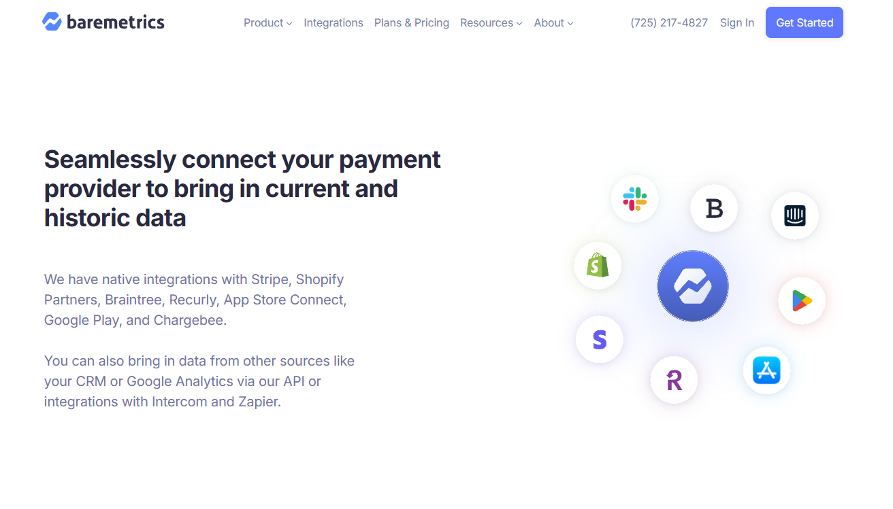

가져올 점

- 중심 하나에 여러 연동처가 모이는 구조가 한눈에 보임

REF-056 · Baremetrics Integrations 히어로

제안 방향

- 가운데 "BAROBILL API" 로고
- 주변으로 계좌, 카드, 홈택스, 국세청, 메시지, 팩스 노드들이 둘러쌈

레퍼런스 2

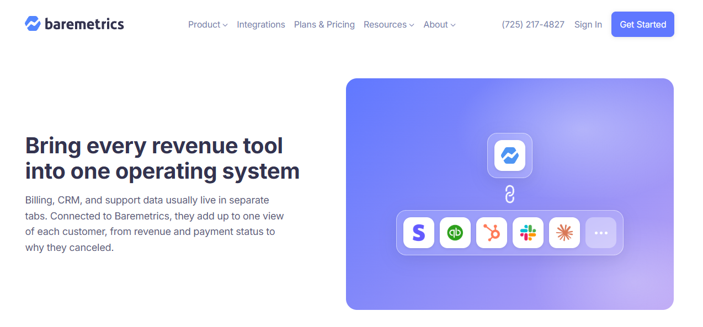

가져올 점

- 하나가 여러 곳으로 이어지는 관계를 위·아래 두 단으로 단순하게 보여 줌

REF-057 · Baremetrics 히어로

제안 방향

- 위에 Barobill API 로고
- 아래에 계좌, 카드, 홈택스, 국세청, 메시지, 팩스 노드들이 가로로 한 줄

레퍼런스 3

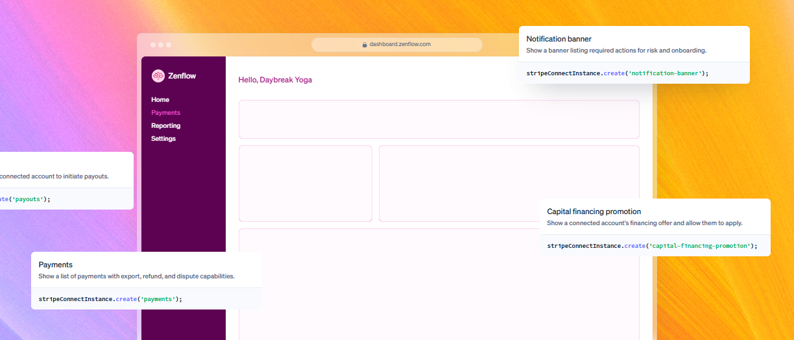

가져올 점

- 실제 업무 화면 위에 기능 카드(이름 + 설명 + 코드 한 줄)가 떠 있어, 무엇을 붙일 수 있는지가 보임

REF-058 · Stripe Connect 임베디드 컴포넌트

제안 방향

- 뒤에 고객 업무 화면 목업(약한 톤)
- 그 위로 메시지형 노드들이 떠 있음
  - 전자세금계산서 발행 + 엔드포인트
  - 계좌 통합 조회 + 엔드포인트
  - 카드 통합 조회 + 엔드포인트
  - 홈택스 매입매출 조회 + 엔드포인트
- 노드마다 계좌, 카드, 국세청, 홈택스를 상징하는 작은 아이콘

구성

우리 시스템(ERP·SaaS) ↔ 바로빌 API ↔ 국세청·은행·카드사·통신사

레퍼런스 1

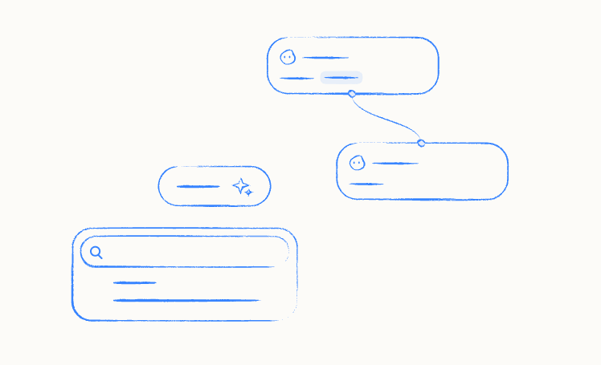

가져올 점

- 코드 스니펫 위에 메시지 노드(AI 메시지 입력창 같은 노드)와 엔드포인트 노드가 연결되는 인상을 준다
- 구성을 참고, 라인 스타일은 참고하지 않음

REF-059 · 노드 연결 일러스트

레퍼런스 2

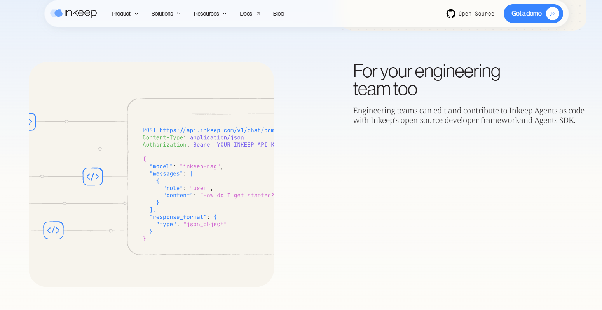

가져올 점

- 코드 스니펫 창 왼쪽으로 연결선과 노드가 이어지는 구성

REF-060 · Inkeep

레퍼런스 3

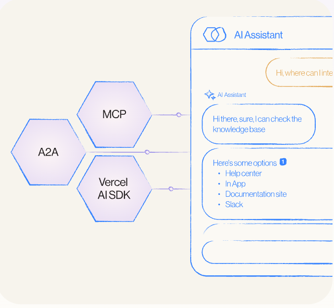

가져올 점

- 이름이 붙은 노드들이 연결선으로 화면에 이어지는 구성

REF-061 · Inkeep

제안 방향

레퍼런스 2와 3을 조합

- 코드 스니펫의 왼쪽 영역만 보임
- 연결선으로 Docs, OpenAPI, SDK, Sandbox, Rest API, Soap APIMCP, Docs, SDK, Sandbox, Rest API, Soap API 노드가 연결된 모습을 보여 준다
  - 덜 중요한 노드(Soap API, Sandbox 등)는 좀 작게

레퍼런스

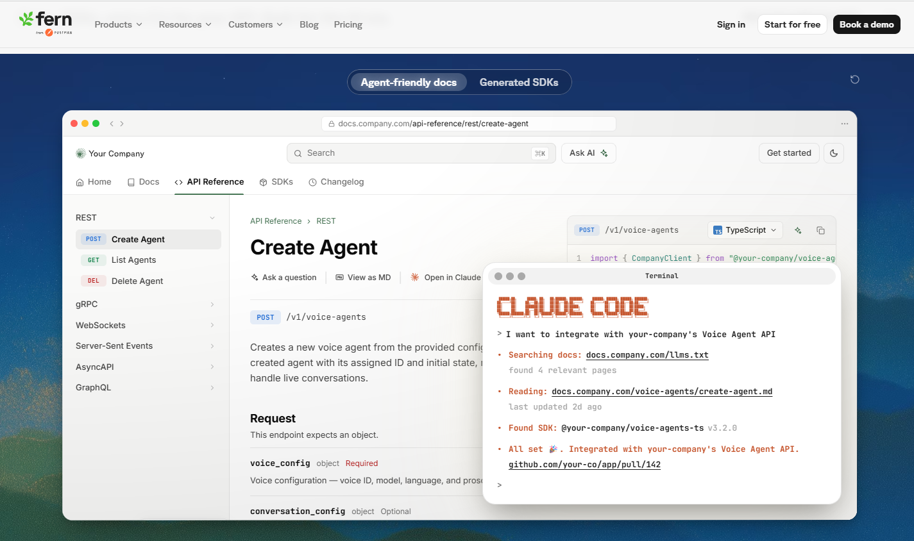

가져올 점

- 문서 페이지 캡처를 바탕에 두고 그 위에 터미널 창을 띄운 구성
- 터미널이 llms.txt → 문서 .md를 차례로 읽는 흐름
- 문서 위쪽의 AI 메뉴(View as MD · Open in …)가 보이는 구도

가져오지 않을 점

- 특정 AI 도구 이름·로고
- 'Integrated'·PR 링크처럼 결과를 보증하는 마지막 줄
- 가로로 긴 구도 — 우리 자리는 거의 정사각이라 터미널을 좁게, 인용 노드 자리를 남김

REF-062 · Fern 메인 히어로 'Agent-friendly docs' · [buildwithfern.com](https://buildwithfern.com/)

레퍼런스

REF-054 · Baremetrics 메가메뉴 Developers 항목

구성

왼쪽 아이콘 + 제목 + 한 줄 설명

아이콘

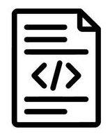문서 위에 \</> 표시되어 있는 아이콘\
라인 굵기와 스타일은 전체 아이콘 컨셉에 맞춤REF-055 · 아이콘 예시